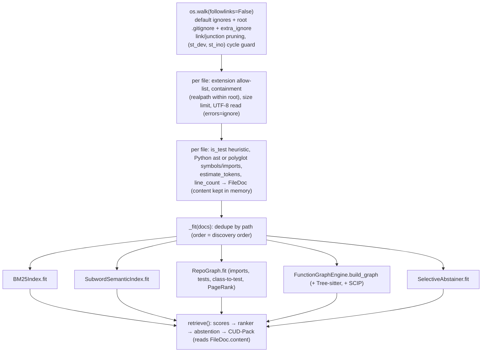
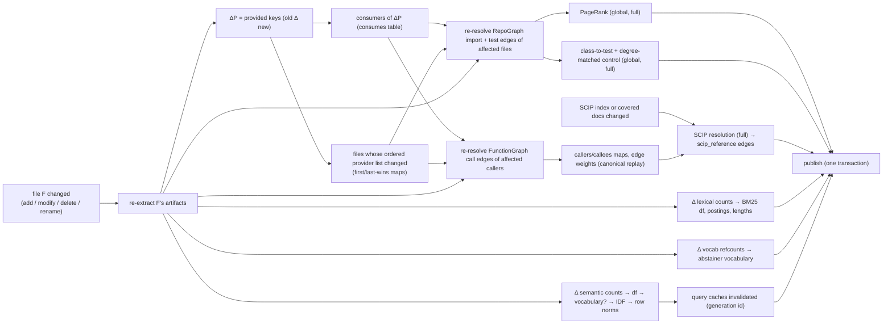

# Persistent and Incremental Indexing: Design

**Status:** **Stages 0, 1 and 2 are implemented.** Stage 0 fixed function-graph rebuild state, replaced process-randomised cache signatures with SHA-256, added `remove_documents()` and the differential equivalence harness. Stage 1 added the opt-in persistent index cache (`from_directory(..., index_cache=IndexCacheConfig(...))`, `engine.refresh()`, `engine.index_cache_diagnostics`, SQLite; §17). Stage 2 adds dependency-scoped re-resolution of both graphs with canonical replay, partially incremental BM25 bookkeeping for in-process `refresh()`, abstainer reference counts, stable file ids (schema version 2, migrated in place), eviction leases and pending-purge reporting (§18; [Stage 2 report](../reports/v2_completion/persistent_indexing/STAGE2_REPORT.md)). **The semantic index, PageRank and the other global graph quantities are still recomputed in full** (Stage 3 and later). Without `index_cache` nothing changes except the resolvers' lookup indexes, which are proven identical to the previous implementation.
**Milestone:** V2 Milestone 4A (architecture and research). **Revision 2** applies the corrections from an independent architecture review; the report's §14 maps each review point to its resolution.
**Evidence:** [reports/v2_completion/persistent_indexing/ARCHITECTURE_REPORT.md](../reports/v2_completion/persistent_indexing/ARCHITECTURE_REPORT.md), with the measurements behind every number quoted here. All repository measurements use one pinned snapshot (commit `bac30c8`, 890 files, 8,173,201 bytes of indexed text).

## Contents

1. [Goals, non-goals and the correctness invariant](#1-goals-non-goals-and-the-correctness-invariant)
2. [Current architecture (summary)](#2-current-architecture-summary)
3. [What can be per-document and what is global](#3-what-can-be-per-document-and-what-is-global)
4. [Storage choice](#4-storage-choice)
5. [Repository identity and cache location](#5-repository-identity-and-cache-location)
6. [Schema](#6-schema)
7. [Fingerprints](#7-fingerprints)
8. [Startup, change detection and incremental update](#8-startup-change-detection-and-incremental-update)
9. [Dependency invalidation](#9-dependency-invalidation)
10. [Transactions, crash recovery and concurrency](#10-transactions-crash-recovery-and-concurrency)
11. [Security and privacy](#11-security-and-privacy)
12. [Cache size management](#12-cache-size-management)
13. [API](#13-api)
14. [Equivalence checking and acceptance criteria](#14-equivalence-checking-and-acceptance-criteria)
15. [Staged implementation plan](#15-staged-implementation-plan)
16. [Design decisions](#16-design-decisions)
17. [Stage 1 as built](#17-stage-1-as-built)
18. [Stage 2 as built](#18-stage-2-as-built)

---

## 1. Goals, non-goals and the correctness invariant

**Goals.**
1. Keep RepoNeedle's index on disk so that a restart does not redo work for unchanged files.
2. After a change, recompute only what the change can affect, including derived *global* structures, and prove it.
3. Opt-in only. **With no persistence configured, behaviour is byte-identical to today.**

**Non-goals for this milestone.** No implementation, file watcher, background service, network or shared cache, retrieval or ranking change, or version bump.

**Central invariant.** Retrieval from a persistent or incrementally updated index must be **equivalent** to retrieval from a fresh full build over the same files, in the same discovery order, with the same configuration. "Equivalent" is defined precisely in §14: identical index state, identical scores, identical ranked order, identical packed context and token accounting.

**Terminology.** This design uses three terms with a specific meaning:

| Term | Meaning |
| :--- | :--- |
| **Persistent** | Per-file artifacts survive restarts. Global structures may still be recomputed in full from them. |
| **Incremental** | After a change, the work done on *global* structures is proportional to what the change can affect, measured by work counters (§14.4). |
| **Fresh build** | `RepoNeedleEngine.from_directory()` as it exists today. |

Today's `update_documents()` is neither: it refits every index over every document. It is faster than a cold build only because some per-document caches are warm.

## 2. Current architecture (summary)

Full audit: report §2. The default lifecycle of `RepoNeedleEngine.from_directory()`:



**Properties a persistent design must preserve:**
- **Order is an input.** Document order is the `os.walk` order, which is filesystem-dependent and unsorted. It determines list indices in every index, ties in feature selection, `max_files` truncation, "first/last wins" name maps and graph insertion order.
- **Content is used at query time.** CUD-Pack renders `FileDoc.content`, and SCIP resolution validates ranges against content.
- **Per-document cache signatures** (fixed in Stage 0). Before Stage 0 they were `f"{path}::{len}::{hash(content)}::{symbols}"`, and Python's `hash()` of `str` is randomised per process. They are now SHA-256 over type- and length-framed extractor inputs plus a versioned namespace (`reponeedle/core/signatures.py`), identical across processes.
- **Two latent defects that mattered for any incremental design** (both fixed in Stage 0). `FunctionGraphEngine.build_graph()` never cleared `module_to_path` or `package_to_files`, so entries from earlier builds survived and produced call edges to removed files; it now resets every build-derived structure. And the engine had no way to remove a document; `remove_documents()` now exists (in memory, refit-based).

## 3. What can be per-document and what is global

| Structure | Per-document (can be persisted per file) | Global (depends on other files or on N) | Incremental strategy |
| :--- | :--- | :--- | :--- |
| Discovery | stat, containment, size, read, `is_test`, language | file set, **order**, `max_files` truncation, root `.gitignore` | Rescan every start (stat-level); diff against the manifest |
| Symbols / imports (`FileDoc.symbols/imports`) | Python `ast` or polyglot extraction | none | Per file |
| **BM25** (`lexical.py`) | weighted term counts (path ×2.5, symbols ×2.0, body ×1.0), effective length | N, `doc_frequencies`, IDF, `avg_doc_len`, `doc_len_norms`, postings (keyed by **positional** document index) | df by delta; IDF of changed-df terms. `avg_doc_len`, every `doc_len_norms` entry, and the positional postings (when N or order changes) are **global O(N)** work (§9.5) |
| **Semantic** (`semantic.py`) | word and char-n-gram counts of `path + symbols + content[:8000]` | df, **vocabulary = top 15,000 by (df, len) with first-insertion tie order**, IDF (depends on N), L2-normalised CSR matrix | df by delta; vocabulary, IDF and normalised rows recomputed (cheap from persisted counts). Exact top-K maintenance only with canonical first-seen order (§9.3) |
| **RepoGraph** (`graph.py`) | symbols/imports, manifest records (`Cargo.toml`, `go.mod`, `package.json`), production class catalog, **unfiltered** test-file call candidates, path stems | `module_to_path` (last/first wins), `symbol_to_paths`, `package_to_files`, `manifest_crates`, import edges, test↔target maps (stem matching), class-to-test edges, degree-matched control (seeded RNG over sorted sets), PageRank | Provider/consumer keys (§9.1) select files whose edges must be re-resolved. PageRank and the control graph are recomputed in full |
| **FunctionGraph** (`function_graph.py`) | functions, call sites, imports (Python `ast`, polyglot regex, or Tree-sitter records) | `module_to_path`, `class_to_methods`, `func_name_to_defs` (**global uniqueness**), Tree-sitter `ImportResolver` (path set, `go.mod`, `Cargo.toml`), edge list order, `graph` edge weight (**last writer wins**), callers/callees maps | Provider/consumer keys (§9.2); re-resolve only affected callers; replay edges in canonical order |
| **SCIP** (`scip_ingestion.py`) | none usable alone; resolution reads the index, the path set and document contents | everything (definitions, ambiguity, freshness) | Cache the resolution keyed by (index digest, digests of the documents it covers); otherwise re-resolve in full |
| **Abstainer** (`abstention.py`) | token vocabulary per file | union of vocabularies | Per-token reference counts |
| Query-time caches | none | semantic query vectors depend on vocabulary and IDF; CUD-Pack caches are digest-keyed | Invalidate on every published index change (generation id in keys) |

**Measured on the pinned snapshot** (890 files, 8.17 MB; report §3.1, recorded run; absolute times vary by ±30–40% between runs on this machine, ratios do not):

| | Lexical | Semantic | RepoGraph | Function graph | Abstainer | Scan and read |
| :--- | ---: | ---: | ---: | ---: | ---: | ---: |
| Cold fit | 4.4 s | 19.2 s | 4.5 s | 5.4 s | 2.2 s | 3.9 s |
| Warm refit (global work only) | 0.6 s | 6.3 s | 3.7 s | 1.1 s | 0.02 s | — |

- A cold build totals 31.6 s in this run (21.6 s in revision 1's run).
- Warm refits sum to about 11.7 s, matching `update_documents()` for one modified file (11.2 s).
- Persisting per-file artifacts alone can therefore remove at most about half of a restart on this repository (49–57% across runs). The remainder is global work, dominated by the semantic index and by `RepoGraph` (which has no per-document cache).

## 4. Storage choice

**Decision: SQLite through Python's standard-library `sqlite3`.** No new dependency.

| Option | Material advantage | Why not the default |
| :--- | :--- | :--- |
| **SQLite (`sqlite3`)** | In the standard library on every supported Python and platform; ACID transactions; WAL gives concurrent readers with one writer; crash-safe; SQL lets the change sets of §9 be indexed queries; one file per repository | Single writer; unreliable locking on network filesystems (§10.5) |
| Files of NumPy/`npz` arrays plus a manifest | Fast bulk load of arrays | No multi-file atomicity, so atomic publish would need a rename-protocol; partial updates are hard; easy to get wrong |
| `pickle` / `shelve` | Trivial | **Rejected:** loading a pickle executes code, and the cache is an untrusted input (§11) |
| LMDB, RocksDB, LevelDB | Faster key-value writes | New native dependency; no query language for the change sets |
| DuckDB | Columnar analytics | New dependency; analytical engine, single writer; nothing it does well is needed here |
| Parquet / Arrow | Columnar arrays | New dependency; no transactional updates |

**Payloads** are stored as BLOBs in an explicit, versioned binary format. **Every payload is self-contained:**
- strings are written inline (varint byte length, then UTF-8), followed by their varint values, and the whole payload is zlib-compressed;
- arrays are raw little-endian with a dtype/shape header, zlib-compressed;
- small structured records (function-graph records, symbol lists) are canonical JSON, zlib-compressed.

There is never any pickle or `eval`. Every payload is checksummed (§6.1) and length-, type- and range-checked on decode.

**Why no shared string table (revision 2).** Revision 1 proposed varint string *ids* into one shared `strings` table. The isolated SQLite prototype (report §3.3) measured both encodings on the pinned snapshot:

| Encoding | Payload bytes | String table in SQLite | Database file | Ratio to source | Write (FULL; one run) | Verify and decode all (one run) |
| :--- | ---: | ---: | ---: | ---: | ---: | ---: |
| A: shared string table (revision 1) | 8.73 MB | 10.99 MB | 25.40 MB | 3.11× | 1.2 s | 1.9 s (strings 0.4 s + artifacts 1.5 s) |
| **B: self-contained (revision 2)** | 11.92 MB | none | **18.43 MB** | **2.26×** | **0.3 s** | **1.4 s** |

Figures are from `sqlite_prototype.json` as regenerated in Stage 0 (same pinned snapshot; the schema gained the `excluded` table and `manifest_sha256`, and the artifact checksum covers every metadata column). Revision 2 measured 18,296,832 bytes (2.24×) for encoding B and 25,264,128 bytes (3.09×) for A; the conclusions are unchanged. Timings are single runs and vary between runs.

- The shared table saves payload bytes but costs more in SQLite than it saves: one row per string, a `UNIQUE` index that stores every string a second time, and a per-row checksum (168,006 strings here). Even without those checksums (32 bytes per string, about 5.4 MB), A would be about 20.0 MB (estimated by subtraction, not measured), still larger than B.
- It also adds failure modes: unreferenced strings accumulate and need garbage collection (§12.3), and an artifact is only valid together with the exact string rows it references.
- Self-contained payloads have neither problem. Strings die with the artifact that holds them.

## 5. Repository identity and cache location

**Repository identity.**
- `repo_root` = `os.path.realpath(repo_dir)`, compared with `os.path.normcase` on Windows.
- `repo_id` = `sha256("reponeedle-index-v1\0" + normcase(repo_root))`.
- The canonical root is also stored inside the database and checked on every open (§11.1). A database whose stored root differs from the requested root is never used.

**Location.** The default cache directory is per user, outside the repository:

| Platform | Default cache directory |
| :--- | :--- |
| Windows | `%LOCALAPPDATA%\reponeedle\index` |
| macOS | `~/Library/Caches/reponeedle/index` |
| Linux and others | `$XDG_CACHE_HOME/reponeedle/index`, else `~/.cache/reponeedle/index` |

`IndexCacheConfig.cache_dir` overrides it. The database file is `<cache_dir>/<repo_id[:32]>-s<schema_major>.sqlite3`, with `-wal` and `-shm` beside it during use.

- **Not inside the repository by default.** A cache inside the repository could be committed by accident, and it would be scanned unless it were ignored. If a user chooses such a directory, discovery must exclude it explicitly (the path is added to the ignore set, never inferred).
- **Never on network filesystems.** If the cache directory is on a network filesystem (detected best-effort), persistence is disabled with a diagnostic (§10.5).

## 6. Schema

**The schema is designed around one rule: nothing the engine trusts is written outside the publishing transaction.** Per-file artifacts are content-addressed and immutable, so they can be written in batches without affecting correctness. The manifest, global state and the "current index" marker are replaced in one final transaction.

Connection settings (`journal_mode`, `synchronous`, `foreign_keys`, `auto_vacuum`, `busy_timeout`) are **not** part of the schema script. They are applied by the connection lifecycle of §10.1, outside any transaction, and verified. Only `application_id` and `user_version`, which are database-header values, are written inside the creation transaction.

```sql
-- Creation transaction (§10.1): BEGIN IMMEDIATE; ...; COMMIT
PRAGMA application_id = 0x524E4458;          -- 'RNDX'
PRAGMA user_version  = 1;                    -- schema version (major); see §10.6

CREATE TABLE meta (                          -- small key/value facts, set in the publish transaction
                                             -- (except clean_shutdown: on writer open and close)
  key   TEXT PRIMARY KEY,
  value TEXT NOT NULL
);
-- keys: repo_root, repo_id, created_by (reponeedle version), python (major.minor), sqlite_version, platform,
--       current_generation, index_fingerprint, discovery_fingerprint, doc_meta_fingerprint, published_at,
--       clean_shutdown ('0' while a writer holds the database open), next_file_id

CREATE TABLE generations (                   -- one row per build/update attempt
  gen_id          INTEGER PRIMARY KEY,
  state           TEXT NOT NULL CHECK (state IN ('building', 'published', 'superseded', 'abandoned')),
  kind            TEXT NOT NULL CHECK (kind IN ('cold', 'incremental', 'reassemble')),
  started_at      TEXT NOT NULL,
  published_at    TEXT,
  index_fingerprint     BLOB NOT NULL,       -- §7
  discovery_fingerprint BLOB NOT NULL,       -- §7
  doc_meta_fingerprint  BLOB NOT NULL,       -- §7
  file_count      INTEGER,
  manifest_sha256 BLOB,                      -- §6.1: digest of the published manifest, file_artifacts,
                                             -- provides, consumes and excluded rows; set at publish
  work_counters   TEXT                       -- JSON: files re-extracted, keys re-resolved, postings touched ...
);

CREATE TABLE manifest (                      -- the published file set; rewritten only by the publish transaction
  path            TEXT PRIMARY KEY,          -- repository-relative, '/'-separated, validated (§11.2)
  file_id         INTEGER NOT NULL UNIQUE,   -- stable id: assigned on first sight, never reused (§9.5)
  ordinal         INTEGER NOT NULL UNIQUE,   -- DENSE position (0..n-1) among PERSISTED files, in discovery order;
                                             -- never the position in the full scan (see §11.5: no gaps)
  size            INTEGER NOT NULL,
  mtime_ns        INTEGER NOT NULL,
  ctime_ns        INTEGER,
  inode           INTEGER,                   -- st_ino where meaningful; NULL on Windows/FAT
  content_sha256  BLOB NOT NULL,             -- of the bytes as read (before UTF-8 decoding)
  text_sha256     BLOB NOT NULL,             -- of the decoded str (errors='ignore'), what the indexes saw
  language        TEXT NOT NULL,             -- discovery metadata, recomputed when doc_meta_fingerprint changes
  is_test         INTEGER NOT NULL,
  line_count      INTEGER NOT NULL,
  token_estimate  INTEGER NOT NULL,
  doc_meta_sha256 BLOB NOT NULL,             -- sha256 of canonical (language, is_test, line_count, token_estimate,
                                             -- symbols, imports): an input of every artifact key that reads them
  artifact_set    BLOB NOT NULL              -- sha256 over this file's artifact keys (detects mismatches)
);

CREATE TABLE excluded (                      -- discovery diagnostics (paths and reasons only, never contents)
  path   TEXT PRIMARY KEY,
  reason TEXT NOT NULL CHECK (reason IN ('skipped_large', 'unreadable', 'symlink_outside_repository',
                                         'directory_skipped', 'max_files'))
);                                           -- files matched by persist_exclude (§11.4) are NOT recorded anywhere

CREATE TABLE artifacts (                     -- immutable, content-addressed, self-contained per-file artifacts
  artifact_key   BLOB PRIMARY KEY,           -- sha256(kind, extractor_fp, path, text_sha256, doc_meta_sha256,
                                             --        other input digests)
  kind           TEXT NOT NULL,              -- 'symbols', 'lexical', 'semantic', 'abstainer', 'repo_graph_facts',
                                             -- 'function_graph', 'tree_sitter' ...
  extractor_fp   BLOB NOT NULL,              -- §7
  path           TEXT NOT NULL,              -- for diagnostics and GC; not trusted for reads
  codec          TEXT NOT NULL,              -- e.g. 'inline-pairs+zlib/1'
  payload        BLOB NOT NULL,              -- self-contained (§4): no references to other rows
  checksum       BLOB NOT NULL,              -- §6.1: sha256("artifact" | artifact_key | kind | extractor_fp |
                                             --        path | codec | payload)
  created_gen    INTEGER NOT NULL,
  last_used_gen  INTEGER NOT NULL
);
CREATE INDEX artifacts_by_path ON artifacts(path, kind);

CREATE TABLE file_artifacts (                -- which artifacts the published manifest uses
  path         TEXT NOT NULL REFERENCES manifest(path) ON DELETE CASCADE,
  kind         TEXT NOT NULL,
  artifact_key BLOB NOT NULL REFERENCES artifacts(artifact_key),
  PRIMARY KEY (path, kind)
);

-- Dependency index (§9): which lookup keys each file provides, and which it consumes.
CREATE TABLE provides (
  path  TEXT NOT NULL REFERENCES manifest(path) ON DELETE CASCADE,
  space TEXT NOT NULL,                       -- 'module', 'symbol', 'package', 'crate', 'path', 'func', 'method',
                                             -- 'class', 'stem', 'go_module', 'rust_crate' ...
  key   TEXT NOT NULL,
  seq   INTEGER NOT NULL,                    -- emission order within the file (for first/last-wins maps)
  PRIMARY KEY (space, key, path, seq)
);
CREATE INDEX provides_by_path ON provides(path);

CREATE TABLE consumes (
  path  TEXT NOT NULL REFERENCES manifest(path) ON DELETE CASCADE,
  space TEXT NOT NULL,
  key   TEXT NOT NULL,
  PRIMARY KEY (space, key, path)
);
CREATE INDEX consumes_by_path ON consumes(path);

-- Global derived state, written only in the publish transaction.
CREATE TABLE global_state (
  name     TEXT PRIMARY KEY,                 -- 'bm25.df', 'bm25.lengths', 'semantic.df', 'semantic.vocabulary',
                                             -- 'semantic.idf', 'repo_graph.edges', 'repo_graph.pagerank',
                                             -- 'function_graph.edges', 'abstainer.refcounts', 'scip.resolution' ...
  gen_id   INTEGER NOT NULL,
  codec    TEXT NOT NULL,
  payload  BLOB NOT NULL,                    -- self-contained, like artifacts
  checksum BLOB NOT NULL                     -- §6.1: sha256("global" | name | gen_id | codec | payload)
);

CREATE TABLE optional_components (           -- Tree-sitter, SCIP and parser availability at build time
  component TEXT PRIMARY KEY,                -- 'tree_sitter.runtime', 'tree_sitter.typescript', ..., 'scip.index'
  version   TEXT,
  digest    BLOB,                            -- e.g. SCIP index sha256, grammar ABI
  status    TEXT NOT NULL                    -- 'available', 'unavailable: <reason>'
);
```

Revision 1 also had a shared `strings` table. Revision 2 removes it (§4, §12.3).

**Not stored:** file contents, query text, query results, diagnostics containing contents, anything from outside the repository root, or anything about files matched by `persist_exclude` (§11.4).

**What the stored artifacts can reconstruct.**
- Artifacts plus the manifest reconstruct every index exactly (§14).
- Today, only CUD-Pack rendering and SCIP range validation need raw text. Both read the current file from disk on demand and verify `text_sha256` (§8.4).

**Semantic payload choice.** Decided in §16.3: Stage 1 stores the ordered n-gram feature counts (exact reconstruction with no recomputation). Regenerating them from ordered word counts is benchmarked separately before it can replace them.

### 6.1 Integrity checksums

SQLite does not checksum page contents by default. A payload whose bytes change inside a valid page, for example from a disk error, a bug or an editing tool, is not detected by SQLite. The cache therefore carries its own SHA-256 checksums. In the table, `|` means concatenation with a `\0` separator; integers are 8-byte little-endian.

| Data | Checksum input | Computed | Verified |
| :--- | :--- | :--- | :--- |
| Artifact payload | `"artifact" \| artifact_key \| kind \| extractor_fp \| path \| codec \| payload` | By the writer, from the in-memory bytes it is about to insert, never by reading the row back | **Every time a payload is read for use, before it is decoded.** `verify=True` and `cache verify` also check artifacts the published generation does not reference. |
| Global-state payload | `"global" \| name \| gen_id \| codec \| payload` | By the writer, in the publish transaction | On load, before decoding |
| Published manifest | `generations.manifest_sha256`: the canonical serialisation of the generation's `manifest`, `file_artifacts`, `provides`, `consumes` and `excluded` rows, each table sorted by primary key | By the writer, from the rows it inserts in the publish transaction | On open, before any reuse decision. Otherwise a forged `content_sha256` or a dropped `file_artifacts` row would make the engine reuse the wrong artifact. |
| Shared strings | Not applicable: there is no shared string table (§4). If one is ever reintroduced, each row carries `sha256("string" \| sid \| text)`, verified when loaded, and ids are never reused (§12.3). | | |

**Artifact identity (Stage 1 requirement).** Before an artifact is reused, the reader checks the stored `kind`, `path`, `extractor_fp` and `codec` against the values it expects for that manifest row and kind, **recomputes `artifact_key` from the expected inputs** (`kind`, `extractor_fp`, `path`, `text_sha256`, `doc_meta_sha256`) and compares it with the stored key, and then verifies the checksum. A key rewritten consistently in `artifacts` and `file_artifacts` is therefore still rejected. The research prototype implements exactly this check (`verify_database` in `sqlite_prototype.py`).

**Binding the context into the checksum.** Because the key, name or generation is included, a payload copied or swapped from another row fails verification even though it decodes. The prototype's on-disk corruption suite (run in CI by `tests/test_stage1_readiness_prototype.py`) applies 14 corruptions to copies of written databases **for both encodings, including the selected self-contained encoding B** (15 for encoding A, which also has string rows): a re-encoded, decodable payload with one count changed; two swapped payloads, with and without their checksums; a changed global-state value; changed artifact kind, path, extractor fingerprint, codec, and key (consistently in both tables); changed manifest `content_sha256` and `is_test`; a deleted `file_artifacts` reference; a deleted artifact row; an unpublished generation; and, for A, a changed string. Every one is rejected by the reader-side verification.

**Failure handling.** A checksum mismatch on any row read for the published generation makes the whole database unusable (§10.4): it is moved aside and rebuilt. The engine never skips the bad row and keeps the rest.

**What checksums do not protect against.** The checksums are unkeyed. They detect corruption and bugs, not a deliberate local attacker who can write the file and recompute them. File permissions handle that threat (§11.3). A keyed MAC would need a secret stored outside the cache directory, which is out of scope.

**Measured cost** (pinned snapshot, encoding B): verifying and decoding all 4,450 artifacts takes 1.4–1.6 s in pure Python (two runs). That fits the Stage 1 restart budget but is not negligible. Stage 1 must measure it again in the real reader, and may verify each kind lazily as its index is assembled. Every payload is still verified before it is used.

## 7. Fingerprints

Every reuse decision is keyed by explicit fingerprints: SHA-256 over canonical JSON (sorted keys, no whitespace). There are four levels. Each one names the algorithms it covers by **version constants in code**. Each constant must be bumped when that algorithm's output can change.

### 7.1 Per-file artifacts: `extractor_fp[kind]`

Part of every artifact key. It covers:
- `ARTIFACT_VERSION[kind]`;
- the parameters of that extractor;
- the Python minor version and `unicodedata.unidata_version` for every kind that tokenises text, because `re` word classes, `str.lower()` and `str.splitlines()` follow the Unicode database.

| Kind | Parameters |
| :--- | :--- |
| `lexical` | tokenizer version (stop words, regexes), `k1`, `b`, field weights, `decouple_symbols` |
| `semantic` | tokenizer version, `min_n`, `max_n`, the 8,000-character truncation |
| `symbols` | `enable_polyglot_symbols`, Python minor version (the `ast` grammar changes between versions) |
| `function_graph` | `structural_parser`, Python minor version, Tree-sitter runtime and grammar versions plus ABI (Tree-sitter mode only) |
| `repo_graph_facts` | Python minor version, regex versions |
| `abstainer` | tokenizer version, stemmer version, the 3,000-character truncation |

Artifact keys also include `doc_meta_sha256` (§6) for every kind that reads `FileDoc` metadata. Today that is every kind:
- `lexical`, `semantic` and `abstainer` read `symbols`;
- `repo_graph_facts` and `function_graph` read `symbols`, `imports` and `is_test`.

A change in a file's derived metadata therefore re-extracts the artifacts that read it. `token_count` and `line_count` are read only at query time (packing and diagnostics), never by an artifact.

### 7.2 Discovery-derived metadata: `doc_meta_fingerprint`

This level is new in revision 2. It covers the algorithms that turn a file's path and bytes into the `FileDoc` fields stored in the manifest. Today they are inline in `from_directory()` and `tokenizer.py`:

| Algorithm | Today's behaviour (preserved by default) | Version constant |
| :--- | :--- | :--- |
| Decoding | UTF-8 with `errors="ignore"`, text mode (universal newlines: `\r\n` and `\r` become `\n`) | `DECODE_VERSION` |
| Language detection | `"python"` for `.py`, otherwise the extension without its dot | `LANGUAGE_VERSION` |
| `is_test` classification | the lower-cased relative path contains `test` or `tests/`, starts with `test_`, or ends with `_test.py` | `IS_TEST_VERSION` |
| Token estimation | `estimate_tokens(content)` | `TOKEN_ESTIMATE_VERSION` |
| Line counting | `len(content.splitlines())` | `LINE_COUNT_VERSION` |
| Symbol and import extraction | Python `ast`, or polyglot when enabled (also part of `extractor_fp["symbols"]`) | `SYMBOLS_VERSION` |

The fingerprint also includes the Python minor version and `unidata_version`, because `lower()` and `splitlines()` follow them.

### 7.3 The file set: `discovery_fingerprint`

| Input | Covers |
| :--- | :--- |
| Traversal | `DISCOVERY_WALK_VERSION`: `os.walk(followlinks=False)`, link and junction pruning, the `(st_dev, st_ino)` cycle guard, containment through `resolve_within_root` |
| Ignore matching | `IGNORE_MATCH_VERSION`, the `pathspec` version and the `gitwildmatch` dialect, `DEFAULT_IGNORE_PATTERNS`, `extra_ignore`, and the digest of the root `.gitignore` as read (the root file only; §16.6) |
| Filtering | `FILTER_VERSION`: the extension allow-list, `max_file_size_bytes` and `max_files` |
| Platform | path case-sensitivity |

### 7.4 Global assembly: `index_fingerprint`

This covers everything that changes *global* assembly:
- all `extractor_fp` values and the `doc_meta_fingerprint`;
- `max_features`;
- `min_confidence`;
- `enable_structural_edges`;
- the class-to-test switches;
- the PageRank parameters;
- SCIP configuration;
- the schema version.

### 7.5 What each change invalidates

| Change | Manifest | Per-file artifacts | Global state |
| :--- | :--- | :--- | :--- |
| `discovery_fingerprint` (ignore rules, filters, traversal, `pathspec` version) | Rows are added and deleted by the new scan's diff. Surviving rows are kept. | Only those of added files are extracted. Those of deleted files become garbage. | Updated through the ordinary add and delete paths (§8.3). Not invalidated wholesale. |
| `doc_meta_fingerprint` (decoding, language, `is_test`, tokens, lines, symbols) | **Every row's metadata is recomputed** from the current text. In `"stat"` mode this forces one read of every file. | Re-extracted only for files whose `doc_meta_sha256` changed. A decoding change changes `text_sha256`, so those files are re-extracted. | **Full reassembly** (it is part of `index_fingerprint`) |
| One `extractor_fp[kind]` | Unchanged | That kind only, for every file | Full reassembly of the indexes that consume that kind |
| `index_fingerprint` only (global parameters) | Unchanged | Reused | Full reassembly |
| Query-time settings (`BudgetConfig`, ranker, router weights, abstention settings, `focus_span_strategy`) | Unchanged | Unchanged | Unchanged. These are deliberately excluded and never invalidate the index. |

**Default behaviour is preserved.** The constants describe today's algorithms; defining them changes nothing in discovery or extraction. A future change to any of these algorithms is a separate, evaluated change that bumps its constant.

### 7.6 Guarding the version constants

- *Problem:* a forgotten bump would silently serve stale artifacts or metadata.
- *Mitigation:* a test stores a digest of the source of each covered function or module (`engine.from_directory` discovery code, `tokenizer.py`, each extractor) and **fails when the source changes without a bump**.
- *Trade-off:* this is deliberately conservative, since a false alarm only costs a bump.
- *Backstop:* the equivalence harness (§14) catches mismatches the digest misses.

## 8. Startup, change detection and incremental update

### 8.1 Startup (`from_directory(..., index_cache=IndexCacheConfig(...))`)

```mermaid
sequenceDiagram
    participant E as Engine
    participant FS as Repository
    participant DB as SQLite cache
    E->>DB: open (read), check application_id, user_version, repo_root, fingerprints
    alt missing / incompatible / corrupt (§10.4)
        E->>FS: full scan + read
        E->>DB: cold build and publish (§10.2)
    else compatible
        E->>FS: scan (same rules and order as today) + stat every file
        E->>E: diff scan vs manifest → unchanged / modified / added / deleted (+ renames)
        E->>FS: read + hash only candidates (validation policy, §8.2)
        E->>E: extract artifacts for changed files; invalidate dependents (§9)
        E->>DB: write artifacts (batches), then ONE publish transaction (§10.2)
        E->>E: assemble in-memory indexes in discovery order
    end
```

**Discovery always runs.** It is the only way to learn the current file set and order. Its cost (stat plus walk) is a small part of a build: 1.5–3.9 s here across runs including reads; stat-only is cheaper still.

### 8.2 Change detection (validation policy)

| `validation` | A file is "unchanged" when | Cost | Guarantee |
| :--- | :--- | :--- | :--- |
| **`"content"` (default)** | its bytes hash to the stored `content_sha256` | read and hash every file | **Detects every content change** (up to SHA-256 collisions). The §1 invariant holds unconditionally. |
| `"stat"` (opt-in optimisation) | size, `mtime_ns` and (where meaningful) `inode`/`ctime_ns` match, **and** the file is not "racily clean" | stat every file; read only files whose metadata changed | **Weaker: detects only changes that also change the file's metadata.** The §1 invariant holds only under that assumption. |

**`"stat"` is not equivalent to hashing.** It is a performance option. A modification that leaves size and timestamps unchanged is **not detected**, and the stale artifacts are served until the file changes again or the next `"content"` run. Known ways this happens:
- **Metadata-preserving tools:** `touch -d`/`touch -r`, `cp -p`, `rsync -t` (and `-a`), `tar` and `unzip` extraction, and some editors and sync tools restore the original mtime. A same-size edit followed by an mtime restore is invisible to stat.
- **Coarse or unreliable timestamps:** FAT (2 s), some network and VM shared folders, clock adjustments, and filesystems with 1-second granularity. Racily-clean handling covers same-tick edits *after* a publish, not timestamps that are restored or lost.
- **`ctime` and `inode` are only partial guards.** On POSIX, `ctime` cannot be set by ordinary tools and catches most restored-mtime edits, but not on every filesystem. On Windows, Python 3.11 reports creation time as `st_ctime` and file indexes are not always stable, so neither helps there.
- **Deliberate evasion:** anyone who can write the repository can make a change that stat does not see.

**Racily clean** is borrowed from Git's index: a file whose `mtime_ns` is not strictly older than the published generation's timestamp is always hashed, because it may have changed within the same timestamp tick.

**Reporting.** Diagnostics always state the validation mode used. A result produced under `"stat"` is labelled as validated by metadata only. `refresh(validation="content")` and `reponeedle cache verify` re-hash everything on demand. Benchmarks report the two modes separately (§14.5), and equivalence tests run under `"content"`. The `"stat"` tests assert detection only for changes that alter metadata, and document the undetected cases as expected behaviour.

### 8.3 Behaviour per change

| Change | Correct behaviour |
| :--- | :--- |
| **Unchanged** file | Reuse its artifacts. It still participates in global reassembly, at its *current* discovery position. |
| **Modified** | Re-extract its artifacts. Apply its old→new deltas to global structures, then invalidate dependents through its provided/consumed keys (§9). |
| **Added** | Extract; insert at its discovery ordinal; invalidate consumers of every key it provides. Ordinals of later files shift, which is handled by order-independent storage plus ordered reassembly (§9.4). |
| **Deleted** | Remove its manifest row (cascades to `provides`/`consumes`/`file_artifacts`); apply negative deltas; invalidate consumers of its provided keys. Its artifacts become garbage. |
| **Renamed** (delete + add with equal `content_sha256`) | Treated as delete + add, because almost every artifact embeds the path (path tokens, module names, `is_test`, `FunctionSymbol.filepath`). Content-only sub-artifacts may be reused (optional optimisation). Both old and new keys are invalidated. |
| **Ignore rules changed** (`.gitignore`, `extra_ignore`, defaults) | `discovery_fingerprint` changes. Nothing is invalidated wholesale: the new scan's file set is diffed against the manifest, giving ordinary adds and deletes. |
| **Discovery order changed** (same files, different `os.walk` order) | No artifact changes. Global state is reassembled in the new order (§9.4). |
| **`max_files` truncation changed** | Same as an ignore change: different file set. |
| **Tokenizer or extractor parameters changed** | The affected `extractor_fp` changes, so only those kinds are re-extracted. Global state for those indexes is rebuilt. |
| **Global parameters changed** (`max_features`, PageRank, `min_confidence` ...) | `index_fingerprint` changes; artifacts are reused and global assembly runs in full. |
| **Discovery metadata algorithm changed** (decoding, language, `is_test`, token estimate, line count; §7.2) | `doc_meta_fingerprint` changes. Every manifest row's metadata is recomputed, artifacts are re-extracted only for files whose `doc_meta_sha256` changed, and global assembly runs in full. |
| **Python minor version or Unicode database changed** | Both are inputs of `doc_meta_fingerprint` and of every text-processing `extractor_fp` (§7.1), so in practice every artifact is re-extracted. This is effectively a cold build into the existing database, and diagnostics report it as one. |
| **Tree-sitter runtime, grammar or ABI changed, or became (un)available** | Only Tree-sitter artifacts are re-extracted. Files that previously fell back to regex are re-extracted when a parser becomes available, and vice versa. |
| **SCIP index changed** (digest or size differs) or SCIP config changed | The SCIP resolution is recomputed in full, and SCIP-derived function-graph edges are replaced. |
| **SCIP index unchanged, covered documents changed** | The SCIP resolution is recomputed in full (it validates contents and ranges). This is accepted for the initial implementation; per-document reuse is an optimisation only if measurements justify it (§16.4). |
| **Database missing** | Cold build. |
| **Database corrupt, foreign or incompatible** | §10.4: set aside, cold build, never partially trusted. |
| **Repository root moved** | Different `repo_id`, so a new database. The old one ages out (§12). |

### 8.4 Content at query time

Persistent mode does not keep raw source on disk, but CUD-Pack must render text. There are two options:

| | Stage 1: eager (current memory profile) | Later stage: lazy |
| :--- | :--- | :--- |
| How | All indexed files are read during startup (required anyway by `validation="content"`); `FileDoc.content` stays as today | `FileDoc.content` is read on demand through the same containment checks as discovery (`resolve_within_root`) |
| Content check | — | Verified against `text_sha256` on read |
| If the file changed since the index was built | — | Excluded from that result and reported as stale, never silently packed |
| Cost | Same memory as today | Requires an API change to `FileDoc`; deferred (§16.2) |

## 9. Dependency invalidation

### 9.1 Provider/consumer keys

Every global name lookup becomes a typed key:
- a file **provides** the keys it can be found under: module names, symbols, Go package names, crate names, its own path as a resolution candidate, function names, method names, class names, test stems;
- a file **consumes** the keys its resolution looked up: import strings, qualifiers, callee names, candidate paths probed for relative imports.

**On a change to file F:**
1. `ΔP` = the keys F provided before, symmetric-difference the keys it provides now (for an add or delete, all of them).
2. `affected` = {F} ∪ {every file that consumes a key in ΔP} ∪ {every file whose *ordered* provider list for a consumed key changed}.
3. Re-resolve the edges **of the affected files only**.
4. Rebuild the maps and replay edges in canonical order (§9.4).
5. Recompute purely global quantities (PageRank, the degree-matched control graph) in full.

Recomputing PageRank in full is acceptable (O(E × iterations)). It is reported as global work, not incremental.



### 9.2 Function graph specifics

| Resolution step (`build_graph`) | Consumes | Provided by |
| :--- | :--- | :--- |
| A. intra-file | caller's own functions | the caller (always re-resolved if the caller changed) |
| B. qualified module call | `module:<qualifier>`, `func:<callee>` in that module | `module_to_path` entries, functions of the target |
| B'. class-qualified | `class:<qualifier>` | `class_to_methods` |
| C. unqualified with import | `module:<base_mod>` for each import ending in the callee | `module_to_path` |
| D. globally unique function | `func:<callee>` — **the count of definitions matters** | every file defining that name |
| E. unique method across classes | `method:<callee>` — count matters | every class defining that method |
| Tree-sitter bindings | `path:<candidate>`, `go_module:*`, `rust_crate:*`, symbol names in bound files | path set, `go.mod`, `Cargo.toml`, extracted symbols |

**Uniqueness-based steps (D, E) are the reason a single-file rebuild is never enough.**
- *Defining a second function with an existing name* removes `unique_global_call` edges from **every** caller of that name.
- *Deleting one of two definitions* creates edges everywhere.
- *Coverage:* both cases are captured because the key `func:<name>` changes provider count.

**Prerequisite (Stage 0, done).** `build_graph()` now resets every structure derived from the document collection (including `module_to_path`, `package_to_files`, diagnostics and SCIP relationships) and keeps only configuration, the loaded SCIP index and the signature-validated extraction caches.

### 9.3 Semantic vocabulary

The vocabulary is the top `max_features` features by `(df, len)` descending. Ties keep **first insertion order**: features enter `df_counts` while iterating documents in order, and each document's features in their first-occurrence order.

**Consequences:**
- Adding or removing *any* file changes N, so IDF changes for every feature, so every normalised row changes. A fresh build therefore differs in every matrix value.
- The exact path is to persist per-file ordered feature counts and recompute vocabulary, IDF and normalised rows with the **same code** (warm refit: 4.3 s here). This is exact by construction and is Stage 1.
- An incremental vocabulary needs df by delta plus a first-seen key per feature. Positional first-seen shifts when files are inserted, so this requires the canonical order of §9.4. The IDF/norm recomputation is a sparse matrix-vector product over persisted TF.
- Before adoption, this must be proven bit-identical to the existing float32 procedure (§14.2). If it cannot be, the semantic index stays "persistent, globally recomputed", and this design says so.

### 9.4 Canonical order and replay

**Fresh-build order is the discovery order of the current scan.**
- The manifest stores `ordinal`, global state is keyed by path, and in-memory assembly always follows the current scan order.
- Insertion-order-sensitive structures are rebuilt by **replaying per-file contributions in that order**: dictionary construction, `module_to_path` first/last wins, edge lists, `graph.add_edge` weight overwrites, NetworkX node and edge insertion before PageRank.
- Replay is O(N + E). Its cost is reported as global work.

### 9.5 BM25: what is incremental and what stays global

**Today's structures** ([lexical.py](../reponeedle/core/lexical.py), `BM25Index.fit`) are all **positional**:
- `docs`, `doc_paths`, `doc_term_freqs` and `doc_lengths` are lists or arrays indexed by the document's position in discovery order;
- the postings `inverted_index[term]` are lists of `(doc_idx, tf)` in ascending `doc_idx`;
- `doc_len_norms[i] = k1 * (1 - b + b * doc_lengths[i] / avg_doc_len)` is a float32 array;
- `avg_doc_len = float(np.mean(doc_lengths))`, a float32 reduction over every document;
- `idf[t] = max(0, log((N - df + 0.5) / (df + 0.5) + 1))` depends on N.

`score()` reads `doc_len_norms[doc_idx]` for each posting and accumulates into `scores[doc_idx]`.

**Persisted form: no positional index is ever stored.**
- The per-file `lexical` artifact holds the weighted term counts and the effective length, keyed by path through the manifest.
- Global BM25 state, when it is persisted (Stage 2), is keyed by **term string** (`bm25.df`) or by **`file_id`**. `file_id` is assigned when a path is first seen, stored in the manifest and never reused (§6).
- Postings are not persisted in Stage 1 or 2. They are rebuilt in memory from the artifacts.

**Mapping to runtime indices.** At assembly the engine builds `runtime_index[file_id]`: the file's position in the *current* discovery order. That is an O(N) array, rebuilt on every load. Any persisted structure keyed by `file_id` is translated through it, and the runtime postings are then sorted by runtime index, so the in-memory structures are exactly those `fit()` builds today.

**Cost of each operation:**

| Operation | Modified file (N and order unchanged) | Added, deleted or reordered files (N or positions change) | Class |
| :--- | :--- | :--- | :--- |
| Term counts and effective length | re-extract the changed files | same | **Incremental**: O(changed files) |
| `doc_frequencies` | ±1 for the terms in the symmetric difference of each changed file's old and new term sets | same | **Incremental**: O(changed terms) |
| `idf` | recompute only the terms whose df changed | **every term**, because N changed | Incremental only while N is unchanged; otherwise **global O(V)** |
| `doc_lengths` | update the changed entries | rebuilt in the new order | Incremental (modify); global O(N) (add/delete) |
| `avg_doc_len` | `np.mean` over all N lengths **whenever any length changed** | same | **Global O(N)**. A float32 pairwise reduction cannot be updated by a running sum and stay bit-identical (§14.2). |
| `doc_len_norms` | **every entry** when `avg_doc_len` changes (almost any edit that changes a token count); only the changed entries otherwise | every entry | **Global O(N)** in the common case (vectorised) |
| Postings | for each term the file had or has: find, replace, insert or remove its entry, which costs O(len(postings[t])) for list insertion or removal. Common terms have postings close to N long. | every entry after the first shifted position is renumbered; in practice the postings are rebuilt from the artifacts | Bounded by **O(total postings)**. Not proportional to the change. |

**What Stage 2 may claim.**
- *Proportional to the change:* only per-file extraction, df maintenance, and IDF for changed-df terms while N is unchanged.
- *Global, linear work recorded on every update:* `avg_doc_len`, `doc_len_norms` and positional postings are O(N) or O(total postings).
- *Counters:* `bm25.terms_df_updated`, `bm25.idf_recomputed` (count, and `full` when N changed), `bm25.norms_recomputed`, and `bm25.postings_entries_rewritten`. BM25 is reported as **"partially incremental"**, never as incremental.
- *Expected benefit:* the measured warm BM25 refit, which is all of BM25's global work, is about 0.4–0.6 s on this repository (report §3.1). If Stage 2's bookkeeping does not beat simply reassembling BM25 from persisted artifacts, BM25 stays "persistent, globally reassembled". Benchmarks decide this.

**Not proposed:** keying runtime postings by `file_id` and translating at query time. It would make additions and deletions cheaper, but it changes `score()` and its data structures. That is a retrieval-code change, which needs its own equivalence proof and is out of scope for this design.

## 10. Transactions, crash recovery and concurrency

### 10.1 Connection lifecycle and settings

**Correction from revision 1.** Revision 1 issued `PRAGMA synchronous=FULL` *inside* the publish transaction. SQLite rejects that (`Safety level may not be changed inside a transaction`), and the prototype reproduces the error (report §3.3). Some other settings fail *silently* inside a transaction or after the first table exists. Settings are therefore owned by the connection lifecycle below, never by a transaction.

**Behaviour the protocol relies on** (SQLite 3.45.1 under Python 3.11, recorded by `sqlite_prototype.py`):

| Setting | Scope | Inside a transaction | Notes |
| :--- | :--- | :--- | :--- |
| `journal_mode=WAL` | Persistent in the file | Leaving WAL is an error | Returns the resulting mode, which must be checked |
| `synchronous` | Per connection, reset on every open | **Error** | |
| `foreign_keys` | Per connection | **Silently ignored** (reads back 0) | |
| `auto_vacuum=INCREMENTAL` | Persistent | — | **Silently not applied** once a table exists (reads back 0); only effective on an empty file |
| `busy_timeout`, `query_only` | Per connection | — | |
| `application_id`, `user_version` | Database header | Allowed, and transactional | |

Python's `sqlite3` adds a trap of its own. With the default `isolation_level`, it opens a transaction implicitly before `INSERT`/`UPDATE`/`DELETE`, so a later `PRAGMA synchronous` fails even though the code never began a transaction. The prototype reproduces this.

**Writer connection.** At most one per process, used by the thread that builds or refreshes:
1. `sqlite3.connect(path, isolation_level=None, timeout=busy_timeout_s)`. `isolation_level=None` turns off implicit transactions in Python 3.10–3.12, so a transaction exists only where the code issues `BEGIN`.
2. **Before any transaction, in this order:**
   - `PRAGMA auto_vacuum=INCREMENTAL`, only if the file is new (`page_count` is 0);
   - `PRAGMA journal_mode=WAL`;
   - `PRAGMA synchronous=FULL`;
   - `PRAGMA foreign_keys=ON`;
   - `PRAGMA busy_timeout=<ms>`;
   - on macOS also `PRAGMA fullfsync=ON` and `PRAGMA checkpoint_fullfsync=ON`, because a plain `fsync` there does not flush the drive cache.
3. **Verify the effective settings** by reading each one back: `journal_mode` must be `wal`, `synchronous` 2 (FULL), `foreign_keys` 1, `busy_timeout` as set, and `fullfsync` 1 where it applies. Also check `sqlite3.sqlite_version_info` against the minimum version that Stage 1 records from its CI matrix. On any mismatch, persistence is disabled for this run with the diagnostic `sqlite_settings_mismatch`. The engine still builds in memory, exactly as without a cache.
4. If the file is new, run the creation transaction (`BEGIN IMMEDIATE`; `application_id`; `user_version`; the schema of §6; `COMMIT`), then check that `PRAGMA auto_vacuum` reads back 2.
5. The settings are never changed for the lifetime of the connection. **Every transaction on the writer connection therefore runs with `synchronous=FULL`, including artifact batches and the publish.** The prototype wrote a complete cold build of the snapshot this way in 0.3 s (encoding B, a single indicative run), so there is no reason to switch levels between transactions.

**Reader connection** (startup load and `refresh()` reloads): `sqlite3.connect(..., isolation_level=None)`, then `PRAGMA query_only=ON` and `busy_timeout`, read back and verified. With `read_only=True` the file is opened as a `mode=ro` URI. If that open fails (a WAL database needs its `-shm` file), persistence is disabled for the run with a diagnostic. A reader loads one generation inside **one** read transaction (`BEGIN` … `COMMIT`). WAL gives that transaction a single snapshot, so a load can never mix rows from two generations.

### 10.2 Writer protocol: cold build and publish

All steps run on the writer connection of §10.1.

1. **Intent marker.** `BEGIN IMMEDIATE`; insert `generations(state='building', kind='cold')`; set `meta.clean_shutdown='0'`; `COMMIT`. This marks intent only; the row is never trusted.
2. **Artifacts.** Write them in batches of about 500 files per `BEGIN IMMEDIATE … COMMIT`, using `INSERT OR IGNORE` because they are immutable and content-addressed. Checksums are computed from the in-memory bytes before insertion (§6.1). A crash here leaves only unreferenced artifacts.
3. **Assemble** global state in memory, holding no lock.
4. **Publish**, one `BEGIN IMMEDIATE … COMMIT`. This is the only way an index becomes valid:
   - re-read `meta.current_generation`; if it is not the generation this change set was computed against, roll back and recompute (§10.5);
   - replace `manifest`, `excluded`, `file_artifacts`, `provides`, `consumes` and `global_state` for the new generation;
   - compute and store `generations.manifest_sha256` from the rows inserted;
   - set the new generation's `state='published'` and the previous one's `'superseded'`;
   - write `meta.current_generation`, the fingerprints and `published_at`;
   - `COMMIT`. With `synchronous=FULL`, the WAL is synced before `COMMIT` returns.
5. **Use.** Only after `COMMIT` returns does the engine report the new generation in its diagnostics.
6. **Maintenance**, each step in its own short transaction or as an autocommit statement, never inside the publish: garbage collection (§12.2), bounded `PRAGMA incremental_vacuum(<pages>)`, and after a cold build `PRAGMA wal_checkpoint(TRUNCATE)`. On close, set `meta.clean_shutdown='1'`.

**A reader accepts an index only if all of these hold**, checked inside its single read transaction:
- `application_id`, `user_version`, `repo_root` and the fingerprints match;
- `meta.current_generation` names a `generations` row with `state='published'`, whose fingerprints equal `meta`'s;
- `manifest_sha256` verifies against the rows read;
- every `global_state` checksum verifies;
- every artifact it uses exists and its checksum verifies, before decoding (§6.1).

No PRAGMA is issued inside steps 1–4, except `application_id` and `user_version` in the creation transaction.

**Incremental update.** The same protocol with `kind='incremental'`. Only changed files' artifacts are written. The publish transaction replaces only the changed manifest and key rows, plus the global state rows that changed, and recomputes `manifest_sha256` over the complete published row set. Work counters are recorded on the generation.

### 10.3 Crash recovery in WAL mode

**Correctness relies on how SQLite commits in WAL mode,** not on the synchronous level:
- **Commit point.** A transaction's pages are appended to the `-wal` file as frames. It is committed when its *commit frame* is written. Readers see only transactions whose commit frame was present when their read transaction began.
- **Recovery.** After an unclean shutdown, the first connection rebuilds the WAL index (`-shm`) by scanning the WAL. Each frame carries a checksum chained over the previous frames, plus the WAL header's salt. Recovery keeps frames up to the last valid commit frame and ignores everything after it, including a half-written publish.
- **The outcome is always a complete generation.** The database reopens at the last committed transaction. Because the publish is one transaction, that is either the previous published generation or the new one, never a mixture. A crash during artifact batches or GC leaves extra unreferenced rows, which are harmless and collected later.

**What `synchronous=FULL` adds is durability, not atomicity.**
- With `FULL`, the WAL is synced at every commit, so a publish whose `COMMIT` returned survives an operating-system crash or power loss.
- With `NORMAL`, a process crash still loses nothing committed, but a power loss can roll back the most recent commits. The database stays consistent, and the cache reopens at an earlier valid generation.
- `FULL` is required for published generations because the engine has already reported that generation (§10.2, step 5). Losing it after a power cut would contradict its diagnostics.
- None of this holds if the storage acknowledges `fsync` without persisting data.

**Checkpoints are crash-safe.** A checkpoint copies committed frames into the main file and syncs it before the WAL is reset. A crash during a checkpoint leaves the frames in the WAL, and the next checkpoint repeats the copy.

**The `-wal` file is part of the database.** Deleting it, or copying or syncing the main file without it, loses committed transactions that have not been checkpointed. After a partial checkpoint, it can leave a main file whose pages come from different transactions. `cache clear` removes all three files together. A database whose generation, manifest digest or checksums do not verify is treated as corrupt (§10.4), never repaired.

### 10.4 Corruption and incompatibility

On open, the database is treated as **unusable** (moved aside to `<name>.corrupt-<UTC timestamp>`, then a cold build) when any of these hold:
- `sqlite3.DatabaseError`;
- a wrong `application_id`;
- `user_version` newer than supported, or older with no migration;
- a `repo_root` mismatch;
- no published generation;
- a `manifest_sha256`, global-state or artifact checksum failure, **including payloads that are structurally valid and decode without error** (§6.1);
- a payload decode, length or range failure;
- after an unclean shutdown (`meta.clean_shutdown='0'`), `PRAGMA quick_check` failing.

A full `PRAGMA integrity_check` and a check of every artifact checksum are available on request (`verify=True`, `reponeedle cache verify`).

**Never:** salvaging part of a database, or serving results from a generation that failed validation.

`rebuild_policy="never"` raises instead of rebuilding (§13).

### 10.5 Concurrency

| Concern | Policy |
| :--- | :--- |
| **Readers** | Any number of processes (for example several MCP servers) read concurrently in WAL mode, each from a consistent snapshot. |
| **Writers** | Serialised by SQLite's `BEGIN IMMEDIATE` with `busy_timeout` (default 30 s; configurable). A writer that waits re-reads `current_generation` after acquiring the lock and recomputes its change set against *that* generation, never against what it saw before waiting. |
| **Long cold builds** | Hold the write lock only for artifact batches and the publish transaction, never during extraction. |
| **In-memory engines** | Keep the generation they loaded. `engine.refresh()` (§13) loads a newer one explicitly. Nothing changes under a running engine. |
| **Network filesystems** | SQLite locking is unreliable on NFS/SMB. If the cache directory is detected as remote, persistence is disabled with a diagnostic; this can be overridden at the user's risk. |
| **Checkpoints** | `wal_autocheckpoint` default, plus `PRAGMA wal_checkpoint(TRUNCATE)` after cold builds, outside any transaction. A large transaction cannot be checkpointed until it commits, so the WAL grows to at least the size of the largest transaction (peak 8.81 MB during a cold build of this repository with encoding B; report §3.3). `PRAGMA journal_size_limit` caps the size the WAL file keeps after a checkpoint. |
| **Read transactions** | A load runs in one read transaction (§10.1). A checkpoint cannot reset the WAL past a frame an open reader still needs, so long-lived read transactions are not kept open after loading. |

### 10.6 Schema migrations

**Version numbering:**
- `user_version` carries the schema version.
- **Minor, additive changes** (new tables, kinds or optional columns) are migrated in place inside one transaction, idempotent and tested from every previous version.
- **Major changes** use a new file name (`-s<major>`), so older RepoNeedle versions never open a database they cannot read. The old file ages out (§12).

**Downgrades:** an older RepoNeedle finding only a newer-major database simply builds its own.

## 11. Security and privacy

### 11.1 The cache is untrusted input

**Threat:** another local user, a sync tool, or a bug could modify the database. Every value read back is validated before use:
- the root, application id, schema version and fingerprints;
- path syntax (§11.2);
- payload codecs, lengths, value ranges and checksums.

**No code is ever executed from the cache:** no pickle, no `eval`, and no dynamic imports keyed by cached strings.

### 11.2 Paths

Manifest and artifact paths are **never used to open files directly**. Every path is checked to be:
- relative and non-empty;
- `/`-separated;
- free of `..`, `.`, empty components, NUL and drive letters.

Before reading a file for packing or validation, its absolute path is re-derived from the *current* root and resolved with the same `resolve_within_root()` and link rules as discovery.

**Symlinks and junctions are re-evaluated at every scan**: a link that now points outside the root is excluded even if it was indexed before. Paths that fail validation invalidate the database (§10.4).

### 11.3 Permissions

- **POSIX:** the cache directory is created `0700` and the database files `0600`. An existing directory with group or world write permission is refused, unless the user configured it explicitly.
- **Windows:** the default location is under the user's profile (`%LOCALAPPDATA%`), which inherits per-user ACLs.

### 11.4 Sensitive data

**Derived artifacts are not anonymous.** Term counts, symbol names, imports and character n-grams reproduce much of a file's vocabulary. The prototype database for the pinned snapshot is **about 2.2× the size of the indexed source** (report §3.3). Secrets present in indexed files (API keys in code or configuration) **will appear** as tokens in the cache.

**The cache must therefore be treated as being as sensitive as the repository.** The protections are:
- persistence is opt-in;
- the cache is local, per user and outside the repository by default;
- files excluded from indexing (ignore rules, the extension allow-list, size limits, links outside the root) are never read and therefore never cached. Today's allow-list already excludes `.env`, `.pem` and `.key` files, because they have no indexed extension;
- an optional persistent-cache exclusion policy (§11.5);
- a documented `cache clear` operation (§13);
- no contents in diagnostics or logs, as today.

### 11.5 Persistent-cache exclusion policy (`persist_exclude`)

Decision §16.5: secret-looking files are **not** silently removed from retrieval. Instead, a file can be indexed in memory, exactly as today, while nothing derived from it is written to disk.

**Configuration.** `IndexCacheConfig.persist_exclude: List[str] = []` holds `gitwildmatch` patterns relative to the repository root. It is **empty by default**. The documentation offers an example list that users can adopt, such as `**/*secret*`, `**/*credential*`, `**/*password*` and `**/.env.*`.

**Behaviour for a matched file:**
- **Retrieval is unchanged.** The file is discovered, read and indexed in memory exactly as today, so the §1 equivalence with a fresh build still holds.
- **Nothing about it is persisted:** no manifest row (not even its path or digest, since a digest of a short secret file allows offline guessing), no artifacts, no `provides`/`consumes` rows, and no `excluded` row.
- **No gap reveals it.** Manifest ordinals are dense over persisted files only (0..n-1 in discovery order), and `file_id`s are assigned only to persisted files, so neither leaks the existence or position of an excluded file. The live discovery scan, which is authoritative for the full in-memory order, interleaves excluded files at load time.
- **Global state is persisted only when it contains no contribution from a matched file.** Structures that cannot be split per file are recomputed in memory on every start while any file matches, and reported as global work. These are the semantic vocabulary and IDF, edge lists that touch the file, and PageRank. Stage 1 recomputes global state on every start anyway, so this matters from Stage 2 onwards.
- **On every start** the file is re-read and re-extracted, and treated as an added file for dependency purposes: consumers of the keys it provides are re-resolved.

**Trade-offs:**

| | Effect |
| :--- | :--- |
| Privacy gained | The file's terms, n-grams, symbols, path and digest never reach the cache |
| Privacy *not* gained | Secrets inside ordinary source files that match no pattern are cached as usual. Name patterns are a heuristic, not a secret scanner, which is why the policy is opt-in rather than presented as a default protection. |
| Performance | Each matched file costs a read and an extraction on every start, plus re-resolution of its consumers. While any file matches, the order-sensitive global structures above cannot be maintained incrementally. Diagnostics report the number of matched files, never their contents. |
| Correctness | Unchanged: the in-memory index includes the file |

## 12. Cache size management

### 12.1 Measured size and provisional limits

**Measured with the isolated prototype** (`sqlite_prototype.py`, report §3.3), encoding B (self-contained payloads), on the pinned snapshot. The source is 890 files and 8.17 MB of indexed text.

| # | Component | Bytes | Status |
| ---: | :--- | ---: | :--- |
| 1 | Encoded per-file payloads (lexical, semantic, abstainer, function graph, symbols) | 11,922,510 (1.46× source) | Measured |
| 2 | Shared string table | 0 (none in encoding B). Encoding A: 10,985,472 in SQLite for 1,028,877 bytes of text. | Measured |
| 3 | **SQLite database file** after `wal_checkpoint(TRUNCATE)` | **18,432,000 (2.26× source)** | Measured |
| 4 | Secondary indexes / remaining page, key, checksum, manifest and implicit-index overhead | 671,744 / 4,756,209 | Measured. Manifest and `file_artifacts` add 995,328 bytes; the `provides`/`consumes` rows (1,593,344 bytes) are an **approximation** from symbols and imports. |
| 5 | WAL during the cold build (peak) / after checkpoint | 8,812,712 / 0 | Measured. Temporary files are **not measured**. |
| 6 | Optional Tree-sitter and SCIP artifacts | — | **Not measured.** The extras were not installed in the measurement environment, and the default build has none. |
| 7 | Global state (df tables, vocabulary, IDF, edges, PageRank, refcounts) | 1,081,537 payload, 1,089,536 in SQLite | Measured |

On the synthetic 3,000-file repository (2.69 MB) the database is 13.4 MB (5.0× source), because small files carry fixed per-row costs.

**The 1.27× figure in revision 1 was payload only.** It counted encoded payloads plus string text (component 1 plus the text part of 2) and excluded SQLite entirely. It is not a database-size estimate.

**Limits (provisional).**
- `max_db_bytes`, default **2 GiB**, applies per repository. If a publish would exceed it, the build still completes in memory, and persistence for that repository is skipped with a diagnostic. It is never truncated: a partial cache is worse than none.
- `max_total_bytes`, default **10 GiB**, applies across the cache directory. Least-recently-*opened* databases are deleted first, never one that is open (detected via the lock).
- **Both defaults are provisional.** A *linear projection* (an estimate, not a measurement) of this repository's measured database size to 100,000 files gives about 2.07 GB, just under 2 GiB (2.15 GB). The synthetic profile projects to about 0.45 GB.
- Stage 1 sets the final defaults from **actual databases** built at 10k, 30k and 100k files (§14.5). Until then no limit should be quoted as validated.

### 12.2 Artifact garbage collection

- After each publish, artifacts that `file_artifacts` does not reference and whose `last_used_gen` is older than the current generation are deleted, in short transactions.
- Artifacts written by a generation still in state `building` are never collected. A `building` generation left by a crashed writer is marked `abandoned` by the next writer that holds the lock, and its artifacts become collectable.
- `PRAGMA incremental_vacuum(<pages>)` then reclaims free pages in bounded steps, outside any other transaction.

### 12.3 String-table garbage collection

**Problem (revision 1).** A shared, append-only `strings` table outlives the artifacts that reference it. Strings that no live artifact references accumulate indefinitely as files change.

**Decision: no shared string table.** Payloads are self-contained (§4). A string is stored inside the artifact that uses it and disappears when that artifact is collected (§12.2). No separate string garbage collection exists, and no artifact can refer to a missing or reassigned string. The measurements in §4 also favour this: a smaller database, faster writes and faster loads.

**Options evaluated** (for the record, and as the protocol if a shared table is ever reintroduced):

| Option | How | Integrity and crash safety | Cost | Verdict |
| :--- | :--- | :--- | :--- | :--- |
| Reference counting | Keep `refcount` per string, incremented on artifact insert and decremented on delete, in the same transaction | Safe only if every insert and delete path updates the counts in the same transaction. A missed path silently leaks or, worse, frees a live string. | Write amplification: one update per distinct string per artifact (about 3,000 per file for semantic artifacts here) | Rejected |
| Periodic compaction (mark and sweep, no renumbering) | Under the write lock, in one transaction: collect the ids referenced by all artifacts and global state, including those of `building` generations; delete the rest; increment `meta.strings_gc_seq` | Safe if ids are **never reused** (taken from a monotonic `meta.next_sid`), so a stale reference fails decoding instead of resolving to a different string. Writers drop their in-memory string-to-id cache whenever `strings_gc_seq` has changed since their last transaction. | Decodes every live payload: 1.4 s for this repository in the prototype | Acceptable fallback |
| Rebuild from live artifacts (renumbering) | Write a new string *epoch* and re-encode every live artifact against it in batches, then switch `file_artifacts` and `meta.string_epoch` in one publish transaction, and collect the old epoch afterwards | Atomic through the ordinary publish protocol (§10.2). A crash before publish leaves only unreferenced new rows. | Rewrites the entire cache; about as expensive as a cold build | Only as part of an explicit `cache compact`. A cold rebuild into a new file is simpler. |
| **No shared table (chosen)** | Strings inline in each payload | Nothing to keep consistent between rows | Larger payloads (11.9 MB vs 8.7 MB here), but a smaller database (18.4 MB vs 25.4 MB) | **Adopted** |

### 12.4 Commands

`reponeedle cache info`, `reponeedle cache clear [--repo PATH | --all]` and `reponeedle cache verify` are a later stage (§15).

## 13. API

**The API is opt-in, and every existing signature is unchanged.**

```python
class IndexCacheConfig(BaseModel):
    cache_dir: Optional[str] = None                      # default per-user location (§5)
    enabled: bool = True                                 # False: behave exactly as without the config
    validation: Literal["content", "stat"] = "content"   # §8.2; "stat" is a weaker, opt-in optimisation
    rebuild_policy: Literal["auto", "never", "always"] = "auto"
    #   auto:   rebuild on missing/incompatible/corrupt cache (default)
    #   never:  raise IndexCacheError instead of rebuilding (CI / reproducibility checks)
    #   always: ignore any existing cache, cold-build and publish (benchmarks, recovery)
    read_only: bool = False                              # use a valid cache, never write (e.g. a second process
                                                         # on the same machine; not a cross-machine cache, §16.8)
    verify: bool = False                                 # every artifact checksum + integrity_check on open
    persist_exclude: List[str] = []                      # §11.5: indexed in memory, never persisted
    max_db_bytes: int = 2 * 1024**3                      # provisional (§12.1)
    max_total_bytes: int = 10 * 1024**3                  # provisional (§12.1)
    busy_timeout_s: float = 30.0

RepoNeedleEngine.from_directory(repo_dir, ..., index_cache: Optional[IndexCacheConfig] = None)
engine.refresh(validation: Optional[str] = None) -> IndexUpdateReport
                                               # rescan + update + publish; the only disk-backed update path;
                                               # only with index_cache; validation overrides the config once
engine.index_cache_diagnostics -> Optional[dict]   # state, generation, reason for any rebuild, change counts,
                                                   # work counters, timings, database bytes
```

**Behaviour without the config.**
- `index_cache=None`, the default, means no database is opened or created and behaviour is byte-identical to today.
- `from_documents()` and `RepoNeedleEngine(docs=...)` do not support persistence: they have no repository root and no discovery to validate against.
- `update_documents()` keeps its current meaning: an in-memory refit, **never written to disk** (§16.7). Its documents need not match the files on disk, so persisting them could publish an index that no fresh build would produce. After `update_documents()`, the engine's in-memory state no longer corresponds to its loaded generation, and diagnostics say so. `refresh()` is the only persistent, disk-backed update.

**Other interfaces.**
- *CLI and MCP (later stage):* `--index-cache [DIR]` and `--index-cache-validation`; MCP `reponeedle_inspect` reports `index_cache_diagnostics`.
- *Excluded:* no file watcher, background thread or service is part of this design.

## 14. Equivalence checking and acceptance criteria

### 14.1 The reference

For every test state, build `fresh = RepoNeedleEngine.from_directory(repo, <same config>)` and compare it with the persistent or incrementally updated engine. The two runs use the same files, the same discovery order (asserted equal) and the same configuration.

### 14.2 What must be identical

**Required: exact equality.** Tolerances are not used, because near-ties decide ranks.

| Layer | Check |
| :--- | :--- |
| Discovery | `[d.path for d in docs]` (order), `FileDoc` fields except `content` (compared by digest), `IndexingDiagnostics` |
| Lexical | `num_docs`, `avg_doc_len` (float bit pattern), `doc_lengths`, `doc_len_norms` (`np.array_equal`), `doc_frequencies`, `idf`, inverted postings as ordered lists; `score(q)` arrays for the query set (`np.array_equal`) |
| Semantic | `vocabulary` **including order**, `idf` (`array_equal`), `doc_matrix` CSR `indptr`/`indices`/`data` (`array_equal` after canonical sorting of indices per row); `score(q)` arrays |
| RepoGraph | node list in insertion order, edge list with attributes in insertion order, `module_to_path`, `symbol_to_paths`, `package_to_files`, `manifest_crates`, test↔target maps, invocation edges, degree-matched maps, `pagerank_scores` (`array_equal`) |
| FunctionGraph | `functions`, `call_sites`, `edges` (ordered, all fields), `file_to_file_edges`, `graph` edges with weights, `callers_map`/`callees_map`, `module_to_path`, Tree-sitter and SCIP diagnostics, `scip_relationships` |
| Abstainer | `repo_vocabulary` |
| Retrieval | for each query × ranker (`legacy`, `bm25`, `arm101`, `cascade`, `change_impact`) × task type: `ranked_files` (full list), per-file `score` and component scores (exact), `abstention` diagnostics |
| Packing | `selected_files` (path, tier, `token_count`, `rendered_content`), `rendered_context` (string equality), `total_tokens`, for budgets {512, 2,000, 4,000, 8,192} × modes {compact, complete} × `focus_span_strategy` {legacy, ast_blocks} |

**Query set.** A fixed, versioned set of at least 200 queries: identifiers sampled from the repository, natural-language task descriptions, stack traces, test-intent queries, empty-match queries, and queries producing exact score ties.

**The only exceptions** are wall-clock fields (`execution_time_ms`) and fields documented as containing the generation id.

### 14.3 Differential and fault testing

- **Mutation sequences:** seeded random sequences over fixture repositories and a synthetic generator. Steps include adding, modifying, deleting and renaming files; adding a second definition of a function name; removing one of two; editing `.gitignore`; changing `max_files`; toggling `structural_parser`; replacing the SCIP index. After **every step**, the persistent engine (restart and `refresh()`) must satisfy §14.2 against a fresh build.
- **Crash injection:** run cold builds and updates in a subprocess and kill it with `os._exit` at fault points (every batch commit, inside the publish transaction, during vacuum). On reopen, the database must be the previous published generation (exact equivalence) or be rebuilt. It must never be partially new.
- **Corruption:** truncate the file, flip bytes in pages and payloads, delete `-wal`/`-shm` mid-write and after a partial checkpoint, change `user_version`, `application_id` or `repo_root`, and insert `..`/absolute/NUL paths. Each must lead to the §10.4 outcome, without crashes or reads outside the root.
- **Structurally valid corruption** (§6.1): rewrite a payload with a re-encoded, decodable payload that has one changed count; swap two artifacts' payloads; copy a global-state payload from another generation; edit a manifest `content_sha256` or delete a `file_artifacts` row without updating `manifest_sha256`. Each must be rejected by a checksum, never decoded into the index.
- **Connection settings** (§10.1): a test opens the writer and asserts the effective `journal_mode`, `synchronous`, `foreign_keys` and `busy_timeout`. Simulated mismatches must disable persistence, not fail the build. A static check rejects any `PRAGMA` issued between `BEGIN` and `COMMIT` other than `application_id` and `user_version`.
- **Validation modes** (§8.2): under `"content"`, a same-size edit with a restored mtime is detected. Under `"stat"`, the same edit is documented as undetected and the diagnostics report `"stat"`.
- **`persist_exclude`** (§11.5): after a build, the database file (main, WAL and `-shm`) contains no byte sequence unique to a matched file: not its path, digest, planted tokens, symbols or identifiers. Manifest ordinals are exactly `0..n-1` over persisted files, so no ordinal gap reveals an excluded file's position. Retrieval equals a fresh full in-memory build.
- **Artifact identity** (§6.1): rows whose `kind`, `path`, `extractor_fp`, `codec` or key differ from the expected inputs are rejected, including a key rewritten consistently in `artifacts` and `file_artifacts`.
- **Both encodings:** the corruption suite runs against the encoding Stage 1 ships (B), not only against encoding A.
- **Concurrency:** two processes refreshing simultaneously and readers during publish, with no torn reads and no lost publishes.

### 14.4 "Incremental" must be demonstrated

Every update records work counters:
- files re-extracted and artifacts written;
- keys in ΔP and affected files;
- edges re-resolved and postings touched;
- whether each global stage ran in full.

**An update counts as incremental only for stages whose counters scale with the change set.** Stages recomputed in full (PageRank, semantic vocabulary in Stage 1) are reported as "global, full" in diagnostics, benchmarks and documentation. A stage with both kinds of work is reported as "partially incremental", with its global O(N) parts named. BM25 is such a stage (§9.5).

### 14.5 Performance benchmarks (reported separately from correctness)

The performance methodology is in report §7. Every benchmark first passes §14.2 on its final state; performance is never reported for an inequivalent run.

| # | Scenario | Measures |
| :--- | :--- | :--- |
| 1 | Cold index creation | Time, peak RSS, **actual database bytes** (main file after checkpoint, peak WAL, per-table growth), overhead against the non-persistent build |
| 2 | Restart, unchanged repository | Time to a ready engine, reported **separately** for `"content"` and `"stat"` validation (they give different guarantees, §8.2) |
| 3 | One modified file (body-only edit; symbol-changing edit; new duplicate function name) | `refresh()` time, work counters |
| 4 | Multiple modified files (1%, 10%) | Same |
| 5 | Added and deleted files | Same, plus GC time |
| 6 | Large repositories | Real repositories plus a synthetic generator at 10k, 30k and **100k files** (`max_files` raised) |
| 7 | Corruption and full rebuild | Detection time and rebuild time |

**Targets** (to be confirmed in Stage 1, not promises):
- persistence overhead on a cold build ≤ 25%;
- restart with an unchanged repository ≥ 2× faster than cold. This target is **at risk**: the measured global-work floor (§3) bounds Stage 1 at about 2.0–2.3× before artifact loading and verification (about 1.6 s here), because Stage 1 still reads every file for packing (§8.4, §16.2). Stage 1 reports the measured figure whether or not it meets 2×;
- in later stages, an update costs ≤ 25% of a cold build for a single body-only edit.

## 15. Staged implementation plan

Each stage is its own PR. A stage ships only with the §14 equivalence harness green, crash and corruption tests, and benchmarks.

| Stage | Scope | Exit criteria |
| :--- | :--- | :--- |
| **0. Prerequisites** (no persistence) — **implemented** | Reset every build-derived function-graph structure; `remove_documents()`, refit-based like today; SHA-256 per-document cache signatures; the **equivalence harness** (§14.2) with a frozen 225-query corpus, run against `remove_documents()`, `update_documents()` and mutation sequences. Today's `update_documents()` matches a fresh build for in-place replacement; an addition matches only a build with the new file appended, and the harness reports the divergence from a discovery-ordered build. | Done: harness and mutation suite in CI; existing tests unchanged; see the [Stage 0 report](../reports/v2_completion/persistent_indexing/STAGE0_REPORT.md) |
| **1. Persistent artifacts, global reassembly** — **implemented** (§17) | `IndexCacheConfig`; SQLite schema with self-contained, checksummed payloads (§4, §6.1); the writer and reader connection protocol with settings verification (§10.1); per-file artifacts for every index; manifest with `doc_meta_sha256`; all four fingerprint levels (§7); publish protocol; validation modes; corruption handling; artifact GC; `persist_exclude`. Global structures recomputed **in full** from artifacts with the *existing* code paths, in current discovery order. Eager `FileDoc.content` as today (§16.2). | Exact equivalence by construction; the restart speedup measured and reported as "persistent, not incremental"; **size defaults set from actual databases at 10k, 30k and 100k files** (§12.1) |
| **2. Incremental bookkeeping; dependency-scoped graphs** — **implemented** (§18) | BM25 df by delta and IDF of changed-df terms, with `avg_doc_len`, `doc_len_norms` and positional postings recomputed as global O(N) work (§9.5); abstainer refcounts; provider/consumer keys; affected-file re-resolution for RepoGraph and FunctionGraph with canonical replay; PageRank in full | Equivalence under mutation sequences; work counters that separate proportional from global work. BM25 is reported as "partially incremental", or stays globally reassembled if bookkeeping does not pay. |
| **3. Semantic** | df by delta; exact vocabulary maintenance with canonical first-seen order; vectorised IDF/norm recomputation, **only if bit-identical**; otherwise documented as global | Equivalence; or an explicit decision to keep the semantic index globally recomputed |
| **4. Optional components and surfaces** | Tree-sitter artifacts and availability changes, with their sizes measured; SCIP: full re-resolution on change (§16.4), per-document reuse only if measured to be worth it; CLI/MCP flags; `cache info/clear/verify`; size limits across repositories | Equivalence including optional extras; documentation |

## 16. Design decisions

Revision 1 left these eight questions open. Revision 2 decides them.

### 16.1 Discovery order: preserve the current filesystem order

**Decision.** Keep today's `os.walk` order. Do not sort files, and do not change `max_files` truncation, in persistent mode or any other mode. Equivalence is defined against a fresh build in the **current scan's** order (§1, §9.4).

**Rationale.** Sorting would change default rankings (ties, semantic vocabulary tie order, graph insertion order) and which files `max_files` keeps, on every machine, including for users who never enable a cache. The persistent design already handles order through the manifest ordinal and ordered replay, so it does not need a sorted order. Any global sorting change needs its own evaluation, with retrieval benchmarks, as a separate proposal.

### 16.2 Lazy content: deferred

**Decision.** Stage 1 keeps the current eager `FileDoc.content`: all indexed files are read at startup, which `validation="content"` requires anyway.

**Rationale.** Lazy loading changes `FileDoc` behaviour, which is a public API change. It adds a failure mode (a file changed between indexing and packing), and it only raises the restart bound modestly (report §3.1). It can be revisited after Stage 1 with measurements.

### 16.3 Semantic artifact format: ordered n-gram feature counts first

**Decision.** Stage 1 stores each file's semantic features as **ordered n-gram feature counts**, in first-occurrence order, exactly as `_doc_feature_cache` holds them. Reconstruction is then a straight decode with no recomputation, so exactness does not depend on re-running the n-gram generator.

**Rationale.** Semantic payloads are the largest artifacts: about 9.2 MB of the 11.9 MB of payloads here (report §3.3). Regenerating n-grams from ordered word counts would be smaller but costs CPU on every load and must reproduce the insertion order exactly. It is **benchmarked separately** (size, load time, and an exactness check against the stored form), and replaces the n-gram form only if it is exact and the measurements justify it.

### 16.4 SCIP: full re-resolution in the initial implementation

**Decision.** When the SCIP index or any document it covers changes, re-run the SCIP resolution in full.

**Rationale.** Resolution validates contents and ranges across documents, and SCIP is opt-in and affects only the `arm101` ranker. Per-document reuse is added only if measurements on real SCIP indexes show that the full re-resolution matters. Until then, diagnostics report SCIP as "global, full".

### 16.5 Secret-looking files: never silently removed; optional persistent-cache exclusion

**Decision.** Discovery and retrieval are unchanged. Files that look like secrets are not dropped from the index, because that would change results and fresh builds. Instead, the opt-in `persist_exclude` policy (§11.5) keeps matching files in the in-memory index while writing nothing derived from them to disk.

**Rationale.** Privacy is gained for the matched files: their terms, paths and digests never reach the cache. Performance is lost: they are re-read and re-extracted on every start, and they block incremental maintenance of order-sensitive global state. Name patterns cannot find secrets inside ordinary source files, so the policy is offered as an option. It is not a default that would suggest more protection than it gives. The primary protection remains treating the whole cache as sensitive (§11.4).

### 16.6 Nested `.gitignore`: deferred

**Decision.** Preserve today's behaviour, which honours the root `.gitignore` only. The discovery fingerprint covers the root file only (§7.3).

**Rationale.** Honouring nested files changes the indexed file set for everyone. It is a discovery change, independent of persistence, and belongs in its own proposal. When it lands, it bumps `IGNORE_MATCH_VERSION` and adds the nested files' digests to the discovery fingerprint.

### 16.7 `update_documents()`: in-memory only

**Decision.** `update_documents()` never writes the cache. `refresh()` is the only explicit, disk-backed persistent operation (§13).

**Rationale.** `update_documents()` accepts arbitrary `FileDoc` objects, which need not match the files on disk. Persisting them could publish a generation that no fresh build of the repository would produce, which breaks the §1 invariant. `refresh()` rescans the disk and so always has a fresh-build reference.

### 16.8 Shared caches: cross-machine portability deferred

**Decision.** A cache is local: one repository root, one user, one machine and a compatible runtime. That means the same Python minor version, Unicode database, SQLite features and optional-component versions, all of which are recorded in the fingerprints (§7). No promise of cross-machine compatibility is made. `read_only=True` exists for a second process on the same machine, not for shipping caches between machines or to CI.

**Rationale.** Portability depends on discovery order (§16.1), the absolute root inside `repo_id` (§5), platform path rules and runtime versions. A fingerprint mismatch on another machine would simply rebuild, so a shared cache would add risk without a dependable benefit. Portability can be revisited once the ordering and fingerprint behaviour has been measured across platforms.

## 17. Stage 1 as built

Stage 1 is implemented in `reponeedle/core/index_cache/` (paths, fingerprints, codecs, schema, connection, store,
session) and integrated through `RepoNeedleEngine.from_directory(..., index_cache=...)` and `RepoNeedleEngine.refresh()`.
Evidence, measurements and limitations: [STAGE1_REPORT.md](../reports/v2_completion/persistent_indexing/STAGE1_REPORT.md).

**How a build reuses work.** Discovery runs unchanged. For each file the SHA-256 of the decoded text is compared with
the verified manifest. When it matches, the file's document metadata (language, `is_test`, counts, symbols, imports)
comes from its verified `doc_meta` artifact, and the per-document caches of BM25, the semantic index, the abstainer and
the function graph are seeded with verified artifacts whose key, recomputed from the current inputs, matches. Then the
existing `_fit()` runs: every global structure is recomputed by the existing code, so the result is identical to an
uncached build by construction (and checked by the Stage 0 harness).

**Deviations from sections 4–14, and why:**

| Design | As built | Reason |
| :--- | :--- | :--- |
| `content_sha256` (raw bytes) and `text_sha256` in the manifest | `text_sha256` only (decoded text) | Every index reads the decoded text, so equal decoded text means equal artifacts; hashing raw bytes would require reading each file twice or changing discovery's read path. |
| `size`, `mtime_ns`, `ctime_ns`, `inode` in the manifest; `validation="stat"` skips hashing | Not stored; `"stat"` runs as `"content"` and says so in the report | Stage 1 reads every file eagerly (§16.2), so stat validation would only save the SHA-256 time (5 ms for 300 files of 2.9 MB). Correctness is not traded for that. |
| `provides`/`consumes` tables | Not created | They serve Stage 2's dependency-scoped re-resolution; Stage 1 never writes approximate rows. |
| `global_state` with df tables, vocabulary, edges | One checksummed summary row per generation | Stage 1 recomputes every global structure; persisting them would be unused data that could go stale. The table, its checksum and its verification exist for Stage 2. |
| Binary varint codecs (§4) | Canonical JSON column arrays + zlib level 1 | Measured: the pure-Python varint decoder took 1.75 s per 300 files; the C-accelerated `json` decoder 0.83 s. Python's float `repr` round-trips exactly, so weights stay bit-identical (tested). Level 1 compresses 6.3× faster than level 6 for ~15% more bytes. |
| `meta.clean_shutdown` flag | Not used | A Boolean marker cannot tell whether another process still writes. Correctness rests on SQLite's WAL recovery plus full verification on every load (checksums, keys, manifest digest); `verify=True` adds `PRAGMA integrity_check`. |
| `file_id` column | Not stored | It serves Stage 2's file-id-keyed BM25 state (§9.5); Stage 1 keys everything by path. |
| Excluded table reasons | `max_files` truncation is not recorded | Truncated files were never read; the scan reports truncation in `IndexingDiagnostics`. |

**Additions beyond the design:**
- **Artifact keys** also include the extractor's Stage 0 input signature (`input_sig`, a SHA-256 of the exact extraction
  inputs and configuration), and the reader recomputes every key from the expected inputs before reuse.
- **Fingerprints include source digests.** Each extractor fingerprint includes a SHA-256 of the source code of every module the
  extractor runs (line endings normalised), so a code change invalidates its artifacts even if no version constant is
  bumped. The explicit `ARTIFACT_VERSIONS` constants remain.
- **`secure_delete=ON`** on the writer connection, then incremental vacuum and `wal_checkpoint(TRUNCATE)` after every
  publish, so artifacts removed by garbage collection (for example after a file becomes `persist_exclude`d) do not
  survive in free pages or the WAL. This is not a forensic-erasure guarantee for the storage medium.
- **Size defaults remain provisional.** Stage 1 measured actual databases of 244.9 MB (10,000 realistic files, 2.7× the source), 103.6 MB (10,000 reduced) and 311.0 MB (30,000 reduced). The 100,000-file run could not be completed on the measurement machine, because the in-memory engine exceeded 15.5 GB of RAM. The §12.1 exit criterion is therefore only partly met, and `max_db_bytes`/`max_total_bytes` keep their provisional defaults ([Stage 1 report §10](../reports/v2_completion/persistent_indexing/STAGE1_REPORT.md#10-database-size-and-performance)).
- **Restart speedup.** It is measured at 2.03× (1,000 realistic files), 1.66× (2,500) and 1.32× (10,000 reduced). At larger sizes the recomputed global work dominates, led by the function graph's superlinear call resolution, and the paging-affected 10,000-realistic and 30,000-reduced runs were not faster. Stage 1 is not a large-repository speedup; that is the Stage 2 target.
- **Optional components take the uncached route.** `structural_parser="tree_sitter"` and `scip_config` builds do not open the
  database at all and report `state="disabled"` with the reason (Stage 4).

## 18. Stage 2 as built

Stage 2 adds dependency-scoped graph re-resolution and incremental bookkeeping to the opt-in cache of §17, plus two
cache-safety hardenings. Evidence, measurements and limitations: [STAGE2_REPORT.md](../reports/v2_completion/persistent_indexing/STAGE2_REPORT.md).
Without `index_cache` nothing in the build path changes except the optimised resolvers of §18.1, which are proven
identical to the previous implementation (verbatim copies of it are the test oracle).

### 18.1 Full-build lookup indexes (every build, cached or not)

The 1.2.0 function-graph resolver scanned every class and method for each unresolved attribute call (step E), and
the local function list, a module's function list and a class's method list for every call (steps A, B, B'). Its cost
grew about N^2 (§17). `FunctionGraphEngine._build_graph_regex` now builds lookup indexes once per build from the
ordered documents (`_FunctionLookup`: per-file name sets, ordered definition paths per name, class-method paths, the
set of files defining each method name) and resolves each caller file on its own (`_resolve_file`), then replays its
edges in discovery order (`_replay_edges`): the same maps, steps, uniqueness rules, winners, edge order, confidences,
edge types and `graph.add_edge` weight overwrites. Tree-sitter builds keep the original loop unchanged.

`RepoGraph.fit` resolves each file's import edges on its own (`_resolve_doc_edges`, steps A–H unchanged) and replays
them in discovery order. The class-to-test linkage no longer re-parses every production file on every fit: its
per-document part (class catalog entries of production files, invocation candidates of test files, in the order the
1.2.0 code found them) is a signature-validated per-document cache (`doc_facts`), persisted as the
`repo_graph_facts` artifact; the repository-wide part (filtering candidates by the production catalog, method and
existing-edge lookups through indexes built in the same order as the scans they replace) runs on every fit.

### 18.2 Typed dependency keys

Every lookup a resolver makes into a structure built from OTHER files goes through a lookup object that records a
typed key and returns exactly the key's value (`key_value`). Keys are derived from the code, one family per lookup:

| Key | Value read by the resolver | Resolver step |
| :--- | :--- | :--- |
| `fg.module:<q>` | `module_to_path[q]` or none | function graph B (qualified call), C (import base module) |
| `fg.def:<path>\0<name>` | whether that file defines `name` | B (verification in the winning module) |
| `fg.cmeth:<class>\0<name>` | ordered files of `class`'s methods named `name` | B' (class-qualified call) |
| `fg.func:<name>` | ordered definition files of `name`, with multiplicity | D (global uniqueness, directory-local) |
| `fg.meth:<name>` | sorted set of files defining a method `name` | E (unique method across classes) |
| `rg.module:<k>` | `module_to_path[k]` or none | RepoGraph A (exact, `src.`-stripped, every prefix probed) |
| `rg.path:<path>` | whether the path is indexed | B (`mod:` submodules), E (relative candidates), F (entrypoints) |
| `rg.symbol:<s>` | ordered `symbol_to_paths[s]` | C |
| `rg.package:<p>` | ordered `package_to_files[p]` | D, G (Go primary file) |
| `rg.crate:<c>` | `manifest_crates[c]` or none | F |
| `rg.cdeps:<c>` | sorted `crate_dependencies[c]` or none | H |
| `rg.entry:<prefix>` | ordered entrypoints under `crates/` or `packages/` | H |

**Providers.** For every file, `provides(doc)` lists its provider events in emission order: (key, contributed value),
with the module-map role (`a:` assigned, last wins; `d:` set only if absent) and manifest-derived values (crate
directories, path dependencies). For every key, the concatenation of all files' events in discovery order is its
**ordered provider list**; the key's value is a function of that list (tested: equal lists give equal values).

**Consumers.** A tracked resolution records exactly the keys it consulted, in the order of its actual evaluation path.

### 18.3 Affected files and reuse (design §9.1)

For each graph, a build:
1. loads every file's previous provider events (`provides` artifact) and resolution (`fg_edges` / `rg_edges`
   artifact: edges plus consumed keys);
2. marks a file **own-changed** when it is new, its decoded text or metadata digest changed, or its stored resolution
   is unusable (another extractor or resolver fingerprint);
3. computes the **changed keys**: keys whose ordered provider list differs. When the files with unchanged provider
   events keep their relative discovery order, only keys provided (before or after) by the other files can change, so
   only those lists are compared and an unchanged repository compares nothing; after a discovery-order change every
   list is compared;
4. **affected** = own-changed files plus every consumer of a changed key: only these are re-resolved;
5. every other file's stored edges are replayed, but only after its **dependency context** is recomputed from the
   CURRENT build: the SHA-256 of its consumed keys bound to their current values. The resolution artifact's key binds
   that context (with the file's path, text and metadata digests and the resolver fingerprint), so the stored key must
   equal the key recomputed now. A mismatch re-resolves the file and is counted
   (`context_mismatches_outside_dependency_index`; every test asserts zero);
6. maps, edge lists, NetworkX insertion order and weight overwrites are rebuilt by replaying every file's edges in the
   current discovery order (O(N + E), reported as global); PageRank, the test-target maps, class-to-test linkage and
   the degree-matched control graph are recomputed in full.

Reusing a file is never required: any re-resolution is correct, so the only property that matters is that a file is
reused only when every value its previous resolution read is unchanged (tested over seeded random mutations, and by
the full equivalence harness after every mutation).

### 18.4 Bookkeeping

- **BM25 is partially incremental, in-process only.** `refresh()` updates the index from its previous fit when the
  document paths and order are unchanged: document frequencies by ±1 per changed term set, IDF only for those terms,
  only the changed documents' posting entries (binary search on the document index), and the first-seen insertion
  order of `doc_frequencies`, `idf` and `inverted_index` rebuilt only for affected first-document groups.
  `avg_doc_len` (float32 `np.mean`) and every `doc_len_norms` entry are recomputed in full whenever a length changes.
  Additions, deletions or reordering take `fit()`. **A warm restart in a new process also takes `fit()`**: the order of
  `doc_frequencies` follows the term-set iteration order, which depends on the per-process string-hash seed, so a
  persisted copy cannot reproduce a fresh build's dictionary order in another process. BM25 global state is
  therefore not persisted, and positional postings never are.
- **Abstainer reference counts** (`token -> persisted documents containing it`) are a checksummed, generation-bound
  global-state row; a build applies per-document deltas and the vocabulary is the set of tokens with a positive count
  plus the vocabularies of `persist_exclude`d documents (never counted).
- **Semantic index:** recomputed in full (Stage 3).

### 18.5 Persistence, schema version 2 and file ids

- **Schema version 2** (minor, additive; file name unchanged): `manifest.file_id` (unique) and `meta.next_file_id`;
  artifact kinds `repo_graph_facts`, `provides`, `fg_edges`, `rg_edges`; the global-state row of the abstainer
  reference counts; `meta.purge_pending`. A version-1 database is migrated in place by the first writer, in one
  transaction: the published version-1 generation is verified first (an unverifiable one is not migrated),
  `file_id` is added and assigned in manifest-ordinal order, and the generation's manifest digest is recomputed with
  the version-2 rows. The migration is idempotent and crash-safe (a crash leaves version 1); read-only clients never
  migrate (they build uncached and report why). Every Stage 1 artifact stays reusable; the first Stage 2 build
  re-resolves the graphs because version 1 has no provider index.
- **File ids** are allocated inside the publish transaction from the rows published at that moment (a concurrent
  writer's included): a path keeps its id through edits and reordering; a new path, including a renamed or re-added
  one, receives `next_file_id`, so a retired id is never reused. `persist_exclude`d files never receive one, and
  ordinals stay dense over persisted files. Artifacts remain keyed by path because every artifact embeds it.
- **Fingerprints** of the new kinds include the resolver versions and configuration (`min_confidence`,
  `enable_structural_edges`) and the source digests of the resolver, dependency and codec modules; the index
  fingerprint includes the Stage 2 bookkeeping versions.

### 18.6 `persist_exclude`

Excluded files are indexed in memory and contribute provider keys to the in-memory maps, so other files' edges can
depend on them. While any excluded file is indexed, graph contributions are therefore neither reused nor persisted
(both graphs report `fallback_full` with the reason), no provider, consumer or resolution artifact exists for an
excluded file, and reference counts cover persisted files only. Per-file artifacts of the other files are persisted
as in Stage 1.

### 18.7 Cache-safety hardening

- **Eviction leases.** Every process that opens a cache database holds a shared operating-system file lock on
  `<database>.lease` (POSIX `flock`, Windows `LockFileEx` through `ctypes`) until its connections are closed.
  `max_total_bytes` eviction deletes a database and its WAL and SHM only while holding the exclusive lock, taken
  without waiting; databases in use are skipped and reported, so the limit may stay exceeded. Locks are released by
  the operating system when a process dies (no PID records), and lock files are never deleted.
- **Privacy purge.** When previously persisted files become `persist_exclude`d, the publish transaction records
  `meta.purge_pending='1'`. After garbage collection (with `secure_delete`) and incremental vacuum, the purge is
  reported complete only if `wal_checkpoint(TRUNCATE)` (run without waiting) backfilled every frame and truncated the
  WAL; otherwise another connection still holds an older snapshot, the report says `privacy_purge="pending"`, and
  the marker stays until a later writer (any `refresh()` or cached start) completes it. This is not a guarantee about
  the physical storage medium.

### 18.8 Deviations from sections 6–15

| Design | As built | Reason |
| :--- | :--- | :--- |
| `provides` and `consumes` row tables in the manifest digest | Per-file `provides` artifacts (ordered typed events) and consumed keys inside each file's resolution artifact; the reverse indexes are built in memory | The same typed keys and order, verified by the existing artifact identity and checksum machinery. As row tables they would be about 191,000 rows per 1,000 realistic files (measured: 168,677 provider events and 22,703 consumed keys), each digested into the manifest and rewritten or re-hashed on every publish. |
| BM25 global state (`bm25.df`) persisted, keyed by term or file id | Not persisted; the in-process `refresh()` is partially incremental, a warm restart refits | Dictionary insertion order depends on the per-process hash seed (term sets), so persisted order cannot reproduce a fresh build in another process (§18.4). |
| Delta replacement of changed manifest and key rows at publish | The manifest and `file_artifacts` are replaced in full (as in Stage 1) | O(N) rows; simple and safe with concurrent writers. Resolution and provider artifacts are content-addressed and written only when new. |
| `generations.kind = 'incremental'` | `'cold'` or `'refresh'` | The work done is described per stage by the work counters, not by one label. |
