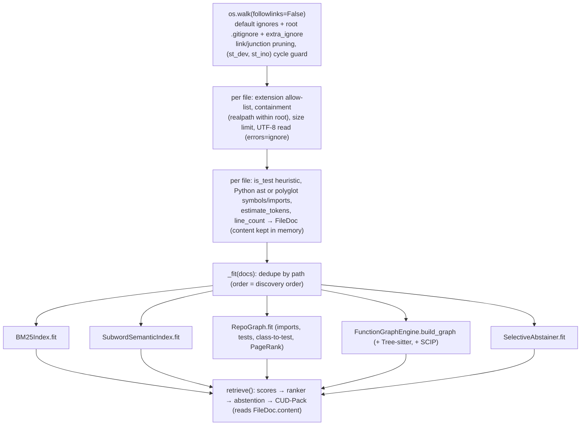
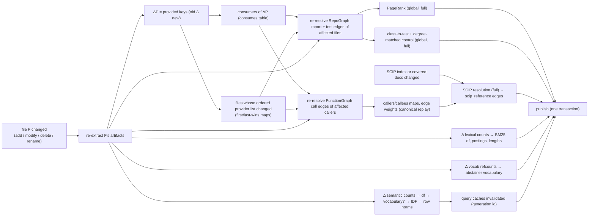

# Persistent and Incremental Indexing: Design

**Status:** design only. **Nothing in this document is implemented.** RepoNeedle still rebuilds every index in memory on each start, and `update_documents()` still refits every index over every document.
**Milestone:** V2 Milestone 4A (architecture and research).
**Evidence:** [reports/v2_completion/persistent_indexing/ARCHITECTURE_REPORT.md](../reports/v2_completion/persistent_indexing/ARCHITECTURE_REPORT.md), with the measurements behind every number quoted here.

## Contents

1. [Goals, non-goals and the correctness invariant](#1-goals-non-goals-and-the-correctness-invariant)
2. [Current architecture (summary)](#2-current-architecture-summary)
3. [What can be per-document and what is global](#3-what-can-be-per-document-and-what-is-global)
4. [Storage choice](#4-storage-choice)
5. [Repository identity and cache location](#5-repository-identity-and-cache-location)
6. [Schema](#6-schema)
7. [Fingerprints](#7-fingerprints)
8. [Startup, change detection and incremental update](#8-startup-change-detection-and-incremental-update)
9. [Dependency invalidation](#9-dependency-invalidation)
10. [Transactions, crash recovery and concurrency](#10-transactions-crash-recovery-and-concurrency)
11. [Security and privacy](#11-security-and-privacy)
12. [Cache size management](#12-cache-size-management)
13. [API](#13-api)
14. [Equivalence checking and acceptance criteria](#14-equivalence-checking-and-acceptance-criteria)
15. [Staged implementation plan](#15-staged-implementation-plan)
16. [Open questions](#16-open-questions)

---

## 1. Goals, non-goals and the correctness invariant

**Goals.**
1. Keep RepoNeedle's index on disk so that a restart does not redo work for unchanged files.
2. After a change, recompute only what the change can affect, including derived *global* structures, and prove it.
3. Opt-in only. **With no persistence configured, behaviour is byte-identical to today.**

**Non-goals for this milestone.** No implementation, file watcher, background service, network or shared cache, retrieval or ranking change, or version bump.

**Central invariant.** Retrieval from a persistent or incrementally updated index must be **equivalent** to retrieval from a fresh full build over the same files, in the same discovery order, with the same configuration. "Equivalent" is defined precisely in §14: identical index state, identical scores, identical ranked order, identical packed context and token accounting.

**Terminology.** This design uses three terms with a specific meaning:

| Term | Meaning |
| :--- | :--- |
| **Persistent** | Per-file artifacts survive restarts. Global structures may still be recomputed in full from them. |
| **Incremental** | After a change, the work done on *global* structures is proportional to what the change can affect, measured by work counters (§14.4). |
| **Fresh build** | `RepoNeedleEngine.from_directory()` as it exists today. |

Today's `update_documents()` is neither: it refits every index over every document. It is faster than a cold build only because some per-document caches are warm.

## 2. Current architecture (summary)

Full audit: report §2. The default lifecycle of `RepoNeedleEngine.from_directory()`:



**Properties a persistent design must preserve:**
- **Order is an input.** Document order is the `os.walk` order, which is filesystem-dependent and unsorted. It determines list indices in every index, ties in feature selection, `max_files` truncation, "first/last wins" name maps and graph insertion order.
- **Content is used at query time.** CUD-Pack renders `FileDoc.content`, and SCIP resolution validates ranges against content.
- **Today's "caches" cannot be persisted.** Per-document caches use `f"{path}::{len}::{hash(content)}::{symbols}"`, and Python's `hash()` of `str` is randomised per process.
- **Two latent defects matter for any incremental design.** `FunctionGraphEngine.build_graph()` never clears `module_to_path` or `package_to_files`, so entries from earlier builds survive (`module_to_path` is used in call resolution). And the engine has no way to remove a document, so deletions and renames are impossible without a full rebuild.

## 3. What can be per-document and what is global

| Structure | Per-document (can be persisted per file) | Global (depends on other files or on N) | Incremental strategy |
| :--- | :--- | :--- | :--- |
| Discovery | stat, containment, size, read, `is_test`, language | file set, **order**, `max_files` truncation, root `.gitignore` | Rescan every start (stat-level); diff against the manifest |
| Symbols / imports (`FileDoc.symbols/imports`) | Python `ast` or polyglot extraction | none | Per file |
| **BM25** (`lexical.py`) | weighted term counts (path ×2.5, symbols ×2.0, body ×1.0), effective length | N, `doc_frequencies`, IDF, `avg_doc_len`, `doc_len_norms`, postings (by document index) | Maintain df and postings by delta. Recompute N, IDF of query terms and `avg_doc_len` with the *identical* numeric procedure (§14.2) |
| **Semantic** (`semantic.py`) | word and char-n-gram counts of `path + symbols + content[:8000]` | df, **vocabulary = top 15,000 by (df, len) with first-insertion tie order**, IDF (depends on N), L2-normalised CSR matrix | df by delta; vocabulary, IDF and normalised rows recomputed (cheap from persisted counts). Exact top-K maintenance only with canonical first-seen order (§9.3) |
| **RepoGraph** (`graph.py`) | symbols/imports, manifest records (`Cargo.toml`, `go.mod`, `package.json`), production class catalog, **unfiltered** test-file call candidates, path stems | `module_to_path` (last/first wins), `symbol_to_paths`, `package_to_files`, `manifest_crates`, import edges, test↔target maps (stem matching), class-to-test edges, degree-matched control (seeded RNG over sorted sets), PageRank | Provider/consumer keys (§9.1) select files whose edges must be re-resolved. PageRank and the control graph are recomputed in full |
| **FunctionGraph** (`function_graph.py`) | functions, call sites, imports (Python `ast`, polyglot regex, or Tree-sitter records) | `module_to_path`, `class_to_methods`, `func_name_to_defs` (**global uniqueness**), Tree-sitter `ImportResolver` (path set, `go.mod`, `Cargo.toml`), edge list order, `graph` edge weight (**last writer wins**), callers/callees maps | Provider/consumer keys (§9.2); re-resolve only affected callers; replay edges in canonical order |
| **SCIP** (`scip_ingestion.py`) | none usable alone; resolution reads the index, the path set and document contents | everything (definitions, ambiguity, freshness) | Cache the resolution keyed by (index digest, digests of the documents it covers); otherwise re-resolve in full |
| **Abstainer** (`abstention.py`) | token vocabulary per file | union of vocabularies | Per-token reference counts |
| Query-time caches | none | semantic query vectors depend on vocabulary and IDF; CUD-Pack caches are digest-keyed | Invalidate on every published index change (generation id in keys) |

**Measured on this repository** (885 files, 8.1 MB; report §3):

| | Lexical | Semantic | RepoGraph | Function graph | Abstainer | Scan and read |
| :--- | ---: | ---: | ---: | ---: | ---: | ---: |
| Cold fit | 2.5 s | 12.6 s | 2.4 s | 4.4 s | 1.4 s | 1.5 s |
| Warm refit (global work only) | 0.4 s | 4.3 s | 2.4 s | 0.8 s | 0.01 s | — |

- A cold build totals 21.6 s.
- Warm refits sum to about 7.9 s, matching `update_documents()` for one modified file (8.2 s).
- Persisting per-file artifacts alone can therefore remove at most about 55–65% of a restart on this repository. The remainder is global work, dominated by the semantic index and by `RepoGraph` (which has no per-document cache).

## 4. Storage choice

**Decision: SQLite through Python's standard-library `sqlite3`.** No new dependency.

| Option | Material advantage | Why not the default |
| :--- | :--- | :--- |
| **SQLite (`sqlite3`)** | In the standard library on every supported Python and platform; ACID transactions; WAL gives concurrent readers with one writer; crash-safe; SQL lets the change sets of §9 be indexed queries; one file per repository | Single writer; unreliable locking on network filesystems (§10.5) |
| Files of NumPy/`npz` arrays plus a manifest | Fast bulk load of arrays | No multi-file atomicity, so atomic publish would need a rename-protocol; partial updates are hard; easy to get wrong |
| `pickle` / `shelve` | Trivial | **Rejected:** loading a pickle executes code, and the cache is an untrusted input (§11) |
| LMDB, RocksDB, LevelDB | Faster key-value writes | New native dependency; no query language for the change sets |
| DuckDB | Columnar analytics | New dependency; analytical engine, single writer; nothing it does well is needed here |
| Parquet / Arrow | Columnar arrays | New dependency; no transactional updates |

**Payloads** are stored as BLOBs in an explicit, versioned binary format:
- varint-packed `(string id, value)` pairs over a per-database string table, zlib-compressed;
- raw little-endian arrays with a dtype/shape header.

There is never any pickle or `eval`, and every payload is length- and type-checked on decode.

## 5. Repository identity and cache location

**Repository identity.**
- `repo_root` = `os.path.realpath(repo_dir)`, compared with `os.path.normcase` on Windows.
- `repo_id` = `sha256("reponeedle-index-v1\0" + normcase(repo_root))`.
- The canonical root is also stored inside the database and checked on every open (§11.1). A database whose stored root differs from the requested root is never used.

**Location.** The default cache directory is per user, outside the repository:

| Platform | Default cache directory |
| :--- | :--- |
| Windows | `%LOCALAPPDATA%\reponeedle\index` |
| macOS | `~/Library/Caches/reponeedle/index` |
| Linux and others | `$XDG_CACHE_HOME/reponeedle/index`, else `~/.cache/reponeedle/index` |

`IndexCacheConfig.cache_dir` overrides it. The database file is `<cache_dir>/<repo_id[:32]>-s<schema_major>.sqlite3`, with `-wal` and `-shm` beside it during use.

- **Not inside the repository by default.** A cache inside the repository could be committed by accident, and it would be scanned unless it were ignored. If a user chooses such a directory, discovery must exclude it explicitly (the path is added to the ignore set, never inferred).
- **Never on network filesystems.** If the cache directory is on a network filesystem (detected best-effort), persistence is disabled with a diagnostic (§10.5).

## 6. Schema

**The schema is designed around one rule: nothing the engine trusts is written outside the publishing transaction.** Per-file artifacts are content-addressed and immutable, so they can be written in batches without affecting correctness. The manifest, global state and the "current index" marker are replaced in one final transaction.

```sql
PRAGMA application_id = 0x524E4458;          -- 'RNDX'
PRAGMA user_version  = 1;                    -- schema version (major); see §10.6
PRAGMA journal_mode  = WAL;
PRAGMA foreign_keys  = ON;
PRAGMA auto_vacuum   = INCREMENTAL;          -- set at creation

CREATE TABLE meta (                          -- small key/value facts, all set in the publish transaction
  key   TEXT PRIMARY KEY,
  value TEXT NOT NULL
);
-- keys: repo_root, repo_id, created_by (reponeedle version), python (major.minor), platform,
--       current_generation, index_fingerprint, discovery_fingerprint, published_at,
--       clean_shutdown ('0' while a writer holds the database open)

CREATE TABLE generations (                   -- one row per build/update attempt
  gen_id          INTEGER PRIMARY KEY,
  state           TEXT NOT NULL CHECK (state IN ('building', 'published', 'superseded', 'abandoned')),
  kind            TEXT NOT NULL CHECK (kind IN ('cold', 'incremental', 'reassemble')),
  started_at      TEXT NOT NULL,
  published_at    TEXT,
  index_fingerprint     BLOB NOT NULL,       -- §7
  discovery_fingerprint BLOB NOT NULL,       -- §7
  file_count      INTEGER,
  work_counters   TEXT                       -- JSON: files re-extracted, keys re-resolved, postings touched ...
);

CREATE TABLE strings (                       -- shared string table for payload encoding
  sid  INTEGER PRIMARY KEY,
  text TEXT NOT NULL UNIQUE
);

CREATE TABLE manifest (                      -- the published file set; rewritten only by the publish transaction
  path            TEXT PRIMARY KEY,          -- repository-relative, '/'-separated, validated (§11.2)
  ordinal         INTEGER NOT NULL UNIQUE,   -- position in discovery order (the fresh-build order)
  size            INTEGER NOT NULL,
  mtime_ns        INTEGER NOT NULL,
  ctime_ns        INTEGER,
  inode           INTEGER,                   -- st_ino where meaningful; NULL on Windows/FAT
  content_sha256  BLOB NOT NULL,             -- of the bytes as read (before UTF-8 decoding)
  text_sha256     BLOB NOT NULL,             -- of the decoded str (errors='ignore'), what the indexes saw
  language        TEXT NOT NULL,
  is_test         INTEGER NOT NULL,
  line_count      INTEGER NOT NULL,
  token_estimate  INTEGER NOT NULL,
  artifact_set    BLOB NOT NULL              -- sha256 over this file's artifact keys (detects mismatches)
);

CREATE TABLE excluded (                      -- discovery diagnostics (paths and reasons only, never contents)
  path   TEXT PRIMARY KEY,
  reason TEXT NOT NULL CHECK (reason IN ('skipped_large', 'unreadable', 'symlink_outside_repository',
                                         'directory_skipped', 'max_files'))
);

CREATE TABLE artifacts (                     -- immutable, content-addressed per-file artifacts
  artifact_key   BLOB PRIMARY KEY,           -- sha256(kind, extractor_fp, path, text_sha256, input digests)
  kind           TEXT NOT NULL,              -- 'symbols', 'lexical', 'semantic', 'abstainer', 'repo_graph_facts',
                                             -- 'function_graph', 'tree_sitter', 'scip_doc' ...
  extractor_fp   BLOB NOT NULL,              -- §7
  path           TEXT NOT NULL,              -- for diagnostics and GC; not trusted for reads
  codec          TEXT NOT NULL,              -- e.g. 'varint-pairs+zlib/1'
  payload        BLOB NOT NULL,
  created_gen    INTEGER NOT NULL,
  last_used_gen  INTEGER NOT NULL
);
CREATE INDEX artifacts_by_path ON artifacts(path, kind);

CREATE TABLE file_artifacts (                -- which artifacts the published manifest uses
  path         TEXT NOT NULL REFERENCES manifest(path) ON DELETE CASCADE,
  kind         TEXT NOT NULL,
  artifact_key BLOB NOT NULL REFERENCES artifacts(artifact_key),
  PRIMARY KEY (path, kind)
);

-- Dependency index (§9): which lookup keys each file provides, and which it consumes.
CREATE TABLE provides (
  path  TEXT NOT NULL REFERENCES manifest(path) ON DELETE CASCADE,
  space TEXT NOT NULL,                       -- 'module', 'symbol', 'package', 'crate', 'path', 'func', 'method',
                                             -- 'class', 'stem', 'go_module', 'rust_crate' ...
  key   TEXT NOT NULL,
  seq   INTEGER NOT NULL,                    -- emission order within the file (for first/last-wins maps)
  PRIMARY KEY (space, key, path, seq)
);
CREATE INDEX provides_by_path ON provides(path);

CREATE TABLE consumes (
  path  TEXT NOT NULL REFERENCES manifest(path) ON DELETE CASCADE,
  space TEXT NOT NULL,
  key   TEXT NOT NULL,
  PRIMARY KEY (space, key, path)
);
CREATE INDEX consumes_by_path ON consumes(path);

-- Global derived state, written only in the publish transaction.
CREATE TABLE global_state (
  name     TEXT PRIMARY KEY,                 -- 'bm25.df', 'bm25.lengths', 'semantic.df', 'semantic.vocabulary',
                                             -- 'semantic.idf', 'repo_graph.edges', 'repo_graph.pagerank',
                                             -- 'function_graph.edges', 'abstainer.refcounts', 'scip.resolution' ...
  gen_id   INTEGER NOT NULL,
  codec    TEXT NOT NULL,
  payload  BLOB NOT NULL,
  checksum BLOB NOT NULL                     -- sha256(payload), verified on load
);

CREATE TABLE optional_components (           -- Tree-sitter, SCIP and parser availability at build time
  component TEXT PRIMARY KEY,                -- 'tree_sitter.runtime', 'tree_sitter.typescript', ..., 'scip.index'
  version   TEXT,
  digest    BLOB,                            -- e.g. SCIP index sha256, grammar ABI
  status    TEXT NOT NULL                    -- 'available', 'unavailable: <reason>'
);
```

**Not stored:** file contents, query text, query results, diagnostics containing contents, or anything from outside the repository root.

**What the stored artifacts can reconstruct.**
- Artifacts plus the manifest reconstruct every index exactly (§14).
- Today, only CUD-Pack rendering and SCIP range validation need raw text. Both read the current file from disk on demand and verify `text_sha256` (§8.4).

**Semantic payload choice.** The semantic artifact can store either the n-gram counts (about 7.9 KB per file here), or the first-occurrence-ordered **word** counts from which the n-gram counts *and their insertion order* are reproduced exactly (much smaller, but n-gram generation costs CPU). Stage 1 stores n-gram counts and measures both (§15).

## 7. Fingerprints

Every reuse decision is keyed by explicit fingerprints: SHA-256 over canonical JSON (sorted keys, no whitespace).

**`extractor_fp[kind]`** (part of every artifact key) covers:
- `ARTIFACT_VERSION[kind]`, an integer constant in code that must be bumped when the extractor's output changes;
- the parameters of that extractor:

| Kind | Parameters |
| :--- | :--- |
| `lexical` | tokenizer version (stop words, regexes), `k1`, `b`, field weights, `decouple_symbols` |
| `semantic` | tokenizer version, `min_n`, `max_n`, the 8,000-character truncation |
| `symbols` | `enable_polyglot_symbols`, Python minor version (the `ast` grammar changes between versions) |
| `function_graph` | `structural_parser`, Python minor version, Tree-sitter runtime and grammar versions plus ABI (Tree-sitter mode only) |
| `repo_graph_facts` | Python minor version, regex versions |
| `abstainer` | tokenizer version, stemmer version, the 3,000-character truncation |

**`index_fingerprint`** covers everything that changes *global* assembly:
- all `extractor_fp` values;
- `max_features`;
- `min_confidence`;
- `enable_structural_edges`;
- the class-to-test switches;
- the PageRank parameters;
- SCIP configuration;
- the schema version.

**`discovery_fingerprint`** covers what changes the *file set*:
- the default ignore list;
- `extra_ignore`;
- the root `.gitignore` bytes digest;
- the extension allow-list;
- `max_file_size_bytes`;
- `max_files`;
- path case-sensitivity of the platform.

**Query-time settings are deliberately excluded:** `BudgetConfig`, ranker choice, router weights, abstention settings and `focus_span_strategy`. They never invalidate the index.

**Guarding the version constants.**
- *Problem:* a forgotten `ARTIFACT_VERSION` bump would silently serve stale artifacts.
- *Mitigation:* a test stores a digest of each extractor's source module and **fails when the source changes without a version bump**.
- *Trade-off:* this is deliberately conservative, since false alarms only cost a bump.
- *Backstop:* the equivalence harness (§14) catches mismatches the digest misses.

## 8. Startup, change detection and incremental update

### 8.1 Startup (`from_directory(..., index_cache=IndexCacheConfig(...))`)

```mermaid
sequenceDiagram
    participant E as Engine
    participant FS as Repository
    participant DB as SQLite cache
    E->>DB: open (read), check application_id, user_version, repo_root, fingerprints
    alt missing / incompatible / corrupt (§10.4)
        E->>FS: full scan + read
        E->>DB: cold build (§10.1) and publish
    else compatible
        E->>FS: scan (same rules and order as today) + stat every file
        E->>E: diff scan vs manifest → unchanged / modified / added / deleted (+ renames)
        E->>FS: read + hash only candidates (validation policy, §8.2)
        E->>E: extract artifacts for changed files; invalidate dependents (§9)
        E->>DB: write artifacts (batches), then ONE publish transaction (§10.2)
        E->>E: assemble in-memory indexes in discovery order
    end
```

**Discovery always runs.** It is the only way to learn the current file set and order. Its cost (stat plus walk) is a small part of a build: 1.5 s here including reads; stat-only is cheaper still.

### 8.2 Change detection (validation policy)

| `validation` | A file is "unchanged" when | Cost | Risk |
| :--- | :--- | :--- | :--- |
| `"content"` (default) | its bytes hash to the stored `content_sha256` | read and hash every file | none beyond SHA-256 |
| `"stat"` | size, `mtime_ns` and (where meaningful) `inode`/`ctime_ns` match, **and** the file is not "racily clean" | read only changed files | stat can lie: coarse mtime (FAT 2 s), editors preserving mtime, `touch -m` |

**Racily clean** is borrowed from Git's index: a file whose `mtime_ns` is not strictly older than the published generation's timestamp is always hashed, because it may have changed within the same timestamp tick.

### 8.3 Behaviour per change

| Change | Correct behaviour |
| :--- | :--- |
| **Unchanged** file | Reuse its artifacts. It still participates in global reassembly, at its *current* discovery position. |
| **Modified** | Re-extract its artifacts. Apply its old→new deltas to global structures, then invalidate dependents through its provided/consumed keys (§9). |
| **Added** | Extract; insert at its discovery ordinal; invalidate consumers of every key it provides. Ordinals of later files shift, which is handled by order-independent storage plus ordered reassembly (§9.4). |
| **Deleted** | Remove its manifest row (cascades to `provides`/`consumes`/`file_artifacts`); apply negative deltas; invalidate consumers of its provided keys. Its artifacts become garbage. |
| **Renamed** (delete + add with equal `content_sha256`) | Treated as delete + add, because almost every artifact embeds the path (path tokens, module names, `is_test`, `FunctionSymbol.filepath`). Content-only sub-artifacts may be reused (optional optimisation). Both old and new keys are invalidated. |
| **Ignore rules changed** (`.gitignore`, `extra_ignore`, defaults) | `discovery_fingerprint` changes. Nothing is invalidated wholesale: the new scan's file set is diffed against the manifest, giving ordinary adds and deletes. |
| **Discovery order changed** (same files, different `os.walk` order) | No artifact changes. Global state is reassembled in the new order (§9.4). |
| **`max_files` truncation changed** | Same as an ignore change: different file set. |
| **Tokenizer or extractor parameters changed** | The affected `extractor_fp` changes, so only those kinds are re-extracted. Global state for those indexes is rebuilt. |
| **Global parameters changed** (`max_features`, PageRank, `min_confidence` ...) | `index_fingerprint` changes; artifacts are reused and global assembly runs in full. |
| **Python minor version changed** | `symbols`, `function_graph` and `repo_graph_facts` artifacts of `.py` files are re-extracted (`ast` differences). |
| **Tree-sitter runtime, grammar or ABI changed, or became (un)available** | Only Tree-sitter artifacts are re-extracted. Files that previously fell back to regex are re-extracted when a parser becomes available, and vice versa. |
| **SCIP index changed** (digest or size differs) or SCIP config changed | The SCIP resolution is recomputed in full, and SCIP-derived function-graph edges are replaced. |
| **SCIP index unchanged, covered documents changed** | The SCIP resolution is recomputed (it validates contents and ranges). Per-document reuse is a later optimisation (§16). |
| **Database missing** | Cold build. |
| **Database corrupt, foreign or incompatible** | §10.4: set aside, cold build, never partially trusted. |
| **Repository root moved** | Different `repo_id`, so a new database. The old one ages out (§12). |

### 8.4 Content at query time

Persistent mode does not keep raw source on disk, but CUD-Pack must render text. There are two options:

| | Stage 1: eager (current memory profile) | Later stage: lazy |
| :--- | :--- | :--- |
| How | All indexed files are read during startup (required anyway by `validation="content"`); `FileDoc.content` stays as today | `FileDoc.content` is read on demand through the same containment checks as discovery (`resolve_within_root`) |
| Content check | — | Verified against `text_sha256` on read |
| If the file changed since the index was built | — | Excluded from that result and reported as stale, never silently packed |
| Cost | Same memory as today | Requires an API change to `FileDoc` (§16) |

## 9. Dependency invalidation

### 9.1 Provider/consumer keys

Every global name lookup becomes a typed key:
- a file **provides** the keys it can be found under: module names, symbols, Go package names, crate names, its own path as a resolution candidate, function names, method names, class names, test stems;
- a file **consumes** the keys its resolution looked up: import strings, qualifiers, callee names, candidate paths probed for relative imports.

**On a change to file F:**
1. `ΔP` = the keys F provided before, symmetric-difference the keys it provides now (for an add or delete, all of them).
2. `affected` = {F} ∪ {every file that consumes a key in ΔP} ∪ {every file whose *ordered* provider list for a consumed key changed}.
3. Re-resolve the edges **of the affected files only**.
4. Rebuild the maps and replay edges in canonical order (§9.4).
5. Recompute purely global quantities (PageRank, the degree-matched control graph) in full.

Recomputing PageRank in full is acceptable (O(E × iterations)). It is reported as global work, not incremental.



### 9.2 Function graph specifics

| Resolution step (`build_graph`) | Consumes | Provided by |
| :--- | :--- | :--- |
| A. intra-file | caller's own functions | the caller (always re-resolved if the caller changed) |
| B. qualified module call | `module:<qualifier>`, `func:<callee>` in that module | `module_to_path` entries, functions of the target |
| B'. class-qualified | `class:<qualifier>` | `class_to_methods` |
| C. unqualified with import | `module:<base_mod>` for each import ending in the callee | `module_to_path` |
| D. globally unique function | `func:<callee>` — **the count of definitions matters** | every file defining that name |
| E. unique method across classes | `method:<callee>` — count matters | every class defining that method |
| Tree-sitter bindings | `path:<candidate>`, `go_module:*`, `rust_crate:*`, symbol names in bound files | path set, `go.mod`, `Cargo.toml`, extracted symbols |

**Uniqueness-based steps (D, E) are the reason a single-file rebuild is never enough.**
- *Defining a second function with an existing name* removes `unique_global_call` edges from **every** caller of that name.
- *Deleting one of two definitions* creates edges everywhere.
- *Coverage:* both cases are captured because the key `func:<name>` changes provider count.

**Prerequisite (Stage 0).** `module_to_path` and `package_to_files` must be cleared on every build. Today they are not.

### 9.3 Semantic vocabulary

The vocabulary is the top `max_features` features by `(df, len)` descending. Ties keep **first insertion order**: features enter `df_counts` while iterating documents in order, and each document's features in their first-occurrence order.

**Consequences:**
- Adding or removing *any* file changes N, so IDF changes for every feature, so every normalised row changes. A fresh build therefore differs in every matrix value.
- The exact path is to persist per-file ordered feature counts and recompute vocabulary, IDF and normalised rows with the **same code** (warm refit: 4.3 s here). This is exact by construction and is Stage 1.
- An incremental vocabulary needs df by delta plus a first-seen key per feature. Positional first-seen shifts when files are inserted, so this requires the canonical order of §9.4. The IDF/norm recomputation is a sparse matrix-vector product over persisted TF.
- Before adoption, this must be proven bit-identical to the existing float32 procedure (§14.2). If it cannot be, the semantic index stays "persistent, globally recomputed", and this design says so.

### 9.4 Canonical order and replay

**Fresh-build order is the discovery order of the current scan.**
- The manifest stores `ordinal`, global state is keyed by path, and in-memory assembly always follows the current scan order.
- Insertion-order-sensitive structures are rebuilt by **replaying per-file contributions in that order**: dictionary construction, `module_to_path` first/last wins, edge lists, `graph.add_edge` weight overwrites, NetworkX node and edge insertion before PageRank.
- Replay is O(N + E). Its cost is reported as global work.

## 10. Transactions, crash recovery and concurrency

### 10.1 Cold build

1. `BEGIN IMMEDIATE`; insert `generations(state='building', kind='cold')`; commit. This marks intent only; the row is never trusted.
2. Write artifacts in batches of about 500 files per transaction, using `INSERT OR IGNORE` because they are immutable and content-addressed. A crash here loses only unreferenced artifacts.
3. Assemble global state in memory.
4. **Publish transaction** (§10.2).

### 10.2 Publish (the only way an index becomes valid)

All of the following happen in one `BEGIN IMMEDIATE … COMMIT`:
- replace `manifest`, `excluded`, `file_artifacts`, `provides`, `consumes` and `global_state` for the new generation;
- set the new generation's `state='published'` and the previous one's `'superseded'`;
- write `meta.current_generation`, the fingerprints and `published_at`;
- `PRAGMA synchronous=FULL` for this transaction.

**A reader accepts an index only if all of these hold:**
- `meta.current_generation` names a `generations` row with `state='published'`;
- that row's fingerprints equal `meta`'s;
- every `global_state.checksum` verifies;
- `manifest` and `file_artifacts` reference existing artifacts. This is checked by count in `"stat"` mode and fully under `validation="content"` with `verify=True`.

**Crash outcomes.**
- *Before COMMIT:* SQLite rolls back, and the previous published generation remains intact and valid.
- *After COMMIT:* the new generation is durable.
- *Either way:* there is no state in which a partially updated index is visible as published.

### 10.3 Incremental update

This is the same protocol with `kind='incremental'`. Only changed files' artifacts are written. The publish transaction replaces only the changed manifest/key rows plus the global state rows that changed. Work counters are recorded on the generation.

### 10.4 Corruption and incompatibility

On open, the database is treated as **unusable** (moved aside to `<name>.corrupt-<UTC timestamp>`, then a cold build) when any of these hold:
- `sqlite3.DatabaseError`;
- a wrong `application_id`;
- `user_version` newer than supported, or older with no migration;
- a `repo_root` mismatch;
- no published generation;
- a checksum failure;
- a payload decode failure;
- after an unclean shutdown (`meta.clean_shutdown='0'`), `PRAGMA quick_check` failing.

A full `PRAGMA integrity_check` is available on request.

**Never:** salvaging part of a database, or serving results from a generation that failed validation.

`rebuild_policy="never"` raises instead of rebuilding (§13).

### 10.5 Concurrency

| Concern | Policy |
| :--- | :--- |
| **Readers** | Any number of processes (for example several MCP servers) read concurrently in WAL mode, each from a consistent snapshot. |
| **Writers** | Serialised by SQLite's `BEGIN IMMEDIATE` with `busy_timeout` (default 30 s; configurable). A writer that waits re-reads `current_generation` after acquiring the lock and recomputes its change set against *that* generation, never against what it saw before waiting. |
| **Long cold builds** | Hold the write lock only for artifact batches and the publish transaction, never during extraction. |
| **In-memory engines** | Keep the generation they loaded. `engine.refresh()` (§13) loads a newer one explicitly. Nothing changes under a running engine. |
| **Network filesystems** | SQLite locking is unreliable on NFS/SMB. If the cache directory is detected as remote, persistence is disabled with a diagnostic; this can be overridden at the user's risk. |
| **Checkpoints** | `wal_autocheckpoint` default, plus `PRAGMA wal_checkpoint(TRUNCATE)` after cold builds. |

### 10.6 Schema migrations

**Version numbering:**
- `user_version` carries the schema version.
- **Minor, additive changes** (new tables, kinds or optional columns) are migrated in place inside one transaction, idempotent and tested from every previous version.
- **Major changes** use a new file name (`-s<major>`), so older RepoNeedle versions never open a database they cannot read. The old file ages out (§12).

**Downgrades:** an older RepoNeedle finding only a newer-major database simply builds its own.

## 11. Security and privacy

### 11.1 The cache is untrusted input

**Threat:** another local user, a sync tool, or a bug could modify the database. Every value read back is validated before use:
- the root, application id, schema version and fingerprints;
- path syntax (§11.2);
- payload codecs, lengths, value ranges and checksums.

**No code is ever executed from the cache:** no pickle, no `eval`, and no dynamic imports keyed by cached strings.

### 11.2 Paths

Manifest and artifact paths are **never used to open files directly**. Every path is checked to be:
- relative and non-empty;
- `/`-separated;
- free of `..`, `.`, empty components, NUL and drive letters.

Before reading a file for packing or validation, its absolute path is re-derived from the *current* root and resolved with the same `resolve_within_root()` and link rules as discovery.

**Symlinks and junctions are re-evaluated at every scan**: a link that now points outside the root is excluded even if it was indexed before. Paths that fail validation invalidate the database (§10.4).

### 11.3 Permissions

- **POSIX:** the cache directory is created `0700` and the database files `0600`. An existing directory with group or world write permission is refused, unless the user configured it explicitly.
- **Windows:** the default location is under the user's profile (`%LOCALAPPDATA%`), which inherits per-user ACLs.

### 11.4 Sensitive data

**Derived artifacts are not anonymous.** Term counts, symbol names, imports and character n-grams reproduce much of a file's vocabulary. Measured here, encoded artifacts are about **1.3× the size of the source**. Secrets present in source (API keys in code or config) **will appear** as tokens in the cache.

**The cache must therefore be treated as being as sensitive as the repository.** The protections are:
- persistence is opt-in;
- the cache is local, per user and outside the repository by default;
- files the user excluded (ignore rules, size limits, links outside the root) are never read and therefore never cached;
- a documented `cache clear` operation (§13);
- no contents in diagnostics or logs, as today.

Optional, configurable exclusion of secret-prone files (`.env`, key files) from indexing would be a discovery change affecting fresh builds too, so it is out of scope (§16).

## 12. Cache size management

**Per database:**
- After each publish, artifacts whose `last_used_gen` is older than the current generation, and that are not referenced by `file_artifacts`, are deleted.
- `PRAGMA incremental_vacuum` reclaims pages, batched so that the time it takes stays bounded.

**Limits:**
- `IndexCacheConfig.max_db_bytes` (default **2 GiB**) applies per repository. If a publish would exceed it, the build still completes in memory, and persistence for that repository is skipped with a diagnostic. It is never truncated: a partial cache is worse than none.
- `IndexCacheConfig.max_total_bytes` (default **10 GiB**) applies across the cache directory. Least-recently-*opened* repository databases are deleted first, never one that is open (detected via the lock).

**Commands:** `reponeedle cache info`, `reponeedle cache clear [--repo PATH | --all]`, `reponeedle cache verify`. These are a later stage (§15).

## 13. API

**The API is opt-in, and every existing signature is unchanged.**

```python
class IndexCacheConfig(BaseModel):
    cache_dir: Optional[str] = None                      # default per-user location (§5)
    enabled: bool = True                                 # False: behave exactly as without the config
    validation: Literal["content", "stat"] = "content"   # §8.2
    rebuild_policy: Literal["auto", "never", "always"] = "auto"
    #   auto:   rebuild on missing/incompatible/corrupt cache (default)
    #   never:  raise IndexCacheError instead of rebuilding (CI / reproducibility checks)
    #   always: ignore any existing cache, cold-build and publish (benchmarks, recovery)
    read_only: bool = False                              # use a valid cache, never write (shared/CI caches)
    verify: bool = False                                 # full artifact/payload verification on open
    max_db_bytes: int = 2 * 1024**3
    max_total_bytes: int = 10 * 1024**3
    busy_timeout_s: float = 30.0

RepoNeedleEngine.from_directory(repo_dir, ..., index_cache: Optional[IndexCacheConfig] = None)
engine.refresh() -> IndexUpdateReport          # rescan + incremental update + publish; only with index_cache
engine.index_cache_diagnostics -> Optional[dict]   # state, generation, reason for any rebuild, change counts,
                                                   # work counters, timings, database bytes
```

**Behaviour without the config.**
- `index_cache=None`, the default, means no database is opened or created and behaviour is byte-identical to today.
- `from_documents()` and `RepoNeedleEngine(docs=...)` do not support persistence: they have no repository root and no discovery to validate against.
- `update_documents()` keeps its current meaning, an in-memory refit. With a persistent engine it does **not** write the cache, because the documents may not match the files on disk. `refresh()` is the persistent path.

**Other interfaces.**
- *CLI and MCP (later stage):* `--index-cache [DIR]` and `--index-cache-validation`; MCP `reponeedle_inspect` reports `index_cache_diagnostics`.
- *Excluded:* no file watcher, background thread or service is part of this design.

## 14. Equivalence checking and acceptance criteria

### 14.1 The reference

For every test state, build `fresh = RepoNeedleEngine.from_directory(repo, <same config>)` and compare it with the persistent or incrementally updated engine. The two runs use the same files, the same discovery order (asserted equal) and the same configuration.

### 14.2 What must be identical

**Required: exact equality.** Tolerances are not used, because near-ties decide ranks.

| Layer | Check |
| :--- | :--- |
| Discovery | `[d.path for d in docs]` (order), `FileDoc` fields except `content` (compared by digest), `IndexingDiagnostics` |
| Lexical | `num_docs`, `avg_doc_len` (float bit pattern), `doc_lengths`, `doc_len_norms` (`np.array_equal`), `doc_frequencies`, `idf`, inverted postings as ordered lists; `score(q)` arrays for the query set (`np.array_equal`) |
| Semantic | `vocabulary` **including order**, `idf` (`array_equal`), `doc_matrix` CSR `indptr`/`indices`/`data` (`array_equal` after canonical sorting of indices per row); `score(q)` arrays |
| RepoGraph | node list in insertion order, edge list with attributes in insertion order, `module_to_path`, `symbol_to_paths`, `package_to_files`, `manifest_crates`, test↔target maps, invocation edges, degree-matched maps, `pagerank_scores` (`array_equal`) |
| FunctionGraph | `functions`, `call_sites`, `edges` (ordered, all fields), `file_to_file_edges`, `graph` edges with weights, `callers_map`/`callees_map`, `module_to_path`, Tree-sitter and SCIP diagnostics, `scip_relationships` |
| Abstainer | `repo_vocabulary` |
| Retrieval | for each query × ranker (`legacy`, `bm25`, `arm101`, `cascade`, `change_impact`) × task type: `ranked_files` (full list), per-file `score` and component scores (exact), `abstention` diagnostics |
| Packing | `selected_files` (path, tier, `token_count`, `rendered_content`), `rendered_context` (string equality), `total_tokens`, for budgets {512, 2,000, 4,000, 8,192} × modes {compact, complete} × `focus_span_strategy` {legacy, ast_blocks} |

**Query set.** A fixed, versioned set of at least 200 queries: identifiers sampled from the repository, natural-language task descriptions, stack traces, test-intent queries, empty-match queries, and queries producing exact score ties.

**The only exceptions** are wall-clock fields (`execution_time_ms`) and fields documented as containing the generation id.

### 14.3 Differential and fault testing

- **Mutation sequences:** seeded random sequences over fixture repositories and a synthetic generator. Steps include adding, modifying, deleting and renaming files; adding a second definition of a function name; removing one of two; editing `.gitignore`; changing `max_files`; toggling `structural_parser`; replacing the SCIP index. After **every step**, the persistent engine (restart and `refresh()`) must satisfy §14.2 against a fresh build.
- **Crash injection:** run cold builds and updates in a subprocess and kill it with `os._exit` at fault points (every batch commit, inside the publish transaction, during vacuum). On reopen, the database must be the previous published generation (exact equivalence) or be rebuilt. It must never be partially new.
- **Corruption:** truncate the file, flip bytes in pages and payloads, delete `-wal`/`-shm` mid-write, change `user_version`, `application_id` or `repo_root`, and insert `..`/absolute/NUL paths. Each must lead to the §10.4 outcome, without crashes or reads outside the root.
- **Concurrency:** two processes refreshing simultaneously and readers during publish, with no torn reads and no lost publishes.

### 14.4 "Incremental" must be demonstrated

Every update records work counters:
- files re-extracted and artifacts written;
- keys in ΔP and affected files;
- edges re-resolved and postings touched;
- whether each global stage ran in full.

**An update counts as incremental only for stages whose counters scale with the change set.** Stages recomputed in full (PageRank, semantic vocabulary in Stage 1) are reported as "global, full" in diagnostics, benchmarks and documentation.

### 14.5 Performance benchmarks (reported separately from correctness)

The performance methodology is in report §7. Every benchmark first passes §14.2 on its final state; performance is never reported for an inequivalent run.

| # | Scenario | Measures |
| :--- | :--- | :--- |
| 1 | Cold index creation | Time, peak RSS, database bytes, overhead against the non-persistent build |
| 2 | Restart, unchanged repository | Time to a ready engine (stat vs content validation) |
| 3 | One modified file (body-only edit; symbol-changing edit; new duplicate function name) | `refresh()` time, work counters |
| 4 | Multiple modified files (1%, 10%) | Same |
| 5 | Added and deleted files | Same, plus GC time |
| 6 | Large repositories | Real repositories plus a synthetic generator at 10k, 30k and **100k files** (`max_files` raised) |
| 7 | Corruption and full rebuild | Detection time and rebuild time |

**Targets** (to be confirmed in Stage 1, not promises):
- persistence overhead on a cold build ≤ 25%;
- restart with an unchanged repository ≥ 2× faster than cold. The measured global-work floor (§3) bounds Stage 1 at about 2.3×, because Stage 1 still reads every file for packing (§8.4); about 2.7× only once content is loaded lazily;
- in later stages, an update costs ≤ 25% of a cold build for a single body-only edit.

## 15. Staged implementation plan

Each stage is its own PR. A stage ships only with the §14 equivalence harness green, crash and corruption tests, and benchmarks.

| Stage | Scope | Exit criteria |
| :--- | :--- | :--- |
| **0. Prerequisites** (no persistence) | Clear `module_to_path`/`package_to_files` on every function-graph build; add a document-removal path (`remove_documents()`), refit-based like today; replace process-randomised `hash()` signatures in per-document caches with SHA-256 digests; build the **equivalence harness** (§14.2) and query set, and run it against today's `update_documents()` (expected to expose the ordering differences in report §4) | Harness exists and is in CI; defaults byte-identical to `main` (golden snapshots) |
| **1. Persistent artifacts, global reassembly** | `IndexCacheConfig`; SQLite schema; per-file artifacts for every index; manifest, fingerprints, publish protocol, validation modes, corruption handling, GC. Global structures recomputed **in full** from artifacts with the *existing* code paths, in current discovery order | Exact equivalence by construction; the restart speedup measured and reported as "persistent, not incremental" |
| **2. Incremental lexical and abstainer; dependency-scoped graphs** | BM25 df/postings by delta with identical recomputation of N, IDF and `avg_doc_len`; abstainer refcounts; provider/consumer keys; affected-file re-resolution for RepoGraph and FunctionGraph with canonical replay; PageRank in full | Equivalence under mutation sequences; work counters proportional to the change for these stages |
| **3. Semantic** | df by delta; exact vocabulary maintenance with canonical first-seen order; vectorised IDF/norm recomputation, **only if bit-identical**; otherwise documented as global | Equivalence; or an explicit decision to keep the semantic index globally recomputed |
| **4. Optional components and surfaces** | Tree-sitter artifacts and availability changes; SCIP resolution caching; CLI/MCP flags; `cache info/clear/verify`; size limits across repositories; lazy content (§8.4) if approved | Equivalence including optional extras; documentation |

## 16. Open questions

These are listed for maintainers' decision and are not settled by this design.

1. **Deterministic discovery order.** Today's order is the filesystem's (`os.walk`), so the same repository can rank ties differently on different machines. Sorting traversal would make equivalence portable and simplify canonical order, but it changes default results and `max_files` truncation. Should persistent mode, or all modes, sort? (This needs its own evaluation.)
2. **Lazy content** (§8.4). Changing `FileDoc.content` loading is an API change, so the question is whether it is worth it.
3. **Semantic artifact form.** Store n-gram counts (fast, about 1.3× source size) or word counts that regenerate them (smaller, slower)? Stage 1 measures both.
4. **SCIP per-document reuse.** Is a full re-resolution on any covered-file change acceptable at the sizes users run?
5. **Secret-prone files.** Should discovery gain an opt-in secret-file exclusion list? This affects fresh builds too.
6. **Nested `.gitignore` files** are not honoured today. Fixing that is a discovery change independent of persistence.
7. **`update_documents()` with persistence.** Keep it in-memory only (proposed), or allow writing when documents match disk?
8. **Shared or CI caches** (`read_only=True`): are artifacts portable across machines? Paths are relative, but Python minor versions and discovery order may differ.
