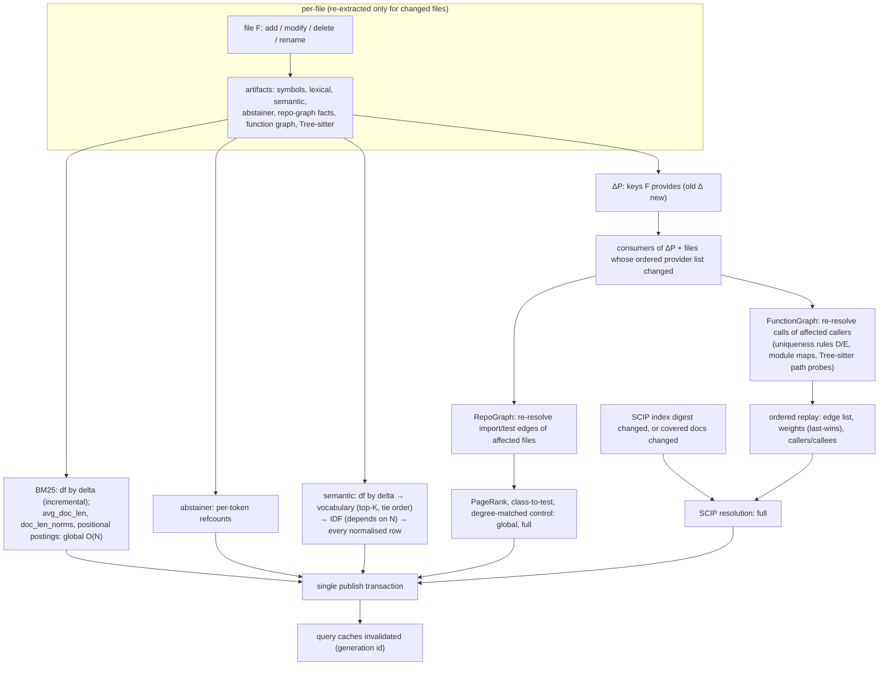

# V2 Milestone 4A: Persistent and Incremental Indexing, Architecture Report

**Revision 1:** branch `design/v2-persistent-indexing`, from `main` at `5bc8c53`; merged as PR #21.
**Revision 2 (review corrections):** branch `docs/v2-persistent-indexing-review-fixes`, from `main` at `bac30c8`. It answers an independent architecture review; §14 maps each review point to its resolution.
**Status:** architecture and research only. **No indexer, no persistence code, and no retrieval change** are in this branch. The package version stays 1.2.0.
**Design specification:** [docs/PERSISTENT_INDEXING_DESIGN.md](../../../docs/PERSISTENT_INDEXING_DESIGN.md). This report holds the evidence and a summary of each design area; the specification holds the schema, protocols and API in full.

## 0. Summary

**How it works today.**
- RepoNeedle rebuilds five indexes in memory on every start: BM25, the subword semantic index, the repository graph, the function graph and the abstainer vocabulary.
- `update_documents()` is **not incremental**. It calls `fit()` on every index over every document. It is cheaper than a cold build only because some per-document caches are warm.
- Those caches cannot be persisted: they are keyed on Python's per-process-randomised `hash()`.

**Measured on a pinned snapshot of this repository** (commit `bac30c8`, 890 files, 8.17 MB; revision 2, §3.1):
- A cold build takes **31.6 s** in the recorded run. Absolute timings vary widely on this machine: 21.6 s in revision 1 and 41.1 s in a contended revision 2 run. The ratios below are stable across all three runs.
- `update_documents()` for **one** modified file takes **11.2 s**. That matches the sum of every stage's global work (11.7 s): semantic vocabulary and matrix 6.3 s, repository graph 3.7 s, function-graph resolution 1.1 s, BM25 0.6 s.
- Persisting per-file artifacts alone therefore bounds a restart at about **2.0–2.3× faster than cold** across runs, or about 2.7× if file contents were loaded lazily. Going further needs genuinely incremental maintenance of global structures.

**Design decisions:**
- **Storage:** SQLite through the standard library, with settings applied and verified per connection, outside transactions (revision 2).
- **Artifacts:** per-file, content-addressed, immutable, **self-contained and SHA-256-checksummed** (revision 2), with no raw source stored.
- **Publishing:** a single publish transaction is the only way an index becomes valid.
- **Invalidation:** a provider/consumer key index scopes graph re-resolution.
- **Reassembly:** canonical replay in discovery order.
- **Correctness:** exact equivalence with a fresh build is the acceptance criterion, checked by a differential harness with mutation, crash and corruption tests.
- **API:** opt-in through `IndexCacheConfig`.

**Audit findings that block a naive design** (§4, each demonstrated by `audit_update_documents.py`):
1. Index state depends on document order, and today's update path changes that order.
2. There is no way to remove a document.
3. `FunctionGraphEngine.build_graph()` keeps `module_to_path` and `package_to_files` entries across builds, which yields call edges to files no longer in the build.
4. The cache keys are process-randomised.

**Size and privacy.**
- Encoded payloads alone are 1.27–1.46× the source, depending on the encoding.
- The **actual prototype SQLite database is 2.24× the source** (self-contained encoding; §3.3). Revision 1's 1.27× was payload only.
- The cache reproduces much of the source's vocabulary and must be treated as sensitive as the source.

## 1. Scope and method

**Read in full:**
- `reponeedle/engine.py`;
- `reponeedle/core/lexical.py`, `semantic.py`, `tokenizer.py`, `graph.py`, `function_graph.py`, `abstention.py`, `scip_ingestion.py` (resolution path), `tree_sitter_extraction.py` (`ImportResolver`), `packer.py` (content use);
- `reponeedle/models.py`;
- the MCP server start-up path;
- the indexing, diagnostics, security, junction, SCIP and update tests.

**Measurement scripts** (in this directory; all are read-only with respect to RepoNeedle's behaviour):

| Script | Measures | Output |
| :--- | :--- | :--- |
| `profile_current.py` | Stage-by-stage timing of the current pipeline (cold, and warm "global work only") on this repository and on synthetic 1,000 and 3,000-file repositories | `profile_results.json` |
| `artifact_size_estimate.py` | Per-file artifact counts and **encoded payload** sizes (payload only), plus a 100,000-file linear projection | `artifact_sizes.json` |
| `sqlite_prototype.py` (revision 2) | An **isolated** prototype SQLite database (design §6 schema, §10.1 connection protocol, checksums) in two payload encodings: the seven size components, write and verification time, SQLite PRAGMA behaviour, and rejection of structurally valid corruption | `sqlite_prototype.json` |
| `snapshot.py` (revision 2) | Exports one pinned commit with `git archive` to a temporary directory and records the measured file set; used by the three scripts above | `snapshot_file_set.json` |
| `audit_update_documents.py` | Today's update path against a fresh build: order, removal, stale function-graph state, `hash()` randomisation (its own fixture in a temporary directory) | `audit_results.json` |

**Measured input (revision 2):** every repository measurement uses the same pinned snapshot: commit `bac30c82fd17b2b21c4726cbd4d49b1fb729b347` (tree `8ab01f7a`), 890 indexed files, 8,173,201 bytes of indexed text, `file_set_sha256` `b6061cba…4274`. The exported snapshot lives in a temporary directory outside the repository, so script outputs cannot change what is measured (§3.4).

**Environment:** Windows 11, Python 3.11.9, SQLite 3.45.1, Intel64 Family 6 Model 170, best of 3. Timings on this machine varied by up to about ±30% between runs. Treat them as indicative ratios, not absolute performance.

## 2. Current architecture and lifecycle

| # | Step | Where | Per-document or global |
| ---: | :--- | :--- | :--- |
| 1 | Discovery: `os.walk(followlinks=False)`. Directory links and junctions are pruned; cycles are guarded with `(st_dev, st_ino)`; containment uses `realpath` within the root. | [engine.py#L374-L415](../../../reponeedle/engine.py#L374-L415) | **Global**: the file set, the **order** (filesystem-defined, unsorted) and `max_files` truncation (L485-L490) |
| 2 | Filtering: `DEFAULT_IGNORE_PATTERNS`, the **root** `.gitignore` only (nested ones are ignored), `extra_ignore`, an extension allow-list, `max_file_size_bytes` | [engine.py#L340-L355](../../../reponeedle/engine.py#L340-L355), [L424](../../../reponeedle/engine.py#L424), [L445](../../../reponeedle/engine.py#L445) | Per file, with global inputs (the ignore set) |
| 3 | Reading: UTF-8 with `errors="ignore"`, from the validated canonical path. **No hashing**; contents are kept in `FileDoc.content`. | [engine.py#L449-L453](../../../reponeedle/engine.py#L449-L453) | Per file |
| 4 | Lexical: field-weighted term counts per document (cached on `hash()`), then df, IDF, average length, length norms and postings over all documents | [lexical.py#L54-L129](../../../reponeedle/core/lexical.py#L54-L129) | Counts per file; **everything else global** (N, df, `avg_doc_len`) |
| 5 | Semantic: words plus character 3-5-grams of `path + symbols + content[:8000]` (cached), then df, **top 15,000 by (df, len) with insertion-order ties**, IDF (depends on N), and an L2-normalised float32 CSR matrix | [semantic.py#L59-L139](../../../reponeedle/core/semantic.py#L59-L139) | Counts per file; **vocabulary, IDF and every matrix row global** |
| 6 | Repository graph: global symbol, module, package and manifest maps (last/first-wins); import edges (rules A-H); test↔target maps by stem; class-to-test invocation linkage (re-parses Python with `ast`); degree-matched control with a seeded RNG over sorted sets; PageRank | [graph.py#L302-L549](../../../reponeedle/core/graph.py#L302-L549), [L613-L860](../../../reponeedle/core/graph.py#L613-L860) | Facts per file; **resolution, linkage and PageRank global**; **no per-document cache** |
| 7 | Function graph: functions, call sites and imports per document (Python `ast`, polyglot regex, or Tree-sitter; cached on `hash()`); resolution through `module_to_path`, `class_to_methods` and **globally unique names**; edge weights are **last-writer-wins** | [function_graph.py#L375-L584](../../../reponeedle/core/function_graph.py#L375-L584) | Extraction per file; **resolution global** |
| 8 | SCIP and Tree-sitter: Tree-sitter `ImportResolver` over the path set, `go.mod` and `Cargo.toml` ([L719-L757](../../../reponeedle/core/function_graph.py#L719-L757)); SCIP resolution over all documents and their contents ([L590-L635](../../../reponeedle/core/function_graph.py#L590-L635)) | as noted | **Global** |
| 9 | Retrieval: lexical and semantic scores; the ranker (legacy, bm25, arm101, cascade or change_impact) consumes the graphs; abstention; CUD-Pack **renders `FileDoc.content`** | [engine.py#L560-L875](../../../reponeedle/engine.py#L560-L875), [packer.py#L470](../../../reponeedle/core/packer.py#L470) | Query-time; the semantic query-vector cache depends on the vocabulary |
| 10 | `update_document(s)`: replace by path in `path_to_doc`, then `fit()` / `build_graph()` **every** index over **every** document | [engine.py#L243-L272](../../../reponeedle/engine.py#L243-L272) | **Full refit**; there is no removal |

The full classification of each structure is in the design, §3.

## 3. Measurements

### 3.1 Stage profile (`profile_results.json`)

| Stage (seconds, best of 3) | This repository (pinned `bac30c8`: 890 files, 8.17 MB) | Synthetic 1,000 files (0.89 MB) | Synthetic 3,000 files (2.69 MB) |
| :--- | ---: | ---: | ---: |
| Scan, read and per-file symbol extraction | 3.90 | 1.18 | 1.61 |
| `lexical.fit`: cold / warm refit (global only) | 4.41 / 0.57 | 0.91 / 0.08 | 2.54 / 0.30 |
| `semantic.fit`: cold / warm | 19.18 / 6.29 | 3.11 / 0.60 | 6.55 / 2.07 |
| `repo_graph.fit`: cold / warm | 4.45 / 3.69 | 0.17 / 0.22 | 0.75 / 0.34 |
| `function_graph.build_graph`: cold / warm | 5.35 / 1.12 | 0.40 / 0.17 | 2.11 / 1.18 |
| `abstainer.fit`: cold / warm | 2.22 / 0.02 | 0.60 / 0.01 | 1.27 / 0.01 |
| **`from_directory` total (cold)** | **31.63** | **5.12** | **13.99** |
| **`update_documents`, one modified file** | **11.17** | **0.84** | **2.23** |

**Run-to-run variation** (same package code):

| Run | Input | Cold | `update_documents` | Sum of warm refits | Stage 1 restart bound (eager / lazy) |
| :--- | :--- | ---: | ---: | ---: | ---: |
| Revision 1 | Live working tree, 884 files | 21.6 s | 8.2 s | 7.9 s | 2.3× / 2.7× |
| Revision 2, contended (not recorded) | Snapshot, 890 files | 41.1 s | 12.7 s | 12.9 s | 2.3× / 3.2× |
| **Revision 2, recorded** | Snapshot, 890 files | **31.6 s** | **11.2 s** | **11.7 s** | **2.0× / 2.7×** |

Absolute seconds on this machine are not reproducible to better than about ±30–40%, so treat them as indicative and use the ratios.

**Readings:**
- **The semantic index dominates a cold build** (61% in the recorded run).
- **"Warm refit" is the cost of a stage's global work** with every per-document cache hot. Its sum matches `update_documents()` in every run (11.7 s vs 11.2 s in the recorded one), confirming that the update path is a full global refit.
- **The repository graph has no per-document cache.** Its class-to-test step re-parses every Python production file on each fit.
- **Upper bound for "persist artifacts, recompute globals" (Stage 1):** a restart costs about scan and read plus the warm refits: 15.6 s against 31.6 s in the recorded run, so about **2.0×** (2.3× in the other two runs). Stage 1 still reads every file, because packing needs the text (design §8.4, §16.2). Without reading (lazy content, deferred) it would be about 2.7×. The bound excludes the cost of loading and verifying artifacts (about 1.6 s here, §3.3), so the real Stage 1 gain will be lower. Larger gains need Stage 2+ incremental global maintenance.

### 3.2 Encoded payload sizes (`artifact_sizes.json`): payload only, not database size

This measures **encoded payload bytes only**: no SQLite pages, indexes, keys, checksums, manifest, WAL or global state. Those are measured in §3.3. There are two encodings: canonical JSON with zlib, and dictionary-coded varint pairs with zlib plus a shared string table.

| | This repository (pinned snapshot `bac30c8`) | Synthetic 3,000 files |
| :--- | ---: | ---: |
| Files / source bytes | 890 / 8,173,201 | 3,000 / 2,694,198 |
| Mean per file: lexical terms / semantic features / vocabulary / functions / call sites | 341 / 3,045 / 183 / 2.6 / 27 | 40 / 266 / 28 / 12 / 12 |
| Mean encoded bytes per file (dictionary-coded): lexical / semantic / abstainer / function graph | 967 / 7,936 / 418 / 387 | 115 / 660 / 74 / 226 |
| Dictionary-coded payloads plus string text | 10,341,689 (**1.27× source, payload only**) | 4,643,323 (1.72×) |
| *Linear projection to 100,000 files (estimate, payload only)* | *≈ 0.97 GB* | *≈ 0.11 GB* |

**Readings:**
- Semantic n-gram counts are about 80% of the payload volume.
- **1.27× is not the database size.** The actual prototype database is 2.24× (encoding B) or 3.09× (encoding A, the one these payloads use) (§3.3). Revision 1 presented 1.27× as the cache size and estimated SQLite overhead at 20–40%. The measured overhead is much larger, and that estimate is withdrawn.

### 3.3 SQLite prototype: actual database size (`sqlite_prototype.json`)

`sqlite_prototype.py` is an **isolated research script**. It imports nothing new into the package and changes no package code. It builds throwaway databases in a temporary directory from the indexes of the pinned snapshot and of the synthetic 3,000-file repository:
- the schema is design §6;
- the writer connection follows design §10.1, with settings applied outside transactions and verified;
- all artifacts are written in batches, then one publish transaction;
- every artifact and global-state row carries its SHA-256 checksum.

It measures two payload encodings:
- **A**, the revision 1 encoding: string ids into a shared `strings` table;
- **B**, self-contained payloads with strings inline.

**Size components, pinned snapshot** (890 files, 8,173,201 bytes of source):

| # | Component | A: shared string table | B: self-contained |
| ---: | :--- | ---: | ---: |
| 1 | Encoded per-file payloads | 8,733,804 | 11,922,510 |
| 2 | String table in SQLite (rows, `UNIQUE` index, per-row checksum) | 10,981,376 (for 1,028,877 bytes of text) | 0 |
| 3 | **Database file** after `wal_checkpoint(TRUNCATE)` | 25,264,128 (**3.09×** source) | **18,296,832 (2.24×)** |
| 3 | After `VACUUM INTO` | 24,801,280 | 18,120,704 |
| 4 | Secondary indexes | 671,744 | 671,744 |
| 4 | Everything else: keys, checksums, manifest and dependency rows, implicit primary-key indexes, page headers and free space | 14,292,929 | 4,620,926 |
| 5 | Peak WAL during the build / after checkpoint | 10,345,352 / 0 | 8,750,912 / 0 |
| 5 | Temporary files | not measured | not measured |
| 6 | Tree-sitter and SCIP artifacts | not measured (extras not installed) | not measured |
| 7 | Global state: payload / in SQLite | 536,774 / 544,768 | 1,081,652 / 1,089,536 |
| | *Linear projection to 100,000 files (estimate)* | *≈ 2.84 GB* | *≈ 2.06 GB* |

**Synthetic 3,000 files** (2,694,198 bytes): A is 20,631,552 bytes (7.66×) and B is 13,131,776 bytes (4.87×). Small files carry fixed per-row costs: manifest and dependency rows, keys and checksums. Linear projections to 100,000 files (estimates): A ≈ 0.69 GB, B ≈ 0.44 GB.

**Payload by kind (B, pinned snapshot):** semantic 9,179,083; lexical 1,575,109; abstainer 732,334; function graph 337,589; symbols 98,395. Persisting the normalised semantic CSR matrix as well, which is not proposed, would add 7,736,930 bytes.

**Timings** (a single run, indicative only; this machine varies by about ±30%):

| | A | B |
| :--- | ---: | ---: |
| Write everything with `synchronous=FULL` (artifact batches, then the publish transaction) | 3.2 s | 0.3 s |
| Verify string checksums | 1.0 s | — |
| Verify artifact checksums and decode every artifact | 1.2 s | 1.6 s |
| String sweep: collect live ids, the mark phase of string GC | 1.4 s | — |

**Readings:**
- **The real database is about 2.2× the source with encoding B, and 3.1× with A.** Revision 1's 1.27× was payload plus string text only, and is not a database-size estimate.
- **The shared string table costs more than it saves.** Each string becomes a row with a 32-byte checksum, and the `UNIQUE` index stores the text a second time. Encoding B is smaller on disk, about 10× faster to write and faster to load, and it removes string GC entirely. The design adopts B (design §4, §12.3).
- **Size limits stay provisional.** At this repository's profile, a linear projection reaches about 2.06 GB per 100,000 files, near the 2 GiB default. Stage 1 must set the defaults from actual databases at 10k, 30k and 100k files.

**SQLite behaviour checks** (SQLite 3.45.1, Python 3.11.9):

| Check | Result |
| :--- | :--- |
| `PRAGMA synchronous=FULL` inside `BEGIN IMMEDIATE` | **error:** `Safety level may not be changed inside a transaction` |
| `PRAGMA foreign_keys=ON` inside a transaction | silently ignored (reads back 0) |
| `PRAGMA journal_mode=DELETE` inside a transaction on a WAL database | error: `cannot change out of wal mode from within a transaction` |
| `PRAGMA auto_vacuum=INCREMENTAL` after the first table | silently not applied (reads back 0) |
| `journal_mode` after reopening | `wal` (persistent); `synchronous` is per connection |
| Python default `isolation_level`, `PRAGMA synchronous` after an `INSERT` | **error**, because Python opened a transaction implicitly |

**Corruption that still decodes** (checked on the prototype's data; all rejected):

| Alteration | Decodes? | Rejected by checksum? |
| :--- | :---: | :---: |
| Lexical payload re-encoded with one weight increased by 1.0 | yes | yes |
| Two artifacts' payloads swapped | yes | yes (the key is in the checksum) |
| A string's text altered; a string moved to another id | yes | yes |
| One value of the `bm25.lengths` global array altered | yes | yes |

**Not covered by the prototype:**
- `provides`/`consumes` rows are approximated from `FileDoc` symbols and imports, because the real key sets do not exist yet;
- `repo_graph_facts` artifacts are not encoded, because RepoGraph has no per-document extraction to encode;
- Tree-sitter and SCIP artifacts are not measured;
- temporary-file use is not measured;
- incremental updates, GC after changes and `incremental_vacuum` are not exercised.

### 3.4 The 884 vs 885 file-count discrepancy

**Observed:** revision 1's `profile_results.json` recorded 884 files and 8,080,900 bytes; `artifact_sizes.json` recorded 885 files and 8,087,409 bytes.

**Cause:** both scripts measured the **live working tree**, while the research files were being written into it:
- `.py` and `.json` are indexed extensions, so the scripts and their own outputs became part of the measured repository;
- the session transcript shows the order: `profile_current.py` was written and its final profile run completed, then `artifact_size_estimate.py` was created, and only then did the size run execute;
- the extra file in the size run was therefore, in all likelihood, `artifact_size_estimate.py` itself;
- the remaining byte difference comes from files that changed between the two runs, such as `profile_results.json` being rewritten and `profile_current.py` being edited.

Neither run recorded its file list, so the exact byte-level difference cannot be reconstructed after the fact.

**Fix:**
- Every script now measures a pinned snapshot exported with `git archive` (`snapshot.py`) into a temporary directory outside the repository, so local edits, untracked files and the scripts' own outputs are never measured.
- Each output records the commit, the tree, the file count, the source bytes and two file-set digests; `snapshot_file_set.json` lists every file and its byte count.
- `--out` paths inside the snapshot are refused.
- **All three repository measurements now report the same file set:** 890 files and 8,173,201 bytes at `bac30c8`, with identical `file_set_sha256` (see §3.1 and §3.2).

The snapshot is the `main` merge commit that contains PR #21, so it includes revision 1's design document and research files. That explains why it has more files than revision 1's 884/885.

## 4. Audit findings (`audit_results.json`)

| # | Finding | Evidence | Consequence for persistence |
| ---: | :--- | :--- | :--- |
| F1 | **Index state depends on document order**, and `update_documents()` changes it: a new file is appended, while a fresh build puts it at its discovery position | Scenario B: `doc_order` and `semantic.vocabulary_order` differ from a fresh build. Rankings were equal in this small case; vocabulary *membership* can differ when features tie at the 15,000 cutoff. | Equivalence must be defined for the current discovery order, and global state must be **replayed in that order** (design §9.4) |
| F2 | Modifying a file in place gives state identical to a fresh build | Scenario A: no differences | Expected: the update path is a full refit |
| F3 | **No removal API**: deletions and renames are impossible without a rebuild | Scenario C | Stage 0 adds a removal path |
| F4 | `FunctionGraphEngine.build_graph()` does not clear `module_to_path` or `package_to_files`; entries for files no longer present survive, and resolution step C then produces **edges to files that are not in the build** | Scenario D: stale keys `app.zeta` and `zeta`; edges `app/alpha.py → app/zeta.py` and `tests/test_zeta.py → app/zeta.py`; edges differ from a fresh instance | Latent today, because the engine never shrinks its document set. It would corrupt any deletion-aware design. **Stage 0 fix.** |
| F5 | Per-document caches key on `hash(content)`, randomised per process | Scenario E: 3 distinct values in 3 processes | Cannot be persisted; replace with SHA-256 (Stage 0) |
| F6 | Several structures are **insertion-order-sensitive**: `module_to_path` (last-wins, with first-wins short names), `graph.add_edge(weight=…)` (last-wins), semantic tie order, NetworkX insertion order before PageRank, the degree-matched RNG stream | Code: [function_graph.py#L395-L399](../../../reponeedle/core/function_graph.py#L395-L399), [L576](../../../reponeedle/core/function_graph.py#L576); [semantic.py#L94-L100](../../../reponeedle/core/semantic.py#L94-L100); [graph.py#L849-L860](../../../reponeedle/core/graph.py#L849-L860) | Global state is rebuilt by ordered replay, never by unordered merging |
| F7 | **Global uniqueness rules**: a call resolves to a "globally unique" function or method name | [function_graph.py#L519-L552](../../../reponeedle/core/function_graph.py#L519-L552) | A new duplicate name anywhere removes edges everywhere; single-file rebuilds are insufficient (design §9.2) |
| F8 | CUD-Pack and SCIP read source text at query/fit time | [packer.py#L470](../../../reponeedle/core/packer.py#L470), [scip_ingestion.py#L616](../../../reponeedle/core/scip_ingestion.py#L616) | Not storing source requires reading files on demand with digest verification (design §8.4) |
| F9 | Only the root `.gitignore` is honoured; `max_files` truncates in filesystem order | [engine.py#L344](../../../reponeedle/engine.py#L344), [L485](../../../reponeedle/engine.py#L485) | Discovery inputs belong in the discovery fingerprint; changing these behaviours is out of scope (design §16) |
| F10 | The existing `test_incremental_indexing_bit_identical_consistency` covers only an in-place modification | [tests/test_v1_1_change_impact_integration.py#L204](../../../tests/test_v1_1_change_impact_integration.py#L204) | Its name overstates the guarantee; the Stage 0 harness covers add, delete, rename and reorder |

## 5. Proposed SQLite schema (summary)

The full DDL is in design §6.

| Table | Purpose | Written |
| :--- | :--- | :--- |
| `meta` | Root, ids, fingerprints, `current_generation`, clean-shutdown flag | Publish transaction |
| `generations` | Build/update attempts (`building` → `published` / `superseded` / `abandoned`), kind, fingerprints, `manifest_sha256`, work counters | Start marker, then publish |
| `manifest` | Published file set: path, stable `file_id`, **discovery ordinal**, size, `mtime_ns`, inode, `content_sha256`, `text_sha256`, language, `is_test`, counts, `doc_meta_sha256` | Publish only |
| `excluded` | Discovery exclusions (path and reason, never contents) | Publish only |
| `artifacts` | Immutable, **self-contained** per-file artifacts keyed by `sha256(kind, extractor_fp, path, text_sha256, doc_meta_sha256, inputs)`, each with a SHA-256 checksum | Batches (`INSERT OR IGNORE`) |
| `file_artifacts` | Which artifacts the published manifest uses | Publish only |
| `provides` / `consumes` | Dependency index: lookup keys each file provides or consumes, with emission order | Publish only |
| `global_state` | df tables, vocabulary, IDF, ordered edge lists, PageRank, refcounts, SCIP resolution, each with a checksum | Publish only |
| `optional_components` | Tree-sitter runtime, grammar and ABI; SCIP index digest; availability | Publish only |

**Not stored:** source text, queries, results, anything outside the root, or anything about files matched by `persist_exclude`. Revision 1's shared `strings` table is removed (§3.3; design §12.3).

## 6. Incremental invalidation (dependency diagram)



**What each stage recomputes.**
- **Incremental by delta:** BM25 df (and IDF of changed-df terms while N is unchanged), and abstainer refcounts.
- **Global O(N) even in Stage 2:** BM25 `avg_doc_len`, `doc_len_norms` and positional postings (design §9.5).
- **Scoped by keys:** graph re-resolution.
- **Global and full:** PageRank, the degree-matched control graph, SCIP resolution, and (until Stage 3 proves an exact incremental method) the semantic vocabulary, IDF and normalisation.

**Reporting rule.** Diagnostics report each stage as incremental or "global, full". A stage that ran in full is never presented as incremental.

## 7. Transactions and crash recovery (summary)

The full protocol is in design §10.

- **Write order:** artifacts are written first, in batches. Being immutable and content-addressed, a crash leaves only unreferenced rows.
- **Connection settings** (revision 2 correction): `journal_mode=WAL`, `synchronous=FULL`, `foreign_keys` and `busy_timeout` are applied when the writer connection opens, before any transaction (`isolation_level=None`), and read back. A mismatch disables persistence for the run. Revision 1's `PRAGMA synchronous=FULL` *inside* the publish transaction is invalid; SQLite rejects it (§3.3).
- **Publish:** the manifest, dependency index, global state, `manifest_sha256`, generation state and `current_generation` are replaced in **one** `BEGIN IMMEDIATE … COMMIT`, on a connection that is `FULL` for its whole lifetime.
- **WAL recovery:** after a crash, SQLite keeps only frames up to the last valid commit frame, so the database reopens at the previous or the new generation, never a mixture. `FULL` adds durability against power loss, not atomicity (design §10.3).
- **Acceptance:** an index is accepted only from a published generation whose fingerprints and checksums verify. A crash before COMMIT leaves the previous published generation intact.
- **Corruption** (open errors, wrong application id or schema, root mismatch, an artifact, global-state or manifest checksum failure, including payloads that still decode, a payload decode failure, or `quick_check` failing after an unclean shutdown): the file is moved aside and a cold build runs. It is never salvaged partially.
- **Concurrency:** WAL readers; serialised writers (`BEGIN IMMEDIATE` and `busy_timeout`) that recompute their change set after acquiring the lock. Persistence is disabled on network filesystems.
- **Migrations:** `user_version`; in-place minor migrations; a new file per schema major.

## 8. Configuration fingerprint strategy (summary)

The full lists are in design §7.

- **`extractor_fp[kind]`**: a per-kind version constant plus that extractor's parameters, and the Python minor version and Tree-sitter versions where relevant. Changing it re-extracts **only that kind**.
- **`index_fingerprint`**: global assembly parameters (`max_features`, PageRank, confidence thresholds, SCIP configuration, schema).
- **`doc_meta_fingerprint`** (revision 2): version constants for decoding, language detection, `is_test`, token estimation, line counting and symbol extraction, plus the Python and Unicode versions. A change recomputes every manifest row's metadata, re-extracts the artifacts of files whose `doc_meta_sha256` changed, and reassembles globally.
- **`discovery_fingerprint`**: traversal, ignore-matching (with the `pathspec` version) and filter versions, ignore inputs (including the root `.gitignore` digest), the extension list, size and file limits, and case-sensitivity. A change yields an ordinary file-set diff, not wholesale invalidation.
- **Invalidation matrix:** design §7.5 states, for each fingerprint, what changes in the manifest, the artifacts and global state.
- **Excluded:** query-time settings (budgets, ranker, router, abstention, `focus_span_strategy`).
- **Guard:** a test fails when an extractor's source changes without a version-constant bump.

## 9. Security and privacy model (summary)

The full model is in design §11.

- **The cache is untrusted input:** everything read back is validated, and there is no pickle or `eval`.
- **Paths:** cached paths are syntax-checked and never opened directly. Files are reopened from the current root with the same `resolve_within_root` and link rules as discovery, and links are re-evaluated on every scan.
- **Permissions:** POSIX `0700` directories and `0600` files; group- or world-writable directories are refused. Windows uses the per-user `%LOCALAPPDATA%`.
- **Sensitivity:** the prototype database is about 2.2× the source size and contains identifiers, n-grams and any secrets present in indexed files. The cache is opt-in, local, per user, outside the repository, clearable, and never logged. Excluded files are never read, so never cached.
- **Integrity:** SHA-256 checksums on every artifact, global-state row and published manifest. They detect corruption and bugs; permissions, not checksums, guard against a local attacker.
- **`persist_exclude`** (revision 2): an optional policy under which matching files are indexed in memory but nothing derived from them is persisted (design §11.5).

## 10. Benchmark methodology

**Correctness first.** Every benchmark's final state must pass the equivalence checks of design §14.2 before its timings are reported. Correctness and performance are reported in separate tables.

**Workloads:**
1. This repository and two or three public repositories of different shapes (Python-heavy, TypeScript/Go-heavy, monorepo), pinned to commits.
2. A deterministic synthetic generator, extending `profile_current.write_synthetic_repo`, at 10k, 30k and **100k** files. It has realistic size distributions (median about 4 KB, long tail to 200 KB), package fan-out, cross-file imports and calls, duplicate function names at a controlled rate (to exercise uniqueness rules), tests that mirror sources, `go.mod`/`Cargo.toml`/`package.json` manifests, and `max_files` raised above the file count.
3. Mutation scripts for each scenario:

| Scenario | Mutation |
| :--- | :--- |
| One modified file | body-only edit; symbol-adding edit; new duplicate definition |
| Multiple modified files | 1% and 10% of files |
| Additions and deletions | 1% added and 1% deleted |
| Renames | a directory rename |
| Ignore change | `.gitignore` edit |
| Configuration change | `max_features` change |
| Optional components | Tree-sitter availability toggle; SCIP index replacement |

**Scenarios (design §14.5):**
1. Cold build.
2. Restart with an unchanged repository (`validation="stat"` and `"content"`).
3. One modified file.
4. Multiple modified files.
5. Added and deleted files.
6. 100k synthetic.
7. Corruption and full rebuild.

**Metrics:**
- wall time per phase (scan, hash, extract, write, publish, assemble);
- peak RSS (process high-water mark per run in a fresh process) and tracemalloc retained bytes;
- database bytes (main plus WAL) and rows per table;
- the work counters of design §14.4.

**Procedure:**
- One fresh process per measurement, with OS file-cache state recorded (warm and, where possible, cold).
- Median of at least 5 runs, with min and max reported.
- Machine, OS, Python and package versions recorded.
- Baseline: today's `from_directory` and `update_documents` on the same workload in the same session, interleaved to limit drift.

**Claims rule:** a stage is called incremental only where its counters scale with the change (design §14.4). Speedups from per-file reuse alone are reported as "persistent".

## 11. Risks, alternatives and unresolved questions

| Risk | Mitigation |
| :--- | :--- |
| Exact equivalence is hard for float32 global structures (semantic, BM25 norms) | Stage 1 reuses the existing code paths, so it is exact by construction. Incremental numeric shortcuts ship only if proven bit-identical; otherwise they stay global and are labelled so. |
| A forgotten extractor version bump serves stale artifacts | Source-digest guard test, plus the differential harness |
| Order sensitivity on different filesystems | Equivalence is defined for the current scan order; deterministic ordering is an open question (§16.1 of the design) |
| Database size for very large repositories (a linear estimate of about 2.06 GB per 100k files of this profile, from the prototype database) | Self-contained payloads (smaller than a shared string table); word-count semantic artifacts benchmarked; `max_db_bytes` with persistence skipped (never truncated); GC and incremental vacuum. Limits are provisional until measured at 10k/30k/100k files. |
| `validation="stat"` misses metadata-preserving edits | `"content"` stays the default; `"stat"` is documented as weaker and labelled in diagnostics (design §8.2) |
| Users treating the cache as non-sensitive | Opt-in; documentation; per-user location and permissions; `cache clear` |
| SQLite on network filesystems | Detection, then disabled by default |
| Concurrent MCP servers on one repository | WAL readers; serialised writers that recompute against the latest generation |
| The Stage 1 restart bound (≈2.0–2.3× before artifact verification) may miss the 2× target | Measured and stated up front; Stage 1 reports the measured figure either way; Stages 2–3 target global work |

**Alternatives considered.**
- *Other stores:* NumPy/`npz` files, pickle, LMDB/RocksDB, DuckDB and Parquet; the rejection reasons are in design §4.
- *Git-based change detection:* using Git's index or `git status`. Rejected as the primary mechanism, because not every repository is a Git checkout and ignored or untracked files matter to discovery. It remains a possible accelerator for `"stat"` validation.
- *A file watcher:* out of scope by requirement.

**Decisions (revision 2).** Design §16 decides the eight questions revision 1 left open:
1. keep filesystem discovery order (no sorting, no `max_files` change);
2. defer lazy content;
3. store ordered n-gram feature counts first, and benchmark word-count regeneration separately;
4. re-run SCIP resolution in full on change;
5. an optional `persist_exclude` policy instead of removing files from retrieval;
6. defer nested `.gitignore`;
7. `update_documents()` stays in memory only, and `refresh()` is the disk path;
8. no cross-machine cache promise.

## 12. Staged implementation plan

| Stage | Scope | Exit criteria |
| :--- | :--- | :--- |
| 0 | Fix F4 (clear function-graph maps); add document removal (F3); SHA-256 cache keys (F5); the equivalence harness and query set in CI, run against today's update path (F1, F10) | Defaults byte-identical to `main`; harness green |
| 1 | `IndexCacheConfig`; schema with self-contained, checksummed payloads; connection protocol with settings verification; per-file artifacts; manifest; four fingerprint levels; publish protocol; validation modes; corruption handling; GC; `persist_exclude`. **Global structures recomputed in full** with existing code paths. | Exact equivalence; restart speedup reported as **persistent, not incremental**; size defaults set from actual databases at 10k/30k/100k files |
| 2 | BM25 df/IDF bookkeeping (with `avg_doc_len`, norms and postings as global O(N) work) and abstainer refcounts; provider/consumer keys; scoped re-resolution of RepoGraph and FunctionGraph edges with ordered replay; PageRank in full | Equivalence under mutation sequences; counters that separate proportional from global work |
| 3 | Semantic df by delta; exact vocabulary maintenance; vectorised IDF/norms only if bit-identical | Equivalence, or an explicit decision to keep the semantic index global |
| 4 | Tree-sitter and SCIP artifact handling; CLI/MCP flags; cache management commands; lazy content if approved | Equivalence including optional extras |

## 13. Reproducing

These require only core dependencies and a Git checkout. `--snapshot` pins the measured commit; outputs are written outside the exported snapshot.

```bash
D=reports/v2_completion/persistent_indexing
python $D/profile_current.py        --snapshot bac30c8 --repeats 3 --sizes 1000 3000 --out $D/profile_results.json
python $D/artifact_size_estimate.py --snapshot bac30c8 --out $D/artifact_sizes.json
python $D/sqlite_prototype.py       --snapshot bac30c8 --file-set-out $D/snapshot_file_set.json --out $D/sqlite_prototype.json
python $D/audit_update_documents.py --out $D/audit_results.json
```

## 14. Review resolution (revision 2)

An independent architecture review of revision 1 (PR #21) raised the issues below. Revision 2 is still design and research only: there is no persistence code, and no change to retrieval, ranking, packing, defaults or the package version.

| # | Review issue | Resolution | Remaining limitation |
| ---: | :--- | :--- | :--- |
| 1 | `PRAGMA synchronous=FULL` placed inside the publish transaction, which SQLite rejects | **Resolved.** Design §10.1 defines the writer and reader connection lifecycle. Settings are applied before any transaction (`isolation_level=None`, so Python never opens one implicitly) and read back. A mismatch disables persistence for the run. The writer is `FULL` for its whole lifetime, so every published generation is synced. §10.2 gives the writer protocol step by step. §10.3 explains WAL commit frames, recovery, checkpoints, and why `FULL` adds durability rather than atomicity. The prototype reproduces the rejected PRAGMA, two silently ignored settings and Python's implicit-transaction trap (§3.3). | The minimum SQLite version is fixed in Stage 1 from the CI matrix. Durability assumes storage that honours `fsync`, and `F_FULLFSYNC` on macOS. |
| 2 | No integrity check for artifact payloads | **Resolved.** Design §6 and §6.1 add SHA-256 checksums to every artifact and global-state row, plus `generations.manifest_sha256` over the published manifest and dependency rows. The checksums bind the row's key, name or generation, so swapped payloads fail. Each is computed from the in-memory bytes before insert and verified before every decode. The prototype shows four structurally valid, decodable alterations, all rejected (§3.3). New fault tests are in design §14.3. | The checksums are unkeyed: they detect corruption and bugs, not a local attacker with write access (permissions cover that). Verification costs about 1.6 s for this repository in pure Python. |
| 3 | String table never garbage-collected | **Resolved by removal.** The shared `strings` table is dropped; payloads are self-contained (design §4, §12.3), so strings die with their artifacts. Reference counting, mark-and-sweep compaction and rebuild-with-renumbering are evaluated in design §12.3, including the safe protocol if a shared table is ever reintroduced: ids never reused, a GC sequence number, `building` generations as roots, and an epoch switch through the publish transaction. Measured: encoding B gives a smaller database (18.3 MB vs 25.3 MB) and is faster to write and load. | None for the chosen design. Artifact GC (design §12.2) remains, as before. |
| 4 | Cache-size research: 884 vs 885 files; payload ratio presented as size | **Resolved.** The cause is explained in §3.4. All scripts now measure one pinned `git archive` snapshot (`bac30c8`) outside the repository, and record its commit, file count, bytes and file-set digests (the full list is in `snapshot_file_set.json`). The seven size components are separated in §3.3 using an actual prototype database: 2.24× source (B), not 1.27×. Limits are marked provisional, and every 100k-file figure is labelled a linear estimate. | Tree-sitter and SCIP artifact sizes, temporary-file use and the real `provides`/`consumes` sizes are **not measured**. Database sizes at 10k/30k/100k files are not yet measured (a Stage 1 exit criterion). |
| 5 | BM25 incremental accounting | **Resolved.** Design §9.5 states that postings are positional today. Nothing positional is persisted: state is keyed by term string or by a stable `file_id`, mapped to runtime indices through an O(N) array rebuilt on every load. `avg_doc_len` (a float32 reduction) and `doc_len_norms` are recomputed as global O(N) work, and postings changes are bounded by O(total postings). Only extraction, df, and IDF while N is unchanged are proportional to the change. BM25 is labelled "partially incremental". | Whether Stage 2's BM25 bookkeeping beats simple reassembly (about 0.4 s here) is decided by benchmark. |
| 6 | Fingerprints miss discovery-derived metadata | **Resolved.** Design §7 adds a `doc_meta_fingerprint` with version constants for decoding, language detection, `is_test`, token estimation, line counting and symbol extraction, plus the Python and Unicode versions. A per-file `doc_meta_sha256` is an input of every artifact key that reads metadata. The discovery fingerprint now names traversal, ignore matching (with the `pathspec` version) and filtering versions. §7.5 says, for each change, what is invalidated in the manifest, the artifacts and global state. Default discovery behaviour is unchanged. | The source-digest guard test is designed, not built (Stage 1). |
| 7 | Stat validation risk understated | **Resolved.** `validation="content"` stays the default. Design §8.2 describes `"stat"` as an opt-in optimisation with weaker guarantees, lists the metadata-preserving modifications it misses, and states that it is not equivalent to hashing. Diagnostics label the mode, and benchmarks and tests treat the two modes separately. | Inherent in the option. |
| 8 | Eight open design questions | **Resolved.** Design §16 records a decision and rationale for each, following the review's recommendations: keep filesystem discovery order; defer lazy content; store ordered n-gram counts (word-count regeneration benchmarked separately); full SCIP re-resolution; an optional `persist_exclude` policy (indexed in memory, never persisted; design §11.5) instead of removing files; defer nested `.gitignore`; `update_documents()` in memory only with `refresh()` as the disk path; no cross-machine cache promise. | Deferred items (sorting, lazy content, nested `.gitignore`, portability) need their own proposals. |
| 9 | Roadmap dates and MCP client status | **Resolved.** The `docs/ROADMAP.md` date is now 2026-11-17. Claude Code is shown as verified (PR #15) and Cursor and Cline as not tested. Persistent-indexing Stages 0–4 remain unchecked and marked "Not started". | — |

**Changes to the research scripts.**
- `snapshot.py` is new.
- `profile_current.py` and `artifact_size_estimate.py` take `--snapshot`, measure the export, and record the file set.
- `sqlite_prototype.py` is new.
- `audit_update_documents.py` is unchanged, because it builds its own fixture in a temporary directory and does not measure this repository.
