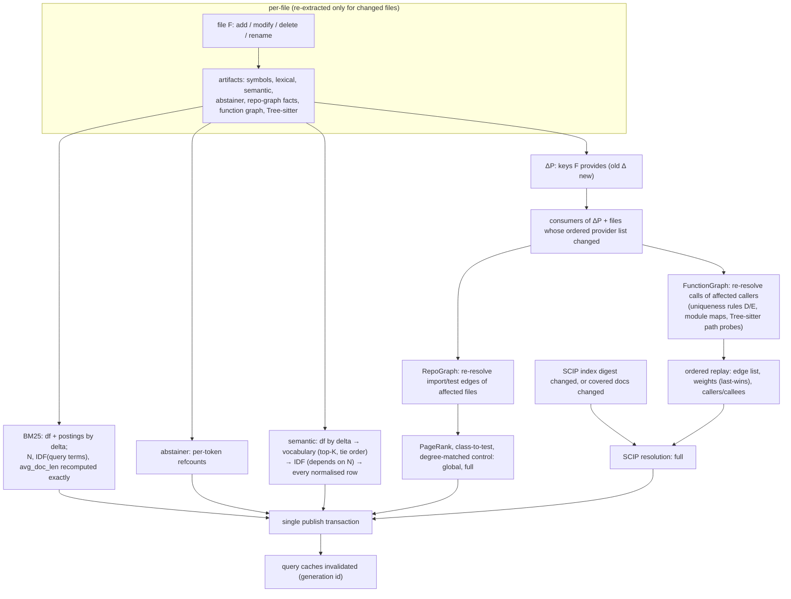

# V2 Milestone 4A: Persistent and Incremental Indexing, Architecture Report

**Branch:** `design/v2-persistent-indexing`, from `main` at `5bc8c53` (includes PR #20).
**Status:** architecture and research only. **No indexer, no persistence code, and no retrieval change** are in this branch. The package version stays 1.2.0.
**Design specification:** [docs/PERSISTENT_INDEXING_DESIGN.md](../../../docs/PERSISTENT_INDEXING_DESIGN.md). This report holds the evidence and a summary of each design area; the specification holds the schema, protocols and API in full.

## 0. Summary

**How it works today.**
- RepoNeedle rebuilds five indexes in memory on every start: BM25, the subword semantic index, the repository graph, the function graph and the abstainer vocabulary.
- `update_documents()` is **not incremental**. It calls `fit()` on every index over every document. It is cheaper than a cold build only because some per-document caches are warm.
- Those caches cannot be persisted: they are keyed on Python's per-process-randomised `hash()`.

**Measured on this repository** (885 files, 8.1 MB):
- A cold build takes **21.6 s**.
- `update_documents()` for **one** modified file takes **8.2 s**. That equals the sum of every stage's global work (7.9 s): semantic vocabulary and matrix 4.3 s, repository graph 2.4 s, function-graph resolution 0.8 s, BM25 0.4 s.
- Persisting per-file artifacts alone therefore bounds a restart at about 2.3× faster than cold (about 2.7× if file contents were loaded lazily). Going further needs genuinely incremental maintenance of global structures.

**Design decisions:**
- **Storage:** SQLite through the standard library.
- **Artifacts:** per-file, content-addressed, immutable, with no raw source stored.
- **Publishing:** a single publish transaction is the only way an index becomes valid.
- **Invalidation:** a provider/consumer key index scopes graph re-resolution.
- **Reassembly:** canonical replay in discovery order.
- **Correctness:** exact equivalence with a fresh build is the acceptance criterion, checked by a differential harness with mutation, crash and corruption tests.
- **API:** opt-in through `IndexCacheConfig`.

**Audit findings that block a naive design** (§4, each demonstrated by `audit_update_documents.py`):
1. Index state depends on document order, and today's update path changes that order.
2. There is no way to remove a document.
3. `FunctionGraphEngine.build_graph()` keeps `module_to_path` and `package_to_files` entries across builds, which yields call edges to files no longer in the build.
4. The cache keys are process-randomised.

**Privacy.** Derived artifacts encode to about **1.3× the source size** and reproduce much of its vocabulary. The cache must be treated as sensitive as the source.

## 1. Scope and method

**Read in full:**
- `reponeedle/engine.py`;
- `reponeedle/core/lexical.py`, `semantic.py`, `tokenizer.py`, `graph.py`, `function_graph.py`, `abstention.py`, `scip_ingestion.py` (resolution path), `tree_sitter_extraction.py` (`ImportResolver`), `packer.py` (content use);
- `reponeedle/models.py`;
- the MCP server start-up path;
- the indexing, diagnostics, security, junction, SCIP and update tests.

**Measurement scripts** (in this directory; all are read-only with respect to RepoNeedle's behaviour):

| Script | Measures | Output |
| :--- | :--- | :--- |
| `profile_current.py` | Stage-by-stage timing of the current pipeline (cold, and warm "global work only") on this repository and on synthetic 1,000 and 3,000-file repositories | `profile_results.json` |
| `artifact_size_estimate.py` | Per-file artifact counts and encoded sizes, plus a 100,000-file projection | `artifact_sizes.json` |
| `audit_update_documents.py` | Today's update path against a fresh build: order, removal, stale function-graph state, `hash()` randomisation | `audit_results.json` |

**Environment:** Windows 11, Python 3.11.9, Intel64 Family 6 Model 170, best of 3. Timings on this machine varied by up to about ±30% between runs. Treat them as indicative ratios, not absolute performance.

## 2. Current architecture and lifecycle

| # | Step | Where | Per-document or global |
| ---: | :--- | :--- | :--- |
| 1 | Discovery: `os.walk(followlinks=False)`. Directory links and junctions are pruned; cycles are guarded with `(st_dev, st_ino)`; containment uses `realpath` within the root. | [engine.py#L374-L415](../../../reponeedle/engine.py#L374-L415) | **Global**: the file set, the **order** (filesystem-defined, unsorted) and `max_files` truncation (L485-L490) |
| 2 | Filtering: `DEFAULT_IGNORE_PATTERNS`, the **root** `.gitignore` only (nested ones are ignored), `extra_ignore`, an extension allow-list, `max_file_size_bytes` | [engine.py#L340-L355](../../../reponeedle/engine.py#L340-L355), [L424](../../../reponeedle/engine.py#L424), [L445](../../../reponeedle/engine.py#L445) | Per file, with global inputs (the ignore set) |
| 3 | Reading: UTF-8 with `errors="ignore"`, from the validated canonical path. **No hashing**; contents are kept in `FileDoc.content`. | [engine.py#L449-L453](../../../reponeedle/engine.py#L449-L453) | Per file |
| 4 | Lexical: field-weighted term counts per document (cached on `hash()`), then df, IDF, average length, length norms and postings over all documents | [lexical.py#L54-L129](../../../reponeedle/core/lexical.py#L54-L129) | Counts per file; **everything else global** (N, df, `avg_doc_len`) |
| 5 | Semantic: words plus character 3-5-grams of `path + symbols + content[:8000]` (cached), then df, **top 15,000 by (df, len) with insertion-order ties**, IDF (depends on N), and an L2-normalised float32 CSR matrix | [semantic.py#L59-L139](../../../reponeedle/core/semantic.py#L59-L139) | Counts per file; **vocabulary, IDF and every matrix row global** |
| 6 | Repository graph: global symbol, module, package and manifest maps (last/first-wins); import edges (rules A-H); test↔target maps by stem; class-to-test invocation linkage (re-parses Python with `ast`); degree-matched control with a seeded RNG over sorted sets; PageRank | [graph.py#L302-L549](../../../reponeedle/core/graph.py#L302-L549), [L613-L860](../../../reponeedle/core/graph.py#L613-L860) | Facts per file; **resolution, linkage and PageRank global**; **no per-document cache** |
| 7 | Function graph: functions, call sites and imports per document (Python `ast`, polyglot regex, or Tree-sitter; cached on `hash()`); resolution through `module_to_path`, `class_to_methods` and **globally unique names**; edge weights are **last-writer-wins** | [function_graph.py#L375-L584](../../../reponeedle/core/function_graph.py#L375-L584) | Extraction per file; **resolution global** |
| 8 | SCIP and Tree-sitter: Tree-sitter `ImportResolver` over the path set, `go.mod` and `Cargo.toml` ([L719-L757](../../../reponeedle/core/function_graph.py#L719-L757)); SCIP resolution over all documents and their contents ([L590-L635](../../../reponeedle/core/function_graph.py#L590-L635)) | as noted | **Global** |
| 9 | Retrieval: lexical and semantic scores; the ranker (legacy, bm25, arm101, cascade or change_impact) consumes the graphs; abstention; CUD-Pack **renders `FileDoc.content`** | [engine.py#L560-L875](../../../reponeedle/engine.py#L560-L875), [packer.py#L470](../../../reponeedle/core/packer.py#L470) | Query-time; the semantic query-vector cache depends on the vocabulary |
| 10 | `update_document(s)`: replace by path in `path_to_doc`, then `fit()` / `build_graph()` **every** index over **every** document | [engine.py#L243-L272](../../../reponeedle/engine.py#L243-L272) | **Full refit**; there is no removal |

The full classification of each structure is in the design, §3.

## 3. Measurements

### 3.1 Stage profile (`profile_results.json`)

| Stage (seconds, best of 3) | This repository (884 files, 8.1 MB) | Synthetic 1,000 files (0.9 MB) | Synthetic 3,000 files (2.7 MB) |
| :--- | ---: | ---: | ---: |
| Scan, read and per-file symbol extraction | 1.46 | 0.72 | 2.33 |
| `lexical.fit`: cold / warm refit (global only) | 2.53 / 0.41 | 0.63 / 0.05 | 2.00 / 0.18 |
| `semantic.fit`: cold / warm | 12.61 / 4.35 | 2.08 / 0.52 | 6.65 / 1.32 |
| `repo_graph.fit`: cold / warm | 2.44 / 2.35 | 0.20 / 0.21 | 0.48 / 0.54 |
| `function_graph.build_graph`: cold / warm | 4.40 / 0.78 | 0.67 / 0.22 | 3.35 / 1.78 |
| `abstainer.fit`: cold / warm | 1.35 / 0.01 | 0.74 / 0.01 | 2.30 / 0.02 |
| **`from_directory` total (cold)** | **21.57** | **4.80** | **17.02** |
| **`update_documents`, one modified file** | **8.21** | **0.96** | **3.98** |

**Readings:**
- **The semantic index dominates a cold build** (58% here).
- **"Warm refit" is the cost of a stage's global work** with every per-document cache hot. Its sum matches `update_documents()` (7.9 s vs 8.2 s here), confirming that the update path is a full global refit.
- **The repository graph has no per-document cache.** Its class-to-test step re-parses every Python production file on each fit.
- **Upper bound for "persist artifacts, recompute globals" (Stage 1):** a restart costs about scan and read + warm refits, roughly 9.4 s against 21.6 s, so about 2.3× on this repository. Stage 1 still reads every file, because packing needs the text (design §8.4). Without reading (lazy content, a later stage) it is about 7.9 s, or 2.7×. Larger gains need Stage 2+ incremental global maintenance.

### 3.2 Artifact sizes (`artifact_sizes.json`)

Encodings: canonical JSON with zlib, and dictionary-coded varint pairs with zlib plus a shared string table.

| | This repository (885 files) | Synthetic 3,000 files |
| :--- | ---: | ---: |
| Source bytes | 8.09 MB | 2.69 MB |
| Mean per file: lexical terms / semantic features / vocabulary / functions / call sites | 340 / 3,044 / 183 / 2.6 / 27 | 40 / 266 / 28 / 12 / 12 |
| Mean encoded bytes per file (dictionary-coded): lexical / semantic / abstainer / function graph | 962 / 7,934 / 418 / 389 | 115 / 660 / 74 / 226 |
| Total encoded (dictionary-coded plus string table) | **10.3 MB** (≈1.27× source) | 4.6 MB (≈1.7× source) |
| Linear projection to 100,000 files | ≈ 0.97 GB | ≈ 0.11 GB |

**Readings:**
- Semantic n-gram counts are about 80% of the artifact volume. The design keeps the alternative of storing word counts and regenerating n-grams exactly (design §6, §16).
- The 2 GiB per-repository default (design §12) covers about 200,000 files of this repository's profile, before SQLite overhead (an estimated 20-40%; to be measured in Stage 1).

## 4. Audit findings (`audit_results.json`)

| # | Finding | Evidence | Consequence for persistence |
| ---: | :--- | :--- | :--- |
| F1 | **Index state depends on document order**, and `update_documents()` changes it: a new file is appended, while a fresh build puts it at its discovery position | Scenario B: `doc_order` and `semantic.vocabulary_order` differ from a fresh build. Rankings were equal in this small case; vocabulary *membership* can differ when features tie at the 15,000 cutoff. | Equivalence must be defined for the current discovery order, and global state must be **replayed in that order** (design §9.4) |
| F2 | Modifying a file in place gives state identical to a fresh build | Scenario A: no differences | Expected: the update path is a full refit |
| F3 | **No removal API**: deletions and renames are impossible without a rebuild | Scenario C | Stage 0 adds a removal path |
| F4 | `FunctionGraphEngine.build_graph()` does not clear `module_to_path` or `package_to_files`; entries for files no longer present survive, and resolution step C then produces **edges to files that are not in the build** | Scenario D: stale keys `app.zeta` and `zeta`; edges `app/alpha.py → app/zeta.py` and `tests/test_zeta.py → app/zeta.py`; edges differ from a fresh instance | Latent today, because the engine never shrinks its document set. It would corrupt any deletion-aware design. **Stage 0 fix.** |
| F5 | Per-document caches key on `hash(content)`, randomised per process | Scenario E: 3 distinct values in 3 processes | Cannot be persisted; replace with SHA-256 (Stage 0) |
| F6 | Several structures are **insertion-order-sensitive**: `module_to_path` (last-wins, with first-wins short names), `graph.add_edge(weight=…)` (last-wins), semantic tie order, NetworkX insertion order before PageRank, the degree-matched RNG stream | Code: [function_graph.py#L395-L399](../../../reponeedle/core/function_graph.py#L395-L399), [L576](../../../reponeedle/core/function_graph.py#L576); [semantic.py#L94-L100](../../../reponeedle/core/semantic.py#L94-L100); [graph.py#L849-L860](../../../reponeedle/core/graph.py#L849-L860) | Global state is rebuilt by ordered replay, never by unordered merging |
| F7 | **Global uniqueness rules**: a call resolves to a "globally unique" function or method name | [function_graph.py#L519-L552](../../../reponeedle/core/function_graph.py#L519-L552) | A new duplicate name anywhere removes edges everywhere; single-file rebuilds are insufficient (design §9.2) |
| F8 | CUD-Pack and SCIP read source text at query/fit time | [packer.py#L470](../../../reponeedle/core/packer.py#L470), [scip_ingestion.py#L616](../../../reponeedle/core/scip_ingestion.py#L616) | Not storing source requires reading files on demand with digest verification (design §8.4) |
| F9 | Only the root `.gitignore` is honoured; `max_files` truncates in filesystem order | [engine.py#L344](../../../reponeedle/engine.py#L344), [L485](../../../reponeedle/engine.py#L485) | Discovery inputs belong in the discovery fingerprint; changing these behaviours is out of scope (design §16) |
| F10 | The existing `test_incremental_indexing_bit_identical_consistency` covers only an in-place modification | [tests/test_v1_1_change_impact_integration.py#L204](../../../tests/test_v1_1_change_impact_integration.py#L204) | Its name overstates the guarantee; the Stage 0 harness covers add, delete, rename and reorder |

## 5. Proposed SQLite schema (summary)

The full DDL is in design §6.

| Table | Purpose | Written |
| :--- | :--- | :--- |
| `meta` | Root, ids, fingerprints, `current_generation`, clean-shutdown flag | Publish transaction |
| `generations` | Build/update attempts (`building` → `published` / `superseded` / `abandoned`), kind, work counters | Start marker, then publish |
| `strings` | Shared string table for payload encoding | Batches (append-only) |
| `manifest` | Published file set: path, **discovery ordinal**, size, `mtime_ns`, inode, `content_sha256`, `text_sha256`, language, `is_test`, counts | Publish only |
| `excluded` | Discovery exclusions (path and reason, never contents) | Publish only |
| `artifacts` | Immutable per-file artifacts keyed by `sha256(kind, extractor_fp, path, text_sha256, inputs)` | Batches (`INSERT OR IGNORE`) |
| `file_artifacts` | Which artifacts the published manifest uses | Publish only |
| `provides` / `consumes` | Dependency index: lookup keys each file provides or consumes, with emission order | Publish only |
| `global_state` | df tables, vocabulary, IDF, ordered edge lists, PageRank, refcounts, SCIP resolution, each with a checksum | Publish only |
| `optional_components` | Tree-sitter runtime, grammar and ABI; SCIP index digest; availability | Publish only |

**Not stored:** source text, queries, results, or anything outside the root.

## 6. Incremental invalidation (dependency diagram)



**What each stage recomputes.**
- **Incremental by delta:** BM25 df and postings, and abstainer refcounts.
- **Scoped by keys:** graph re-resolution.
- **Global and full:** PageRank, the degree-matched control graph, SCIP resolution, and (until Stage 3 proves an exact incremental method) the semantic vocabulary, IDF and normalisation.

**Reporting rule.** Diagnostics report each stage as incremental or "global, full". A stage that ran in full is never presented as incremental.

## 7. Transactions and crash recovery (summary)

The full protocol is in design §10.

- **Write order:** artifacts are written first, in batches. Being immutable and content-addressed, a crash leaves only unreferenced rows.
- **Publish:** the manifest, dependency index, global state, generation state and `current_generation` are replaced in **one** `BEGIN IMMEDIATE … COMMIT`, with `synchronous=FULL`.
- **Acceptance:** an index is accepted only from a published generation whose fingerprints and checksums verify. A crash before COMMIT leaves the previous published generation intact.
- **Corruption** (open errors, wrong application id or schema, root mismatch, checksum or payload failure, or `quick_check` failing after an unclean shutdown): the file is moved aside and a cold build runs. It is never salvaged partially.
- **Concurrency:** WAL readers; serialised writers (`BEGIN IMMEDIATE` and `busy_timeout`) that recompute their change set after acquiring the lock. Persistence is disabled on network filesystems.
- **Migrations:** `user_version`; in-place minor migrations; a new file per schema major.

## 8. Configuration fingerprint strategy (summary)

The full lists are in design §7.

- **`extractor_fp[kind]`**: a per-kind version constant plus that extractor's parameters, and the Python minor version and Tree-sitter versions where relevant. Changing it re-extracts **only that kind**.
- **`index_fingerprint`**: global assembly parameters (`max_features`, PageRank, confidence thresholds, SCIP configuration, schema).
- **`discovery_fingerprint`**: ignore inputs (including the root `.gitignore` digest), the extension list, size and file limits, and case-sensitivity. A change yields an ordinary file-set diff, not wholesale invalidation.
- **Excluded:** query-time settings (budgets, ranker, router, abstention, `focus_span_strategy`).
- **Guard:** a test fails when an extractor's source changes without a version-constant bump.

## 9. Security and privacy model (summary)

The full model is in design §11.

- **The cache is untrusted input:** everything read back is validated, and there is no pickle or `eval`.
- **Paths:** cached paths are syntax-checked and never opened directly. Files are reopened from the current root with the same `resolve_within_root` and link rules as discovery, and links are re-evaluated on every scan.
- **Permissions:** POSIX `0700` directories and `0600` files; group- or world-writable directories are refused. Windows uses the per-user `%LOCALAPPDATA%`.
- **Sensitivity:** artifacts are about 1.3× the source size and contain identifiers, n-grams and any secrets present in code. The cache is opt-in, local, per user, outside the repository, clearable, and never logged. Excluded files are never read, so never cached.

## 10. Benchmark methodology

**Correctness first.** Every benchmark's final state must pass the equivalence checks of design §14.2 before its timings are reported. Correctness and performance are reported in separate tables.

**Workloads:**
1. This repository and two or three public repositories of different shapes (Python-heavy, TypeScript/Go-heavy, monorepo), pinned to commits.
2. A deterministic synthetic generator, extending `profile_current.write_synthetic_repo`, at 10k, 30k and **100k** files. It has realistic size distributions (median about 4 KB, long tail to 200 KB), package fan-out, cross-file imports and calls, duplicate function names at a controlled rate (to exercise uniqueness rules), tests that mirror sources, `go.mod`/`Cargo.toml`/`package.json` manifests, and `max_files` raised above the file count.
3. Mutation scripts for each scenario:

| Scenario | Mutation |
| :--- | :--- |
| One modified file | body-only edit; symbol-adding edit; new duplicate definition |
| Multiple modified files | 1% and 10% of files |
| Additions and deletions | 1% added and 1% deleted |
| Renames | a directory rename |
| Ignore change | `.gitignore` edit |
| Configuration change | `max_features` change |
| Optional components | Tree-sitter availability toggle; SCIP index replacement |

**Scenarios (design §14.5):**
1. Cold build.
2. Restart with an unchanged repository (`validation="stat"` and `"content"`).
3. One modified file.
4. Multiple modified files.
5. Added and deleted files.
6. 100k synthetic.
7. Corruption and full rebuild.

**Metrics:**
- wall time per phase (scan, hash, extract, write, publish, assemble);
- peak RSS (process high-water mark per run in a fresh process) and tracemalloc retained bytes;
- database bytes (main plus WAL) and rows per table;
- the work counters of design §14.4.

**Procedure:**
- One fresh process per measurement, with OS file-cache state recorded (warm and, where possible, cold).
- Median of at least 5 runs, with min and max reported.
- Machine, OS, Python and package versions recorded.
- Baseline: today's `from_directory` and `update_documents` on the same workload in the same session, interleaved to limit drift.

**Claims rule:** a stage is called incremental only where its counters scale with the change (design §14.4). Speedups from per-file reuse alone are reported as "persistent".

## 11. Risks, alternatives and unresolved questions

| Risk | Mitigation |
| :--- | :--- |
| Exact equivalence is hard for float32 global structures (semantic, BM25 norms) | Stage 1 reuses the existing code paths, so it is exact by construction. Incremental numeric shortcuts ship only if proven bit-identical; otherwise they stay global and are labelled so. |
| A forgotten extractor version bump serves stale artifacts | Source-digest guard test, plus the differential harness |
| Order sensitivity on different filesystems | Equivalence is defined for the current scan order; deterministic ordering is an open question (§16.1 of the design) |
| Database size for very large repositories (about 1 GB per 100k files of this profile) | Word-count semantic artifacts; `max_db_bytes` with persistence skipped (never truncated); GC and incremental vacuum |
| Users treating the cache as non-sensitive | Opt-in; documentation; per-user location and permissions; `cache clear` |
| SQLite on network filesystems | Detection, then disabled by default |
| Concurrent MCP servers on one repository | WAL readers; serialised writers that recompute against the latest generation |
| The ≈2.3× restart bound of Stage 1 may disappoint | Measured and stated up front; Stages 2-3 target global work |

**Alternatives considered.**
- *Other stores:* NumPy/`npz` files, pickle, LMDB/RocksDB, DuckDB and Parquet; the rejection reasons are in design §4.
- *Git-based change detection:* using Git's index or `git status`. Rejected as the primary mechanism, because not every repository is a Git checkout and ignored or untracked files matter to discovery. It remains a possible accelerator for `"stat"` validation.
- *A file watcher:* out of scope by requirement.

**Unresolved questions.** These are in design §16:
- deterministic discovery order;
- lazy content;
- the semantic artifact form;
- SCIP per-document reuse;
- secret-file exclusion;
- nested `.gitignore` files;
- `update_documents()` semantics with persistence;
- portability of shared caches.

## 12. Staged implementation plan

| Stage | Scope | Exit criteria |
| :--- | :--- | :--- |
| 0 | Fix F4 (clear function-graph maps); add document removal (F3); SHA-256 cache keys (F5); the equivalence harness and query set in CI, run against today's update path (F1, F10) | Defaults byte-identical to `main`; harness green |
| 1 | `IndexCacheConfig`; schema; per-file artifacts; manifest; fingerprints; publish protocol; validation modes; corruption handling; GC. **Global structures recomputed in full** with existing code paths. | Exact equivalence; restart speedup reported as **persistent, not incremental** |
| 2 | Incremental BM25 and abstainer; provider/consumer keys; scoped re-resolution of RepoGraph and FunctionGraph edges with ordered replay; PageRank in full | Equivalence under mutation sequences; proportional work counters |
| 3 | Semantic df by delta; exact vocabulary maintenance; vectorised IDF/norms only if bit-identical | Equivalence, or an explicit decision to keep the semantic index global |
| 4 | Tree-sitter and SCIP artifact handling; CLI/MCP flags; cache management commands; lazy content if approved | Equivalence including optional extras |

## 13. Reproducing

These require only core dependencies:

```bash
python reports/v2_completion/persistent_indexing/profile_current.py --out profile_results.json
python reports/v2_completion/persistent_indexing/artifact_size_estimate.py --out artifact_sizes.json
python reports/v2_completion/persistent_indexing/audit_update_documents.py --out audit_results.json
```
