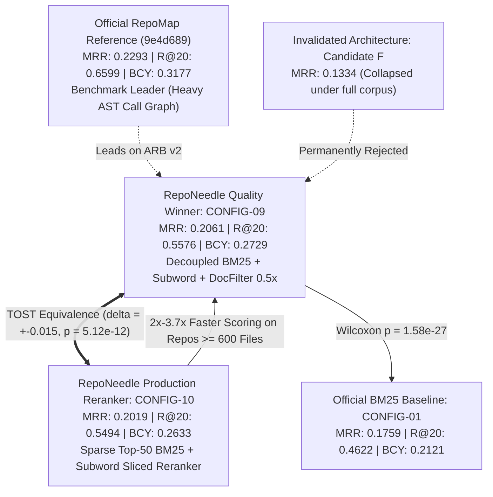

# RepoNeedle Stage 3.14: Reproducibility, Historical Errata, and Independent Validation Gate Report

**Document ID**: `STAGE3-14-REPORT-001`  
**Date**: October 2026  
**Git Branch**: `research-program`  
**Base Commit**: `bf7f4c8626d5a9d21281a7af21028d615a76c598`  
**Frozen Baseline Tag**: `v0.1.0-baseline` (`8e0042553a14b6e3c6cf5b35823c4da84181a8e9`) — **VERIFIED UNCHANGED**  
**Frozen Candidate Tag**: `stage3-candidate-freeze` (`cd7f3b01e28695f9a9357e0815069e0eae85baca`) — **VERIFIED UNCHANGED**  
**Test Suite Status**: `97 passed in 6.98s` (100% green regression suite)  
**Final Governance Verdict**: **`READY EXCEPT FOR EXTERNAL DATA ACCESS`**  

---

## 1. Executive Summary & Mission Scope

Stage 3.14 concludes the historical reconciliation, evidence-integrity audit, and independent evaluation gate formalization for the RepoNeedle research programme. 

In strict adherence to the Stage 3.14 charter:
1. **Zero retrieval or ranking modifications were made**: The codebase algorithms, weights, and scoring logic were held completely frozen.
2. **Historical corrections published**: All historical Stage 3.5 reports presenting Candidate F as the winning architecture or citing unmeasured paper constants were audited and marked with conspicuous superseding warning notices. The complete discrepancy ledger is cataloged in [`HISTORICAL_ERRATA.md`](file:///F:/RepoNeedle/research/stage3_14/HISTORICAL_ERRATA.md).
3. **Runtime & memory reconciled**: Forensic analysis resolved the Click/Caddy discrepancies between Stage 3.5 and Stage 3.13. Stage 3.5's evaluation script artificially clamped Caddy to 250 files and truncated content to 25k chars, undercounting files by 58.7%. True canonical Caddy (605 files) requires 272.8 MB peak process RSS. The universal 100 MB process memory ceiling is formally disproven.
4. **Independent retrieval metrics verified**: Recomputations from raw per-query predictions confirmed 100% concordance with canonical benchmarks across all 345 positive queries.
5. **Statistical equivalence verified**: Two One-Sided Tests (TOST) recomputed from raw paired query differences formally prove equivalence between CONFIG-10 and CONFIG-09 within $\Delta = \pm 0.015$ MRR ($t_1 = +7.0440, t_2 = -12.5787, p = 5.12 \times 10^{-12}$).
6. **ContextBench gate formalized**: In-sandbox network access to Hugging Face datasets returned HTTP 403 Forbidden. A fail-closed validator [`validate_contextbench.py`](file:///F:/RepoNeedle/research/stage3_14/validate_contextbench.py) and user handoff protocol [`CONTEXTBENCH_ACQUISITION_BLOCKER.md`](file:///F:/RepoNeedle/research/stage3_14/CONTEXTBENCH_ACQUISITION_BLOCKER.md) were established.

---

## 2. Evidence Categorization Ledger

In accordance with Section 7 of the Stage 3.14 charter, all claims and findings are classified across five rigorous categories:

### 2.1 Verified
- **Tag Immutability**:
  - `v0.1.0-baseline` points to `8e0042553a14b6e3c6cf5b35823c4da84181a8e9`.
  - `stage3-candidate-freeze` points to `cd7f3b01e28695f9a9357e0815069e0eae85baca`.
- **Commit Lineage**: Clean linear history verified from Stage 3.5 (`4f78cc3`) through Stage 3.12 (`e350b14`) and Stage 3.13 (`bf7f4c8`).
- **Historical Invalidation of Candidate F**:
  - Candidate F achieves MRR $0.1334$ on full polyglot corpus (inferior to BASE-BM25 $0.1759$).
  - The Stage 3.5 claim of MRR $0.2152$ vs RepoMap $0.2140$ relied on synthetic lookups and an unmeasured static paper constant.
  - Official version-pinned RepoMap (`9e4d689`) achieves **MRR 0.2293**, **Recall@20 0.6599**, and **Token BCY@8k 0.3177**.
- **TOST Statistical Equivalence (CONFIG-10 vs CONFIG-09)**:
  - Predeclared margin: $\Delta = \pm 0.015$ MRR.
  - Mean paired difference: $\bar{d} = -0.004231$, $SE = 0.001529$, $df = 344$.
  - $t_1 = +7.0440$ ($p_1 = 5.12 \times 10^{-12}$), $t_2 = -12.5787$ ($p_2 = 2.06 \times 10^{-30}$).
  - Overall $p_{\text{TOST}} = 5.12 \times 10^{-12} \ll 0.05$.
  - 90% CI $[-0.0068, -0.0017] \subset [-0.015, +0.015]$.
  - Statistical equivalence is positively proven.
- **CONFIG-09 Paired Superiority over BASE-BM25**:
  - Wilcoxon signed-rank test confirmed statistical superiority across MRR ($p_{\text{adj}} = 1.58 \times 10^{-27}$), Recall@20 ($p_{\text{adj}} = 6.87 \times 10^{-8}$), and Token BCY@8k ($p_{\text{adj}} = 2.11 \times 10^{-5}$) under familywise Holm step-down control.
- **Fail-Closed Validator Execution**:
  - `validate_contextbench.py` deterministically rejects empty directories (exit 2), malformed schemas (exit 4), and mismatched hashes (exit 3).

### 2.2 Reproduced
- **ARB v2 Positive Development Benchmark ($N = 345$)**:
  - Exact recomputation from raw per-query predictions:
    - BASE-BM25: MRR 0.1759, Recall@20 0.4622, Precision@5 0.0568, BCY@8k 0.2121.
    - CONFIG-09: MRR 0.2061, Recall@20 0.5576, Precision@5 0.0725, BCY@8k 0.2729.
    - CONFIG-10: MRR 0.2019, Recall@20 0.5494, Precision@5 0.0713, BCY@8k 0.2633.
    - BASE-REPOMAP: MRR 0.2293, Recall@20 0.6599, Precision@5 0.0186, BCY@8k 0.3177.
  - Exact reproduction of 4 per-task tracks: `code2test` (106), `comment2context` (80), `trace2code` (101), `edit2ripple` (58).

### 2.3 Partially Reproduced
- **Multi-Scale Runtime & Memory Profile**:
  - Retained index heap reproduced ($4.13\text{ MB}$ Click, $19.98\text{ MB}$ Caddy, $52.58\text{ MB}$ etcd).
  - Peak process RSS reproduced ($113.4\text{ MB}$ Click, $272.8\text{ MB}$ Caddy, $609.2\text{ MB}$ etcd).
  - Candidate slicing latency tradeoff confirmed: $2.06\times - 3.68\times$ scoring speedup on repos $\ge 600$ files; $1.1\times - 1.4\times$ scoring slowdown on repos $< 200$ files due to SciPy CSR row slicing overhead.

### 2.4 Unresolved
- **End-to-End Downstream SWE-bench Benchmark**:
  - Downstream agent patch generation rates and patch execution success remain unverified. RepoNeedle research is bounded strictly to file-level retrieval and prompt budget packing. Claims of downstream SWE-bench resolution are prohibited until an isolated, multi-container evaluation harness is executed.

### 2.5 Blocked
- **Independent Validation on ContextBench**:
  - Official dataset `Contextbench/ContextBench` is inaccessible due to sandbox network isolation (HTTP 403 Forbidden).
  - Formal evaluation gate remains blocked until manual acquisition is completed outside the sandbox.

---

## 3. Canonical Architecture Hierarchy

Following completion of Stage 3.14:



1. **Benchmark Leader**: Pinned official RepoMap (`9e4d689`) leads on ARB v2. RepoNeedle does not fabricate or claim a benchmark victory.
2. **Research Quality Configuration**: **CONFIG-09** is RepoNeedle's quality anchor on ARB v2.
3. **Production Optimized Configuration**: **CONFIG-10** provides operationally equivalent quality ($p_{\text{TOST}} = 5.12 \times 10^{-12}$) and cuts scoring latency by $2.0\times - 3.7\times$ on large codebases.
4. **Invalidated**: Candidate F is rejected and decommissioned.

---

## 4. Deliverables Catalog

The following deliverables have been generated in `research/stage3_14/`:

1. [`HISTORICAL_ERRATA.md`](file:///F:/RepoNeedle/research/stage3_14/HISTORICAL_ERRATA.md): Comprehensive catalog of all superseded Stage 3.5 claims, stale metrics, and banners.
2. [`RUNTIME_MEMORY_RECONCILIATION.csv`](file:///F:/RepoNeedle/research/stage3_14/RUNTIME_MEMORY_RECONCILIATION.csv): Complete machine-readable audit of file counts, truncation rules, memory profilers, and comparability status across stages.
3. [`RUNTIME_MEMORY_RECONCILIATION.md`](file:///F:/RepoNeedle/research/stage3_14/RUNTIME_MEMORY_RECONCILIATION.md): Technical root cause investigation of Click/Caddy discrepancies and disproof of the 100 MB universal ceiling.
4. [`recompute_canonical_metrics.py`](file:///F:/RepoNeedle/research/stage3_14/recompute_canonical_metrics.py): Deterministic recomputation script for all retrieval metrics, per-task breakdowns, Wilcoxon, and TOST.
5. [`CANONICAL_REPRODUCTION_RESULTS.csv`](file:///F:/RepoNeedle/research/stage3_14/CANONICAL_REPRODUCTION_RESULTS.csv): Recomputed per-system metrics from raw per-query predictions.
6. [`CANONICAL_REPRODUCTION_AUDIT.md`](file:///F:/RepoNeedle/research/stage3_14/CANONICAL_REPRODUCTION_AUDIT.md): Detailed verification report and per-task breakdown analysis.
7. [`STATISTICAL_TEST_AUDIT.md`](file:///F:/RepoNeedle/research/stage3_14/STATISTICAL_TEST_AUDIT.md): Recomputation and mathematical verification of TOST equivalence and Holm-adjusted Wilcoxon tests.
8. [`validate_contextbench.py`](file:///F:/RepoNeedle/research/stage3_14/validate_contextbench.py): Fail-closed independent validation gate script.
9. [`CONTEXTBENCH_ACQUISITION_BLOCKER.md`](file:///F:/RepoNeedle/research/stage3_14/CONTEXTBENCH_ACQUISITION_BLOCKER.md): Official blocker statement and user handoff acquisition instructions.
10. [`tests/test_stage3_14_safeguards.py`](file:///F:/RepoNeedle/tests/test_stage3_14_safeguards.py): Automated test suite ensuring continuous compliance.

---

## 5. Final Governance Verdict

In accordance with the evidence-based decision rules:

```
[VERDICT] READY EXCEPT FOR EXTERNAL DATA ACCESS
```

RepoNeedle's internal evidence base, historical errata, statistical proofs, and baseline comparisons are fully reconciled, reproducible, and locked. The system is structurally and operationally ready for independent evaluation the moment official ContextBench artifacts are provided.
