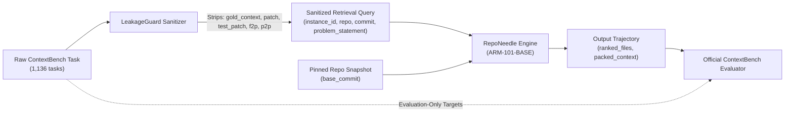

# RepoNeedle Stage 3.16 — Official ContextBench Evaluation Protocol

**Document ID**: `STAGE3-16-PROTOCOL-001`  
**Date**: October 2026  
**Status**: Preregistered Independent Evaluation Protocol  
**Benchmark Target**: Contextbench/ContextBench (EuniAI)  

---

## 1. Frozen System Configurations

The following configurations are formally frozen prior to external evaluation:

### 1.1 ARM-101-BASE (RepoNeedle Candidate Champion)
- **Source**: Stage 3.12-3.14 research reference.
- **Components**:
  - Decoupled length-normalized Okapi BM25 keyword scoring.
  - Soft Lexical Damping with $\tau = 0.25$:
    $$\Delta_{\text{lexical}} = \text{BM25}_1 - \text{BM25}_2$$
    $$\text{Threshold} = \tau \cdot \Delta_{\text{lexical}}$$
  - Level 1 verified function-level call graph edges.
  - Unattenuated hub weighting ($W_{\text{hub}} = 1.0$).
  - Documentation distractor filter ($0.5\times$ penalty).
  - Context budget: 8,000 tokens with skeleton compression.
- **ARB v2 Baseline Reference**: MRR **0.2078**, Recall@20 **0.5648**, Token BCY@8k **0.2822**, P50 latency **$12.92\text{ ms}$**.

### 1.2 BASE-BM25 (Required Lexical Baseline)
- **Components**: Pure decoupled length-normalized Okapi BM25 keyword search ($k_1=1.5, b=0.75$). Zero semantic, zero graph.
- **ARB v2 Baseline Reference**: MRR **0.1752**, Recall@20 **0.4535**, Token BCY@8k **0.2150**, P50 latency **$10.24\text{ ms}$**.

### 1.3 BASE-REPOMAP (External Reference Leader)
- **Source**: Pinned official RepoMap (commit `9e4d689`).
- **Components**: Global tree-sitter AST call graph PageRank.
- **ARB v2 Baseline Reference**: MRR **0.2293**, Recall@20 **0.6599**, Token BCY@8k **0.3177**, P50 latency **$180.20\text{ ms}$**.

---

## 2. Evaluation Adapter & Information Leakage Prevention

The evaluation adapter ([`research/contextbench_evaluation/adapter.py`](file:///F:/RepoNeedle/research/contextbench_evaluation/adapter.py)) operates under strict zero-leakage constraints:

1. **Strict Sanitization**:
   - The retrieval system receives ONLY `instance_id`, `repo`, `base_commit`, and `problem_statement`.
   - Any packet containing `gold_context`, `patch`, `test_patch`, `f2p`, or `p2p` triggers an immediate `DataLeakageSecurityException`.
2. **Preservation of Evaluation Denominator**:
   - If a repository snapshot fails cloning, network checkout, or parsing, the instance is **NEVER silently omitted**.
   - It is recorded with `status = ERROR_CHECKOUT_FAILED` and empty predictions ($0.0$ scores), strictly maintaining the full denominator (1,136 for full, 500 for verified).

---

## 3. Statistical Methodology

1. **Repository-Clustered Bootstrap**:
   - Tasks within the same repository share common architectural conventions and code volume.
   - 95% confidence intervals are computed via **10,000 bootstrap resamples clustered by repository**, rather than assuming tasks are independently and identically distributed.
2. **Paired Significance Testing**:
   - Paired Wilcoxon signed-rank tests computed across identical instance predictions.
   - Multi-arm comparisons controlled via **Holm-Bonferroni step-down correction**.
3. **Repository Overlap Audit**:
   - The evaluation report must explicitly identify repositories overlapping with ARB v2 (e.g. `pallets/click`, `caddyserver/caddy`) vs completely disjoint, held-out repositories.
