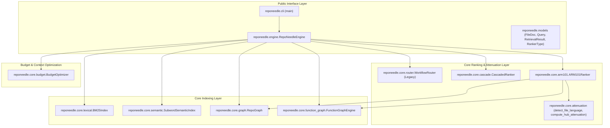

# RepoNeedle Stage 3.20 — Production Architecture Design for ARM-101 Integration

**Document Version:** 1.0  
**Target Package:** `reponeedle`  
**Date:** 2026-10-30  
**Status:** APPROVED FOR IMPLEMENTATION  

---

## 1. Architectural Principles & Non-Negotiable Constraints

To maintain software engineering integrity while migrating experimental research into production:

1. **Zero Research Import Rule:** Code inside `reponeedle/` must never import from `research/`. All necessary algorithms and data structures must be natively implemented within the package.
2. **Explicit Ranker Selection:** The retrieval engine must support explicit ranker selection via configuration:
   - `"legacy"`: Current router-based linear weighted combination (default behavior preserved).
   - `"bm25"`: Pure decoupled Okapi BM25 ranking.
   - `"cascade"`: Hard lexical freeze (`CONTROL-CASCADE`).
   - `"arm101"`: Soft Lexical Damping ($\tau=0.25$) with verified function call graph diffusion.
3. **Preservation of Existing Defaults:** The default ranker in `RepoNeedleEngine.retrieve()` remains `"legacy"` until Stage 3.20 parity certification is complete.
4. **Zero New External Dependencies:** Uses standard library (`ast`, `re`, `math`, `os`), `networkx`, `numpy`, and existing `reponeedle` dependencies. No PyTorch, no HuggingFace downloads, no network calls.
5. **Deterministic Execution:** Strict tie-breaking by file path to guarantee bit-level determinism across platforms.

---

## 2. Production Component Architecture



---

## 3. Module Specifications

### 3.1 `reponeedle/core/attenuation.py`
- **Functions:**
  - `detect_file_language(path: str) -> str`: Identifies file language (`python`, `go`, `rust`, `typescript`, `java`, `unknown`) from file extension.
  - `compute_hub_attenuation(path: str, in_deg: int, out_deg: int, policy: str) -> float`: Computes degree-based hub attenuation factor. Under `"unattenuated"` (ARM-101), returns `1.0`.

### 3.2 `reponeedle/core/function_graph.py`
- **Classes:**
  - `FunctionSymbol`: Metadata for extracted functions, methods, and closures.
  - `CallSite`: Extracted invocation sites with caller context, callee name, and qualifier.
  - `FunctionGraphEdge`: Directed edge between files with confidence and classification (`verified_call`, `unique_global_call`, `intra_file_call`, `directory_local_call`, `structural_method_call`).
  - `FunctionGraphEngine`: AST-based parser for Python, regex extractors for Go, Rust, TS/JS, resolution engine, and networkx directed graph container.

### 3.3 `reponeedle/core/arm101.py`
- **Class `ARM101Ranker`:**
  - `__init__(soft_damping_tau=0.25, policy="unattenuated", forward_weight=0.25, reverse_weight=0.20, graph_weight=0.25, class_to_test_weight=0.35, doc_filter_penalty=0.50)`
  - `rank(docs, bm25_scores, semantic_scores, function_graph, repo_graph) -> List[int]`:
    1. Select top-3 BM25 seeds.
    2. Propagate forward and reverse along verified edges with degree normalization.
    3. Propagate class-to-test and convention test discovery.
    4. Fused scoring with doc filter penalty.
    5. Soft Lexical Damping on Rank #1 with $\tau = 0.25$ hurdle.

### 3.4 `reponeedle/engine.py` Integration
- In `RepoNeedleEngine`:
  - `self.function_graph = FunctionGraphEngine()`
  - In `_fit(self, docs)`: calls `self.function_graph.build_graph(docs)`
  - In `retrieve(self, query, budget_tokens=None, task_type=None, ranker=None)`:
    - If `ranker == "arm101"`: executes `self.arm101_ranker.rank(...)`
    - If `ranker == "bm25"`: sorts by BM25
    - If `ranker == "cascade"`: executes `self.cascaded_ranker.rank(...)`
    - Else: executes legacy linear combination fusion.

### 3.5 `reponeedle/cli.py` Integration
- Add argument:
  ```python
  parser.add_argument(
      "--ranker",
      type=str,
      default="legacy",
      choices=["legacy", "bm25", "arm101", "cascade"],
      help="Context ranking algorithm (default: legacy).",
  )
  ```
