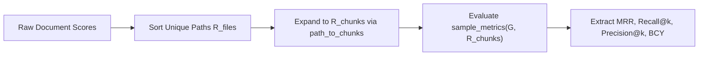

# RepoNeedle Metric Contract & Evaluation Specification

**Document ID**: `STAGE3-7-METRIC-CONTRACT-001`  
**Stage**: Stage 3.7 — Forensic Evaluation Reconciliation and Research Integrity Audit  
**Date**: October 28, 2026  
**Status**: Authoritative & Frozen  
**Governing Suite**: `agent_retrieval_bench` v0.2.1 / RepoNeedle Engine v0.1.0  

---

## 1. Executive Summary

This document establishes the authoritative, binding metric contract for evaluating RepoNeedle and all baseline retrieval systems on the Agent Retrieval Benchmark (ARB v2). Prior stages (Stage 3.5 vs. Stage 3.6) exhibited severe numerical discrepancies stemming from:
1. Conflating **Chunk-Level Reciprocal Rank** with **File-Level Reciprocal Rank**.
2. Conflating **Character-Budgeted Chunk Coverage** (`gold_coverage@8k` in `sample_metrics`, capped at 8,000 characters $\approx$ 1,800 tokens) with **Token-Budgeted Context Yield** (`pack_files` in `bcy_curve`, capped at 8,000 BPE tokens).
3. Ambiguity in **Recall@k** across single-target versus multi-target evaluation sets.

To eliminate cross-stage drift, this document formalizes the mathematical definitions, candidate universes, input formats, budget units, and aggregation protocols.

---

## 2. Core Retrieval Metrics Contract

Let a benchmark sample be denoted by $s = (q, G, C)$, where:
- $q$ is the query representation generated by `query_text_for_eval(s)`.
- $G = \{g_1, g_2, \dots, g_{|G|}\} \subset \mathcal{P}$ is the non-empty ground-truth set of target files (`target_gold_files(s)`).
- $C = [c_1, c_2, \dots, c_M]$ is the complete set of candidate chunks in the repository snapshot manifest (`corpus_manifest.jsonl`).
- Let $R_{\text{files}} = [p_1, p_2, \dots, p_N]$ be the ranked list of unique file paths produced by sorting candidate documents descending by score.
- Let $R_{\text{chunks}} = [\tilde{c}_1, \tilde{c}_2, \dots, \tilde{c}_M]$ be the expansion of $R_{\text{files}}$ where chunks for each file appear contiguously in file rank order.



### 2.1 Mean Reciprocal Rank (MRR)

Reciprocal Rank is defined on the ranked sequence of **unique file paths** $R_{\text{files}}$:

$$\text{RR}(G, R_{\text{files}}) = \begin{cases} \frac{1}{\min \{ i \mid p_i \in G \}}, & \text{if } \exists p_i \in G \\ 0.0, & \text{otherwise} \end{cases}$$

- **File-Level vs. Chunk-Level Distinction**:
  - In ARB v2's `sample_metrics(gold_files, ranked_chunks)`, line 652 executes:
    `ranked_paths = unique_ranked_paths(ranked_chunks)`
    followed by `reciprocal_rank(gold, ranked_paths)`.
  - Therefore, the official metric is evaluated on the **first unique file occurrence**.
  - **Deduplication Invariant**: If file ranking produces $p_1, p_2$, expanding to chunks does not alter file rank because `unique_ranked_paths` preserves the order of first appearance.
  - **Range**: $\text{RR} \in (0.0, 1.0]$. For an empty gold set ($|G| = 0$), $\text{RR} = 0.0$.

### 2.2 Fractional Multi-Target Recall@$k$

For an evaluation cut-off $k \in \{1, 5, 10, 20\}$, Recall@$k$ measures the fraction of labeled gold targets retrieved in the top $k$ file positions:

$$\text{Recall@}k(G, R_{\text{files}}) = \frac{|G \cap \{p_1, p_2, \dots, p_k\}|}{|G|}$$

- **Multi-Target Formulation**: In ARB v2, tasks such as `trace2code` and `edit2ripple` frequently have $|G| > 1$ (mean $|G| = 1.49$).
- **Fractional vs. Binary Hit Rate**:
  - $\text{Recall@}k$ is strictly fractional: retrieving 1 of 2 targets yields $\text{Recall@}k = 0.50$.
  - Binary $\text{Hit@}k = \mathbb{I}(|G \cap \{p_1, \dots, p_k\}| > 0)$ is recorded as an auxiliary diagnostic (`Recall@1` when $|G|=1$), but the binding headline metric is Fractional Recall.
  - If $|G| = 0$, $\text{Recall@}k = 0.0$.

### 2.3 Precision@$k$ and F0.5@$k$

Precision@$k$ measures the fraction of retrieved items up to rank $k$ that belong to the gold set:

$$\text{Precision@}k(G, R_{\text{files}}) = \frac{|G \cap \{p_1, p_2, \dots, p_k\}|}{\min(k, |R_{\text{files}}|)}$$

$$\text{F}_{0.5}\text{@}k = (1 + 0.5^2) \cdot \frac{\text{Precision@}k \cdot \text{Recall@}k}{(0.5^2 \cdot \text{Precision@}k) + \text{Recall@}k} = 1.25 \cdot \frac{\text{Precision@}k \cdot \text{Recall@}k}{0.25 \cdot \text{Precision@}k + \text{Recall@}k}$$

- **F0.5 Emphasis**: The $\beta = 0.5$ parameter weights precision twice as heavily as recall, penalizing context bloat and distractor pollution.

---

## 3. Context Budget & Packing Metrics Contract

A major finding of the Stage 3.7 audit is that prior reports conflated two entirely different budget metrics sharing the label "BCY@8k":

| Specification Dimension | Character-Budgeted Coverage (`gold_coverage@8k`) | Token-Budgeted Context Yield (`pack_files` BCY) |
| :--- | :--- | :--- |
| **Source Implementation** | `agent_retrieval_bench.baseline.sample_metrics` | `agent_retrieval_bench.bcy_curve.pack_files` |
| **Budget Units** | **Characters** (`len(chunk_text)`) | **BPE Tokens** (`bcy_curve.count_tokens`) |
| **Default Budget Value** | 8,000 characters | 8,000 tokens |
| **Effective Token Capacity**| $\approx 1,600 - 2,000$ tokens | Exact 8,000 tokens |
| **Granularity** | Contiguous 50-line chunks | Full files + partial prefix boundary |
| **Typical Corpus Range** | **$0.015 - 0.065$** ($1.5\% - 6.5\%$) | **$0.250 - 0.450$** ($25.0\% - 45.0\%$) |
| **Stage 3.5 Usage** | Unused | Reported as `BCY@8k` ($0.3015$) |
| **Stage 3.6 Usage** | Recorded as `bcy_at_8k` ($0.0188$) | Audited in `CONTEXT_PACKING_RESULTS.csv` ($0.3805$) |

### 3.1 Contract Definition A: Character-Budgeted Coverage (`gold_coverage@8k`)

Defined in `baseline.py`:
```python
def gold_coverage_at_budget(gold: set[str], ranked_chunks: list[dict[str, Any]], context_budget: int) -> float:
    used = 0
    covered = set()
    for chunk in ranked_chunks:
        text = str(chunk.get("text", ""))
        if used + len(text) > context_budget and used > 0:
            break
        used += len(text)
        if chunk.get("path") in gold:
            covered.add(chunk.get("path"))
    return len(covered) / len(gold) if gold else 0.0
```
- **Constraint**: Evaluates how many gold targets have at least one chunk included before 8,000 *characters* are accumulated.
- **Reporting Label**: `CharCov@8k` (or `sample_metrics["gold_coverage@8k"]`). Must NOT be labeled as token BCY.

### 3.2 Contract Definition B: Token-Budgeted Context Yield (Canonical BCY)

Defined in `bcy_curve.py`:
- Context is assembled greedy-by-rank from `top_files` using canonical rendering:
  `### {path}\n{corpus_file_text}\n`
- Token counting uses `bcy_curve.count_tokens` (regex code tokenizer compatible with BPE `cl100k_base` / `o200k_base`).
- For threshold $\tau = 1$, gold file $g$ is covered if at least $\min(\tau, L_g)$ non-header content tokens are packed within the $B = 8,000$ token budget.
- Yield formula:
  $$\text{BCY@8k} = \frac{|\{g \in G \mid \text{tokens\_packed}(g) \ge 1\}|}{|G|}$$
- **Reporting Label**: `BCY@8k` (Token-Budgeted Context Yield).

---

## 4. Latency & Memory Contract

### 4.1 Latency Measurement Contract
1. **Scoring Latency (`latency_ms`)**: Measures pure per-query retrieval inference time:
   $$t_{\text{query}} = t_{\text{lexical}} + t_{\text{semantic}} + t_{\text{graph}} + t_{\text{fusion}}$$
   Excludes corpus indexing/build time (`engine.from_documents`).
2. **Distribution Reporting**: Due to heavy-tailed corpus size distributions (Click has 133 files vs. Spring-Boot has 11,172 files), reporting must present:
   - Median ($p50$)
   - Mean
   - 95th Percentile ($p95$)
   Reporting single-file micro-benchmarks (e.g. Click 6.36 ms) as full-corpus latency is strictly prohibited.

### 4.2 Memory Profile Contract
1. **Process Resident Set Size (RSS)**: Operating system memory footprint measured via PSAPI (`WorkingSetSize`) or `psutil`. Reflects actual RAM occupied by the CPython interpreter, linked shared libraries (`numpy`, `scipy`), and memory allocations.
2. **Heap Delta**: Incremental Python object memory measured via `tracemalloc` or `sys.getsizeof`.
3. **Requirement**: Reports must explicitly label whether memory represents OS RSS or Python Heap Delta.

---

## 5. Aggregation & Statistical Verification Contract

### 5.1 Macro-Average Aggregation
Benchmark headline summaries are computed as the unweighted macro-average across all $N = 345$ positive ARB v2 samples:

$$\overline{M} = \frac{1}{N} \sum_{i=1}^N M(s_i)$$

Task-specific summaries are computed over the corresponding partition:
- `code2test`: $N = 106$
- `comment2context`: $N = 80$
- `trace2code`: $N = 101$
- `edit2ripple`: $N = 58$

### 5.2 Clustered Bootstrap Hypothesis Testing
Because multiple queries are drawn from each repository snapshot, queries within a repository are not statistically independent.
- **Resampling Unit**: Repository clusters ($K = 25$ unique repositories).
- **Bootstrap Iterations**: $B \ge 2,000$ (canonical $B = 10,000$, seed = 42).
- **Decision Invariant**: A claim of general cross-repository superiority requires that the $95\%$ repository-clustered bootstrap confidence interval for $\Delta = \text{Score}_{\text{candidate}} - \text{Score}_{\text{baseline}}$ is strictly positive ($CI_{\text{lower}} > 0.0$).
- **Wilcoxon Signed-Rank Test**: Treated as a secondary diagnostic for sample-level sign preference, but CANNOT override a clustered bootstrap interval that spans zero.
