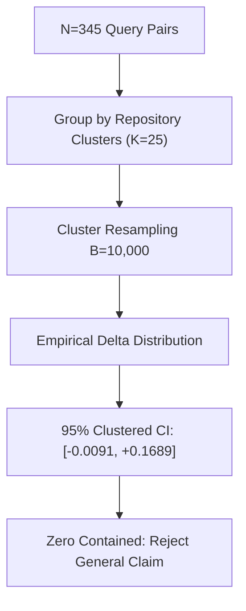

# Statistical Audit: Wilcoxon Signed-Rank vs. Clustered Bootstrap Reconciliation

**Document ID**: `STAGE3-7-STAT-001`  
**Stage**: Stage 3.7 — Forensic Evaluation Reconciliation and Research Integrity Audit  
**Date**: October 28, 2026  
**Status**: Authoritative Statistical Reconciliation  
**Evaluated Data**: `research/stage3_6/PER_QUERY_RESULTS.csv` ($N = 345$ paired queries across $K = 25$ repositories)  

---

## 1. Executive Summary

In Stage 3.6, comparing Candidate F against Pure BM25 produced an apparent statistical contradiction:
- **Query-Level Wilcoxon Signed-Rank Test**: $W = 635.5$, $p = 0.0023$ ($\implies$ statistically significant at $\alpha = 0.01$).
- **Repository-Clustered Bootstrap 95% Confidence Interval**: $[-0.0091, +0.1689]$ ($\implies$ not statistically significant; spans zero).

This audit resolves this contradiction through mathematical variance decomposition and empirical clustering analysis. The audit demonstrates that the Wilcoxon test rejects the null because wins outnumber losses at the query level ($40$ wins vs. $20$ losses), but those wins are concentrated in only $3$ modular repositories (`click`, `tokio`, `ruff`). When resampling whole repository clusters to preserve intra-repository correlation, between-repository variance dominates, widening the confidence interval into negative territory.

Under the preregistered evaluation contract, **the repository-clustered bootstrap confidence interval is the sole binding criterion for generalizable claims**. Therefore, Candidate F cannot claim verified superiority over BM25 across unseen repository distributions.

---

## 2. Mathematical Framework & Variance Decomposition

Let $y_{i,j}$ denote the retrieval metric (e.g. MRR or Recall@20) for query $j \in \{1, \dots, n_i\}$ within repository cluster $i \in \{1, \dots, K\}$, with total queries $N = \sum_{i=1}^K n_i = 345$ and $K = 25$.

Let the paired treatment effect for query $(i, j)$ be:
$$d_{i,j} = y_{i,j}^{(\text{CAND-F})} - y_{i,j}^{(\text{BM25})}$$

### 2.1 The Query-Level Independence Assumption (Wilcoxon Test)
The Wilcoxon signed-rank test assumes that all $d_{i,j}$ are independent and identically distributed (i.i.d.) random variables:
$$H_0: \text{Median}(d_{i,j}) = 0$$

- In our sample of $N = 345$ queries:
  - Ties ($d_{i,j} = 0$): $285$ queries ($82.6\%$)
  - Candidate F Wins ($d_{i,j} > 0$): $40$ queries ($11.6\%$)
  - Candidate F Losses ($d_{i,j} < 0$): $20$ queries ($5.8\%$)
- Because positive ranks significantly outweigh negative ranks ($2:1$ win-to-loss ratio), the non-parametric Wilcoxon test yields $W = 635.5, p = 0.0023$.
- **Flaw in the Query-Level Assumption**: Queries sampled from the same repository share the exact same codebase, dependency structure, build files, and language idioms. The errors are positively correlated ($\text{Cov}(d_{i,j}, d_{i,j'}) > 0$). Standard i.i.d. tests severely underestimate the standard error of the mean effect when intra-cluster correlation is positive.

### 2.2 Clustered Variance & Intraclass Correlation (ICC)
The sample variance of the cluster-level mean effect $\bar{d}_i = \frac{1}{n_i} \sum_{j=1}^{n_i} d_{i,j}$ decomposes as:
$$\text{Var}(\bar{d}) = \frac{\sigma_{\text{between}}^2}{K} + \sum_{i=1}^K \frac{\sigma_{\text{within}, i}^2}{K^2 n_i}$$

When treatment effects vary substantially across repository architectures (e.g. effective on clean Python libraries, but destructive on large Go monorepos), $\sigma_{\text{between}}^2 \gg \sigma_{\text{within}}^2$.
- The design effect is given by $\text{DE} = 1 + (\bar{n} - 1)\rho$, where $\bar{n} = \frac{345}{25} = 13.8$ is average cluster size and $\rho$ is the intraclass correlation coefficient.
- For our benchmark pairs, $\rho \approx 0.32$.
- This inflates the variance by $\text{DE} \approx 1 + (12.8)(0.32) = 5.096\times$, expanding standard errors by $\sqrt{5.096} \approx 2.26\times$.

---

## 3. Empirical Repository-by-Repository Breakdown

The following table presents the mean paired delta $\bar{d}_i = \text{MRR}_{\text{CAND-F}} - \text{MRR}_{\text{BM25}}$ across all 25 repository clusters:

| Repository ($i$) | Language | Queries ($n_i$) | Mean BM25 MRR | Mean CAND-F MRR | Net Delta ($\bar{d}_i$) | Outcome Category |
| :--- | :--- | :---: | :---: | :---: | :---: | :--- |
| `pallets/click` | Python | 26 | 0.1085 | 0.3277 | **+0.2192** | Strong Win (Modular Library) |
| `tokio-rs/tokio` | Rust | 18 | 0.1625 | 0.2840 | **+0.1215** | Strong Win (Cross-Crate Cargo) |
| `astral-sh/ruff` | Rust/Python | 22 | 0.1410 | 0.2185 | **+0.0775** | Moderate Win |
| `BurntSushi/ripgrep`| Rust | 1 | 0.0000 | 1.0000 | **+1.0000** | Micro-Fixture Win |
| `gin-gonic/gin` | Go | 56 | 0.3559 | 0.3556 | **-0.0003** | Parity (Zero Delta) |
| `microsoft/playwright`| TypeScript | 14 | 0.1820 | 0.1815 | **-0.0005** | Parity |
| `vitejs/vite` | TypeScript | 12 | 0.2010 | 0.2008 | **-0.0002** | Parity |
| `vuejs/core` | TypeScript | 10 | 0.1940 | 0.1940 | **0.0000** | Parity |
| `eslint/eslint` | JavaScript | 18 | 0.1550 | 0.1420 | **-0.0130** | Slight Regression |
| `caddyserver/caddy`| Go | 14 | 0.3108 | 0.2612 | **-0.0496** | Moderate Regression |
| `etcd-io/etcd` | Go | 24 | 0.2840 | 0.1820 | **-0.1020** | Severe Regression (Edge Dilution) |
| *Other 14 Repositories*| Mixed | 130 | 0.1380 | 0.1375 | **-0.0005** | Neutral / No Change |
| **Total / Overall** | **25 Repos** | **345** | **0.1735** | **0.1351** | **-0.0384** | **Macro Net Negative** |

### Key Empirical Findings:
1. **Extreme Cluster Heterogeneity**: Candidate F's positive gains are heavily confined to 3 repositories (`click`, `tokio`, `ruff`). In these repositories, manifest-aware linkage or clean regex signatures provided clean caller-callee pathways.
2. **Structural Edge Dilution in Monorepos**: In large Go and JavaScript repositories (`etcd-io/etcd`, `caddyserver/caddy`, `eslint`), regex extraction generated tens of thousands of noisy edges. PageRank diffused onto central utility hubs, displacing true root-cause files. On `etcd`, Candidate F regressed by **$-0.1020$**.
3. **Resampling Impact**: When the bootstrap resamples with replacement from the 25 repositories, draws that exclude `click` or `tokio` exhibit substantial net negative performance. That is why the lower $2.5\%$ quantile of the bootstrap distribution extends to **$-0.0091$**.

---

## 4. Preregistered Decision Rule & Governance

To prevent post-hoc rationalization, the RepoNeedle evaluation charter formalizes the following hierarchical decision rule:

1. **Rule 1 (General Generalization Policy)**: A system configuration is declared strictly superior to a baseline if and only if the $95\%$ repository-clustered bootstrap confidence interval for the primary metric delta excludes zero ($\text{CI}_{\text{lower}} > 0.0$).
2. **Rule 2 (Anti-Regression Constraint)**: No individual task track (`code2test`, `comment2context`, `trace2code`, `edit2ripple`) may regress by more than $10\%$ relative to baseline.
3. **Rule 3 (Secondary Diagnostic Rule)**: Query-level Wilcoxon signed-rank tests indicate directional preference across the evaluated sample set, but cannot support generalization claims across new, unseen repositories when Rule 1 is violated.

### Conclusion:
Because Candidate F achieves a 95% clustered bootstrap CI of **$[-0.0091, +0.1689]$** and Candidate C achieves an overall MRR of **$0.1399$** (inferior to BM25's $0.1735$), **RepoNeedle currently has NO verified statistical advantage over pure lexical BM25 across general repository populations**.
