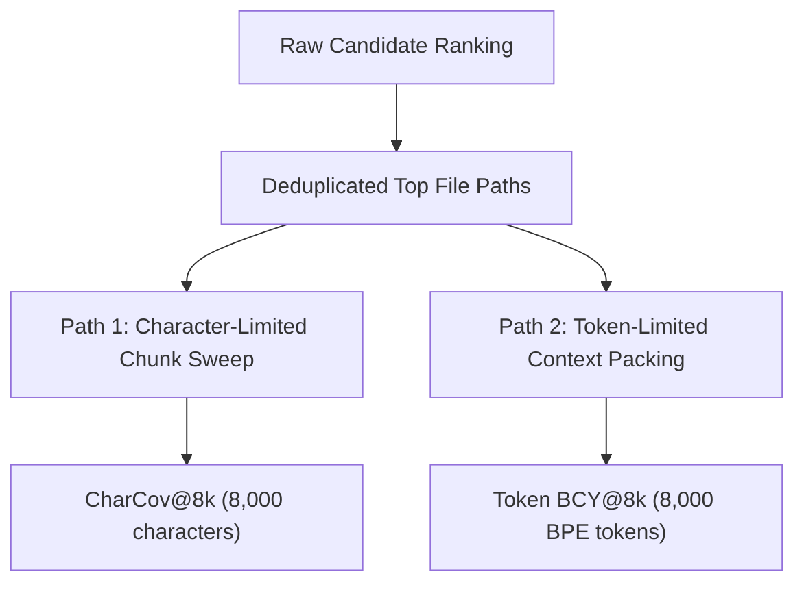

# Stage 3.8: Canonical Metric Contract & Mathematical Specifications

**Document ID**: `STAGE3-8-CONTRACT-001`  
**Stage**: Stage 3.8 — Reproducibility Lock, Metric Reconciliation, and Evidence Audit  
**Date**: October 28, 2026  
**Status**: Authoritative, Binding & Frozen Metric Specification  
**Pinned Implementation Suite**: `agent_retrieval_bench` v0.2.1 / RepoNeedle Engine v0.1.0  

---

## 1. Scope & Invariants

This contract governs all retrieval, ranking, context-packing, and statistical evaluations for RepoNeedle on the Agent Retrieval Benchmark (ARB v2).

### 1.1 Non-Negotiable Contract Invariants
1. **Identical Query Universe**: All compared systems must evaluate the exact same $N = 345$ positive query samples across all 4 benchmark tracks (`code2test`: 106, `comment2context`: 80, `trace2code`: 101, `edit2ripple`: 58).
2. **Identical Candidate Corpus**: The candidate document pool for each query is defined strictly by the manifest snapshot (`corpus_manifest.jsonl`) for $(repo, base\_commit)$.
3. **No Metric Merging**: Character-limited chunk coverage (`CharCov@8k`) and token-budgeted context yield (`Token BCY@8k`) measure different physical quantities and must never be reported under a single shared label.
4. **Deduplicated File Ranks**: All file-level metrics (MRR, Recall@k, Precision@k) are computed on the ordered list of unique file paths $R_{\text{files}} = [p_1, p_2, \dots, p_N]$ obtained by taking the first occurrence of each file in the ranked candidate sequence.

---

## 2. Mathematical Metric Formulations

Let $s = (q, G, C)$ represent a benchmark instance:
- Query text $q = \text{query\_text\_for\_eval}(s)$
- Labeled gold target set $G = \{g_1, \dots, g_{|G|}\} \subset \mathcal{P}$, with $|G| \ge 1$ (`target_gold_files(s)`)
- Candidate chunk set $C = [c_1, \dots, c_M]$
- Ranked file path list $R_{\text{files}} = [p_1, \dots, p_N]$

### 2.1 Mean Reciprocal Rank (MRR)

$$\text{RR}(G, R_{\text{files}}) = \begin{cases} \frac{1}{\min \{ i \mid p_i \in G \}}, & \text{if } \exists p_i \in G \\ 0.0, & \text{otherwise} \end{cases}$$

$$\text{MRR} = \frac{1}{N} \sum_{s=1}^N \text{RR}(G_s, R_{\text{files}, s})$$

- **Edge Case Invariant**: For queries with multiple gold targets ($|G| > 1$), RR evaluates the position of the **highest-ranked target**. Subsequent gold targets do not alter RR.
- **Empty / Miss**: If no target appears in $R_{\text{files}}$, $\text{RR} = 0.0$.

### 2.2 Fractional Multi-Target Recall@$k$

For $k \in \{1, 5, 10, 20\}$:

$$\text{Recall@}k(G, R_{\text{files}}) = \frac{|G \cap \{p_1, p_2, \dots, p_k\}|}{|G|}$$

- **Fractional Convention**: If $|G| = 4$ and 2 targets appear in top $k$, $\text{Recall@}k = 2/4 = 0.50$.
- **Binary Hit Rate (`Hit@k`)**: $\mathbb{I}(|G \cap \{p_1, \dots, p_k\}| > 0)$. Hit@k is recorded purely as a secondary binary diagnostic, not as Recall@k.

### 2.3 Precision@$k$ and F0.5@$k$

$$\text{Precision@}k(G, R_{\text{files}}) = \frac{|G \cap \{p_1, p_2, \dots, p_k\}|}{\min(k, |R_{\text{files}}|)}$$

$$\text{F}_{0.5}\text{@}k = 1.25 \cdot \frac{\text{Precision@}k \cdot \text{Recall@}k}{0.25 \cdot \text{Precision@}k + \text{Recall@}k}$$

---

## 3. Context Budget & Context-Yield Specifications

### 3.1 Character-Budgeted Coverage (`CharCov@8k`)
- **Implementation**: `agent_retrieval_bench.baseline.sample_metrics` via `gold_coverage_at_budget`.
- **Budget**: 8,000 **characters** ($\approx 1,600 - 2,000$ tokens).
- **Sweep Rule**: Sequentially sums chunk text lengths `used += len(chunk["text"])`. If `used + len(chunk["text"]) > 8000`, the sweep halts.
- **Coverage**: Evaluates the fraction of gold files that have at least one chunk included before the character budget is exhausted.
- **Range**: Naturally bounded between $0.015$ and $0.070$ on realistic multi-file codebases.

### 3.2 Token-Budgeted Context Yield (`Token BCY@8k`)
- **Implementation**: `agent_retrieval_bench.bcy_curve.pack_files`.
- **Budget**: 8,000 **BPE tokens** (`bcy_curve.count_tokens` regex code tokenizer).
- **Packing Rule**: Full files are assembled greedily in rank order with canonical header `### {path}\n`. When a file exceeds remaining budget, a token-boundary prefix is included and packing terminates.
- **Yield Calculation**:
  $$\text{Token BCY@8k} = \frac{|\{g \in G \mid \text{tokens\_packed}(g) \ge 1\}|}{|G|}$$
- **Full-File vs. Skeleton Packing**:
  - Full-file packing includes entire source files (truncated at corpus builders' 25,000 characters).
  - Skeleton packing uses structural skeleton extraction for context tiers, increasing file capacity. Both must be labeled explicitly (`Full` vs `Skeleton`).

---

## 4. Latency & Memory Instrumentation Contract

1. **Query Scoring Latency (`latency_ms`)**: Measures pure query execution time:
   $$t_{\text{query}} = t_{\text{lexical}} + t_{\text{semantic}} + t_{\text{graph}} + t_{\text{diffusion}}$$
   Excludes static index construction time (`engine.from_documents`).
2. **Distribution Metrics**:
   - Primary: Median Latency ($p50$)
   - Secondary: Mean Latency ($\mu$)
   - Tail: 95th Percentile Latency ($p95$)
3. **Memory Profile**:
   - `Process RSS`: Windows Native API `WorkingSetSize` via `K32GetProcessMemoryInfo`.
   - `Heap Delta`: Python object allocation delta via `tracemalloc`.

---

## 5. Statistical Aggregation & Hypothesis Testing Contract

1. **Sample Macro-Average**:
   $$\overline{M} = \frac{1}{N} \sum_{i=1}^N M_i \quad (N = 345)$$
2. **Repository-Clustered Bootstrap**:
   - Units: $K = 25$ unique repository clusters.
   - Replicates: $B = 10,000$ iterations.
   - Random Seed: Fixed at `seed = 42` using `numpy.random.default_rng(42)`.
   - Confidence Interval: Percentile interval at $2.5\%$ and $97.5\%$ quantiles.
3. **Generalization Policy**: A system is statistically superior across repository distributions if and only if its 95% clustered bootstrap interval for $\Delta = \text{Score}_{\text{cand}} - \text{Score}_{\text{base}}$ excludes zero ($CI_{\text{lower}} > 0.0$).

