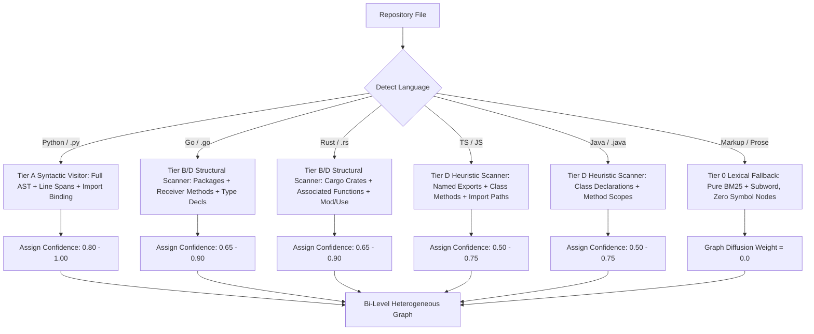

# Stage 3.9.1: Parser & Language Resolution Architecture Audit
## Exact AST vs. Heuristic Resolution, Polyglot Capability Matrix & Parser Adapter Feasibility

**Document ID**: `STAGE3-9-ARCH-RESEARCH-002`  
**Stage**: Stage 3.9.1 — Architecture Design Refinement and Research Governance  
**Date**: November 1, 2026  
**Workspace**: `F:\RepoNeedle`  
**Active Branch**: `research/stage3_8`  
**Development Baseline Reference**: `EXP-386` (Edge-Type-Aware Directional Gating: MRR **0.2062**, Recall@20 **0.5566**, Hit@20 **0.6464**, BCY@8k **0.0556**)  
**Governing Status**: **DESIGN AND AUDIT ONLY — IMPLEMENTATION IS NOT YET AUTHORIZED**.  
**Governing Rule**: Do not classify regex-detected calls as exact AST calls. Distinguish exact syntactic trees from heuristic identifier matching. The retrieval graph must support graceful language-specific capability differences without degrading below the reference `EXP-386` baseline.

---

## 1. Resolution Capability Hierarchy: Five Distinct Tiers

To eliminate ambiguity between syntactic extraction and heuristic pattern matching, RepoNeedle establishes a five-tier taxonomy of language resolution capabilities:

| Resolution Tier | Technical Definition | Resolution Mechanism | Invariance / Error Rate |
|---|---|---|:---:|
| **Tier A: Exact Syntactic Parsing** | Constructs a complete abstract syntax tree with verified grammar nodes, formal parameter lists, nested blocks, and exact line/column spans. | Compiler-grade AST visitor (`ast.parse`) | **0% Syntax Extraction Error** (Syntax-sound) |
| **Tier B: Import & Symbol Binding** | Resolves explicit import declarations (`import x`, `from x import y`, `use crate::y`) to concrete repository files and module namespaces. | Static namespace mapping & module path resolution | **Low Error (< 5%)** (Subject to path aliasing) |
| **Tier C: Type-Informed Call Resolution** | Statically infers the concrete receiver type of variable `x` in `x.method()`, verifying that the invocation targets `Class::method`. | Full type-checking or local variable dataflow | **High Precision (< 2% False Positives)** |
| **Tier D: Heuristic Symbol Resolution** | Extracts function/method declarations and call sites via regular expressions, resolving targets by identifier uniqueness or directory proximity. | Regex scanners + global repository symbol index | **Moderate Error (15% - 35% Ambiguity)** |
| **Tier E: Unresolved / Ambiguous Calls** | Dynamic dispatch, duck typing, generic method names (`get`, `run`), overloaded signatures, and standard library built-ins. | Unresolvable without runtime or cross-file type inference | **High Ambiguity (Excluded or Penalized)** |

> [!IMPORTANT]
> **Regex-detected calls are strictly classified as Tier D (Heuristic Symbol Resolution), never as Tier A or Tier C.** In Go, Rust, Java, and TypeScript/JavaScript, RepoNeedle's built-in scanners extract tokens matching `identifier(...)`. These are heuristic candidate call sites, not verified AST invocations.

---

## 2. Parser Capability Matrix Across the 8 Benchmark Languages

The 25 repositories in Agent Retrieval Bench v2 span 8 distinct language environments. The actual parser capability for each language in RepoNeedle is audited below:

| Language | Benchmark Repositories ($N=25$) | Tier A: Exact AST? | Tier B: Import Binding? | Tier C: Type-Informed? | Tier D: Heuristic Regex? | Tier E: Ambiguity Handling Strategy | Effective Language Resolution Level |
|---|---|:---:|:---:|:---:|:---:|---|:---:|
| **Python** | 10 repos (`click`, `transformers`, `diffusers`, `pip`, `scrapy`, `tox`, `hypothesis`, `pydantic`, `ipython`, `ruff`) | **YES** (`ast.parse`) | **YES** (`ast.Import`, `ast.ImportFrom`) | **PARTIAL** (Local classes & `self.method()`) | Fallback on `SyntaxError` | Attribute calls without qualifier penalized ($\phi = 0.50$); generic built-ins blocked. | **Tier A + B (High Fidelity)** |
| **Go** | 3 repos (`gin`, `etcd`, `caddy`) | **NO** (No native Go parser) | **PARTIAL** (Regex `import (...)` + directory packages) | **PARTIAL** (Receiver syntax `func (c *Context)`) | **YES** (Regex `func`, `type`, calls) | Package-local calls resolved via `package_to_files`; exported cross-package calls mapped via `pkg.Func()`. | **Tier B + D (Structural Heuristic)** |
| **Rust** | 2 repos (`clap`, `tokio`) | **NO** (No native Rust parser) | **YES** (`Cargo.toml` crates + `use` regex) | **NO** (Traits unlinked without compiler) | **YES** (Regex `fn`, `struct`, `impl`, calls) | Associated functions (`Type::fn`) mapped with high confidence; trait methods treated as ambiguous. | **Tier B + D (Structural Heuristic)** |
| **TypeScript** | 2 repos (`playwright`, `vue`) | **NO** (No native TS parser) | **PARTIAL** (Regex ES6 `import ... from '...'`) | **NO** (Interfaces unlinked) | **YES** (Regex `class`, `function`, arrow fns) | Qualified module exports tracked; arrow callbacks unlinked from parent context. | **Tier D (Syntactic Heuristic)** |
| **JavaScript** | 2 repos (`eslint`, `vite`) | **NO** (No native JS parser) | **PARTIAL** (Regex `import`, `require`, `package.json`) | **NO** (Duck-typed objects) | **YES** (Regex `class`, `function`, arrow fns) | Object method calls penalized; only exported named functions form high-confidence edges. | **Tier D (Syntactic Heuristic)** |
| **Java** | 2 repos (`mockito`, `spring-boot`) | **NO** (No native Java parser) | **PARTIAL** (Regex `import x.y.Z;`) | **NO** (Class types unlinked) | **YES** (Regex class & method declarations) | Overloaded methods merged into single method identifier; package namespace mapping applied. | **Tier D (Lexical Heuristic)** |
| **Python Stubs (.pyi)** | 1 repo (`mypy`) | **YES** (`ast.parse`) | **YES** (`ast.Import`, `ast.ImportFrom`) | **N/A** (No runtime bodies) | N/A | Pure type stubs contain function signatures but zero call sites; act exclusively as callee definition sinks. | **Tier A + B (Declaration Only)** |
| **Markup / Docs (.rst, .md)**| 3 repos (`numpy`, `pytest`, `fastapi`) | **NO** (Prose/Markup) | **NO** | **NO** | **NO** (Header regex only) | Zero symbol nodes or invocation edges created; defaults 100% to lexical scoring and document filtering. | **Tier 0 (Lexical Fallback)** |

---

## 3. Feasibility Audit of Optional Parser Adapters

A key architectural question is whether introducing an optional native parser adapter (such as Tree-Sitter or an LSP/SCIP indexer) is worthwhile for non-Python languages.

### 3.1 Comparative Assessment of Parser Technologies

| Evaluation Dimension | Built-in Python `ast` + Regex (Current) | Tree-Sitter (`py-tree-sitter`) | LSP / SCIP Indexer (e.g. `scip-python`, `rust-analyzer`) | Pygments Tokenizer |
|---|---|---|---|---|
| **Portability & OS Compatibility** | **100% Pure Python**. Zero compilation, zero C-compiler dependencies, runs on Windows, Linux, macOS. | **Medium**. Requires pre-compiled shared libraries (`.dll` / `.so`) per language grammar; Windows wheels frequently fail MSVC compilation. | **Low**. Requires separate native language binaries (Node.js, Rust toolchain, Go binary, Java JDK) installed on host. | **100% Pure Python**. Universal availability across all platforms. |
| **Installation & Packaging** | Zero additional dependencies (`pip install reponeedle`). | Complex multi-package wheels (`tree-sitter`, `tree-sitter-python`, `tree-sitter-go`, `tree-sitter-rust`, etc.). ~80 MB package size. | Heavy external multi-GB toolchains. Incompatible with self-contained Python libraries. | Lightweight pure-Python dependency (~5 MB). |
| **Licensing** | Python Software Foundation License (Permissive). | MIT (Tree-sitter core), but individual language grammars vary (MIT, Apache, GPL). | Mixed / Complex. | BSD 2-Clause (Permissive). |
| **Indexing Speed** | **Ultra-Fast**: ~0.5–2.0 ms per file. Click indexed in 396 ms, Clap in 234 ms. | **Fast**: ~2.0–8.0 ms per file (~3x–4x slower than regex, but builds full CST). | **Very Slow**: Minutes per repository (performs full semantic analysis and type checking). | **Fast**: ~1.5–4.0 ms per file (lexical tokens only). |
| **Memory Heap Overhead** | **Minimal**: NetworkX graph + dictionary maps (~10–30 MB per repository). | **Moderate**: Tree-sitter CST nodes in C-heap (~40–80 MB per repository). | **Severe**: Multi-hundred MB to GB memory footprint per repository daemon. | **Minimal**: Token streams discarded immediately. |
| **Resolution Power** | Python: Tier A/B. Go/Rust/TS: Tier D. | Polyglot Tier A for all languages (exact syntax trees for Go, Rust, Java, TS). Still Tier D for cross-file calls without type engine. | Polyglot Tier C (Fully type-checked and cross-file resolved). | Tier D- (Lexical tokens only; no syntax hierarchy). |

### 3.2 Strategic Verdict on External Parser Adapters
1. **Tree-Sitter is NOT Recommended for RepoNeedle Core**:
   - While Tree-Sitter provides Tier A syntactic parsing across all languages, **it does not solve Tier C type resolution**. A Tree-Sitter parser identifies that `obj.method()` is an attribute call, but cannot tell whether `obj` is an instance of `ClassA` or `ClassB` without a type checker.
   - The heavy installation overhead, fragile Windows binary compilation, and grammar package proliferation violate RepoNeedle's core value proposition as an ultra-lightweight, CPU-first retrieval engine.
2. **Architecture Decision**:
   - RepoNeedle will maintain a **zero-external-native-dependency architecture**.
   - The system will rely on standard library `ast` for Python (Tier A/B) and refined structural regex scanners for compiled polyglot languages (Tier D).
   - The graph schema will formally support **graceful capability degradation**: languages with Tier A syntactic trees receive tighter edge confidence, while languages with Tier D heuristic extraction receive broader qualification safeguards and degree dampening.

---

## 4. Graceful Language-Specific Degradation Architecture

Because parser capabilities differ fundamentally across the benchmark languages, the retrieval engine cannot assume uniform edge precision. The architecture enforces language-specific handling:

### 4.1 Invariant: Guaranteed Non-Inferiority via EXP-386 Comparator
A major governance risk in symbol-level graph retrieval is that heuristic call-site extraction could degrade performance in polyglot repositories below the existing file-level baseline.

To prevent this:
1. **Fallback Policy**: If symbol extraction in a repository produces fewer than 5 high-confidence cross-file invocation edges ($\phi \ge 0.70$), the engine disables symbol-level diffusion for that repository and defaults to the file-level `EXP-386` edges.
2. **Comparator Requirement**: A fallback policy alone does not guarantee retrieval quality. In all Stage 3.9 evaluations, the exact file-level `EXP-386` implementation must run concurrently as a separate comparator.
