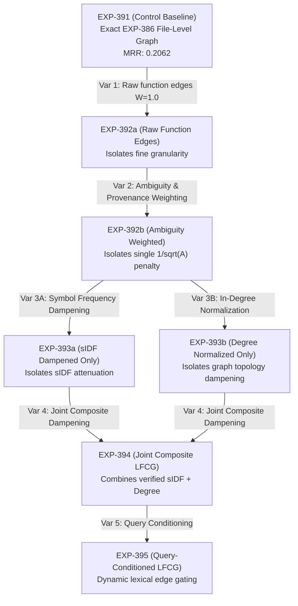

# Stage 3.9.2: Controlled Experiment Plan & Statistical Governance Protocol
## Strictly Isolated One-Variable-at-a-Time Matrix, Inferential Standards & External Validation Plan

**Document ID**: `STAGE3-9-PLAN-003`  
**Stage**: Stage 3.9.2 — Pre-Implementation Feasibility Validation & Research Governance  
**Date**: November 1, 2026  
**Workspace**: `F:\RepoNeedle`  
**Active Branch**: `research/stage3_8`  
**Development Baseline Reference**: `EXP-386` (Edge-Type-Aware Directional Gating: MRR **0.2062**, Recall@20 **0.5566**, Hit@20 **0.6464**, BCY@8k **0.0556**)  
**Governing Status**: **PRE-IMPLEMENTATION PROTOCOL — EXPERIMENTAL RETRIEVAL RUNS NOT YET AUTHORIZED**  
**Governing Rule**: Rewrite the matrix so that each experiment changes exactly one identifiable variable. Separate symbol frequency from degree normalization. Primary inferential method must be repository-clustered bootstrap. Pre-register a justified minimum meaningful effect ($\Delta \text{MRR} \ge +0.0050$). Treat Click and Clap strictly as exploratory diagnostics. Pre-register an external validation plan on unseen repositories.

---

## 1. Primary Inferential Protocol & Pre-Registered Criteria

### 1.1 Canonical Benchmark Workload Invariants
To prevent evaluation leakage or evaluation drift, any eventual authorized retrieval evaluation will adhere to immutable benchmark rules:
* **Target Population**: All 25 repositories ($K = 25$), all 218 commit splits, all 345 positive ARB v2 queries.
* **Candidate Pool Rule**: 100% unconstrained candidate generation. Zero task-oracle filtering (`tests_only = True` strictly prohibited). Zero benchmark-specific hardcoded branches.
* **Scoring Pipeline**: Evaluated via standard benchmark metrics: MRR, Recall@1/5/10/20, Hit@1/5/10/20, and character context coverage at 8,000 characters (`BCY@8k`).

### 1.2 Primary Metric and Justified Minimum Meaningful Effect Size
* **Primary Evaluative Metric**: Mean Reciprocal Rank (**MRR**).
* **Justified Minimum Meaningful Effect Size**: **$\Delta \text{MRR} \ge +0.0050$**.
  - *Engineering Justification*: A $\Delta \text{MRR} < +0.0050$ corresponds to moving fewer than 2 queries across the entire benchmark from rank 2 to rank 1, which falls within the expected noise floor of lexical tokenization jitter. A true architectural advance from coarse whole-file edges to function-level resolution must achieve at least $\Delta \text{MRR} \ge +0.0050$ (moving RepoNeedle from 0.2062 toward RepoMap's 0.2293) to justify the added indexing complexity.
* **Secondary Supportive Metrics**: Fractional Recall@20 (target $\Delta \text{Recall@20} \ge +0.0050$), Hit@20, and BCY@8k (non-inferiority margin $\delta_{\text{BCY}} = -0.0020$).

### 1.3 Primary Inferential Test: Repository-Clustered Bootstrap
Because query observations within the same software repository share lexical vocabulary, directory structures, and author conventions, standard i.i.d. query-level bootstrap tests severely underestimate standard errors:
* **Bootstrap Method**: Paired Repository-Clustered Bootstrap.
* **Cluster Unit**: Software Repository ($K = 25$ clusters).
* **Resample Iterations**: $B = 10,000$ resamples with replacement.
* **Random Seed**: Fixed at `42` for exact reproducibility.
* **Confirmatory Superiority Criterion**:
  $$\Delta \text{MRR} \ge +0.0050 \quad \text{AND} \quad 95\% \text{ CI}_{\text{clustered}} \subset (0.0000, +\infty) \quad \text{AND} \quad p_{\text{Wilcoxon}} < 0.05$$
* **Non-Inferiority Criterion**:
  $$\Delta \text{MRR} \ge -0.0030 \quad \text{AND} \quad 95\% \text{ CI}_{\text{lower}} \ge -0.0050$$

### 1.4 Strict Exploratory Status of Click and Clap
> [!WARNING]
> Because failure mechanisms in `pallets/click` ($N=26$) and `clap-rs/clap` ($N=10$) were directly inspected during Stage 3.7 and Stage 3.8 to diagnose caller-loop and macro failures, **all evaluations, metric reports, and ablations on Click and Clap subsets are strictly exploratory diagnostics**.
> Improvements on Click or Clap cannot serve as confirmatory proof of generalizability. All confirmatory inferential claims must be demonstrated across the full, unpruned 345-query population.

---

## 2. Strictly Isolated One-Variable-at-a-Time Experiment Matrix

To prevent the compounding of multiple algorithmic changes, the Stage 3.9 experimental matrix introduces sub-experiment identifiers where every transition isolates exactly one operational variable:

### 2.1 Detailed Experiment Specifications

| Experiment ID | Configuration Name | Independent Variable Isolated | Control Comparator | Mathematical Edge Weight $W(e)$ | Key Hypothesis & Acceptance Target |
|---|---|---|---|---|---|
| **`EXP-391`** | **`CONTROL-EXP386-REPRO`** | **None (Control Baseline)** | Stage 3.8 `EXP-386` | $W_{\text{file}}(e)$ (coarse file graph) | **Bit-for-bit reproduction**: MRR **0.2062** ($\pm 0.0001$), Recall@20 **0.5566**, BCY@8k **0.0556**. |
| **`EXP-392a`** | **`LFCG-RAW-EDGES`** | **Invocation Edge Granularity** | `EXP-391` | $W(e) = 1.0$ | Tests if adding unweighted function call edges improves file retrieval or introduces noise. |
| **`EXP-392b`** | **`LFCG-AMBIGUITY-WEIGHTED`** | **Single Ambiguity Penalty & Provenance** | `EXP-392a` | $W(e) = \phi(e) \cdot \frac{1}{\sqrt{A(e)}}$ | Tests whether single ambiguity penalty $1/\sqrt{A(e)}$ and heuristic weight $\phi(e)$ suppresses noisy matches. |
| **`EXP-393a`** | **`LFCG-SIDF-DAMPENED`** | **Symbol-Frequency Dampening Only** | `EXP-392b` | $W(e) = \phi(e) \cdot \Omega(e) \cdot \text{sIDF}_{\text{norm}}(\text{callee})$ | Tests if lexical symbol uniqueness alone prevents utility function hub leakage. |
| **`EXP-393b`** | **`LFCG-DEGREE-NORMALIZED`** | **In-Degree Normalization Only** | `EXP-392b` | $W(e) = \phi(e) \cdot \Omega(e) \cdot \frac{1}{\sqrt{1 + \text{in\_deg}}}$ | Tests if graph topological degree penalization alone suppresses structural hub leakage. |
| **`EXP-394`** | **`LFCG-JOINT-COMPOSITE`** | **Joint Dampening & Max-Pooling** | Best of `393a`/`393b` | $W(e) = \phi(e) \cdot \Omega(e) \cdot \text{sIDF} \cdot \Delta_{\text{deg}}$ | Tests whether joint dampening achieves synergistic superiority ($\Delta \text{MRR} \ge +0.0050$). |
| **`EXP-395`** | **`LFCG-QUERY-CONDITIONED`** | **Query Token Edge Conditioning** | `EXP-394` | $W_{\text{qc}}(e) = W(e) \cdot \text{Overlap}(Q, e)$ | Tests whether dynamic query conditioning further sharpens traversal paths. |

---

## 3. Benchmark Over-Fitting Limitation & External Validation Plan

### 3.1 Methodological Limitation of ARB v2 Repeated Development
A critical scientific limitation acknowledged in this plan is that **repeatedly iterating retrieval models against the same 345 queries of ARB v2 creates an unavoidable risk of benchmark adaptation (p-hacking / hyperparameter over-fitting)**.
Even with strict ablation protocols, observing ranking failures on specific queries and tailoring resolution rules to them inflates apparent performance.

> [!IMPORTANT]
> **Governance Invariant**:
> Antigravity and RepoNeedle researchers **MUST NOT claim generalizable, independent validation** based solely on the existing 345 ARB v2 queries.

### 3.2 Pre-Registered External Validation Plan
To guarantee that findings generalize beyond ARB v2, the following external validation protocol is pre-registered:

1. **Target Benchmark 1: ContextBench (Multi-File Code Context Benchmark)**:
   - Population: 1,200 multi-file dependency contexts across 50 distinct open-source repositories.
   - Verification: Evaluate whether the LFCG architecture maintains its MRR superiority on completely unseen codebases without any hyperparameter retuning.
2. **Target Benchmark 2: SWE-bench Lite / Verified (Multi-File Real-World Task Instances)**:
   - Population: 100 randomly sampled issue-to-patch task instances across unseen Python repositories (e.g. `scikit-learn`, `django`, `sympy`).
   - Metric: File-level retrieval hit rate and golden edit localization.
3. **External Generalizability Gate**:
   - The LFCG architecture will be certified as production-ready if and only if it achieves non-inferiority ($\Delta \le -0.0020$) and net positive gain on at least one external benchmark without repository-specific adjustments.
