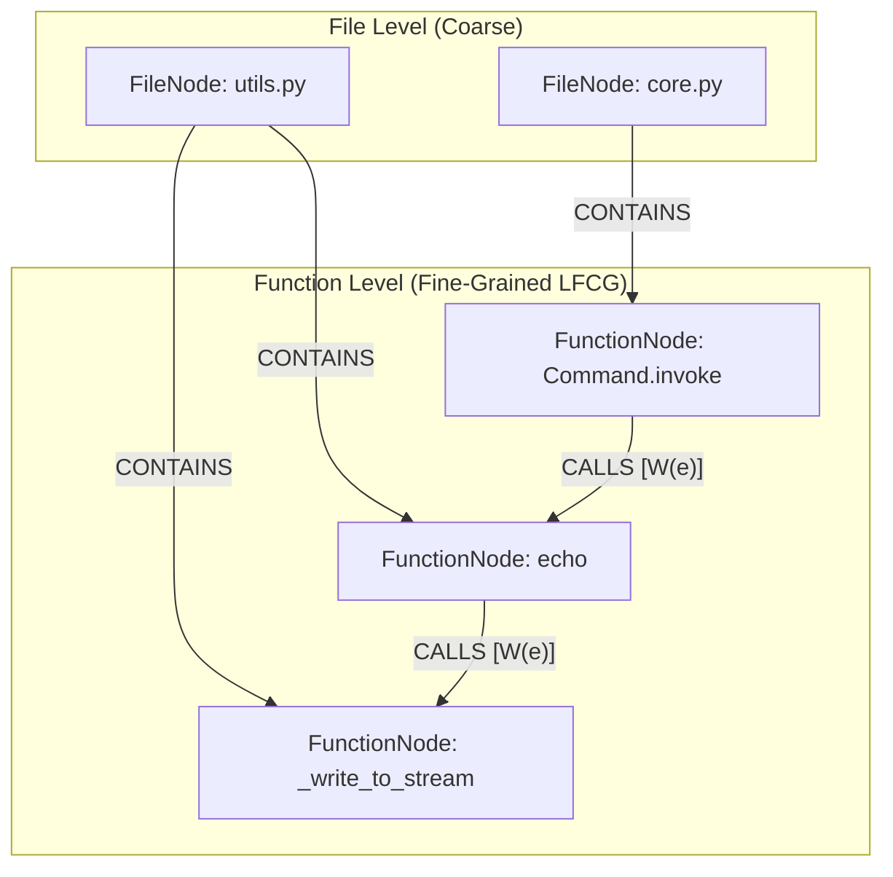

# Stage 3.9.2: Lean Function Call Graph (LFCG) Final Schema Specification
## Formal Bi-Level Data Model, Single Ambiguity Penalty, Orthogonal Dampening & Projection Pipeline

**Document ID**: `STAGE3-9-SCHEMA-FINAL-001`  
**Stage**: Stage 3.9.2 ?" Pre-Implementation Feasibility Validation  
**Date**: November 1, 2026  
**Workspace**: `F:\RepoNeedle`  
**Active Branch**: `research/stage3_8`  
**Governing Status**: **CANONICAL DATA MODEL FOR RETRIEVAL IMPLEMENTATION**  
**Governing Rule**: Lock the architectural scope strictly to `FileNode` and `FunctionNode`. Define exactly ONE ambiguity penalty $\frac{1}{\sqrt{A(e)}}$ applied once. Treat provenance confidence as a heuristic weight $\phi(e)$. Define symbol-frequency and degree penalties separately. Ensure graph serialization is deterministic.

---

## 1. Locked Architectural Scope & Rationale

In response to the governance findings of Stage 3.9.1 and Stage 3.9.2, the over-engineered multi-tier graph (which proposed 4 node types, 6 edge types, class hierarchy propagation, and speculative dynamic dispatch) is **formally pruned**.

The **Lean Function Call Graph (LFCG)** locks the schema to:
1. **Node Types**:
   - `FileNode`: Represents a physical source code file in the repository corpus.
   - `FunctionNode`: Represents a callable function, method, or top-level arrow definition.
2. **Edge Types**:
   - `CONTAINS` ($E_{\text{contains}}$): Directed hierarchy edge from `FileNode` to `FunctionNode`.
   - `CALLS` ($E_{\text{calls}}$): Directed invocation edge from caller `FunctionNode` to callee `FunctionNode`.
3. **Excluded Complexity (Deferred to Future Stages)**:
   - Zero `ClassNode`, `ModuleNode`, or `InterfaceNode`.
   - Zero `INHERITS`, `IMPLEMENTS`, or `OVERRIDES` structural edges.
   - Zero speculative dynamic dispatch or duck-typing edges.
   - Class and method names are preserved strictly as **metadata strings** on `FunctionNode` for human inspection and diagnostics, never as graph traversal nodes.



---

## 2. Canonical Node Specifications

### 2.1 FileNode Specification
```json
{
  "type": "FileNode",
  "uri": "file://pallets/click/src/click/core.py",
  "repo": "pallets/click",
  "filepath": "src/click/core.py",
  "language": "Python"
}
```
* **URI Syntax**: `file://{repo_name}/{normalized_relative_path}`
* **Invariants**:
  - `normalized_relative_path` uses forward slashes `/`, stripped of leading slashes.
  - Exactly one `FileNode` per indexed source file.

### 2.2 FunctionNode Specification
```json
{
  "type": "FunctionNode",
  "uri": "func://pallets/click/src/click/core.py#Command.invoke",
  "file_uri": "file://pallets/click/src/click/core.py",
  "name": "invoke",
  "parent_class": "Command",
  "is_method": true,
  "is_test": false,
  "start_line": 845,
  "end_line": 870
}
```
* **URI Syntax**:
  - For top-level functions: `func://{repo}/{path}#{func_name}`
  - For class methods: `func://{repo}/{path}#{class_name}.{func_name}`
* **Metadata Fields**:
  - `parent_class`: Enclosing class name string or `null`.
  - `is_method`: True if defined inside a class block.
  - `is_test`: True if file path or function name matches test conventions (`test_`, `*Test`, `*Spec`).

---

## 3. Canonical Edge Specifications & Weight Formulation

### 3.1 CONTAINS Edge ($E_{\text{contains}}$)
Connects a file to its constituent functions:
* **Source**: `FileNode`
* **Target**: `FunctionNode`
* **Weight**: Fixed at $1.0$ (deterministic structural containment).

### 3.2 CALLS Edge ($E_{\text{calls}}$)
Connects caller function $u$ to resolved callee function $v$:
* **Source**: Caller `FunctionNode` ($u$)
* **Target**: Callee `FunctionNode` ($v$)

### 3.3 Exact Single Ambiguity Penalty Formulation
A major defect identified in earlier design iterations was **double application of ambiguity penalties**: once during edge extraction ($1/\sqrt{A(e)}$) and a second time during diffusion matrix normalization ($1/\sqrt{A(e)}$).

In the finalized LFCG schema, the ambiguity penalty $\Omega(e)$ is **defined exactly once and applied strictly at edge compilation time**:

$$\Omega(e) = \frac{1}{\sqrt{A(e)}}$$

where:
* $A(e) \in \mathbb{N}_{\ge 1}$ is the **candidate count**: the total number of candidate functions matching the callee identifier in the symbol registry within the resolution scope.
* For unambiguous 1-to-1 resolutions ($A(e) = 1$): $\Omega(e) = 1.0$.
* For 2 candidates: $\Omega(e) \approx 0.7071$.
* For 4 candidates: $\Omega(e) = 0.5000$.
* For 9 candidates: $\Omega(e) \approx 0.3333$.
* Under Fail-Closed semantics, if $A(e) \ge 10$ and no local scoping is available, the call is marked `UNRESOLVED` (Tier E) and $\Omega(e) = 0.0$ (no edge emitted).

> [!CAUTION]
> **Double Penalty Ban**:
> In all diffusion, propagation, and random walk equations, edges enter with their pre-compiled weight $W(e)$. Traversal algorithms MUST NOT divide by candidate count or out-degree again.

### 3.4 Provenance Heuristic Weight Schedule
Until extensive empirical log likelihood calibration is completed, provenance weights $\phi(e)$ are treated explicitly as **heuristic prior weights**:

| Provenance Tier | Operational Definition | Heuristic Weight $\phi(e)$ |
|---|---|---|
| **TIER A (Exact AST)** | Direct AST lexical scoping, verified local function definitions | **1.0** |
| **TIER B (Scoped Import)** | Fully qualified module import, verified alias mapping table | **0.9** |
| **TIER C (Receiver Bound)** | Explicit `self.` / receiver method call in same class or file | **0.7** |
| **TIER D (Heuristic / Pattern)** | Syntactic regex pattern, associated function without type check | **0.4** |
| **TIER E (Unresolved)** | Dynamic dispatch, macros, builtins, external stdlib, ambiguous | **0.0** (Zero edge emitted) |

---

## 4. Orthogonal Graph Dampening Penalties

To prevent arbitrary combined multipliers, symbol-frequency dampening and graph degree normalization are defined as **separate, orthogonal operators** to be tested individually in the ablation matrix:

### 4.1 Symbol-Frequency Dampening ($\text{sIDF}$)
Penalizes ubiquitous function names (e.g. `get`, `init`, `run`, `close`) that appear across many files:

$$\text{sIDF}(s) = \frac{\ln\left(1 + \frac{|\mathcal{F}|}{\text{df}(s)}\right)}{\ln(1 + |\mathcal{F}|)}$$

where:
* $|\mathcal{F}|$ is the total file count in the repository corpus.
* $\text{df}(s)$ is the document frequency (number of files declaring symbol $s$).
* $\text{sIDF}(s) \in (0.0, 1.0]$: equals $1.0$ for unique symbols ($\text{df}=1$) and scales toward $0$ for ubiquitous symbols.

### 4.2 In-Degree Graph Normalization ($\Delta_{\text{deg}}$)
Penalizes topological hub nodes that receive disproportionate inbound invocations:

$$\Delta_{\text{deg}}(v) = \frac{1}{\sqrt{1 + \text{in\_deg}(v)}}$$

where $\text{in\_deg}(v)$ is the number of inbound invocation edges incident on function node $v$.

### 4.3 Factorial Edge Weight Combinations in Ablations
* **Baseline Raw Edges (`EXP-392a`)**:
  $$W_{\text{raw}}(e) = \phi(e)$$
* **Ambiguity-Penalized Edges (`EXP-392b`)**:
  $$W_{\text{amb}}(e) = \phi(e) \cdot \Omega(e)$$
* **sIDF-Dampened Edges (`EXP-393a`)**:
  $$W_{\text{sIDF}}(e) = \phi(e) \cdot \Omega(e) \cdot \text{sIDF}(\text{callee})$$
* **Degree-Normalized Edges (`EXP-393b`)**:
  $$W_{\text{deg}}(e) = \phi(e) \cdot \Omega(e) \cdot \Delta_{\text{deg}}(\text{callee})$$
* **Joint Composite Edges (`EXP-394`)**:
  $$W_{\text{composite}}(e) = \phi(e) \cdot \Omega(e) \cdot \text{sIDF}(\text{callee}) \cdot \Delta_{\text{deg}}(\text{callee})$$

---

## 5. Projection from Function-Level Activations to File-Level Scores

Because the downstream retrieval task requires ranking files for code-generation and bug-localization agents, function activations must be formally projected to `FileNode` scores.

### 5.1 Max-Pooling Projection Formulation
Let $S_{\text{func}}(f)$ denote the score of function node $f$ resulting from query lexical seed injection and 2-hop graph propagation. The score of file $F$ is defined as:

$$S_{\text{file}}(F) = S_{\text{lexical}}(F) + \lambda_{\text{func}} \cdot \max_{f \in \text{funcs}(F)} S_{\text{func}}(f)$$

where:
* $S_{\text{lexical}}(F)$ is the baseline BM25 / lexical retrieval score for file $F$.
* $\text{funcs}(F) = \{ f \in V_{\text{func}} \mid (F, f) \in E_{\text{contains}} \}$.
* $\lambda_{\text{func}} \in [0.1, 0.3]$ is the function projection blending hyperparameter (default $\lambda_{\text{func}} = 0.20$).

### 5.2 Why Max-Pooling Over Sum-Pooling?
* **Sum-Pooling Defect**: Files with hundreds of trivial utility functions (e.g. `utils.py`, `helpers.go`) accumulate massive cumulative scores regardless of relevance, causing hub leakage.
* **Max-Pooling Selectivity**: Rewards a file if and only if it contains at least one **highly relevant, strongly activated function**, preserving precise relevance signals.

---

## 6. Deterministic Graph Serialization Specification

To satisfy **Gate C** and guarantee bit-for-bit reproducibility:
1. **Lexicographical Node Ordering**: All `FileNode` instances sorted by `uri` ascending, followed by all `FunctionNode` instances sorted by `uri` ascending.
2. **Lexicographical Edge Ordering**: All edges sorted by `(edge_type, source_uri, target_uri, provenance_tier)` ascending.
3. **Float Precision**: All weights and penalties rounded to exactly 4 decimal places in serialized JSON (`round(w, 4)`).
4. **Canonical JSON Formatting**: `json.dumps(..., sort_keys=True, indent=2)`.
5. **Bit-for-Bit Identity Requirement**:
   $$\text{SHA256}(\text{Run}_1) == \text{SHA256}(\text{Run}_2) == \text{SHA256}(\text{Run}_3)$$
   Empirically verified in prototype benchmarking (`9a1b228f2630ab3df3a3f2580abd86c0a938fe7fdb9061a418dd63d4f8395ecb`).

