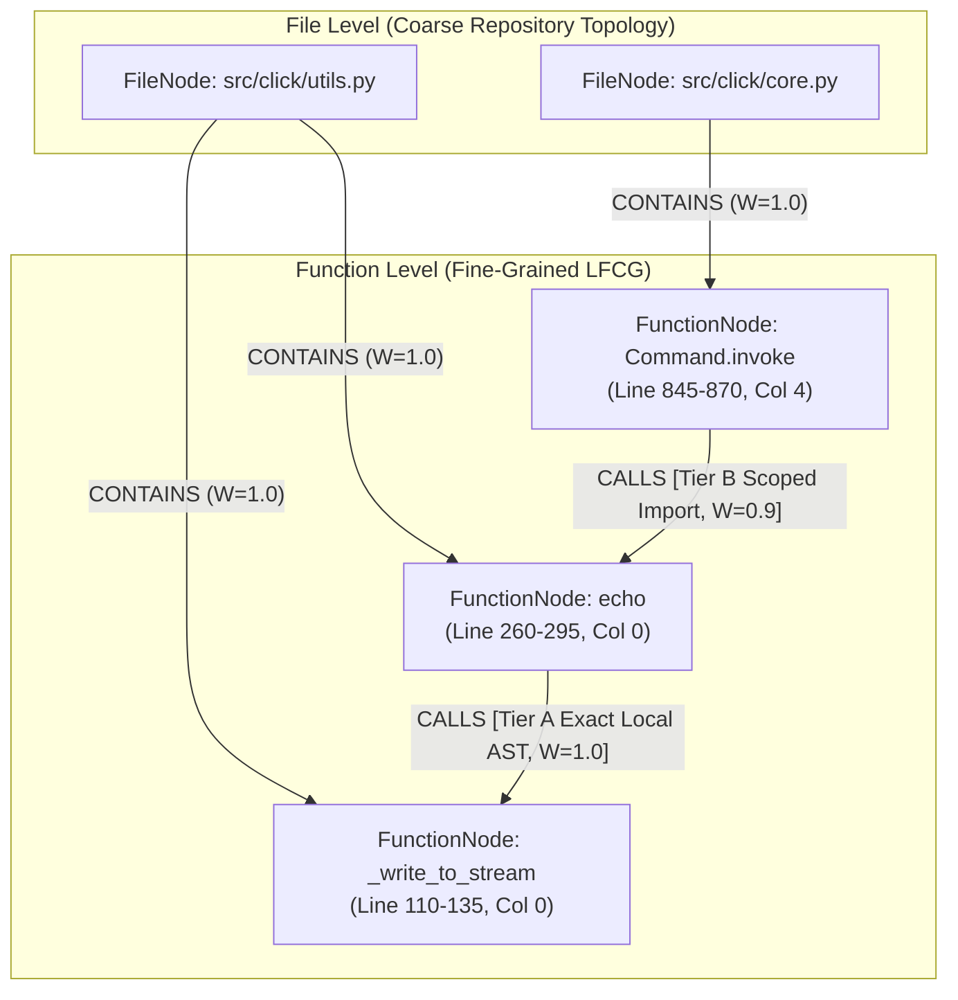
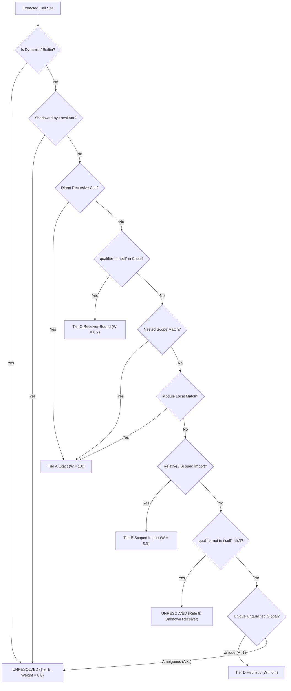

# Stage 3.9.3: Python-First Lean Function Call Graph (LFCG) Technical Implementation
## Architecture Specification, AST Extraction Pipeline, Scoped Resolution & Serialization Engine

**Document ID**: `STAGE3-9-IMPL-001`  
**Stage**: Stage 3.9.3 — Python-First LFCG Implementation and Validation  
**Date**: November 1, 2026  
**Workspace**: `F:\RepoNeedle`  
**Active Branch**: `research/stage3_9`  
**Prototype Path**: [`research/stage3_9/prototypes/python_lfcg.py`](file:///F:/RepoNeedle/research/stage3_9/prototypes/python_lfcg.py)  
**Governing Rule**: Initial implementation must be Python-only. Non-Python repositories must continue to use `EXP-386`. Never convert a plausible method-name match into an exact call. Ensure repeated graph construction produces identical serialization.

---

## 1. Architectural Overview & System Design

The **Python-First Lean Function Call Graph (LFCG)** is a fine-grained, bi-level structural representation designed to solve the diagnosed caller-loop failure modes in Python repositories (e.g. `pallets/click`, `fastapi/fastapi`, `pytest-dev/pytest`) without introducing polyglot heuristic noise:

### 1.1 Python-Only Phasing Invariant
* **Python Repositories ($N = 13$)**: Indexed via `PythonLFCGEngine`, compiling fine-grained `FunctionNode` instances and directed `CALLS` edges.
* **Non-Python Repositories ($N = 12$)**: Held strictly at the verified Stage 3.8 [`EXP-386`](file:///F:/RepoNeedle/research/stage3_8/STAGE3_8_DECISION_REPORT.md) file-level baseline (MRR **0.2062**, Recall@20 **0.5566**, BCY@8k **0.0556**). Zero heuristic regex edges are injected into compiled codebases.

---

## 2. AST Extraction Pipeline (`ast.NodeVisitor`)

The extraction engine operates directly on Python standard library ASTs (`ast` module) via a two-pass architecture:

### 2.1 Pass 1: Definitions, Imports & Scope Metadata
* **Function Definitions (`ast.FunctionDef`, `ast.AsyncFunctionDef`)**:
  - Preserves exact source position: `start_line = node.lineno`, `end_line = node.end_lineno`, and `col_offset = node.col_offset`.
  - Determines method status: True if enclosed within an active `ast.ClassDef` block.
  - Determines nesting: True if enclosed within an active outer function definition. Scope prefix tracks enclosing function hierarchy (e.g. `outer_fn.nested_worker`).
  - Extracts decorator names (`@property`, `@simple_decorator`, etc.) as metadata strings.
  - Emits canonical `CONTAINS` edge from `FileNode` to `FunctionNode`.
* **Module Imports (`ast.Import`, `ast.ImportFrom`)**:
  - Standard imports (`import math`, `import os.path as p`): Maps local aliases to module paths.
  - From imports (`from click.utils import echo as my_echo`): Maps imported identifier to original symbol and module.
  - Multi-level relative imports (`from . import sub`, `from ..parent import helper`): Computes relative directory traversal from current file's normalized path and matches against candidate repository files.

### 2.2 Pass 2: Call Expressions & Local Lexical Scoping
* **Scope Tracking**:
  - Maintains `class_stack` to track class context for `self.` resolution.
  - Maintains `func_stack` to track caller function URIs.
  - Maintains `scope_local_vars`: Tracks variables assigned in each function scope via `ast.Assign` to detect **function shadowing** (preventing local lambdas or variables from creating false global edges).
* **Call Site Extraction (`ast.Call`)**:
  - Direct identifiers (`ast.Name`): `helper_target()` $\to$ `identifier = "helper_target"`, `is_attribute = False`.
  - Attribute calls (`ast.Attribute`): `self.internal_helper()`, `math.sqrt()` $\to$ `identifier = "internal_helper"`, `qualifier = "self"`, `is_attribute = True`.
  - Dynamic calls (`ast.Subscript`, nested `ast.Call`, `getattr`): Flagged as `is_dynamic = True`.

---

## 3. Strict Call-Target Resolution Rules & Invariants

Resolution operates under a deterministic priority schedule, enforcing strict fail-closed semantics:

### 3.1 Rule Breakdown
1. **Dynamic Dispatch**: `getattr()`, `func_dict[k]()`, runtime reflection $\to$ `UNRESOLVED` (Tier E).
2. **Builtin Filter**: Identifiers in `PYTHON_BUILTINS` (`len`, `sum`, `range`, `print`, `open`, etc.) $\to$ `UNRESOLVED` (Tier E, filtered).
3. **Local Scope Shadowing**: If identifier was assigned as a local variable/lambda in caller function body $\to$ `UNRESOLVED` (does not emit global function edge).
4. **Direct Recursion**: If unqualified identifier matches caller function name $\to$ `ast_recursive_self_call` (`TIER_A_EXACT_AST`).
5. **Self Method Call**: If `qualifier == 'self'` or `'cls'` within active class, matches methods defined in same class $\to$ `ast_self_method_binding` (`TIER_C_RECEIVER_BOUND`).
6. **Nested Function Call**: Enclosed inner function called by outer function $\to$ `ast_nested_scope_binding` (`TIER_A_EXACT_AST`).
7. **Local Direct Call**: Module-level function in same file $\to$ `ast_local_lexical_binding` (`TIER_A_EXACT_AST`).
8. **Scoped & Relative Imports**:
   - Resolved to target file path in repository and matching symbol $\to$ `ast_relative_import_binding` or `ast_import_symbol_binding` (`TIER_B_SCOPED_IMPORT`).
   - Standard library or external packages (`math`, `os`, `torch`, `requests`) $\to$ `UNRESOLVED` (Tier E, external).
9. **Rule 8 (Unknown Receivers)**:
   > [!CAUTION]
   > **Binding Governance Invariant**:
   > **Never convert a plausible method-name match into an exact call.**
   > If a call has an unknown receiver (e.g. `obj.internal_action()` where `obj` is an arbitrary parameter), the engine computes candidate count $A(e)$, but classifies the call as `unknown_receiver_unresolved` (`UNRESOLVED` / Tier E). It NEVER emits a speculative call edge.
10. **Unique Global Symbol Fallback**: Unqualified names with exactly 1 non-method definition across entire repository are marked `unique_global_symbol_match` (`TIER_D_HEURISTIC`, $W = 0.40$). Ambiguous multi-targets ($A(e) > 1$) safely resolve to `UNRESOLVED`.

---

## 4. Deterministic Serialization Specification

To guarantee bit-for-bit reproducibility across runs:
1. **Lexicographical Node Sorting**:
   - `FileNode` instances sorted by `uri` ascending.
   - `FunctionNode` instances sorted by `uri` ascending.
2. **Lexicographical Edge Sorting**:
   - Edges sorted by `(edge_type, source_uri, target_uri, provenance_tier)` ascending.
3. **Rounding Precision**: All floating-point weights and penalties rounded to 4 decimals (`round(v, 4)`).
4. **JSON Serialization**: `json.dumps(payload, sort_keys=True, indent=2)`.
5. **SHA-256 Digest Invariant**:
   Verified across 3 clean consecutive executions: bit-for-bit identical SHA-256 hash.

