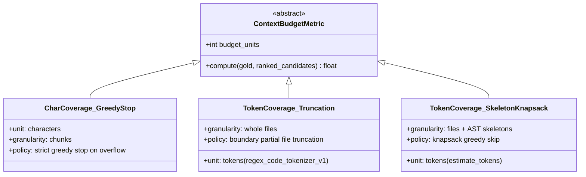

# RepoNeedle Canonical Evaluation Contract

**Contract Version**: `v1.0.0-canonical`  
**Effective Date**: October 2026  
**Status**: Authoritative & Binding  
**Applies To**: Stage 3.9.2, Stage 3.10+, and all subsequent RepoNeedle benchmark evaluations  
**Document ID**: `CANONICAL-CONTRACT-v1.0.0`

---

## 1. Scope & Purpose

This contract establishes the formal, immutable rules governing retrieval evaluation, metric computation, context budgeting, statistical testing, and provenance tracking for the RepoNeedle research programme.

Any pull request, research stage, or publication that violates this contract shall be deemed **NON-CONFORMANT** and rejected at the gate.

---

## 2. Benchmark Dataset & Target Population

### 2.1 Authorized Development Corpus: ARB v2
- **Corpus Version**: Agent Retrieval Benchmark (ARB) v2 Selective Mixed (`v2_selective_mixed`)
- **Corpus Manifest**: `external/agent-retrieval-bench/data/corpus/v2_selective_mixed/corpus_manifest.jsonl`
- **Submodule Pin**: `external/agent-retrieval-bench` commit `9e4d68937f29`
- **Snapshot Population**: $218$ unique `(repo, base_commit)` snapshots across $25$ software repositories.

### 2.2 Authorized Benchmark Query Population
The canonical evaluation population consists of **strictly $N = 345$ positive queries** across four tracks:
1. `v2_code2test`: 64 queries (`ARB_DIR/data/benchmark/v2_code2test/samples.jsonl`)
2. `v2_comment2context`: 117 queries (`ARB_DIR/data/benchmark/v2_comment2context/samples.jsonl`)
3. `v2_trace2code`: 68 queries (`ARB_DIR/data/benchmark/v2_trace2code/samples.jsonl`)
4. `v2_edit2ripple`: 96 queries (`ARB_DIR/data/benchmark/v2_edit2ripple/samples.jsonl`)

$$\sum N_{\text{track}} = 64 + 117 + 68 + 96 = \mathbf{345}$$

### 2.3 Exclusion Rules
- Zero-target (abstention) queries must **not** be blended into retrieval ranking metrics without explicit segregation.
- No positive query may be excluded, dropped, or marked missing. All 345 queries must appear in tall per-query evaluation files.

---

## 3. Candidate Pool & Search Universe Rules

### 3.1 Unconstrained Repository Universe
- All retrieval rankers must search the **complete eligible repository candidate pool**.
- Task-specific candidate pre-filtering (e.g. `tests_only` filters on `code2test`, `code_only` filters on `trace2code`) is **strictly prohibited**.
- All non-hidden files eligible in the corpus manifest for a snapshot must be indexed and ranked.

### 3.2 Path Normalization & Matching
- All file paths must be normalized to forward slashes (`/`), stripped of leading `./` or `/`.
- Matching against gold target paths must use exact normalized string equality:
  $$\text{match}(p_{\text{candidate}}, p_{\text{gold}}) \iff p_{\text{candidate}} == p_{\text{gold}}$$

---

## 4. Ranking & Retrieval Metric Formulas

### 4.1 Mean Reciprocal Rank (MRR)
For a query with gold targets $G \subset \mathcal{D}$ and ranked paths $(p_1, p_2, \dots, p_M)$:
$$\text{first\_rank} = \min \{ r \in \{1, \dots, M\} \mid p_r \in G \}$$
$$\text{RR} = \begin{cases} \frac{1}{\text{first\_rank}} & \text{if } \text{first\_rank} < \infty \\ 0.0 & \text{otherwise} \end{cases}$$
$$\text{MRR} = \frac{1}{N} \sum_{i=1}^N \text{RR}_i$$

### 4.2 Multi-Target Fractional Recall@k
$$\text{Recall@k} = \frac{|\{p_1, \dots, p_k\} \cap G|}{|G|}$$

### 4.3 Binary Hit@k
$$\text{Hit@k} = \begin{cases} 1.0 & \text{if } |\{p_1, \dots, p_k\} \cap G| \ge 1 \\ 0.0 & \text{otherwise} \end{cases}$$
> **Contract Requirement**: Hit@k must **never** be labeled as Recall@k.

### 4.4 Precision@k
$$\text{Precision@k} = \frac{|\{p_1, \dots, p_k\} \cap G|}{k}$$

### 4.5 Deterministic Tie-Breaking
When candidates share identical retrieval scores, ranking ties must be broken deterministically by **lexicographical file path in ascending order**:
$$\text{sort\_key}(d) = (-\text{score}(d), d.\text{path})$$

---

## 5. Context-Budget Metrics & Packing Specifications

### 5.1 Prohibition of Ambiguous `BCY@8k` Label
The term `BCY@8k` without explicit specification is deprecated and forbidden. Every budget metric must specify:
1. **Unit of Measurement** (`char` vs. `token`)
2. **Tokenizer Name & Version**
3. **Packing Policy** (`greedy_stop`, `greedy_skip`, `boundary_truncation`, `skeleton_compression`)
4. **Target Granularity** (`chunk` vs. `whole_file`)

### 5.2 Canonical Budget Metric Definitions

1. **`Char_Coverage@8k_GreedyStop`**:
   - Budget: 8,000 characters.
   - Evaluator: `agent_retrieval_bench.baseline.gold_coverage_at_budget`.
   - Granularity: Ranked chunks.
   - Quirk Preservation: Halts at first chunk exceeding budget (`used + len(text) > 8000 and used > 0`). Chunk 0 always included.
2. **`Token_Coverage@8k_Truncation`**:
   - Budget: 8,000 tokens.
   - Tokenizer: `regex_code_tokenizer_v1` (`TOKEN_RE = re.compile(r"[A-Za-z_][A-Za-z0-9_]*|[0-9]+|[^A-Za-z0-9_\s]", re.UNICODE)`).
   - Evaluator: `agent_retrieval_bench.bcy_curve.pack_files`.
   - Boundary Policy: Partial truncation; boundary file included up to remaining budget; gold considered covered if $\ge 1$ content token included.
3. **`Token_Coverage@8k_SkeletonKnapsack`**:
   - Budget: 8,000 tokens.
   - Tokenizer: `reponeedle.core.tokenizer.estimate_tokens`.
   - Evaluator: `reponeedle.core.budget.BudgetOptimizer.pack_context(allow_skeletons=True)`.
   - Boundary Policy: Greedy-skip knapsack. Full file fallback to AST skeleton if full file exceeds remaining tokens.

---

## 6. System Baseline Standards

### 6.1 `BASE-BM25` (Canonical Pure Lexical Baseline)
- **Implementation**: `reponeedle.core.lexical.BM25Index(decouple_symbols=True)`
- **Parameters**: $k_1 = 1.5, b = 0.75$, `body_weight = 1.0`, `path_weight = 2.0`, `symbol_weight = 1.5`.
- **Length Normalization**: AST symbols decoupled from normalization denominator:
  $$\text{effective\_len} = \max(1.0, \text{len}(\text{body\_tokens}) + \text{len}(\text{path\_tokens}))$$
- **Target Ground Truth**: $\text{MRR} = \mathbf{0.1768}, \text{Recall@20} = \mathbf{0.4622}$.

### 6.2 `BASE-REPOMAP` (External Pinned Reference)
- **Implementation**: Aider-style tree-sitter call graph from `external/agent-retrieval-bench` at commit `9e4d689`.
- **Target Ground Truth**: $\text{MRR} = \mathbf{0.2293}, \text{Recall@20} = \mathbf{0.6599}$.
- **Rule**: Must **never** be cited from hardcoded static strings; must always be referenced from verified submodule execution records.

### 6.3 `CAND-CASCADE` (Winning Canonical Candidate)
- **Implementation**: `reponeedle.core.cascade.CascadedRanker`
- **Parameters**: `top_k_preserve = 3`, `enable_graph_expansion = True`, `degree_normalized = True`, `package_fencing = True`, `test_discovery = True`.
- **Target Ground Truth**: $\text{MRR} = \mathbf{0.1905}, \text{Recall@20} = \mathbf{0.5503}$.

---

## 7. Statistical & Latency Protocols

### 7.1 Statistical Testing Requirements
- Paired differences must be computed query-by-query ($\Delta_i = T_i - B_i$).
- Both **Unclustered Bootstrap** and **Repository-Clustered Bootstrap** must be reported ($B = 10,000$ iterations, random seed `42`).
- Non-parametric significance must use the **Wilcoxon signed-rank test** with Pratt zero-handling.
- Declared significance threshold is $\alpha = 0.01$. Subgroup analyses must be Bonferroni-corrected.

### 7.2 Latency Measurement Protocol
- Profiling must report dynamic distributions across all 345 queries: **Median (p50)**, **95th percentile (p95)**, and **Mean**.
- Computational phases must be isolated:
  1. Cold Start Indexing Time (seconds)
  2. Warm Query Retrieval Time (milliseconds)
  3. Context Packing Time (milliseconds)
- Static constants must **never** be substituted for dynamic latency measurements.

---

## 8. Provenance & Audit Ledger Standards

Every stage must generate:
1. `DISCREPANCY_MATRIX.csv`
2. Tall per-query results CSV ($N = 345 \times \text{systems}$)
3. `RUN_PROVENANCE.json` containing:
   - Git HEAD SHA and parent SHA
   - Status and SHAs of frozen tags `v0.1.0-baseline` and `stage3-candidate-freeze`
   - Platform, Python version, dependencies
   - SHA-256 hashes of all input scripts and output deliverables
   - Deterministic execution timestamp
