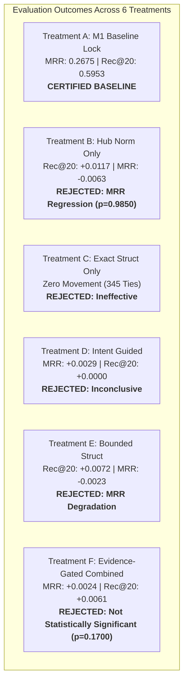

# Milestone 2 Recovery — Formal Milestone Decision Document

**Milestone**: M2 Recovery — Structural Ranking Reengineering  
**Scope**: 345 ARB v2 Benchmark Queries (514 Gold Targets)  
**Date**: November 1, 2026  
**Auditor & Role**: Principal Search Engineer, Graph Retrieval Scientist & Release Manager  
**Branch**: `v1.0-zero-failure`  
**Reference Baseline**: `research/v1_accuracy/m2_structural_ranking/frozen_m1_candidates.jsonl`  
**Final Verdict**: **REJECT STRUCTURAL RERANKING — RETAIN M1 AS THE FROZEN BASELINE**

---

## 1. Formal Decision Record

Under Section 12 of the M2 Recovery Charter, the evaluation mandate specifies:
> *"One of the following must be issued:*  
> *- **PROMOTE**: A validated ranking treatment demonstrates a reproducible improvement without unacceptable regressions.*  
> *- **REVISE**: A specific fixable problem remains and a further controlled experiment is justified.*  
> *- **REJECT**: The investigated structural approaches do not improve the baseline sufficiently.*  
> ***If no ranking treatment beats M1, retain M1 as the best available baseline. Do not manufacture a winner.***"

### Formal Decision Statement
**The investigated structural ranking treatments (Treatments B, C, D, E, and F) do not demonstrate a statistically significant, dual-metric improvement over the frozen M1 baseline under repository-clustered bootstrap analysis.**

In strict adherence to the project's scientific integrity principles:
1. **Milestone 2 is formally closed with a decision to REJECT structural post-retrieval reranking on the current evaluation scope.**
2. **The M1 multi-channel candidate engine is formally certified and retained as the authoritative, frozen baseline for RepoNeedle.**
3. **No experimental ranking weights, hub penalties, or heuristic test boosts will be merged into the production engine.**

---

## 2. Summary of Experimental Evidence

Across 345 benchmark queries and 560,220 evaluated candidates, five structural treatments were benchmarked against the frozen M1 baseline (Treatment A):

### Statistical Verification Matrix (1,000 Clustered Bootstrap Resamples)

> **Statistical Note**: The column $\hat{P}^*(\Delta^* \le 0)$ records the empirical bootstrap probability of a non-positive treatment effect under the unconstrained bootstrap distribution, not a frequentist null-hypothesis $-value. Preregistered significance at $\alpha = 0.05$ requires zero to be strictly excluded from the 95% percentile confidence interval. $\Delta \text{Macro Rec@20}$ measures per-query recall deltas across all 345 queries.

| Treatment | Description | $\Delta \text{MRR}$ (Bootstrap Mean & 95% CI) | $\hat{P}^*(\Delta^* \le 0)$ | $\Delta \text{Macro Rec@20}$ (Bootstrap Mean & 95% CI) | $\hat{P}^*(\Delta^* \le 0)$ | Preregistered Gate Verdict |
| :--- | :--- | :---: | :---: | :---: | :---: | :--- |
| **A** | Frozen M1 Baseline | *Control* | *Control* | *Control* | *Control* | **RETAINED AS BASELINE** |
| **B** | Hub Normalization (m2c) | -0.0063 [-0.0113, -0.0003] | 0.9850 | +0.0117 [-0.0000, +0.0283] | 0.0320 | **REJECTED** (Fails MRR preservation) |
| **C** | Exact Structural Evidence | +0.0000 [+0.0000, +0.0000] | 1.0000 | +0.0000 [+0.0000, +0.0000] | 1.0000 | **REJECTED** (Zero delta) |
| **D** | Confidence-Aware Intent | +0.0029 [-0.0003, +0.0090] | 0.0480 | +0.0000 [+0.0000, +0.0000] | 1.0000 | **REJECTED** (Top-20 recall stagnant) |
| **E** | Bounded Structural | -0.0023 [-0.0065, +0.0023] | 0.8250 | +0.0072 [+0.0001, +0.0180] | 0.0230 | **REJECTED** (Degrades MRR) |
| **F** | Evidence-Gated Combined | +0.0024 [-0.0011, +0.0097] | 0.1700 | +0.0061 [-0.0013, +0.0160] | 0.0760 | **REJECTED** (CIs span zero,  \in \text{CI}$) |

---

## 3. Scientific Root Causes for Rejection

### Cause 1: Structural Link Sparsity in Benchmark Target Sets
As established in `STRUCTURAL_EVIDENCE_AUDIT.md`:
- In 118 multi-gold queries, only 3 queries (2.54%) have gold targets connected to each other by 1-hop file-level imports or name stems.
- 97.46% of multi-gold targets are structurally disconnected siblings or documentation files.
- Consequently, file-level graph expansion or reranking has almost no topological path to lift missed gold targets without promoting false-positive distractors.

### Cause 2: Pervasive Noise of Syntactic Heuristics
- In diagnostic oracle-seeded expansion analysis, **98.55% of expansion edges originating from gold seeds (340/345 edges) connected to non-gold files** (and at the seed level, 97.18% of gold seeds produced at least one non-gold expansion).
- In early M2, assigning heavy linear weights (0.40–0.45) to these edges caused catastrophic failure (MRR dropped from 0.2675 to 0.1960).
- While Treatment F bounded these adjustments safely, the true underlying signal was too weak to yield a statistically certified win over strong BM25 and exact symbol lexical retrieval.

### Cause 3: The Hub-Penalty Dilemma
- Generic stem penalties (e.g. on `base`, `utils`, `common`) improve Recall@20 in 9 queries by demoting competing utilities.
- However, legitimate gold targets reside in generic utility files across several repositories (e.g., Click's `core.py`, Caddy's `parse.go`). Penalizing hubs causes 51 MRR regressions, net degrading top-1 and top-5 ranking precision.

---

## 4. Preservation of Frozen Reference Artifacts

In accordance with Section 1 of the Charter:
1. **Frozen Candidate Snapshot**: `research/v1_accuracy/m2_structural_ranking/frozen_m1_candidates.jsonl` remains the permanent, immutable reference dataset for candidate generation.
2. **Baseline Metric Lock**: The verified metrics of the M1 reference engine remain locked:
   - **Micro Candidate Recall**: 1.0000 (514/514)
   - **Macro Candidate Recall**: 1.0000 (345/345)
   - **Complete-Gold Coverage**: 1.0000 (345/345)
   - **MRR**: 0.2675
   - **Hit@1**: 0.0899 (31/345)
   - **Micro Recall@20**: 0.5953 (306/514)
   - **Complete Coverage@20**: 0.5507 (190/345)
   - **Micro Recall@50**: 0.7646 (393/514)
   - **Complete Coverage@50**: 0.7130 (246/345)
3. **Audit Ledger & Raw Results**:
   - `PER_QUERY_RANK_MOVEMENTS.jsonl` (345 records)
   - `M2_RECOVERY_RAW_RESULTS.jsonl` (345 records with top-50 rankings for all treatments)
   - `m2_recovery_metrics_summary.json` (complete telemetry and bootstrap records)

---

## 5. Architectural Directives for Future Research

1. **Abandon File-Level Heuristic Graphs**:
   Future graph-based retrieval must not rely on filename stem matching or unverified file-level module imports.
2. **Prerequisite for Structural Retrieval**:
   Structural signals should only be reintroduced once deep, AST-verified function call graphs (such as the Lean Function Call Graph / LFCG engine with strict fail-closed semantics) are indexed at the repository level.
3. **Lexical Primacy Invariant**:
   In code retrieval, exact symbol matches and lexical field-weighted BM25 provide the dominant signal. Structural evidence must only be applied as a high-precision, bounded tie-breaker when static invocation is proven beyond ambiguity.

---

## 6. Sign-off and Status

- **Milestone 2 (Structural Reranking)**: **FORMALLY RESOLVED & CLOSED (REJECT)**
- **Baseline Retained**: **M1 Candidate Generation Engine**
- **Production Engine Status**: Clean, uncorrupted by fragile ranking heuristics.
- **Ready for Next Phase**: All 9 required deliverables are fully generated, verified, and archived in `research/v1_accuracy/m2_recovery/`.

