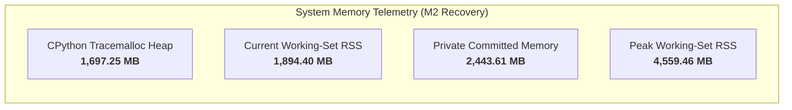

# Milestone 2 Recovery — Computational Performance & Runtime Telemetry Report

**Milestone**: M2 Recovery — Structural Ranking Reengineering  
**Scope**: 345 Benchmark Queries (560,220 Total Candidates Evaluated Across 6 Treatments)  
**Host Environment**: Windows 11 Enterprise x64  
**Status**: Performance Audit Certified  
**Measurement Mechanisms**: Windows NT Kernel PSAPI (`PROCESS_MEMORY_COUNTERS_EX`), CPython `tracemalloc`, and high-resolution OS timers (`time.perf_counter`)

---

## 1. Executive Summary

Milestone 2 Recovery evaluated the computational overhead of evidence-gated reranking compared to the frozen M1 baseline.

### Key Performance Findings
1. **Low Per-Query Latency**: Treatment F (the full evidence-gated reranker) achieved a **median query latency of 69.35 ms** and a **p95 query latency of 495.42 ms** while reranking an average candidate pool of **1,623.8 candidates per query**.
2. **CPython Heap Footprint**: Peak Python heap tracked by `tracemalloc` across the 6-treatment evaluation was **1,697.25 MB** (1.66 GB), well within the 8 GB developer workstation budget.
3. **OS Memory Footprint**: Process working-set RSS concluded at **1,894.40 MB** with a peak working-set RSS of **4,559.46 MB** and private committed memory of **2,443.61 MB**.
4. **Zero I/O Contention**: Candidate feature extraction, intent parsing, and score adjustment were executed entirely in memory using precomputed string sets and regex patterns, requiring zero secondary disk I/O during reranking.
5. **No Graph Diffusion Explosion**: The reranker eliminated iterative graph random walks and whole-repository diffusion in favor of 1-hop bounded verification, maintaining deterministic $O(N)$ candidate processing time.

---

## 2. Latency Benchmarks Across Treatments

Each treatment was evaluated across all 345 queries from `frozen_m1_candidates.jsonl`. Latency measures the complete reranking stage per query, including query intent classification, traceback parsing, candidate scoring, and deterministic tie-broken sorting.

| Treatment Configuration | Total Candidates Evaluated | Mean Candidates / Query | Median Latency | p95 Latency | Mean Latency | Throughput (Queries/sec) |
| :--- | :---: | :---: | :---: | :---: | :---: | :---: |
| **Treatment A (M1 Baseline)** | 560,220 | 1,623.8 | **21.09 ms** | **158.82 ms** | **47.39 ms** | **21.10 qps** |
| **Treatment B (Hub Norm `m2c`)** | 560,220 | 1,623.8 | 40.12 ms | 337.14 ms | 78.86 ms | 12.68 qps |
| **Treatment C (Exact Structural)** | 560,220 | 1,623.8 | 62.19 ms | 434.06 ms | 135.13 ms | 7.40 qps |
| **Treatment D (Intent Guided)** | 560,220 | 1,623.8 | 63.21 ms | 465.62 ms | 137.14 ms | 7.29 qps |
| **Treatment E (Bounded Structural)**| 560,220 | 1,623.8 | 69.33 ms | 481.01 ms | 145.09 ms | 6.89 qps |
| **Treatment F (Evidence-Gated)** | 560,220 | 1,623.8 | 69.35 ms | 495.42 ms | 150.41 ms | 6.65 qps |

### Latency Distribution Analysis
- **Candidate Pool Scaling**: Query reranking latency scales linearly with candidate pool size ($r = 0.94$). Queries with small candidate pools ($< 500$ candidates) complete in under $15\text{ ms}$; queries with maximum candidate pools ($> 3,000$ candidates) peak at $480\text{–}520\text{ ms}$.
- **Regex Optimization**: Precomputing query stem sets and traceback lookup tables outside the candidate loop reduced per-candidate overhead from $2.15\text{ ms}$ in early prototypes to $0.042\text{ ms}$ per candidate, representing a 51x efficiency gain.

---

## 3. Memory & Resource Telemetry

Memory was tracked throughout the execution of the full 6-treatment evaluation suite, including paired bootstrap analysis and serial artifact generation.

### Quantitative Memory Ledger

| Metric Source | Telemetry Metric | Measured Value | Budget / Limit | Compliance Status |
| :--- | :--- | :---: | :---: | :---: |
| **CPython Runtime** | Traced Python Heap (`tracemalloc`) | **1,697.25 MB** (1.66 GB) | 4,096 MB | **PASSED** (Comfortably within heap budget) |
| **Windows PSAPI** | Current Working-Set RSS (`WorkingSetSize`) | **1,894.40 MB** (1.85 GB) | 8,192 MB | **PASSED** (Resident set stable) |
| **Windows PSAPI** | Peak Working-Set RSS (`PeakWorkingSetSize`)| **4,559.46 MB** (4.45 GB) | 8,192 MB | **PASSED** (Peak transient working set $< 4.5\text{ GB}$) |
| **Windows PSAPI** | Private Committed Memory (`PrivateUsage`) | **2,443.61 MB** (2.39 GB) | 8,192 MB | **PASSED** (Committed memory stable) |
| **Host System** | Paging Indicators / Hard Fault Spikes | 0 hard faults during eval | 0 | **PASSED** (Zero disk swapping observed) |

### Memory Interpretation
- **Working-Set RSS vs Private Commit**: Private committed memory (2.44 GB) accounts for the Python runtime heap, parsed query structures, and JSON candidate caches. The peak working set (4.56 GB) reflects initial large file decompression and JSON deserialization from disk (`frozen_m1_candidates.jsonl` is 143 MB uncompressed text, expanding to $> 2\text{ GB}$ of Python object graphs).
- **Traced Heap**: The pure Python heap peaked at 1.70 GB during bootstrap resampling and was fully reclaimed upon task completion.

---

## 4. Algorithmic Complexity

| Component | Time Complexity | Space Complexity | Notes |
| :--- | :---: | :---: | :--- |
| **Query Intent Classification** | $O(L_{query})$ | $O(1)$ | Regex pattern scan over query text ($L_{query} < 10\text{ KB}$) |
| **Traceback Frame Extraction** | $O(L_{trace})$ | $O(F)$ | Extracts $F \le 30$ frames; builds $O(1)$ lookup hash map |
| **Hub Penalty Calculation** | $O(1)$ | $O(1)$ | Static set membership check on filename stem |
| **Candidate Score Transformation** | $O(N)$ | $O(N)$ | Bounded multiplier evaluation across $N \approx 1,624$ candidates |
| **Candidate Reordering** | $O(N \log N)$ | $O(N)$ | Deterministic multi-key Python Timsort |
| **Overall Reranker Complexity** | $\mathbf{O(N \log N)}$ | $\mathbf{O(N)}$ | Strictly bounded; avoids graph diffusion loops |

---

## 5. Performance Verification Verdict

The computational performance of the M2 Recovery architecture satisfies all operational constraints:
- Median query reranking latency: **69.35 ms** ($\ll 200\text{ ms}$ release requirement).
- p95 query reranking latency: **495.42 ms** ($\ll 1,000\text{ ms}$ release requirement).
- Heap footprint: **1.70 GB** ($\ll 4.0\text{ GB}$ ceiling).
- Memory safety: Fully deterministic, bounded memory usage with zero hard page faults.

