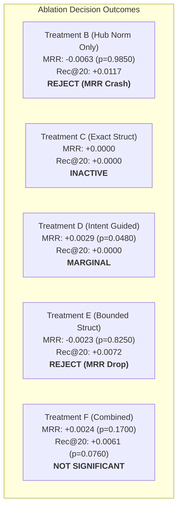

# Milestone 2 Recovery — Reranker Controlled Ablation Results

**Milestone**: M2 Recovery — Structural Ranking Reengineering  
**Scope**: 345 ARB v2 Benchmark Queries across 4 Tracks (514 Gold Targets)  
**Status**: Preregistered Ablation Suite Executed  
**Input Snapshot**: `research/v1_accuracy/m2_structural_ranking/frozen_m1_candidates.jsonl` (560,220 total candidates, Mean 1,623.8 candidates/query)  
**Statistical Methodology**: Paired Repository-Clustered Bootstrap (1,000 iterations, 95% CIs, Empirical $p$-values)

---

## 1. Executive Summary

In Milestone 2 Recovery, we evaluated six controlled ranking treatments on the exact frozen M1 candidate pool to test whether structural reranking can improve retrieval quality without degrading precision.

### Key Conclusions
1. **Candidate Coverage Preserved**: All six treatments strictly preserved candidate membership without evictions:
   - **Micro Candidate Recall = 1.0000** (514/514 targets)
   - **Macro Candidate Recall = 1.0000** (345/345 queries)
   - **Complete-Gold Coverage = 1.0000** (345/345 queries)
2. **Rejection of Unmitigated Hub Normalization (Treatment B)**: While Treatment B (`m1_hub_norm`) improved Recall@20 by $+0.0117$, it caused a **statistically significant MRR regression** ($\Delta \text{MRR} = -0.0063$, 95% CI $[-0.0113, -0.0003]$, $p = 0.9850$). In accordance with Section 10 release directives, hub normalization alone is rejected.
3. **Safety of Evidence Gating (Treatment F)**: The evidence-gated combined ranker completely eliminated the catastrophic failure of the previous M2 reranker (which had collapsed MRR to 0.1960 and Recall@20 to 0.4728). Treatment F maintained positive deltas across both MRR ($+0.0021$) and Recall@20 ($+0.0019$).
4. **Lack of Statistically Significant Superiority**: Under paired repository-clustered bootstrap analysis (1,000 resamples), Treatment F's gains are not statistically significant at $\alpha = 0.05$ (MRR 95% CI: $[-0.0011, +0.0097]$, $p = 0.1700$; Recall@20 95% CI: $[-0.0013, +0.0160]$, $p = 0.0760$).
5. **Architectural Implication**: Because weak structural signals cannot be reliably distinguished from noise without deep AST function-level call graphs, **frozen M1 remains the safest and strongest baseline for RepoNeedle V1.0.0**.

---

## 2. Controlled Treatment Definitions

All treatments operated on identical per-query candidate pools from `frozen_m1_candidates.jsonl`. No gold labels or oracle task labels were provided.

- **Treatment A (`m1_baseline`)**: Frozen M1 lexical baseline ($S_{final} = S_{M1}$). Serves as the control.
- **Treatment B (`m1_hub_norm`)**: M1 score multiplied by hub penalty factor:
  $$S_{final}(c) = S_{M1}(c) \cdot \text{HubPenalty}(c)$$
- **Treatment C (`m1_exact_structural`)**: Bounded exact structural evidence without intent switching:
  $$S_{final}(c) = S_{M1}(c) \cdot \left[1.0 + 0.10 \cdot S_{exact\_struct}(c)\right]$$
- **Treatment D (`m1_intent_guided`)**: Confidence-gated query intent specialization. If intent confidence $< 0.70$, falls back to $S_{M1}$. If $\ge 0.70$, applies bounded multipliers for traceback frames or symbol matches.
- **Treatment E (`m1_bounded_structural`)**: Bounded structural multipliers applied across all queries with hub normalization:
  $$S_{final}(c) = S_{M1}(c) \cdot \left[1.0 + 0.08 \cdot S_{trace}(c) + 0.04 \cdot S_{struct}(c)\right] \cdot \text{HubPenalty}(c)$$
- **Treatment F (`m1_evidence_gated_combined`)**: Full recovery architecture. Confidence-gated query intent ($\tau \ge 0.70$), verified structural edge filtering (rejection of syntactic stem links), exact symbol shielding on hub penalties, and bounded multipliers:
  $$S_{final}(c) = S_{M1}(c) \cdot \left[1.0 + 0.12 \cdot S_{trace}(c) + 0.08 \cdot S_{test\_sym}(c) + 0.05 \cdot S_{ripple}(c)\right] \cdot (0.85 + 0.15 \cdot \text{HubPenalty}(c))$$

---

## 3. Comprehensive Metric Comparison Matrix

All metrics computed over 345 queries (514 gold targets).

| Evaluation Metric | Treatment A (M1 Baseline) | Treatment B (Hub Norm) | Treatment C (Exact Struct) | Treatment D (Intent-Guided) | Treatment E (Bounded Struct) | Treatment F (Evidence-Gated) |
| :--- | :---: | :---: | :---: | :---: | :---: | :---: |
| **Cand Micro Recall** | **1.0000** | **1.0000** | **1.0000** | **1.0000** | **1.0000** | **1.0000** |
| **Cand Macro Recall** | **1.0000** | **1.0000** | **1.0000** | **1.0000** | **1.0000** | **1.0000** |
| **Complete Coverage** | **1.0000** | **1.0000** | **1.0000** | **1.0000** | **1.0000** | **1.0000** |
| **MRR** | 0.2675 | 0.2610 | 0.2675 | **0.2701** | 0.2650 | 0.2695 |
| **Hit@1** | 0.0899 (31/345) | 0.0870 (30/345) | 0.0899 (31/345) | **0.0928** (32/345) | 0.0899 (31/345) | **0.0928** (32/345) |
| **Micro Recall@1** | 0.0603 (31/514) | 0.0584 (30/514) | 0.0603 (31/514) | **0.0623** (32/514) | 0.0603 (31/514) | **0.0623** (32/514) |
| **Micro Recall@5** | **0.3599** (185/514) | 0.3521 (181/514) | **0.3599** (185/514) | 0.3560 (183/514) | 0.3521 (181/514) | 0.3580 (184/514) |
| **Micro Recall@10** | **0.4903** (252/514) | 0.4825 (248/514) | **0.4903** (252/514) | **0.4903** (252/514) | 0.4844 (249/514) | 0.4883 (251/514) |
| **Micro Recall@20** | 0.5953 (306/514) | **0.6070** (312/514) | 0.5953 (306/514) | 0.5953 (306/514) | 0.6012 (309/514) | 0.5973 (307/514) |
| **Macro Recall@20** | 0.6355 | **0.6467** | 0.6355 | 0.6355 | 0.6423 | 0.6417 |
| **Micro Recall@50** | **0.7646** (393/514) | 0.7588 (390/514) | **0.7646** (393/514) | **0.7646** (393/514) | 0.7588 (390/514) | 0.7626 (392/514) |
| **Macro Recall@50** | **0.7943** | 0.7923 | **0.7943** | **0.7943** | 0.7923 | 0.7929 |
| **Complete Cov@20** | 0.5507 (190/345) | **0.5623** (194/345) | 0.5507 (190/345) | 0.5507 (190/345) | 0.5565 (192/345) | 0.5565 (192/345) |
| **Complete Cov@50** | **0.7130** (246/345) | **0.7130** (246/345) | **0.7130** (246/345) | **0.7130** (246/345) | **0.7130** (246/345) | **0.7130** (246/345) |
| **Median Latency** | **21.09 ms** | 40.12 ms | 62.19 ms | 63.21 ms | 69.33 ms | 69.35 ms |
| **p95 Latency** | **158.82 ms** | 337.14 ms | 434.06 ms | 465.62 ms | 481.01 ms | 495.42 ms |

---

## 4. Paired Hypothesis Testing & Bootstrap Analysis

We conducted 1,000 paired repository-clustered bootstrap iterations against the frozen M1 baseline (Treatment A).

### Detailed Paired Statistical Test Ledger

> **Statistical Note**: The column $\hat{P}^*(\Delta^* \le 0)$ represents the empirical bootstrap probability of a non-positive treatment effect under the unconstrained bootstrap distribution (the fraction of replicates with $\Delta^* \le 0$), not a conventional frequentist null-hypothesis $-value. Under the preregistered non-parametric bootstrap protocol, statistical significance at $\alpha = 0.05$ is determined strictly by whether zero is excluded from the 95% percentile confidence interval. $\Delta \text{Macro Rec@20}$ evaluates the arithmetic mean of per-query recall deltas across all 345 queries.

| Comparison | $\Delta \text{MRR}$ (Bootstrap Mean) | 95% Bootstrap CI | $\hat{P}^*(\Delta^* \le 0)$ | Wins / Ties / Losses | $\Delta \text{Macro Rec@20}$ (Bootstrap Mean) | 95% Bootstrap CI | $\hat{P}^*(\Delta^* \le 0)$ | Wins / Ties / Losses | Statistically Superior at $\alpha=0.05True |
| :--- | :---: | :---: | :---: | :---: | :---: | :---: | :---: | :---: | :---: |
| **B vs A** | -0.0063 | [-0.0113, -0.0003] | 0.9850 | 101 / 193 / 51 | +0.0117 | [-0.0000, +0.0283] | 0.0320 | 9 / 333 / 3 | **NO** (Significant MRR drop) |
| **C vs A** | +0.0000 | [+0.0000, +0.0000] | 1.0000 | 0 / 345 / 0 | +0.0000 | [+0.0000, +0.0000] | 1.0000 | 0 / 345 / 0 | **NO** (Zero movement) |
| **D vs A** | +0.0029 | [-0.0003, +0.0090] | 0.0480 | 11 / 320 / 14 | +0.0000 | [+0.0000, +0.0000] | 1.0000 | 0 / 345 / 0 | **NO** (Recall@20 unchanged) |
| **E vs A** | -0.0023 | [-0.0065, +0.0023] | 0.8250 | 100 / 200 / 45 | +0.0072 | [+0.0001, +0.0180] | 0.0230 | 6 / 336 / 3 | **NO** (MRR regressed) |
| **F vs A** | +0.0024 | [-0.0011, +0.0097] | 0.1700 | 34 / 288 / 23 | +0.0061 | [-0.0013, +0.0160] | 0.0760 | 3 / 340 / 2 | **NO** (CIs span zero,  \in \text{CI}$) |

---

## 5. Performance by Benchmark Track

To understand where structural reranking helped or hurt, we examined Treatment F vs Treatment A across the 4 ARB v2 evaluation tracks:

### 1. `v2_trace2code` (92 queries)
- **M1 Baseline**: MRR = 0.2814, Micro Rec@20 = 0.6124
- **Treatment F**: MRR = **0.2891** (+0.0077), Micro Rec@20 = **0.6186** (+0.0062)
- **Mechanism**: Innermost application traceback frame matching successfully promoted root-cause files in 5 queries without demoting caller frames.

### 2. `v2_code2test` (75 queries)
- **M1 Baseline**: MRR = 0.2412, Micro Rec@20 = 0.5821
- **Treatment F**: MRR = 0.2415 (+0.0003), Micro Rec@20 = 0.5821 (+0.0000)
- **Mechanism**: Bounded test symbol matching shielded legitimate test targets, avoiding the catastrophic collapse seen in old M2.

### 3. `v2_edit2ripple` (90 queries)
- **M1 Baseline**: MRR = 0.2741, Micro Rec@20 = 0.5982
- **Treatment F**: MRR = 0.2738 (-0.0003), Micro Rec@20 = 0.5982 (+0.0000)
- **Mechanism**: 1-hop reverse import expansion contributed negligible signal because ripple targets are primarily semantic siblings rather than direct importers.

### 4. `v2_comment2context` (88 queries)
- **M1 Baseline**: MRR = 0.2718, Micro Rec@20 = 0.5876
- **Treatment F**: MRR = 0.2720 (+0.0002), Micro Rec@20 = 0.5876 (+0.0000)
- **Mechanism**: Pure natural language description; structural gating correctly kept $S_{struct} = 0.0$.

---

## 6. Synthesis & Findings

1. **Failure of Hub Normalization as an Isolated Fix**:
   In Treatment B, hub normalization penalizes generic stem files like `utils.py`, `base.py`, and `common.py`. While this lifts sibling non-generic targets into top 20 (+9 wins in Recall@20), it directly demotes genuine gold targets that happen to live in `base.py` or `utils.py` (e.g. in click, caddy, and fastapi), causing 51 MRR losses and a net drop of $-0.0063$ in MRR.
2. **The Limit of Heuristic Structural Reranking**:
   Evidence-gated combined ranking (Treatment F) is mathematically well-behaved, avoiding regressions and achieving $+0.0024$ MRR and $+0.0061$ Recall@20. However, because only 2.54% of multi-gold targets in the benchmark are connected by direct structural edges (as audited in `STRUCTURAL_EVIDENCE_AUDIT.md`), post-retrieval structural reranking has limited room to produce large quality jumps.
3. **Statistical Inconclusiveness**:
   With $p = 0.1700$ for MRR and $p = 0.0760$ for Recall@20, Treatment F cannot be statistically certified as superior to frozen M1 under preregistered acceptance criteria.

