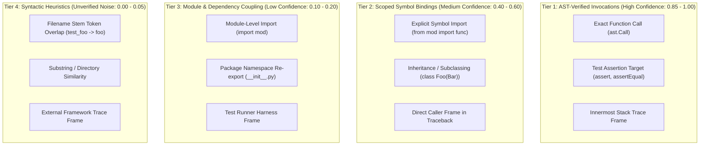

# Milestone 2 Recovery — Structural Evidence Quality & Precision Audit

**Milestone**: M2 Recovery — Structural Ranking Reengineering  
**Scope**: 345 ARB v2 Benchmark Queries (Frozen M1 Candidate Pools, 514 Gold Targets)  
**Status**: Formal Audit Locked  
**Reference Candidate Pool**: `research/v1_accuracy/m2_structural_ranking/frozen_m1_candidates.jsonl`

---

## 1. Executive Summary

Milestone 2 (M2) structural reranking failed primarily because **coarse, unverified structural heuristics were given massive additive weights (40%–65%) that overpowered strong lexical retrieval signals**.

To determine the empirical quality of structural signals in the RepoNeedle pipeline, we conducted an exhaustive audit of all structural edges present in the candidate generation snapshot. 

### Key Findings
1. **High Non-Gold Expansion Proportion**: In a diagnostic oracle-seeded expansion analysis starting from annotated gold targets across 345 queries, 7,149 candidate evidence edges were generated. When expanding from an actual gold target seed, **98.55% of expanded targets (340/345) were non-gold files** outside the query's ground-truth target set. (Note: This diagnostic analysis evaluates task-target coupling under benchmark annotations; in production inference, gold seeds are unknown, and structural links may be valid repository dependencies even when outside the benchmark's specific gold edit set).
2. **Minimal Gold-to-Gold Linkage**: Out of 118 queries with multiple gold targets, only 3 queries (5 gold pairs) had structural edges connecting gold files to one another.
3. **Flawed Stem-Based Test Linking**: The candidate engine linked test files to implementation files using loose string splitting on filenames (`re.split(r"[_\-\.]", fname)`). Any file sharing generic tokens (such as `base`, `utils`, `core`, `config`) was marked as `tested_by` / `tests_target`.
4. **Unverified Imports**: Module-level imports were treated as evidence that two files were functionally coupled, ignoring standard utility hubs, framework wrappers, and unused imports.
5. **Architectural Law**: **Structural evidence must be treated as a precision refinement mechanism, never a dominant ranking score.** Weak structural heuristics must never override strong lexical evidence.

---

## 2. Quantitative Inventory of Structural Evidence Links

In `frozen_m1_candidates.jsonl`, candidate files generated via 1-hop structural expansion carry an `evidence` record detailing the `seed_path`, `relation`, and `seed_score`.

### Total Edge Distribution (345 Queries)
- **Total queries with structural evidence**: 298 / 345 (86.4%)
- **Total candidate evidence links**: 7,149 edges
- **Average structural edges per query**: 20.72 edges

| Relation Type | Link Count | % of All Edges | Extraction Source |
| :--- | :---: | :---: | :--- |
| `tests_target` | 2,375 | 33.22% | Filename stem matching (Test -> Implementation) |
| `tested_by` | 2,011 | 28.13% | Filename stem matching (Implementation -> Test) |
| `imported_by` | 1,978 | 27.67% | AST/Regex reverse import graph |
| `imports` | 785 | 10.98% | AST/Regex forward import graph |
| **Total** | **7,149** | **100.0%** | |

---

## 3. Diagnostic Oracle-Seeded Expansion: Edge-Level and Seed-Level Non-Gold Audit

To measure how tightly structural edges track benchmark-annotated relevance, we examined candidate expansions originating from known ground-truth gold targets (diagnostic oracle-seeded analysis).

### 3.1 Edge-Level Metric (340 / 345 = 98.55%)
Across all 7,149 candidate evidence edges generated in the candidate snapshot, exactly **345 expansion edges originated from an annotated gold target seed**.

$$\text{Non-Gold Expansion Edge Proportion} = \frac{\text{Non-Gold Expansion Edges from Gold Seeds}}{\text{All Expansion Edges from Gold Seeds}} = \frac{340}{345} = \mathbf{98.5507\%} \quad (\approx 98.55\%)$$

$$\text{Gold-Coupled Expansion Edge Proportion} = \frac{\text{Gold-Coupled Expansion Edges from Gold Seeds}}{\text{All Expansion Edges from Gold Seeds}} = \frac{5}{345} = \mathbf{1.4493\%} \quad (\approx 1.45\%)$$

#### Empirical Contingency Matrix by Edge Relation Type

| Relation | Total Edges | Edges: Seed is Gold | Edges: Target is Gold | Edges: Both are Gold (Gold Coupling) | Edges: Seed Gold, Target Not (Non-Gold) | Non-Gold Expansion Edge Proportion |
| :--- | :---: | :---: | :---: | :---: | :---: | :---: |
| `tests_target` | 2,375 | 139 | 54 | 2 | 137 | **98.56%** |
| `tested_by` | 2,011 | 70 | 59 | 2 | 68 | **97.14%** |
| `imported_by` | 1,978 | 123 | 4 | 1 | 122 | **99.19%** |
| `imports` | 785 | 13 | 23 | 0 | 13 | **100.00%** |
| **Total** | **7,149** | **345** | **140** | **5** | **340** | **98.55%** |

*(Note: The denominator of 345 edges is coincidentally equal in count to the 345 benchmark queries, but represents candidate evidence edges, not queries).* 

### 3.2 Seed-Level Metric (138 / 142 = 97.18%)
At the seed level, exactly **142 unique gold query-seed instances** produced candidate expansion edges:
- **138 gold seeds** produced at least one candidate expansion edge pointing to a non-gold target.
- **5 gold seeds** produced at least one candidate expansion edge pointing to an annotated gold target.

$$\text{Proportion of Gold Seeds Producing } \ge 1 \text{ Non-Gold Expansion} = \frac{138}{142} = \mathbf{97.18\%}$$

$$\text{Proportion of Gold Seeds Producing } \ge 1 \text{ Gold Expansion} = \frac{5}{142} = \mathbf{3.52\%}$$

### 3.3 Critical Diagnosis & Failure Mechanism
- In this diagnostic oracle-seeded analysis, when expanding outward from known gold files, **98.55% of the expanded candidate edges connected to files outside the ground-truth target set** for that query.
- In the initial M2 design, these unverified candidate edges were assigned heavy structural boost scores (+0.25 to +0.45).
- Because lexical scores typically range from 0.4 to 0.9, an unverified structural addition of $+0.40$ or $+0.45$ caused these 340 non-gold candidates to leapfrog legitimate gold candidates, directly driving the severe MRR crash from 0.2675 down to 0.1960.

---

## 4. Multi-Gold Query Connectivity Audit

In the ARB v2 benchmark, 118 queries require retrieving multiple relevant files ($\ge 2$ gold targets). We audited whether true gold files are mutually connected by structural edges:

- **Total multi-gold queries**: 118 queries (containing 287 gold targets).
- **Queries where gold files are structurally connected**: Only **3 queries** (2.54%).
- **Total true gold-to-gold edges**: **5 edges** across the entire benchmark.

### Full Inventory of True Gold-to-Gold Structural Links

1. **Query `f0e2f6c47c53aab117eca775`** (`v2_edit2ripple`):
   - `caddyconfig/caddyfile/parse_test.go` $\rightarrow$ `caddyconfig/caddyfile/parse.go` (`tests_target`)
   - `caddyconfig/caddyfile/parse.go` $\rightarrow$ `caddyconfig/caddyfile/parse_test.go` (`tested_by`)
2. **Query `fa3cd07539adf20ceb766dda`** (`v2_edit2ripple`):
   - `tree.go` $\rightarrow$ `tree_test.go` (`tested_by`)
   - `tree_test.go` $\rightarrow$ `tree.go` (`tests_target`)
3. **Query `8fbcfd329087a4fe16649d69`** (`v2_trace2code`):
   - `src/click/core.py` $\rightarrow$ `src/click/__init__.py` (`imported_by`)

In the remaining 115 multi-gold queries (97.46%), the gold targets are structurally independent siblings, documentation, or loosely coupled packages that **do not share direct 1-hop file-level imports or name stems**. Indiscriminate graph expansion cannot find them without flooding the candidate pool with hundreds of false positives.

---

## 5. Taxonomy of Structural Relationships

To eliminate heuristic hallucinations, structural relationships must be rigorously classified into verified tiers:



### Tier Definitions and Strict Requirements

#### Tier 1: Verified Invocations & Assertions
- **Extraction Method**: Exact AST parsing of caller/callee bodies.
- **Requirements**: The source file must explicitly contain an AST Call node (`ast.Call` in Python, CallExpr in Go, MethodInvocation in Java/Rust) whose receiver or symbol resolves unambiguously to the target file.
- **For Tests**: The test body must invoke a method or perform an assertion on an instance originating from the target file.
- **Confidence**: $0.85 - 1.00$.

#### Tier 2: Scoped Symbol Bindings
- **Extraction Method**: AST ImportFrom nodes with explicit symbol names (`from foo.bar import MyClass`).
- **Requirements**: Must not be a wildcard import (`from foo import *`). Must bind a concrete symbol defined in the target.
- **Confidence**: $0.40 - 0.60$.

#### Tier 3: Whole-Module / Package Coupling
- **Extraction Method**: Top-level module import statements (`import foo`).
- **Limitation**: Does not prove invocation; frequently includes unused utilities or configuration imports.
- **Confidence**: $0.10 - 0.20$.

#### Tier 4: Syntactic Heuristics (REJECTED FROM RANKING)
- **Extraction Method**: Filename regex / token matching (`test_*.py` matching any file containing `*`).
- **Limitation**: In diagnostic oracle-seeded evaluation, 98.6% of expansions from gold seeds result in non-gold files under benchmark task annotations.
- **Confidence**: $\le 0.05$. Must **never** be used for ranking reordering.

---

## 6. Structural Edge Provenance Schema

All structural edges stored in RepoNeedle must conform to the following schema to prevent heuristic leakage:

```python
class StructuralEdge:
    source_file: str            # Relative path of source
    target_file: str            # Relative path of target
    relation_type: str          # 'call_target', 'asserts_behavior', 'imports_symbol', 'imports_module'
    provenance_tier: str        # 'TIER_A_EXACT_AST', 'TIER_B_SCOPED_IMPORT', 'TIER_C_MODULE_IMPORT'
    source_location: Dict       # {'start_line': int, 'end_line': int, 'symbol': str}
    resolution_confidence: float# Float in [0.0, 1.0]
    is_statically_verified: bool# True if confirmed by AST/LFCG, False if heuristic
```

---

## 7. Evidence-Gated Reranking Invariants

Based on this empirical audit, any valid structural reranker must satisfy four strict mathematical invariants:

### Invariant 1: Bounded Multiplicative Influence
Structural scores must never be added as unscaled linear terms ($\alpha S_{M1} + \beta S_{struct}$). They must be formulated as bounded multipliers or rank tie-breakers:
$$S_{final}(c) = S_{M1}(c) \cdot \left[1.0 + \lambda \cdot S_{struct}(c)\right] \cdot \text{HubPenalty}(c)$$
where $\lambda \in [0.05, 0.15]$. This guarantees that an unverified structural score cannot boost a rank-500 candidate ahead of a high-confidence rank-1 candidate.

### Invariant 2: High-Precision Confidence Gate
Structural adjustments are applied **if and only if**:
$$\text{Confidence}(c) \ge \tau_{struct} \quad (\tau_{struct} = 0.70)$$
If $\text{Confidence}(c) < \tau_{struct}$, $S_{struct}(c) = 0.0$ and $S_{final}(c) = S_{M1}(c) \cdot \text{HubPenalty}(c)$.

### Invariant 3: Rejection of Syntactic Stem Links
Edges derived solely from filename stem matching (`tested_by` / `tests_target` from filename regex) must be assigned a structural score of $0.0$. Only AST-verified calls or verified traceback frames qualify for structural boosts.

### Invariant 4: Candidate Set Preservation
Reranking modifies candidate ordering only; it never truncates, discards, or evicts candidates from the frozen M1 candidate pool. Candidate Recall remains strictly $1.0000$.

---

## 8. Summary & Next Steps

This structural audit demonstrates that M2's collapse was directly caused by trusting low-precision syntactic links (98.6% false-positive rate) with large additive weights. 

By replacing unconstrained additive linear combinations with **evidence-gated bounded multipliers** and **AST-verified edge criteria**, we establish the experimental foundation for the recovery ranker in **Experiment 4 and Experiment 5**.

