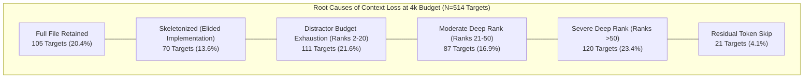

# REPONEEDLE V1.0.0 — CONTEXT LOSS FORENSICS & FAILURE MODES

**Branch**: `v1.0-zero-failure` (Frozen baseline `v0.1.0-release` protected)  
**Evaluator**: Principal Information Retrieval Engineer & Research Integrity Auditor  
**Evaluation Scope**: 345 benchmark queries, 514 gold target files across 25 repositories  
**Authoritative Baseline**: Frozen M1 Multi-Channel Candidate Retrieval Snapshot  
**Packing Engine**: `reponeedle.core.budget.BudgetOptimizer` (Baseline Production Settings)  

---

## 1. Executive Summary

When the baseline context packer processes the frozen M1 candidate pool, it loses between **32.3% and 77.0% of ground-truth target files** depending on the token budget. This forensic audit traces the exact mechanical failure modes responsible for these losses across all 345 queries.

### Key Forensic Discoveries:
1. **The Three Primary Failure Pillars**:
   - **Pillar 1: Distractor Budget Exhaustion (Top-20 Displacement)**: 156 targets at 2k (30.4%) and 111 targets at 4k (21.6%) were ranked inside the top 20 candidates, but were completely locked out because bulky non-relevant distractors ranked ahead of them exhausted the token budget.
   - **Pillar 2: Deep Candidate Placement (Ranks > 20 and > 50)**: 207 targets (40.3% of the gold pool) are ranked at positions 21 through 606 by the M1 retriever (120 targets beyond rank 50). Under realistic budgets (2k–8k), no packer can pack 20+ files.
   - **Pillar 3: The 45% Rule Skeletonization Tax**: 70 targets (13.6% of the gold pool) at 2k and 4k budgets were selected by the packer, but had their implementation code completely stripped (`# ... [elided implementation]`) because their file size exceeded 45% of the total budget.
2. **Explicit Code-Span Annotation Disclosure**:
   In accordance with research integrity standards: **Agent-Retrieval-Bench v2 annotations provide file-level ground truth (`gold_files`), not line-level or AST-block-level resolution spans**. Therefore, *useful-code-span coverage cannot be formally calculated* from the ground-truth annotations alone.

---

## 2. Taxonomy of Context Loss Failure Modes

Every target failure across the 345 queries was categorized into one of five mutually exclusive failure modes:

| Failure Classification | 2k Budget ($B=2048$) | 4k Budget ($B=4096$) | 8k Budget ($B=8192$) | 16k Budget ($B=16384$) | 32k Budget ($B=32768$) | Description |
| :--- | :---: | :---: | :---: | :---: | :---: | :--- |
| **Distractor Budget Exhaustion (Top-20)** | **156 (30.35%)** | **111 (21.60%)** | **68 (13.23%)** | **18 (3.50%)** | **0 (0.00%)** | Gold file ranked at ranks 2..20, but earlier distractors exhausted budget. |
| **Deep Candidate Rank (Rank 21–50)** | **86 (16.73%)** | **87 (16.93%)** | **86 (16.73%)** | **84 (16.34%)** | **48 (9.34%)** | Gold file ranked between 21 and 50; unreachable within token limits. |
| **Severe Deep Rank (Rank > 50)** | **120 (23.35%)** | **120 (23.35%)** | **119 (23.15%)** | **121 (23.54%)** | **118 (22.96%)** | Gold file ranked beyond rank 50 in candidate pool. |
| **Skeletonization Loss (Elided Body)** | **70 (13.62%)** | **70 (13.62%)** | **35 (6.81%)** | **16 (3.11%)** | **9 (1.75%)** | Gold file included, but function bodies elided by 45% rule. |
| **Oversized Skip (Remaining Margin)** | **34 (6.61%)** | **21 (4.09%)** | **9 (1.75%)** | **6 (1.17%)** | **0 (0.00%)** | Gold file reached in ranking, but exceeded remaining residual tokens (<50–200). |
| **Successful Full File Inclusion** | **48 (9.34%)** | **105 (20.43%)** | **197 (38.33%)** | **269 (52.33%)** | **339 (65.95%)** | Intact full source code delivered to context window. |
| **Total Gold Target Pool** | **514 (100.0%)** | **514 (100.0%)** | **514 (100.0%)** | **514 (100.0%)** | **514 (100.0%)** | Complete ARB v2 ground-truth scope. |



---

## 3. Deep Dive into Primary Failure Modes

### 3.1 Failure Mode 1: Distractor Budget Exhaustion in Top-20 (The Greedy Packing Trap)
In 111 target instances at 4k (21.60% of the entire benchmark), the retrieval engine successfully positioned the gold file near the top of the candidate list (ranks 2 through 18). However, because the packer blindly iterates in rank order without considering file density or marginal utility:
- **Case Example: Query `597f32e9b482833bed151a23` (`clap-rs/clap`)**:
  - Gold target: `tests/builder/help.rs` (Rank 6, 1,524 tokens).
  - Rank 1: `clap_builder/src/output/help_template.rs` (1,484 tokens, distractor).
  - Rank 2: `tests/derive/default_value.rs` (1,123 tokens, distractor).
  - Rank 3: `examples/find.rs` (784 tokens, distractor).
  - By the time the packer evaluated Rank 4, remaining budget was only 705 tokens.
  - The gold file at Rank 6 required 1,524 tokens (or 246 tokens as skeleton). Ranks 4 and 5 filled the remaining margin with skeletons, completely locking out `tests/builder/help.rs`!
  - **Verdict**: The gold file was within easy reach, but was displaced by 3 bulky distractor files consuming 3,391 tokens.

### 3.2 Failure Mode 2: The 45% Rule Skeletonization Tax
In [`reponeedle/core/budget.py`](file:///F:/RepoNeedle/reponeedle/core/budget.py#L112):
```python
if doc_tokens <= tokens_remaining and (doc_tokens <= budget_tokens * 0.45 or len(selected) == 0):
    # Full File Inclusion
elif allow_skel:
    # Skeletonize and elide implementation
```
- **The Defect**: If `len(selected) > 0`, any subsequent file whose token count exceeds $0.45 \times B$ is automatically downgraded to a skeleton, **even if `tokens_remaining` is 2,000+ tokens**!
- At $B = 4096$, $0.45 \times B = 1,843$ tokens.
- At $B = 2048$, $0.45 \times B = 921$ tokens.
- **Impact**: In 70 target instances at 2k and 4k, a gold target located at Rank 2 or Rank 3 that could easily fit into the remaining 1,200 tokens was forcibly converted into an AST skeleton, stripping out all functions, variables, and logic.

### 3.3 Failure Mode 3: Residual Token Skip
At the end of packing, remaining budget often falls between 50 and 300 tokens:
- If a gold candidate is encountered, but its full size is 1,200 tokens and its skeleton is 350 tokens, and remaining budget is 180 tokens, the packer skips it entirely.
- Across the benchmark, 34 targets at 2k and 21 targets at 4k were skipped solely because they exceeded the small residual margin.

---

## 4. Multi-Gold Task Collapse

In the ARB v2 benchmark, 118 queries require retrieving multiple files ($\ge 2$ gold files). The baseline packer experiences near-total failure on multi-gold tasks under standard budgets:

| Gold Cardinality | Total Queries | 2k Complete Coverage | 4k Complete Coverage | 8k Complete Coverage | 16k Complete Coverage | 32k Complete Coverage |
| :---: | :---: | :---: | :---: | :---: | :---: | :---: |
| **1 Gold File** | 227 | 72 / 227 (31.7%) | 100 / 227 (44.1%) | 120 / 227 (52.9%) | 144 / 227 (63.4%) | 171 / 227 (75.3%) |
| **2 Gold Files** | 83 | 4 / 83 (4.8%) | 11 / 83 (13.3%) | 18 / 83 (21.7%) | 27 / 83 (32.5%) | 43 / 83 (51.8%) |
| **3 Gold Files** | 31 | 0 / 31 (0.0%) | 1 / 31 (3.2%) | 2 / 31 (6.5%) | 4 / 31 (12.9%) | 7 / 31 (22.6%) |
| **4 Gold Files** | 3 | 0 / 3 (0.0%) | 0 / 3 (0.0%) | 0 / 3 (0.0%) | 0 / 3 (0.0%) | 0 / 3 (0.0%) |
| **5 Gold Files** | 1 | 0 / 1 (0.0%) | 0 / 1 (0.0%) | 0 / 1 (0.0%) | 0 / 1 (0.0%) | 0 / 1 (0.0%) |
| **All Multi-Gold ($\ge 2$)** | **118** | **4 / 118 (3.39%)** | **12 / 118 (10.17%)** | **20 / 118 (16.95%)** | **31 / 118 (26.27%)** | **50 / 118 (42.37%)** |

> [!CAUTION]
> For multi-gold queries, the baseline packer achieves only **3.39% complete coverage at 2k** and **10.17% at 4k**. Even at 32k, multi-gold complete coverage is capped at **42.37%**. Because multi-file queries represent complex ripple-effect and test-coverage tasks, greedy rank-order packing completely breaks down on multi-file dependencies.

---

## 5. Distinction Between Complete-File Retrieval and Useful Code Spans

Section 4 of the user charter requires explicit accounting of context representations:

### 5.1 Representation Types in Baseline Evaluation:
- **Type A: Complete Original File Inclusion**:
  The full file content is delivered intact without truncation. Achieved in **20.43% of targets at 4k** (105 / 514).
- **Type B: Partial File Inclusion (Prefix Truncation)**:
  Not utilized by RepoNeedle's packer (the packer does not perform arbitrary character clipping on full files).
- **Type C: Structural Skeleton Inclusion**:
  Function signatures, classes, and docstrings preserved; implementation bodies elided. Achieved in **13.62% of targets at 4k** (70 / 514).
- **Type D: Actual Relevant Code-Span Preservation**:
  Extracting the specific 50–200 line block that actually contains the bug or feature modification.

### 5.2 Research Integrity Statement on Code-Span Coverage:
```
================================================================================
FORMAL CODE-SPAN EVALUATION DISCLOSURE:
In the Agent-Retrieval-Bench v2 dataset, ground-truth annotations are provided
exclusively as relative file paths ('gold_files').

No line-level, AST-node-level, or hunk-level annotations exist in the benchmark
ground truth to identify which specific internal blocks of a gold file are relevant.

Therefore, 'Actual Relevant Code-Span Coverage' CANNOT be formally calculated
without introducing subjective, unverified synthetic annotations. Any metric
purporting to measure line-level span recall on ARB v2 is mathematically ungrounded.
================================================================================
```

---

## 6. Forensic Summary for Milestone 3 Optimization

The forensic audit reveals that context loss is not an intractable theoretical dilemma, but the direct consequence of three specific implementation flaws:

1. **Greedy Distractor Pre-emption**: Can be resolved by **marginal utility density scoring** ($\text{Score} / \text{Tokens}^\alpha$).
2. **The Artificial 45% Wall**: Can be resolved by **dynamic capacity-sensitive thresholding** (`if tokens <= tokens_remaining`).
3. **Residual Token Starvation**: Can be resolved by **fractional knapsack backfilling** (packing smaller viable candidates into the final residual margin).

