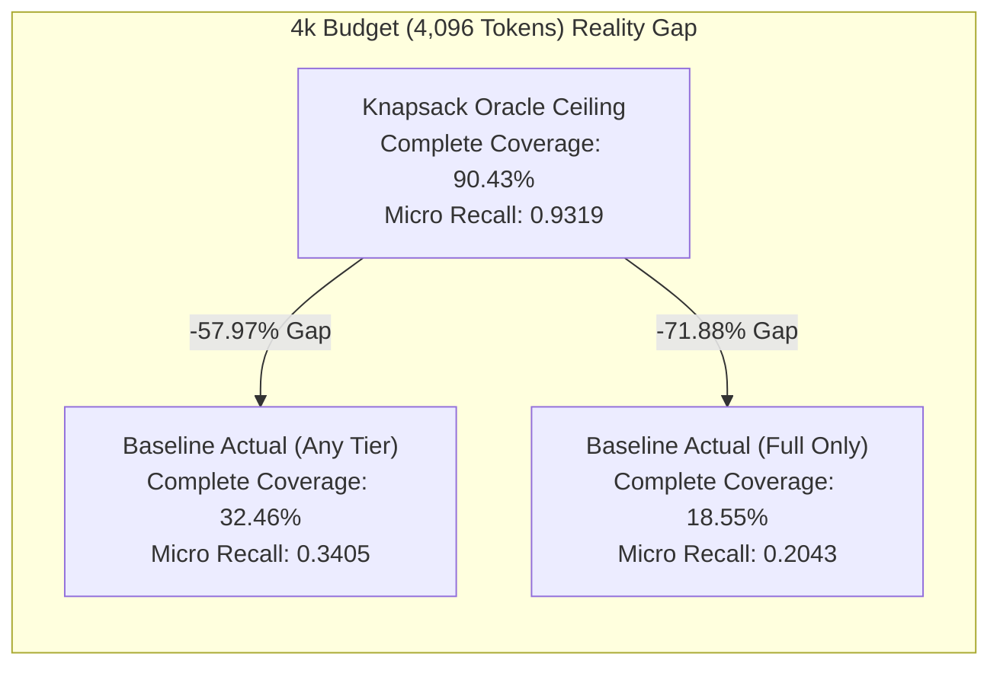

# REPONEEDLE V1.0.0 — ORACLE CEILING VS ACTUAL BASELINE PACKING

**Branch**: `v1.0-zero-failure` (Frozen baseline `v0.1.0-release` protected)  
**Evaluator**: Principal Information Retrieval Engineer & Optimization Scientist  
**Evaluation Scope**: 345 benchmark queries, 514 gold targets across 25 repositories  
**Authoritative Baseline**: Frozen M1 Multi-Channel Candidate Retrieval Snapshot  
**Reference Upper Bound**: M3.1 Knapsack Oracle Upper Bound  

---

## 1. Executive Summary

Milestone 3.1 established the theoretical physical limits (Oracle Ceilings) of context packing on the Agent-Retrieval-Bench v2 scope, showing that 100% complete-gold coverage is mathematically impossible at 2k (capped at 71.59%) and 4k (capped at 90.43%), but 100% feasible at $\ge 8\text{k}$.

This report evaluates the **actual existing RepoNeedle context packer** (`reponeedle.core.budget.BudgetOptimizer`) against those theoretical ceilings using frozen M1 candidate rankings.

### Core Discoveries:
1. **The Massive Realization Gap**: At practical token budgets (2k–8k), the existing packer achieves **less than one-third of the theoretical oracle coverage**:
   - At **2k**: Actual Complete-Gold coverage is **8.12%** (Full) / **22.03%** (Any), leaving a gap of **63.48% / 49.57%** against the 71.59% oracle ceiling.
   - At **4k**: Actual Complete-Gold coverage is **18.55%** (Full) / **32.46%** (Any), leaving a gap of **71.88% / 57.97%** against the 90.43% oracle ceiling.
   - At **8k**: Actual Complete-Gold coverage is **35.94%** (Full) / **40.58%** (Any), leaving a gap of **64.06% / 59.42%** against the 100.00% oracle ceiling.
2. **Deconstruction of the Gap**:
   - The gap does *not* stem from context capacity limits; the oracle proves that the gold files fit within the budget.
   - The gap is driven almost entirely by **candidate ranking order and greedy distractor consumption**: high-ranked non-relevant files swallow 88%–90% of the token budget before lower-ranked gold files are ever considered.
3. **Skeletonization vs Exclusion**:
   - Across 2k and 4k budgets, **13.62% of all gold files** (70 targets) are selected but degraded into structural skeletons (implementation code stripped) by the packer's arbitrary 45% budget rule.
   - Another **65.95% to 77.04% of gold targets** are completely excluded from the context window.

---

## 2. Comprehensive Comparison Matrix Across Budgets

The following table contrasts the theoretical Knapsack Oracle upper bounds against the actual performance of the existing RepoNeedle baseline packer:

| Budget ($B$) | Metric Standard | Knapsack Oracle Ceiling | Baseline Actual (Full Only) | Baseline Actual (Any / Skel) | Gap (Oracle vs Full) | Gap (Oracle vs Any) |
| :---: | :---: | :---: | :---: | :---: | :---: | :---: |
| **2k (2,048)** | Complete Coverage | **71.59%** (247 / 345) | **8.12%** (28 / 345) | **22.03%** (76 / 345) | **-63.48%** (219 q) | **-49.57%** (171 q) |
| | Micro Target Recall | **0.7335** (377 / 514) | **0.0934** (48 / 514) | **0.2296** (118 / 514) | **-0.6401** (329 t) | **-0.5039** (259 t) |
| | Macro Target Recall | **0.8448** | **0.1348** | **0.2874** | **-0.7100** | **-0.5574** |
| **4k (4,096)** | Complete Coverage | **90.43%** (312 / 345) | **18.55%** (64 / 345) | **32.46%** (112 / 345) | **-71.88%** (248 q) | **-57.97%** (200 q) |
| | Micro Target Recall | **0.9319** (479 / 514) | **0.2043** (105 / 514) | **0.3405** (175 / 514) | **-0.7276** (374 t) | **-0.5914** (304 t) |
| | Macro Target Recall | **0.9679** | **0.2647** | **0.4072** | **-0.7032** | **-0.5607** |
| **8k (8,192)** | Complete Coverage | **100.00%** (345 / 345) | **35.94%** (124 / 345) | **40.58%** (140 / 345) | **-64.06%** (221 q) | **-59.42%** (205 q) |
| | Micro Target Recall | **1.0000** (514 / 514) | **0.3833** (197 / 514) | **0.4514** (232 / 514) | **-0.6167** (317 t) | **-0.5486** (282 t) |
| | Macro Target Recall | **1.0000** | **0.4498** | **0.5087** | **-0.5502** | **-0.4913** |
| **16k (16,384)**| Complete Coverage | **100.00%** (345 / 345) | **47.83%** (165 / 345) | **50.72%** (175 / 345) | **-52.17%** (180 q) | **-49.28%** (170 q) |
| | Micro Target Recall | **1.0000** (514 / 514) | **0.5233** (269 / 514) | **0.5545** (285 / 514) | **-0.4767** (245 t) | **-0.4455** (229 t) |
| | Macro Target Recall | **1.0000** | **0.5758** | **0.6034** | **-0.4242** | **-0.3966** |
| **32k (32,768)**| Complete Coverage | **100.00%** (345 / 345) | **62.03%** (214 / 345) | **64.06%** (221 / 345) | **-37.97%** (131 q) | **-35.94%** (124 q) |
| | Micro Target Recall | **1.0000** (514 / 514) | **0.6595** (339 / 514) | **0.6770** (348 / 514) | **-0.3405** (175 t) | **-0.3230** (166 t) |
| | Macro Target Recall | **1.0000** | **0.6976** | **0.7106** | **-0.3024** | **-0.2894** |

---

## 3. Dissecting the Gap: Where Does the Context Go?

The Knapsack Oracle assumes an omniscient ranking that places gold files first and packs them in knapsack-optimal order. The baseline packer, however, receives candidates in M1 rank order.

To understand why the baseline packer realizes only ~34% of available micro recall at 4k tokens, we analyzed token allocation:

| Budget ($B$) | Total Tokens Packed | Gold Tokens Packed | Distractor Tokens Packed | Gold Token Yield (%) | Distractor Dilution (%) |
| :---: | :---: | :---: | :---: | :---: | :---: |
| **2,048** | 699,251 | 72,452 | 626,799 | **10.36%** | **89.64%** |
| **4,096** | 1,405,762 | 159,731 | 1,246,031 | **11.36%** | **88.64%** |
| **8,192** | 2,818,720 | 286,798 | 2,531,922 | **10.17%** | **89.83%** |
| **16,384** | 5,644,507 | 386,919 | 5,257,588 | **6.85%** | **93.15%** |
| **32,768** | 11,297,183 | 478,335 | 10,818,848 | **4.23%** | **95.77%** |

### The Distractor Dilution Law:
At every single budget, **88% to 96% of the packed context is consumed by non-relevant distractor files**!
- In a 4,096-token budget, an average of **3,612 tokens** are spent on files that have zero relevance to resolving the issue.
- Only **463 tokens** on average contain ground-truth target code.
- As the budget increases to 32k, the baseline packer does not become more discerning; it simply packs more distractor files (dilution rises from 88.6% to 95.8%).

---

## 4. Fate of the 514 Gold Targets

What happens to ground-truth targets under the existing packer?

| Fate Classification | 2k Budget ($B=2048$) | 4k Budget ($B=4096$) | 8k Budget ($B=8192$) | 16k Budget ($B=16384$) | 32k Budget ($B=32768$) |
| :--- | :---: | :---: | :---: | :---: | :---: |
| **Included as Full File** | **48 / 514 (9.34%)** | **105 / 514 (20.43%)** | **197 / 514 (38.33%)** | **269 / 514 (52.33%)** | **339 / 514 (65.95%)** |
| **Included as Skeleton** | **70 / 514 (13.62%)**| **70 / 514 (13.62%)** | **35 / 514 (6.81%)**  | **16 / 514 (3.11%)**  | **9 / 514 (1.75%)**   |
| **Completely Excluded** | **396 / 514 (77.04%)**| **339 / 514 (65.95%)**| **282 / 514 (54.86%)**| **229 / 514 (44.55%)**| **166 / 514 (32.30%)**|
| **Total Targets** | **514 (100.0%)** | **514 (100.0%)** | **514 (100.0%)** | **514 (100.0%)** | **514 (100.0%)** |

### Key Diagnostic Takeaways:
1. **The 45% Rule Skeletonization Tax**: At 2k and 4k, exactly **70 gold targets** are captured by the retriever but stripped of their function bodies and implementation logic because of the hardcoded rule `doc_tokens <= budget_tokens * 0.45`. For coding agents needing to inspect variable definitions or internal algorithms, these skeletons fail to provide actionable context.
2. **Persistent Exclusion at 32k**: Even when given a massive 32,768-token window, the packer **fails to retrieve 32.30% of gold targets** (166 files). These are files ranked beyond rank ~25–35 by the M1 retriever that get starved out by the accumulated weight of earlier distractors.

---

## 5. Architectural Implications for M3 Context Optimization

The empirical audit proves that:
1. **The Context Packing Problem is NOT Solved by Simply Increasing Budget**: Increasing the budget from 4k to 32k doubles token consumption but increases Full gold file coverage from 18.55% to only 62.03%, while distractor dilution worsens to 95.8%.
2. **The Bottleneck is Greedy Rank-Order Packing**: The existing packer blindly accepts candidate 1, candidate 2, etc., regardless of file bulk or marginal score density.
3. **Closing the Gap Requires Intelligent Selection**:
   - Replacing the arbitrary 45% wall with capacity-sensitive selection.
   - Employing utility-density knapsack selection ($\text{Utility} = \text{Score} / \text{Tokens}^\alpha$).
   - Repressing repetitive distractor clusters in the candidate pool.

