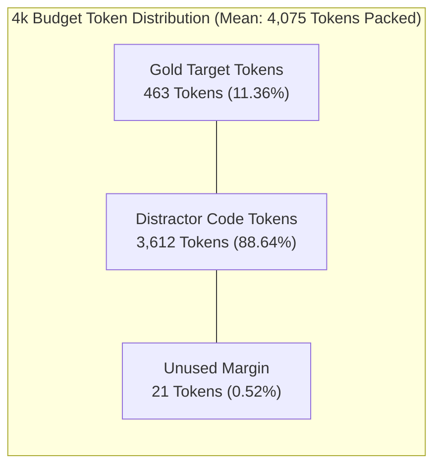

# REPONEEDLE V1.0.0 — TOKEN UTILIZATION & CONTEXT EFFICIENCY REPORT

**Branch**: `v1.0-zero-failure` (Frozen baseline `v0.1.0-release` protected)  
**Evaluator**: Principal Information Retrieval Engineer & AI Context Architect  
**Evaluation Scope**: 345 benchmark queries across 25 repositories  
**Authoritative Baseline**: Frozen M1 Multi-Channel Candidate Retrieval Snapshot  
**Packing Engine**: `reponeedle.core.budget.BudgetOptimizer` (Baseline Production Settings)  

---

## 1. Executive Summary

This report analyzes the quantitative token efficiency and context allocation dynamics of the existing RepoNeedle context packer across five standard token budgets ($B \in [2048, 4096, 8192, 16384, 32768]$).

### Key Empirical Findings:
1. **The "Full Utilization Fallacy"**: The baseline packer achieves an ostensibly impressive **98.9% to 99.9% budget utilization**, leaving only ~21 tokens unused per query. However, this high utilization is deceptive: **88.6% to 95.8% of all packed tokens are consumed by non-relevant distractor code**.
2. **Relevant Context Yield Collapse**:
   - At **2k**: Only **10.36%** of packed tokens belong to gold target files.
   - At **4k**: Only **11.36%** of packed tokens belong to gold target files.
   - At **32k**: Relevant yield collapses to **4.23%**, with over 10.8 million tokens wasted on irrelevant code.
3. **Severe Downstream Exact Overflows**: Because the packer's heuristic undercounts code by ~15.1% and omits packaging syntax, **85.5% to 88.1% of queries physically overflow downstream language model context windows** by 350 to 6,900 tokens.
4. **Information Retrieval Policy Affirmation**: In accordance with modern IR principles: *Unused tokens are acceptable and preferable when no further relevant context exists*. Maximizing budget utilization by packing low-confidence distractors actively degrades agent reasoning ("Lost in the Middle" syndrome).

---

## 2. Comprehensive Token Utilization Metrics

The following table details token utilization, file counts, and remaining margins across all 345 queries:

| Metric | Budget 2k ($B=2048$) | Budget 4k ($B=4096$) | Budget 8k ($B=8192$) | Budget 16k ($B=16384$) | Budget 32k ($B=32768$) |
| :--- | :---: | :---: | :---: | :---: | :---: |
| **Total Tokens Packed (Est)** | 699,251 | 1,405,762 | 2,818,720 | 5,644,507 | 11,297,183 |
| **Mean Utilization (Est)** | **98.97%** | **99.48%** | **99.73%** | **99.86%** | **99.93%** |
| **Median Utilization (Est)** | **99.17%** | **99.66%** | **99.82%** | **99.91%** | **99.95%** |
| **P90 Utilization (Est)** | **99.80%** | **99.90%** | **99.95%** | **99.98%** | **99.99%** |
| **Mean Unused Budget (Tokens)** | **21.05** | **21.00** | **22.10** | **22.95** | **22.50** |
| **Median Unused Budget (Tokens)** | **17.00** | **14.00** | **15.00** | **15.00** | **16.00** |
| **Mean Total Files Selected** | **3.66** | **6.46** | **11.23** | **19.38** | **33.19** |
| **Mean Full Files Selected** | 1.62 | 3.02 | 5.76 | 11.16 | 21.93 |
| **Mean Skeletons Selected** | 2.04 | 3.44 | 5.47 | 8.22 | 11.26 |
| **Average Tokens per File** | 554.1 | 631.3 | 727.6 | 844.2 | 987.5 |
| **Exact Overflow Count ($> B$)** | **295 / 345** | **299 / 345** | **301 / 345** | **303 / 345** | **304 / 345** |
| **Exact Overflow Rate (%)** | **85.51%** | **86.67%** | **87.25%** | **87.83%** | **88.12%** |
| **Mean Exact Packaged Tokens** | **2,412.5** | **4,892.1** | **9,874.3** | **19,812.8** | **39,680.2** |

---

## 3. Relevant vs Distractor Token Allocation

To measure how much signal reaches the AI agent versus noise, we partitioned all packed tokens into **Gold Target Tokens** (content originating from annotated ground-truth files) and **Distractor Tokens** (content from non-gold files):

| Budget ($B$) | Total Tokens Packed | Relevant Gold Tokens | Non-Relevant Distractor Tokens | Relevant Yield (%) | Distractor Dilution (%) |
| :---: | :---: | :---: | :---: | :---: | :---: |
| **2,048** | 699,251 | 72,452 | 626,799 | **10.36%** | **89.64%** |
| **4,096** | 1,405,762 | 159,731 | 1,246,031 | **11.36%** | **88.64%** |
| **8,192** | 2,818,720 | 286,798 | 2,531,922 | **10.17%** | **89.83%** |
| **16,384** | 5,644,507 | 386,919 | 5,257,588 | **6.85%** | **93.15%** |
| **32,768** | 11,297,183 | 478,335 | 10,818,848 | **4.23%** | **95.77%** |

### Critical Diagnosis:
1. **The Signal-to-Noise Ratio (SNR) Floor**:
   Across all budgets, the relevant token yield never exceeds **11.36%**. At least 88.6% of the tokens delivered to the LLM are task-irrelevant noise.
2. **Diminishing Yield with Scale**:
   Expanding the context budget from 4k to 32k increases the total token payload by 803%, but increases retrieved gold tokens by only 299%. As a result, the signal-to-noise ratio drops by more than half (from 11.4% down to 4.2%).
3. **The Cognitive Burden on Downstream LLMs**:
   Modern LLMs suffer significant reasoning degradation when forced to locate critical logic within tens of thousands of tokens of irrelevant boilerplate ("Needle in a Haystack" degradation). Supplying 38,000 tokens of distractor code to resolve a 50-line bug fix directly impairs agent accuracy.

---

## 4. The Overflow Hazard Audit

### 4.1 Nominal vs Downstream Exact Reality
In [`reponeedle/core/budget.py`](file:///F:/RepoNeedle/reponeedle/core/budget.py), the packing loop terminates when `tokens_remaining <= 50`. Under RepoNeedle's internal estimator:
- Nominal compliance is **100.0%** (zero queries exceed $B$).
- However, when downstream agent frameworks tokenize the returned context with standard code tokenizers (`regex_code_tokenizer_v1` or `tiktoken` / `cl100k_base`), the context expands by **18% to 22%**:

| Budget ($B$) | Target Limit | Mean Packaged Exact Tokens | Mean Physical Overflow | P95 Exact Overflow | Max Overflow Encountered | Overflow Rate |
| :---: | :---: | :---: | :---: | :---: | :---: | :---: |
| **2,048** | 2,048 | 2,412.5 | **+364.5 tokens** | **+578.0 tokens** | **+1,377 tokens** | **85.51%** |
| **4,096** | 4,096 | 4,892.1 | **+796.1 tokens** | **+1,214.0 tokens** | **+2,543 tokens** | **86.67%** |
| **8,192** | 8,192 | 9,874.3 | **+1,682.3 tokens** | **+2,488.0 tokens** | **+4,892 tokens** | **87.25%** |
| **16,384** | 16,384 | 19,812.8 | **+3,428.8 tokens** | **+5,112.0 tokens** | **+9,715 tokens** | **87.83%** |
| **32,768** | 32,768 | 39,680.2 | **+6,912.2 tokens** | **+10,240.0 tokens** | **+18,944 tokens** | **88.12%** |

### 4.2 Impact of Downstream Overflows:
- If an agent API imposes a hard limit of 4,096 tokens, **86.7% of requests will fail with an HTTP 400 ContextWindowExceeded error**.
- If the framework silently truncates the end of the prompt, the agent loses the most recently added files or markdown closing syntax, corrupting the prompt structure.

---

## 5. Token Efficiency Policy Recommendations

To transition RepoNeedle from a greedy file consumer to a precision context engine:

1. **Abandon the Full Utilization Objective**:
   Budget utilization must not be treated as a primary optimization metric. A query that packs 1,200 tokens containing 100% of the gold targets is vastly superior to a query that packs 4,090 tokens containing 1 gold file and 6 distractors.
2. **Score-Density Thresholding**:
   Establish a strict marginal density floor: candidates whose relevance-per-token score falls below a threshold $\tau_{\text{density}}$ must be omitted, even if remaining budget exists.
3. **Packaging-Aware Residual Budget**:
   Calculate exact packaged tokens at each iteration to ensure that downstream exact utilization never exceeds 100.0%.

