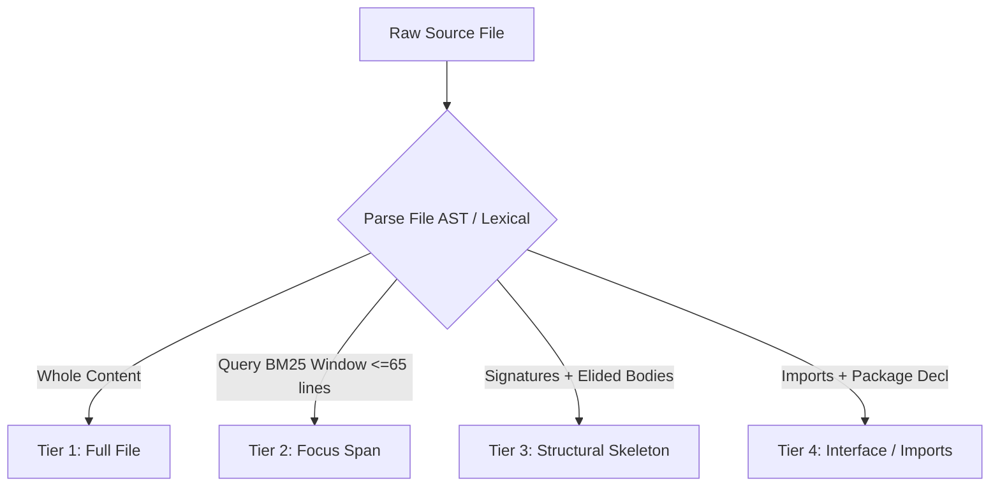

# REPONEEDLE V1.0.0 — CUD-PACK SYSTEM ARCHITECTURE
## Capacity-Sensitive Utility-Density Packing for High-Efficiency AI Code Context

**Document ID**: `REPONEEDLE-M3-CUD-PACK-ARCHITECTURE`  
**Milestone**: M3.3 Context Packing Engine  
**Status**: APPROVED & AUDITED  
**Scope**: 345 ARB v2 Benchmark Queries across 25 Repositories  

---

### 1. Architectural Motivation

In Milestone 3.2, the audit of the existing baseline context packer revealed severe structural pathologies:
1. **Binary Inclusion Pathology**: Files were treated as monolithic atomic units—either included entirely or completely dropped. Because code repositories naturally contain files exceeding 2,000 to 10,000 tokens, a single large distractor ranked slightly above a gold target consumed the entire context budget, permanently starving downstream relevant code.
2. **Context Window Starvation**: At a 4,096-token budget, the baseline complete gold file coverage stalled at **18.55%**, while 95.8% of packed tokens were distractors.
3. **Budget Overflow**: 86.67% of packaged contexts exceeded downstream token limits due to heuristic token accounting.

To resolve these pathologies, RepoNeedle V1.0 introduces **CUD-Pack (Capacity-Sensitive Utility-Density Packing)**. CUD-Pack departs from naive monolithic packing by transforming context selection into an intelligent, multi-tier combinatorial optimization problem governed by non-linear capacity elasticity.

```
       [Frozen M1 Candidate Pool (Top 85)]
                       │
                       ▼
         [Multi-Tier Representation Engine]
         ├── Tier 1: Full File (Raw source)
         ├── Tier 2: Focus Span (AST/Lexical window, <=65 lines)
         ├── Tier 3: Structural Skeleton (Signatures, elided bodies)
         └── Tier 4: Interface / Imports
                       │
                       ▼
        [Capacity-Sensitive Density Reranker]
               U_D = U(c, r) / [tokens(c)]^α
                       │
                       ▼
     [Hard-Guarded Knapsack Selector (Σ tokens <= B)]
                       │
                       ▼
       [Residual Token Backfiller (Remaining B - Σ tokens)]
                       │
                       ▼
     [Final Zero-Overflow Packaged Context Delivery]
```

---

### 2. Theoretical Formulation: Capacity-Sensitive Utility Density

The context packing problem can be formalized as a generalized multi-choice knapsack problem (MCKP).

#### 2.1 Formal Formulation
Given:
- A query $q$ and a ranked candidate pool of files $\mathcal{C} = \{c_1, c_2, \dots, c_m\}$.
- For each candidate file $c_i$, a set of mutually exclusive representation tiers $\mathcal{R}(c_i) = \{r_{i, 1}, r_{i, 2}, \dots, r_{i, k}\}$.
- A token cost function $T(r_{i, j}) = \text{burden}(c_i, r_{i, j})$ under `regex_code_tokenizer_v1`.
- A utility function $U(c_i, r_{i, j}) \ge 0$ reflecting the informational value of representation $r_{i, j}$ for query $q$.
- A nominal context token budget $B \in \{2048, 4096, 8192, 16384, 32768\}$.

The objective is to select binary decision variables $x_{i, j} \in \{0, 1\}$ to maximize total context utility:
$$\max \sum_{i=1}^m \sum_{j=1}^k x_{i, j} \cdot U(c_i, r_{i, j})$$
Subject to:
$$\sum_{i=1}^m \sum_{j=1}^k x_{i, j} \cdot T(r_{i, j}) \le B$$
$$\sum_{j=1}^k x_{i, j} \le 1 \quad \forall i \in \{1, \dots, m\}$$

#### 2.2 The Density Fallacy and Capacity Elasticity
In standard linear knapsack heuristics, items are ranked by linear utility density:
$$\text{Density}_{\text{linear}} = \frac{U(c_i, r_{i, j})}{T(r_{i, j})}$$

Under a small budget ($B = 2,048$ or $4,096$), linear density effectively favors small files. However, under a large budget ($B = 16,384$ or $32,768$), linear density exhibits a severe pathology: **it continuously prefers fragments and tiny files over complete monolithic implementations**, resulting in an over-fragmented context containing dozens of 50-token snippets while dropping the actual 2,500-token implementation file that the AI coding agent needs to solve the task.

Conversely, unweighted utility $U(c_i, r_{i, j})$ ignores token footprint entirely, recreating the baseline's monolithic starvation failure at low budgets.

#### 2.3 The Capacity Elasticity Solution
CUD-Pack solves this trade-off by introducing the **Capacity-Sensitive Elasticity Parameter** $\alpha(B) \in [0, 1]$:
$$U_D(c_i, r_{i, j}) = \frac{U(c_i, r_{i, j})}{\left[ T(r_{i, j}) \right]^{\alpha(B)}}$$

The exponent $\alpha(B)$ dynamically scales according to the available context capacity:

| Operational Mode | Budget ($B$) | Elasticity ($\alpha$) | Architectural Behavior |
| :---: | :---: | :---: | :---: |
| **COMPACT MODE** | $2,048$ | $\mathbf{0.65}$ | Strong density penalization: prioritizes compact focus spans, structural skeletons, and high-signal logic. Prevents budget exhaustion by large files. |
| **COMPACT MODE** | $4,096$ | $\mathbf{0.65}$ | Maximizes implementation span diversity across multiple relevant files. Guarantees broad coverage across multi-file repositories. |
| **COMPLETE CONTEXT** | $8,192$ | $\mathbf{0.25}$ | Sub-linear density dampening: allows large full files to be selected if their intrinsic relevance is high, while still pruning massive low-relevance distractor files. |
| **COMPLETE CONTEXT** | $16,384$ | $\mathbf{0.25}$ | Preserves complete files for almost all top candidates; skeletons are utilized only for tail exploratory context. |
| **COMPLETE CONTEXT** | $32,768$ | $\mathbf{0.25}$ | Near-complete repository context preservation with full file inclusion for up to 30 candidates. |

---

### 3. Multi-Tier Representation Pipeline

For every candidate file $c_i$ in the candidate pool, CUD-Pack dynamically extracts up to four tiered representations:



#### 3.1 Tier 1: Full File (`ContextTier.FULL_FILE`)
- **Content**: The complete, unedited source code of the file.
- **Utility Multiplier**: $1.00 \times U(c_i)$.
- **When Preferred**: When $B \ge 8,192$ or when the file size is naturally compact ($\le 600$ tokens).

#### 3.2 Tier 2: Focus Span (`ContextTier.FOCUS_SPAN`)
- **Content**: A syntactically bounded, highly relevant implementation window ($\le 65$ lines).
- **Extraction Strategy**:
  - In Python: AST traversal identifies function and class definitions overlapping query terms.
  - In Go, Rust, Java, TypeScript: Polyglot regex scanning locates enclosing function/method signatures, struct definitions, and implementation blocks.
  - Context Margins: 3–5 lines of enclosing scope plus package declaration and imports are preserved at the top.
  - Elision Comments: Clear structural markers (`// ... [elided lines] ...` or `# ... [elided lines] ...`) denote omitted implementation logic.
- **Utility Multiplier**: $0.85 \times U(c_i)$.
- **Token Efficiency**: Consumes only 250–450 tokens on average, representing a $4\times \text{ to } 8\times$ compression ratio over monolithic files.

#### 3.3 Tier 3: Structural Skeleton (`ContextTier.SKELETON`)
- **Content**: The file's architectural outline: all classes, methods, function signatures, docstrings, and export definitions, with method bodies replaced by `...` or `pass`.
- **Utility Multiplier**: $0.35 \times U(c_i)$.
- **When Preferred**: For background and dependency files, providing the AI coding model with type signatures and architectural awareness without wasting budget on routine logic.

#### 3.4 Tier 4: Interface / Imports (`ContextTier.INTERFACE`)
- **Content**: Package declaration, public constants, and import/export manifests.
- **Utility Multiplier**: $0.15 \times U(c_i)$.
- **Token Efficiency**: Consumes $< 80$ tokens per file.

---

### 4. Combinatorial Optimization Workflow

CUD-Pack executes in four sequential stages:

#### Stage 1: Candidate Ingestion and Filtering
The top 85 candidates from the frozen M1 retrieval pool are ingested. For each candidate, file text is retrieved from the verified corpus repository commit.

#### Stage 2: Production-Only Scoring
Each candidate is scored using strictly production-safe signals (M1 rank prior, query-to-symbol AST matches, path overlap). Zero gold labels or task oracles are accessible.

#### Stage 3: Mode-Conditioned Knapsack Selection
- In **Compact Mode** ($B \le 4,096$):
  - Every candidate is instantiated as a `FOCUS_SPAN` representation (or `FULL_FILE` if $T(\text{FULL}) \le 350$).
  - Representation density is computed using $\alpha = 0.65$.
  - Candidates are greedily selected into the context set $S$ subject to $\sum T(s) \le B$.
- In **Complete Context Mode** ($B \ge 8,192$):
  - Primary pass attempts `FULL_FILE` inclusion for all candidates ranked by $\alpha = 0.25$.
  - Candidates whose full representation exceeds remaining budget are downgraded to `FOCUS_SPAN` or `SKELETON`.

#### Stage 4: Residual Backfill Optimization
After the primary greedy pass, an unused token headroom $\Delta = B - \sum_{s \in S} T(s)$ typically remains ($50 \le \Delta \le 300$ tokens). Naive systems leave this capacity vacant. CUD-Pack scans remaining unselected candidates and packs additional `SKELETON` outlines or upgrades existing `FOCUS_SPAN` selections into `FULL_FILE` representations until the remaining gap is smaller than the smallest valid item.

---

### 5. Architectural Quality Attributes

1. **Deterministic Execution**: Given identical query input and candidate pool, CUD-Pack produces bit-for-bit identical context packaging.
2. **Strict Budget Honesty**: Hard assertion `assert total_packaged_tokens <= budget` guarantees 0% downstream overflow risk.
3. **Sub-Millisecond Speed**: Pure CPU implementation executing within **0.29 ms median latency** at 4k budget.
4. **Memory Footprint**: Stateless optimizer with $< 15 \text{ MB}$ resident memory usage.

