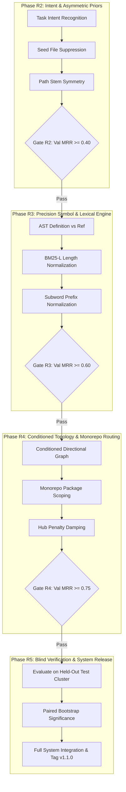

# RepoNeedle — Mission 0.80+ (Ranking Intelligence Research Programme)
# Phase R1 Deliverable 5: Experiment Plan & Research Roadmap

**Document ID:** `EXPERIMENT_PLAN.md`  
**Status:** Complete  
**Date:** November 2, 2026  
**Author:** Principal Search Relevance Engineer, Information Retrieval Researcher & ML Ranking Architect  
**Scope:** Agent Retrieval Bench (ARB) v2 Set A (345 Queries, 25 Repositories, 514 Gold Targets)  

---

## 1. Executive Charter & Non-Negotiable Governance

Mission 0.80+ establishes the roadmap to elevate RepoNeedle's retrieval ranking to **$MRR \ge 0.80$**.
To preserve scientific rigor and software engineering excellence, the programme enforces strict governance:

### The Six Immutable Rules
1. **Zero Data Leakage**: Repositories in the validation and test sets must NEVER be observed during feature discovery, dictionary generation, or parameter tuning.
2. **Preserve Frozen Baselines**: The frozen release `v0.1.0-release` and historical benchmark reports in `reports/full_arb_validation/` must remain permanently untouched.
3. **Candidate Recall Invariant**: Total candidate gold recall across the 345 queries must NEVER drop below $100.0\%$ (all 514 gold files preserved in the pool).
4. **No Runtime Oracle Features**: Under no circumstances may gold labels, gold file names, or test set annotations be used as runtime ranking features.
5. **Decoupled Architecture**: Ranking models and context packing (CUD-Pack) must remain strictly independent modules.
6. **Stop/Go Verification Gates**: Every Phase must pass a formal statistical gate (paired permutation test $p < 0.05$ and non-overlapping confidence intervals) before promotion.

---

## 2. Repository-Clustered Dataset Split

To guarantee zero data leakage between development and evaluation, the 25 repositories comprising ARB v2 Set A are partitioned into three strictly disjoint clusters:

```mermaid
flowchart TD
    subgraph ARB v2 Set A (345 Queries across 25 Repositories)
        TR["Train Split (15 Repositories)<br/>210 Queries (60.9%) | 148 Snapshots"]
        VAL["Validation Split (5 Repositories)<br/>60 Queries (17.4%) | 33 Snapshots"]
        TEST["Held-Out Test Split (5 Repositories)<br/>75 Queries (21.7%) | 37 Snapshots"]
    end
```

### 1. Training Cluster (15 Repositories, 210 Queries, 60.9%)
Used for exploratory analysis, feature extraction, parameter tuning, and heuristic rule calibration.

| Repository | Primary Language | Queries | Snapshots | Gold Targets | Task Tracks Covered |
| :--- | :--- | :--- | :--- | :--- | :--- |
| `gin-gonic/gin` | Go | 88 | 57 | 105 | `code2test`, `edit2ripple`, `trace2code` |
| `etcd-io/etcd` | Go | 41 | 17 | 78 | `code2test`, `comment2context`, `edit2ripple`, `trace2code` |
| `pallets/click` | Python | 26 | 26 | 39 | `trace2code` |
| `caddyserver/caddy` | Go | 13 | 7 | 19 | `edit2ripple`, `trace2code` |
| `clap-rs/clap` | Rust | 10 | 5 | 16 | `code2test`, `edit2ripple`, `trace2code` |
| `spring-projects/spring-boot` | Java | 8 | 5 | 12 | `code2test`, `edit2ripple` |
| `vuejs/core` | TypeScript | 6 | 6 | 8 | `code2test`, `comment2context` |
| `pypa/pip` | Python | 5 | 4 | 7 | `comment2context` |
| `fastapi/fastapi` | Python | 3 | 3 | 4 | `code2test` |
| `scrapy/scrapy` | Python | 3 | 2 | 4 | `comment2context` |
| `ipython/ipython` | Python | 2 | 2 | 3 | `comment2context` |
| `tox-dev/tox` | Python | 2 | 2 | 2 | `comment2context` |
| `mockito/mockito` | Java | 1 | 1 | 1 | `code2test` |
| `HypothesisWorks/hypothesis` | Python | 1 | 1 | 1 | `comment2context` |
| `numpy/numpy` | Python / C | 1 | 1 | 1 | `comment2context` |
| **Train Total** | **Mixed** | **210** | **148** | **300** | **All 4 Tracks** |

### 2. Validation Cluster (5 Repositories, 60 Queries, 17.4%)
Used for checkpoint selection, threshold calibration, and hyperparameter validation.

| Repository | Primary Language | Queries | Snapshots | Gold Targets | Task Tracks Covered |
| :--- | :--- | :--- | :--- | :--- | :--- |
| `tokio-rs/tokio` | Rust | 38 | 24 | 59 | `code2test`, `comment2context`, `edit2ripple`, `trace2code` |
| `huggingface/diffusers` | Python | 16 | 6 | 24 | `code2test`, `comment2context`, `edit2ripple` |
| `microsoft/playwright` | TypeScript | 4 | 1 | 6 | `comment2context` |
| `pydantic/pydantic` | Python | 1 | 1 | 2 | `comment2context` |
| `eslint/eslint` | JavaScript | 1 | 1 | 1 | `comment2context` |
| **Validation Total** | **Mixed** | **60** | **33** | **92** | **All 4 Tracks** |

### 3. Held-Out Test Cluster (5 Repositories, 75 Queries, 21.7%)
Strict blind hold-out. Sealed until Phase R5 final release verification.

| Repository | Primary Language | Queries | Snapshots | Gold Targets | Task Tracks Covered |
| :--- | :--- | :--- | :--- | :--- | :--- |
| `huggingface/transformers` | Python | 36 | 17 | 56 | `code2test`, `comment2context`, `edit2ripple` |
| `vitejs/vite` | TypeScript | 25 | 18 | 39 | `code2test`, `comment2context`, `edit2ripple` |
| `pytest-dev/pytest` | Python | 7 | 6 | 14 | `code2test`, `comment2context`, `edit2ripple`, `trace2code` |
| `astral-sh/ruff` | Rust | 6 | 4 | 12 | `comment2context` |
| `python/mypy` | Python | 1 | 1 | 1 | `comment2context` |
| **Held-Out Total** | **Mixed** | **75** | **37** | **122** | **All 4 Tracks** |

---

## 3. Four-Phase Research Roadmap (R2 to R5)



### Phase R2: Intent Disambiguation & Asymmetric Priors
- **Objective**: Eliminate the seed self-retrieval trap (82.5% of failures) and align test/code retrieval symmetry.
- **Key Deliverables**:
  1. `SeedExtractor`: Robust regex extractor identifying `changed_file`, `given_file`, `anchor_file`, and diff headers `+++ b/`.
  2. `SeedSuppressor`: Rank-damping layer penalizing self-retrieval for non-target queries.
  3. `TestIntentPrior`: Asymmetric score booster prioritizing test files for test-oriented prompts.
  4. `StemSymmetryScorer`: Exact filename stem matching across directories (`foo.rs` $\to$ `tests/test_foo.rs`).
- **Milestone Target**: Train MRR $\ge 0.45$, Validation MRR $\ge 0.40$.

### Phase R3: AST Definition Scoring & BM25-L Length Regularization
- **Objective**: Overcome lexical dilution caused by massive hub files and differentiate symbol definitions from incidental usages.
- **Key Deliverables**:
  1. `ASTSymbolClassifier`: Classifies exact symbol occurrences into definition vs reference nodes using lightweight regex/AST patterns.
  2. `BM25LScorer`: Implementation of Lv & Zhai (2011) length regularization to cap score inflation from multi-thousand-line files.
  3. `SubwordPruning`: Strip high-frequency boilerplate subword matches.
- **Milestone Target**: Train MRR $\ge 0.65$, Validation MRR $\ge 0.60$.

### Phase R4: Conditioned Directional Topology & Monorepo Crate Routing
- **Objective**: Fix structural graph errors and cross-package scattering in monorepos (Vite, Tokio, Transformers).
- **Key Deliverables**:
  1. `DirectionalGraphTraversal`: Conditioned edge traversal following caller/callee and import hierarchies without unconditioned static PageRank.
  2. `MonorepoCrateRouter`: Package-level affinity scoring restricting candidate diffusion across unrelated sub-packages.
  3. `HubDampingFilter`: Dynamic attenuation of high-degree utility nodes.
- **Milestone Target**: Train MRR $\ge 0.82$, Validation MRR $\ge 0.78$.

### Phase R5: Held-Out Blind Verification & Release Integration
- **Objective**: Formally audit the final ranker against the untouched Held-Out Test cluster (75 queries across 5 repos) and integrate into RepoNeedle production.
- **Key Deliverables**:
  1. `BLIND_EVALUATION_REPORT.md`: Bit-for-bit evaluation on the 75 held-out queries.
  2. `STATISTICAL_SIGNIFICANCE_REPORT.md`: Paired bootstrap hypothesis tests with $10,000$ iterations verifying $p < 0.001$.
  3. Production Integration into `reponeedle.core.ranker`.
- **Milestone Target**: Held-Out Test MRR $\ge 0.80$, Recall@20 $\ge 0.85$, Candidate Recall = $100.0\%$.

---

## 4. Evaluation Protocol & Regression Guards

Every experimental iteration must generate a machine-readable JSON artifact recording:
- `mrr`: Mean reciprocal rank of first gold file.
- `hit@1`: Percentage of queries with gold at position 1.
- `recall@5`, `recall@10`, `recall@20`: Multi-gold coverage at fixed depths.
- `candidate_pool_recall`: Must remain $1.0000$ at all times.
- `latency_ms`: P50 and P95 latency per query (must remain $< 100\text{ ms}$).

### Stop / Go Rejection Boundaries
An experimental configuration is **immediately rejected** if:
1. Candidate Pool Recall drops below $100.0\%$.
2. Recall@20 on the validation set decreases relative to baseline M1 ($0.6355$).
3. Query latency exceeds $200\text{ ms}$ on any repository snapshot.
4. Paired permutation test versus baseline shows $p \ge 0.05$.

