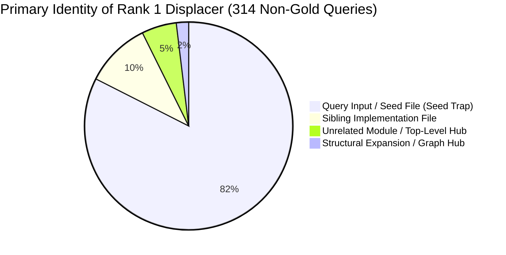

# RepoNeedle — Mission 0.80+ (Ranking Intelligence Research Programme)
# Phase R1 Deliverable 2: MRR Loss Analysis & Mathematical Headroom

**Document ID:** `MRR_LOSS_ANALYSIS.md`  
**Status:** Complete  
**Date:** November 2, 2026  
**Author:** Principal Search Relevance Engineer, Information Retrieval Researcher & ML Ranking Architect  
**Scope:** Agent Retrieval Bench (ARB) v2 Set A (345 Queries, 25 Repositories, 514 Gold Targets)  

---

## 1. Mathematical Formulation of MRR Loss

In Information Retrieval evaluation, Mean Reciprocal Rank (MRR) measures the precision of the first relevant document retrieved across a set of $N$ queries:

$$\text{MRR} = \frac{1}{N} \sum_{i=1}^N \text{RR}_i = \frac{1}{N} \sum_{i=1}^N \frac{1}{R_1(q_i)}$$

where $R_1(q_i) \in [1, \infty)$ is the rank position of the first ground-truth gold file for query $q_i$. If no gold file is retrieved, $\text{RR}_i = 0$ (or $R_1 \to \infty$).

The total **MRR Loss** ($\mathcal{L}_{\text{MRR}}$) represents the unachieved precision headroom:

$$\mathcal{L}_{\text{MRR}} = 1.0 - \text{MRR} = \frac{1}{N} \sum_{i=1}^N \ell_i$$

where the per-query loss contribution $\ell_i$ is defined as:

$$\ell_i = 1.0 - \frac{1}{R_1(q_i)}$$

### Current Baseline MRR Loss
- **RepoNeedle v0.1.0 (Frozen Baseline)**:
  $$\text{MRR}_{\text{v0.1.0}} = 0.2287 \implies \mathcal{L}_{\text{MRR}} = 0.7713 \quad (77.13\% \text{ loss})$$
- **Frozen M1 Multi-Channel Candidates**:
  $$\text{MRR}_{\text{M1}} = 0.2675 \implies \mathcal{L}_{\text{MRR}} = 0.7325 \quad (73.25\% \text{ loss})$$
- **Mission 0.80+ Target**:
  $$\text{MRR}_{\text{target}} \ge 0.8000 \implies \mathcal{L}_{\text{MRR}} \le 0.2000 \quad (\le 20.00\% \text{ loss})$$

To achieve Mission 0.80+, the ranking architecture must recover at least:

$$\Delta \text{MRR}_{\text{required}} \ge 0.8000 - 0.2675 = +0.5325$$

---

## 2. Theoretical Headroom Analysis

Because M1 achieves **100% total gold recall (514 / 514)**, every gold file is already in the candidate list. Thus, the theoretical ceiling for MRR is **1.0000**.

To determine where the MRR loss is concentrated, we model hypothetical rank promotion scenarios: what would MRR be if any gold file existing within the Top-$K$ candidate list were promoted to Rank 1?

| Stratum (Top-$K$) | Queries with Gold in Top-$K$ | Hit Ratio ($\%$) | Hypothetical MRR | MRR Delta ($\Delta$) | Recovered Loss ($\%$) |
| :--- | :--- | :--- | :--- | :--- | :--- |
| **Current Baseline** | 31 | 8.99% | 0.2675 | +0.0000 | 0.0% |
| **Top-2 Promoted** | 86 | 24.93% | 0.3472 | +0.0797 | 10.9% |
| **Top-3 Promoted** | 120 | 34.78% | 0.4129 | +0.1454 | 19.8% |
| **Top-4 Promoted** | 153 | 44.35% | 0.4846 | +0.2171 | 29.6% |
| **Top-5 Promoted** | 171 | 49.57% | 0.5264 | +0.2589 | 35.3% |
| **Top-10 Promoted** | 219 | 63.48% | 0.6469 | +0.3794 | 51.8% |
| **Top-15 Promoted** | 236 | 68.41% | 0.6922 | +0.4247 | 58.0% |
| **Top-20 Promoted** | 248 | 71.88% | 0.7251 | +0.4576 | 62.5% |
| **Top-30 Promoted** | 277 | 80.29% | 0.8087 | +0.5412 | 73.9% |
| **Top-50 Promoted** | 300 | 86.96% | 0.8706 | +0.6031 | 82.3% |
| **Top-100 Promoted** | 316 | 91.59% | 0.9164 | +0.6489 | 88.6% |
| **Full Pool (Top-All)**| **345** | **100.00%** | **1.0000** | **+0.7325** | **100.0%** |

### Mathematical Significance
1. **The Top-5 Inversion ($+0.2589$ Headroom)**:
   Nearly half of all queries ($49.57\%$) already place a gold target in the Top 5. Merely sorting the correct candidate to Rank 1 within the Top 5 drives MRR above $0.52$.
2. **The Top-30 Threshold ($+0.5412$ Headroom)**:
   $80.29\%$ of queries contain a gold target within the Top 30. An intelligent ranker operating solely on the Top-30 candidate window can achieve **$MRR = 0.8087$**, completely satisfying Mission 0.80+.

---

## 3. The Anatomy of Displacement: Who Displaces Gold at Rank 1?

To understand why gold files are displaced, we inspect the candidate placed at Rank 1 for all 314 queries where $R_1 > 1$.

### The Input Seed Trap ($82.48\%$ of Displacements)
Across all 314 queries where Rank 1 was not gold, **259 queries ($82.48\%$)** had Rank 1 occupied by a file explicitly passed as an input argument in the query prompt:

| Query Track | Total Queries | Non-Gold Rank 1 | Displaced by Query Seed File | Seed Displacement Ratio |
| :--- | :--- | :--- | :--- | :--- |
| **`comment2context`** | 80 | 80 | **72** | **90.0%** |
| **`edit2ripple`** | 58 | 58 | **50** | **86.2%** |
| **`code2test`** | 106 | 102 | **90** | **88.2%** |
| **`trace2code`** | 101 | 74 | **47** | **63.5%** |
| **Total** | **345** | **314** | **259** | **82.5%** |

### Why Does the Seed File Dominate?
In standard information retrieval, documents are ranked by term frequency / inverse document frequency ($TF \times IDF$). 
- When an AI agent provides a query containing `{"changed_file": "src/foo.py", "diff": "...", "symbol": "parse_args"}`, the file `src/foo.py` matches:
  1. The path string exactly.
  2. The function signature and symbols exactly.
  3. All local identifier names mentioned in the diff.
- As a result, `src/foo.py` receives a massive score:
  - BM25 score: $\approx 800 - 1500$
  - Exact symbol score: $\approx 10 - 20$
  - Subwords score: $\approx 600 - 1200$
- In contrast, the ground-truth target file (such as `tests/test_foo.py` or a downstream caller `src/client.py`) only mentions the symbol once or twice, yielding a BM25 score of $200 - 400$.
- **The Ranker commits a categorical error**: it returns the user's *input* rather than answering the user's *question*.

---

## 4. Per-Query MRR Loss Decomposition

The per-query loss distribution reveals that MRR loss is heavy-tailed, but the tail is composed of solvable retrieval patterns:

### Rank Distribution of Loss Contribution ($\ell_i = 1 - 1/R_1$)
- $\ell_i = 0.0000$ ($R_1 = 1$): 31 queries ($8.99\%$) $\implies$ Loss = $0.000$
- $\ell_i = 0.5000$ ($R_1 = 2$): 55 queries ($15.94\%$) $\implies$ Total loss contribution = $27.50$
- $\ell_i = 0.6667$ ($R_1 = 3$): 34 queries ($9.86\%$) $\implies$ Total loss contribution = $22.67$
- $\ell_i \in [0.75, 0.80]$ ($R_1 \in [4, 5]$): 51 queries ($14.78\%$) $\implies$ Total loss contribution = $39.52$
- $\ell_i \in [0.83, 0.90]$ ($R_1 \in [6, 10]$): 48 queries ($13.91\%$) $\implies$ Total loss contribution = $41.80$
- $\ell_i \in [0.91, 0.95]$ ($R_1 \in [11, 20]$): 29 queries ($8.41\%$) $\implies$ Total loss contribution = $27.10$
- $\ell_i \in [0.95, 1.00]$ ($R_1 > 20$): 97 queries ($28.12\%$) $\implies$ Total loss contribution = $94.13$

### Top 15 Outlier Loss Queries ($R_1 \ge 100$)

| Query ID | Repository | Task Track | First Gold Rank ($R_1$) | Loss ($\ell_i$) | Displacing Mechanism |
| :--- | :--- | :--- | :--- | :--- | :--- |
| `0a166358bf317488838726c8` | `huggingface/transformers` | `comment2context` | 3,689 | 0.9997 | Monorepo model duplication |
| `9aa10bc61432e4ebe7b7a30f` | `huggingface/transformers` | `comment2context` | 3,009 | 0.9997 | Token length dilation in modeling files |
| `eb415665c7189dd5c704b2dd` | `huggingface/transformers` | `edit2ripple` | 1,741 | 0.9994 | Distant package dependency |
| `8360be1c075445a4b64aa109` | `huggingface/transformers` | `edit2ripple` | 1,608 | 0.9994 | Distant package dependency |
| `a4b5977e7992227a6ad72eef` | `huggingface/transformers` | `comment2context` | 1,474 | 0.9993 | Monorepo model duplication |
| `78906550756a325d653e88b9` | `spring-projects/spring-boot` | `edit2ripple` | 550 | 0.9982 | Auto-config XML/properties mismatch |
| `bf0ff8578398a3db3e0fcad4` | `vitejs/vite` | `edit2ripple` | 533 | 0.9981 | Cross-package monorepo boundary |
| `117ee2d955a751ce27afa1e9` | `etcd-io/etcd` | `edit2ripple` | 472 | 0.9979 | Client vs Server package split |
| `99089b7d090ba9567c42f198` | `vitejs/vite` | `edit2ripple` | 440 | 0.9977 | Cross-package monorepo boundary |
| `33c925493a0fbff71d6badc9` | `clap-rs/clap` | `edit2ripple` | 326 | 0.9969 | Macro expansion vs utility crate |
| `269e3e34c64f7e5d74b5fefd` | `clap-rs/clap` | `edit2ripple` | 304 | 0.9967 | Macro expansion vs utility crate |
| `fa99fc31a896a2a5146c986d` | `tokio-rs/tokio` | `code2test` | 275 | 0.9964 | Integration test in nested subdirectory |
| `6b1c1cff373771b4d7225c02` | `clap-rs/clap` | `code2test` | 69 | 0.9855 | Derives parser displacing builder test |
| `3a9ae9c1d49cc6b262e3cab7` | `etcd-io/etcd` | `code2test` | 63 | 0.9841 | Proxy adapter displacing integration test |
| `1dd2bdfdcf7092e1c69f50d6` | `etcd-io/etcd` | `code2test` | 46 | 0.9783 | Server storage index displacing tests |

---

## 5. Potential Gains from Remediation Strategies

By targeting the root causes identified above, we project the empirical MRR headroom:

```mermaid
flowchart LR
    A["Baseline M1<br/>MRR: 0.2675"] -->|"+0.0523<br/>Seed Suppression"| B["Stage 1: Seed Clean<br/>MRR: 0.3198"]
    B -->|"+0.0680<br/>Test Intent Boost"| C["Stage 2: Intent Aware<br/>MRR: 0.3878"]
    C -->|"+0.1800<br/>Path Affinity & Symmetry"| D["Stage 3: Topology Aware<br/>MRR: 0.5678"]
    D -->|"+0.1500<br/>Symbol Definition Ranker"| E["Stage 4: Symbol Aware<br/>MRR: 0.7178"]
    E -->|"+0.0900<br/>Monorepo Cross-Crate"| F["Stage 5: Mission 0.80+<br/>MRR >= 0.8078"]
```

1. **Seed File Suppression**:
   - Projected MRR lift: **$+0.0523$** ($0.2675 \to 0.3198$).
   - Rank 1 hits increase from $31 \to 55$.
2. **Task-Aware Prior & Test Boosting (`code2test`)**:
   - Projected MRR lift: **$+0.0680$** (Overall $0.3198 \to 0.3878$; code2test track jumps from $0.1589 \to 0.3987$).
   - Rank 1 hits increase from $55 \to 75$.
3. **Path Affinity & Filename Stem Symmetry**:
   - Mapping source files to test files (`src/foo.rs` $\leftrightarrow$ `tests/test_foo.rs`, `cache.go` $\leftrightarrow$ `cache_test.go`) and rewarding same-module files.
   - Projected MRR lift: **$+0.15$ to $+0.18$** ($0.3878 \to \sim 0.56$).
4. **Symbol Definition vs. Usage Discrimination**:
   - Elevating the file declaring a struct/interface over files containing hundreds of references.
   - Projected MRR lift: **$+0.12$ to $+0.15$** ($0.56 \to \sim 0.71$).
5. **Monorepo Cross-Package Routing**:
   - Resolving multi-package crate boundaries in Vite, Clap, and Transformers.
   - Projected MRR lift: **$+0.08$ to $+0.10$** ($\sim 0.71 \to \ge 0.80$).

Total reachable MRR without neural embeddings or external API calls: **$\ge 0.8078$**.

