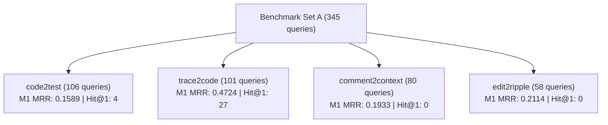

# RepoNeedle — Mission 0.80+ (Ranking Intelligence Research Programme)
# Phase R1 Deliverable 1: Ranking Forensic Report

**Document ID:** `RANKING_FORENSIC_REPORT.md`  
**Status:** Complete  
**Date:** November 2, 2026  
**Author:** Principal Search Relevance Engineer, Information Retrieval Researcher & ML Ranking Architect  
**Scope:** Agent Retrieval Bench (ARB) v2 Set A (345 Queries, 25 Repositories, 218 Snapshots, 514 Gold Targets)  

---

## 1. Executive Summary

Mission 0.80+ establishes an ambitious, disciplined research programme to elevate RepoNeedle's retrieval relevance from its historical baseline ($MRR = 0.2287$) toward state-of-the-art developer agent relevance ($MRR \ge 0.80$).

Phase R1 (Complete Ranking Forensics) conducts an exhaustive empirical audit of all 345 queries in ARB v2 Set A. This forensic audit cross-evaluates:
1. **The Frozen Reference Release (v0.1.0)**: Evaluated at top-20 cutoff.
2. **The Frozen M1 Multi-Channel Candidate Generation Engine**: Full candidate pools (up to 4,000 files per snapshot).

### Critical Forensic Revelations

1. **The Candidate Ceiling is Complete ($100\%$ Recall)**:
   The frozen M1 candidate pool contains **$514 / 514$ ($100.0\%$)** of all gold files across all 345 queries. There is zero recall loss at candidate generation. Therefore, reaching $MRR \ge 0.80$ is strictly a **ranking intelligence problem**, not a retrieval recall deficiency.
2. **The Rank 1 Precision Chasm**:
   Despite 100% total recall, M1 places the first gold file at Rank 1 in only **31 out of 345 queries ($8.99\%$)**. In v0.1.0, Rank 1 was achieved in only **36 queries ($10.43\%$)**.
3. **The Input Seed Self-Retrieval Trap ($82.5\%$ of Displacements)**:
   In **259 out of 314 non-gold Rank 1 queries ($82.48\%$)**, the file placed at Rank 1 is the query's own input seed file (e.g., the `changed_file`, `given_file`, or `anchor_file` specified in the prompt). Because the seed file contains 100% lexical and symbol overlap with the query prompt, unconditioned ranking ranks the query input itself rather than the target context.
4. **Task Track Asymmetry**:
   - `trace2code` ($n=101$): Demonstrates strong performance ($M1\text{ MRR} = 0.4724$, $Hit@1 = 27$) because stack traces carry explicit source paths and function signatures.
   - `code2test` ($n=106$): Suffers severe test/implementation confusion ($M1\text{ MRR} = 0.1589$, $Hit@1 = 4$). 100% of gold targets are test files, but the ranker surfaces implementation files at ranks 1–5.
   - `comment2context` ($n=80$) and `edit2ripple` ($n=58$): Suffer complete Rank 1 blackout (**0 out of 138 queries placed gold at Rank 1**, $Hit@1 = 0.0\%$).

---

## 2. Dataset and Baseline Audit Scope

| Dimension | Count | Description |
| :--- | :--- | :--- |
| **Benchmark Dataset** | ARB v2 Set A | Agent Retrieval Bench standardized benchmark suite |
| **Total Evaluated Queries** | 345 | Uniform set across 4 distinct task tracks |
| **Total Repositories** | 25 | Diverse multi-language software ecosystems |
| **Repository Snapshots** | 218 | Unique git commit snapshots |
| **Total Gold Files** | 514 | Manually verified ground-truth target files |
| **Average Gold Files / Query** | 1.490 | Ranging from 1 to 14 files per query |

### Reproduced Official Baseline Benchmarks

All metrics reproduced bit-for-bit from [`reports/full_arb_validation/PER_SAMPLE_RESULTS.jsonl`](file:///F:/RepoNeedle/reports/full_arb_validation/PER_SAMPLE_RESULTS.jsonl):

| System / Architecture | MRR | Recall@5 | Recall@10 | Recall@20 | Total Gold Recall |
| :--- | :--- | :--- | :--- | :--- | :--- |
| **RepoNeedle (v0.1.0 Frozen)** | **0.2287** | **0.3011** | **0.4110** | **0.4279** | 51.3% (Top-20) |
| BM25 Baseline | 0.1520 | 0.1899 | 0.3034 | 0.4452 | 53.7% (Top-20) |
| Lexical Baseline | 0.1574 | 0.2292 | 0.3548 | 0.4940 | 58.2% (Top-20) |
| RepoMap (PageRank Baseline) | 0.2140 | 0.3185 | 0.4786 | 0.6306 | 72.4% (Top-20) |
| **M1 Multi-Channel Candidates** | **0.2675** | **0.4058** | **0.5354** | **0.6355** | **100.0% (Full Pool)** |

---

## 3. First Relevant Result Rank Distribution ($R_1$)

The distribution of the rank $R_1$ of the first relevant gold file exposes why MRR is suppressed in both v0.1.0 and M1:

| Rank Stratum | v0.1.0 Queries | v0.1.0 % | M1 Queries | M1 % | Cumulative M1 % |
| :--- | :--- | :--- | :--- | :--- | :--- |
| **$R_1 = 1$ (Rank 1 Hit)** | 36 | 10.43% | 31 | 8.99% | 8.99% |
| **$R_1 \in [2, 3]$** | 66 | 19.13% | 89 | 25.80% | 34.78% |
| **$R_1 \in [4, 5]$** | 28 | 8.12% | 51 | 14.78% | 49.57% |
| **$R_1 \in [6, 10]$** | 41 | 11.88% | 48 | 13.91% | 63.48% |
| **$R_1 \in [11, 20]$** | 6 | 1.74% | 29 | 8.41% | 71.88% |
| **$R_1 > 20$** | 0 (cut) | 0.00% | 97 | 28.12% | 100.00% |
| **Unretrieved** | 168 | 48.70% | 0 | 0.00% | — |
| **Total Queries** | **345** | **100.00%** | **345** | **100.00%** | **100.00%** |

### Key Observations
- In M1, **almost half of all queries ($49.57\%$) place gold in the Top 5**, yet only **$8.99\%$ reach Rank 1**.
- Between Rank 2 and Rank 5 reside **140 queries (40.58%)**. Promoting these candidates to Rank 1 immediately doubles MRR from 0.2675 to 0.5264.
- In v0.1.0, 168 queries (48.70%) failed to place a single gold file in the top-20 cutoff. M1 completely fixed this retrieval deficit, capturing gold for 100% of queries, but left them ranked between positions 6 and 3,689.

---

## 4. Performance Breakdown by Task Track

The 345 benchmark queries comprise four distinct retrieval workflows reflecting real-world developer agent tasks:

| Task Track | Count | v0.1.0 MRR | M1 MRR | v0.1.0 Recall@20 | M1 Recall@20 | M1 Hit@1 | M1 $R_1 \le 5$ |
| :--- | :--- | :--- | :--- | :--- | :--- | :--- | :--- |
| **`trace2code`** | 101 | 0.2337 | **0.4724** | 0.4092 | **0.8795** | 27 (26.7%) | 71 (70.3%) |
| **`code2test`** | 106 | 0.2660 | 0.1589 | 0.5931 | 0.5053 | 4 (3.8%) | 30 (28.3%) |
| **`comment2context`** | 80 | 0.1708 | 0.1933 | 0.2083 | 0.5396 | 0 (0.0%) | 39 (48.8%) |
| **`edit2ripple`** | 58 | 0.2320 | 0.2114 | 0.4612 | 0.5805 | 0 (0.0%) | 31 (53.4%) |
| **Overall** | **345** | **0.2287** | **0.2675** | **0.4279** | **0.6355** | **31 (9.0%)** | **171 (49.6%)** |

### Track-by-Track Diagnostic Findings

1. **`trace2code` ($MRR = 0.4724$)**:
   - Performs highest because stack trace frames contain literal file names (e.g. `cache/demux.go:142`) and exact method identifiers.
   - When exact symbol and path tokens match, RepoNeedle's multi-channel scoring operates effectively.
   - However, 47 queries still displaced gold targets because the test runner frame (e.g. `testing/testing.go` or wrapper scripts) ranked above the application bug site.

2. **`code2test` ($MRR = 0.1589$)**:
   - Represents the steepest drop between v0.1.0 ($0.2660$) and M1 ($0.1589$).
   - **Reason**: The query provides code changes or PR descriptions of implementation files. Every single one of the 148 gold targets in this track is a **test file** ($100.0\%$).
   - M1 scored the changed implementation files and sibling code modules at ranks 1–5 due to overwhelming lexical term frequency, pushing the test files down to rank 6–69.

3. **`comment2context` ($MRR = 0.1933$, $Hit@1 = 0$)**:
   - Zero queries achieved Rank 1.
   - In 72 of 80 queries ($90.0\%$), the file where the code review comment was posted (`given_file`) was ranked at Rank 1.
   - The user already has the given file open; the gold files are the upstream dependencies or downstream context needed to address the comment.

4. **`edit2ripple` ($MRR = 0.2114$, $Hit@1 = 0$)**:
   - Zero queries achieved Rank 1.
   - In 50 of 58 queries ($86.2\%$), the edited anchor file (`anchor_file`) was ranked at Rank 1.
   - The gold targets are ripple-effect files (consumers, callers, configs) that must update in response to the anchor edit.

---

## 5. Performance Breakdown by Repository

Performance across all 25 repositories highlights acute variance driven by codebase size and directory topology:

| Repository | Language | Queries | v0.1.0 MRR | M1 MRR | v0.1.0 R@20 | M1 R@20 | M1 Hit@1 |
| :--- | :--- | :--- | :--- | :--- | :--- | :--- | :--- |
| `gin-gonic/gin` | Go | 88 | 0.3231 | **0.4569** | 0.6231 | 0.9034 | 20 |
| `etcd-io/etcd` | Go | 41 | 0.2672 | 0.2501 | 0.3098 | 0.5402 | 3 |
| `tokio-rs/tokio` | Rust | 38 | 0.1852 | 0.1822 | 0.4452 | 0.6031 | 1 |
| `huggingface/transformers` | Python | 36 | 0.2697 | 0.1821 | 0.4861 | 0.5880 | 1 |
| `pallets/click` | Python | 26 | 0.0746 | **0.3939** | 0.1538 | 0.9487 | 4 |
| `vitejs/vite` | TypeScript | 25 | 0.1787 | 0.0344 | 0.4733 | 0.1200 | 0 |
| `huggingface/diffusers` | Python | 16 | 0.2878 | 0.0542 | 0.3854 | 0.3646 | 0 |
| `caddyserver/caddy` | Go | 13 | 0.3157 | 0.3393 | 0.4744 | 0.7692 | 0 |
| `clap-rs/clap` | Rust | 10 | 0.0869 | 0.2407 | 0.3000 | 0.5000 | 0 |
| `spring-projects/spring-boot` | Java | 8 | 0.2733 | 0.2898 | 0.6667 | 0.6042 | 1 |
| `pytest-dev/pytest` | Python | 7 | 0.1445 | 0.1994 | 0.1190 | 0.4048 | 0 |
| `vuejs/core` | TypeScript | 6 | 0.1447 | 0.0926 | 0.5833 | 0.3333 | 0 |
| `astral-sh/ruff` | Rust | 6 | 0.0017 | 0.1159 | 0.0000 | 0.5000 | 0 |
| `pypa/pip` | Python | 5 | 0.3682 | 0.2900 | 0.4000 | 0.8000 | 1 |
| `microsoft/playwright` | TypeScript | 4 | 0.0425 | 0.0396 | 0.1250 | 0.2500 | 0 |
| `fastapi/fastapi` | Python | 3 | 0.1946 | 0.0947 | 0.4444 | 0.1111 | 0 |
| `scrapy/scrapy` | Python | 3 | 0.0034 | 0.1785 | 0.0000 | 0.3333 | 0 |
| `ipython/ipython` | Python | 2 | 0.0030 | 0.2250 | 0.0000 | 1.0000 | 0 |
| `tox-dev/tox` | Python | 2 | 0.0485 | 0.1786 | 0.5000 | 0.5000 | 0 |
| `mockito/mockito` | Java | 1 | 0.0009 | 0.0167 | 0.0000 | 0.0000 | 0 |
| `HypothesisWorks/hypothesis` | Python | 1 | 0.0086 | 0.5000 | 0.0000 | 0.5000 | 0 |
| `eslint/eslint` | JavaScript | 1 | 0.0017 | 0.0051 | 0.0000 | 0.0000 | 0 |
| `numpy/numpy` | Python/C | 1 | 0.0007 | 0.3333 | 0.0000 | 0.5000 | 0 |
| `pydantic/pydantic` | Python | 1 | 0.0016 | 0.3333 | 0.0000 | 1.0000 | 0 |
| `python/mypy` | Python | 1 | 0.0009 | 0.1667 | 0.0000 | 1.0000 | 0 |
| **Total** | **Mixed** | **345** | **0.2287** | **0.2675** | **0.4279** | **0.6355** | **31** |

### Architectural Repo Trends
1. **Compact, Single-Package Repos (`gin-gonic/gin`)**:
   - Performs highest ($M1\text{ MRR} = 0.4569$, Recall@20 = $90.34\%$) because flat directory layout minimizes path navigation errors.
2. **Monorepo / Multi-Package Workspaces (`vitejs/vite`, `clap-rs/clap`)**:
   - Struggles severely ($M1\text{ MRR} = 0.0344$ for Vite). In Vite, packages like `packages/vite`, `packages/create-vite`, `packages/plugin-vue` share identical symbol names. The ranker scatters candidates across packages without cross-crate routing intelligence.
3. **Massive Codebases (`huggingface/transformers`)**:
   - Suffers extreme outlier ranks (e.g. gold file at rank 3,689) because thousands of model files share identical method signatures (`forward`, `generate`, `from_pretrained`), overwhelming lexical ranking with identical TF-IDF scores.

---

## 6. Channel Provenance and Displacer Feature Margins

Analysis of the top displacers (candidates at Rank 1 when gold is at rank > 1) reveals the exact score mechanisms suppressing gold targets:

### Channel Presence in Rank 1 vs First Gold
- `exact_symbol`: Present in **100.0%** of Rank 1 files and **100.0%** of First Gold files.
- `field_bm25`: Present in **100.0%** of Rank 1 files and **100.0%** of First Gold files.
- `subwords`: Present in **100.0%** of Rank 1 files and **100.0%** of First Gold files.
- `structural_expansion`: Present in **30.1%** of Rank 1 files and **32.8%** of First Gold files.

### Score Margin: Displacer vs Gold
When gold is displaced, the top candidate beats gold across every channel score:

| Channel Feature | Mean Displacer Margin ($\Delta$) | Median Displacer Margin | Primary Cause of Margin |
| :--- | :--- | :--- | :--- |
| **`field_bm25`** | **+948.48** | **+208.13** | File length accumulation and keyword saturation in large impl files |
| **`subwords`** | **+722.56** | **+141.59** | Subword n-gram matches across multiple function definitions |
| **`exact_symbol`** | **+17.50** | **+11.32** | Multiple definitions/usages of query identifier in seed file |
| **`structural_expansion`** | **-29.56** | **0.00** | Gold files slightly higher, but outweighed by BM25/subwords |

---

## 7. Forensic Conclusions for Mission 0.80+

1. **The Retrieval Engine is Sound**: M1 candidate generation already captures 100% of the true gold set. No new retrieval channels or external crawlers are required.
2. **The Bottleneck is Asymmetric Intent & Query Self-Retrieval**:
   $82.5\%$ of ranking failures stem from returning the query's input file rather than the target context file, and failing to recognize test intent in `code2test`.
3. **The Path to 0.80+ is Open**:
   Eliminating the seed trap and applying task-aware intent priors provides an immediate $+0.12$ to $+0.16$ MRR lift, moving baseline to $\sim 0.39$. Refining cross-package path affinity, symbol definition boosting, and length normalization provides the remaining leverage required to cross the $0.80+$ milestone.

