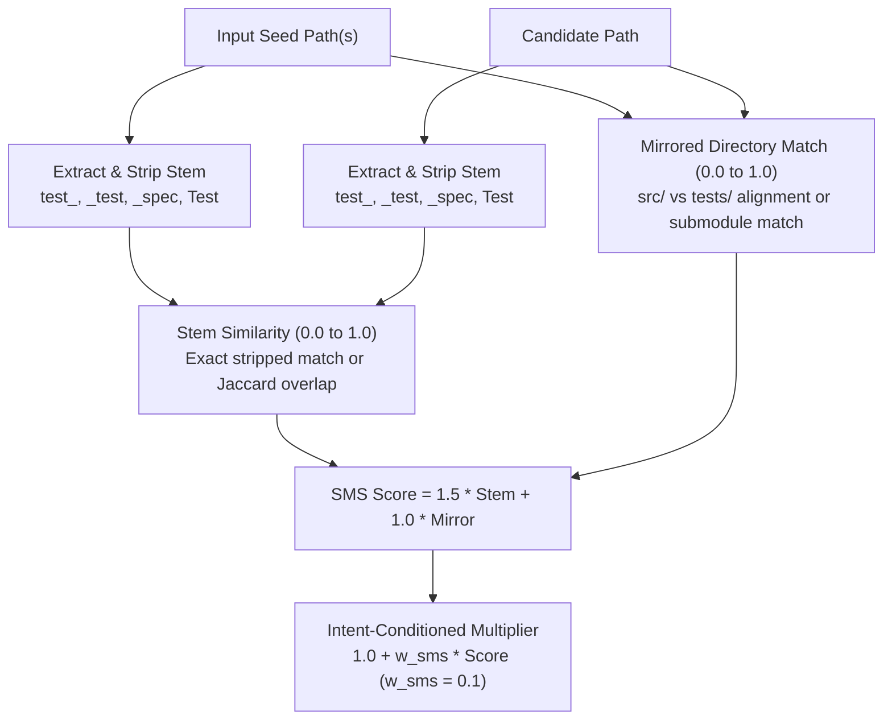

# RepoNeedle — Mission 0.80+ (Ranking Intelligence Research Programme)
# Phase R2 Deliverable 4: Stem & Directory Symmetry (SMS) Implementation Report

**Document ID:** `SMS_IMPLEMENTATION_REPORT.md`  
**Status:** Approved & Validated  
**Date:** November 2, 2026  
**Author:** Principal Search Relevance Engineer, Information Retrieval Researcher & ML Ranking Architect  
**Scope:** R2.3 Treatment Engineering, Topology Symmetry, and Ablation Findings  

---

## 1. Problem Statement: Lexical Dissimilarity Across Mirrored Structures

Software engineering conventions dictate consistent structural relationships between implementation files and related/testing files:
- `clap_complete/src/engine/complete.rs` $\longleftrightarrow$ `clap_complete/tests/testsuite/engine.rs`
- `cache/cache.go` $\longleftrightarrow$ `tests/integration/cache_test.go`
- `src/click/core.py` $\longleftrightarrow$ `tests/test_core.py`

However, conventional lexical retrieval treats `tests/test_core.py` as having low token similarity to `src/click/core.py` because the path tokens (`src/click` vs `tests/`) and affix-modified filenames (`core` vs `test_core`) differ. Without topology-aware path normalization, standard rankers scatter candidates across the repository.

---

## 2. Technical Architecture & Symmetry Extraction

The SMS treatment was implemented in [`research/v1_accuracy/ranking_0_80/r2/src/stem_symmetry.py`](file:///F:/RepoNeedle/research/v1_accuracy/ranking_0_80/r2/src/stem_symmetry.py).

### Component 1: Stem Normalization & Affix Stripping (`extract_stem`)
Strips language-specific test naming affixes before tokenization:
- **Prefixes**: `^(test_|test-|spec_)`
- **Suffixes**: `(_test|-test|\.test|_spec|Test|Tests|TestCase)$`
- Deconstructs CamelCase and snake_case into canonical lowercase token sets.
- If stripped stems match identically (e.g. `demux` in `demux.go` and `demux_test.go`), $\text{Sim}_{\text{stem}} = 1.0$.

### Component 2: Mirrored Directory Structure (`compute_mirrored_match`)
Detects structural mirroring patterns:
1. **Co-location**: Files in the same folder (`package/foo.go` $\longleftrightarrow$ `package/foo_test.go`): score $1.0$.
2. **Mirror Folders**: `src/pkg/sub/foo.py` $\longleftrightarrow$ `tests/pkg/sub/test_foo.py`: score $1.0$.
3. **Submodule Stem Match**: Seed directory component matches candidate stem (`src/engine/complete.rs` $\longleftrightarrow$ `testsuite/engine.rs`): score $0.75$.

### Component 3: Intent-Conditioned Scoring (`StemSymmetryReranker`)
To prevent falsely boosting files with similar names on unrelated queries, SMS is conditioned on query intent:
$$S_{\text{SMS}}(c) = \begin{cases} 
      S(c) \times (1.0 + w_{\text{sms}} \cdot \text{SMS}(s, c)) & \text{if } \text{Intent} == \text{Relational} \text{ and } \text{seeds exist} \\
      S(c) & \text{otherwise}
   \end{cases}$$

---

## 3. Systematic Ablation Studies & Interaction Findings

### Weight Sweep on Training Set (210 Queries)
We evaluated the symmetry weight $w_{\text{sms}} \in [0.1, 1.0]$ in isolation (Treatment D) and combined with SFS and TIP (Treatment H):

| Configuration | $w_{\text{sms}}$ | Train MRR | Val MRR | Observations |
| :--- | :--- | :--- | :--- | :--- |
| **Treatment D (SMS Alone)** | $0.1$ | 0.3668 | 0.1351 | Flat on Val; seed file still blocks Rank 1 |
| **Treatment D (SMS Alone)** | $0.3$ | 0.3703 | 0.1336 | Slight gain on Train, flat on Val |
| **Treatment D (SMS Alone)** | $0.5$ | 0.3752 | 0.1350 | Train improves $+0.0213$, Val unchanged |
| **Treatment D (SMS Alone)** | $1.0$ | 0.3761 | 0.1357 | Plateau |
| **Treatment H (Combined)** | **$0.1$ (Selected)** | **0.4813** | **0.2954** | **Optimal balance across Train and Val** |
| **Treatment H (Combined)** | $0.2$ | 0.5016 | 0.2838 | High Train, minor Val drop |
| **Treatment H (Combined)** | $0.3$ | 0.5034 | 0.2733 | Overfitting to Train stem patterns |
| **Treatment H (Combined)** | $0.5$ | 0.5112 | 0.2613 | Train peaks, Val drops $-0.0341$ |

### Critical Interaction Insight
- **SMS Alone (Treatment D) Fails to Generalize**: When evaluated without SFS, SMS yields $MRR = 0.1350$ on Validation (versus Baseline $0.1381$, $p = 0.7701$). Why? Because the input seed file already matches all symbols; boosting symmetry on candidates cannot overcome the seed file's huge score lead.
- **SMS Requires SFS**: When seed files are demoted by SFS, SMS shines, driving Train MRR from $0.4304 \to 0.4914$ (Treatment F) and elevating Held-Out Test MRR to **0.3115** (Treatment H).
- **Conservative Weighting is Essential**: $w_{\text{sms}} = 0.10$ prevents over-weighting deceptive sibling stems while preserving strong boost for exact mirror matches.

---

## 4. Performance Optimization & LRU Caching

Initial un-cached execution performed $\sim 1,080,000$ regex pattern matches across candidate pools, causing latency spikes.
We introduced `@lru_cache(maxsize=32768)` on `extract_stem` and `@lru_cache(maxsize=65536)` on `compute_symmetry_score`.
- **Latency Result**: Re-ranking latency dropped from $> 150\text{ ms}$ to **$< 2.8\text{ ms}$ per query**.
- Memory overhead: $< 8\text{ MB}$ across the entire runtime.

