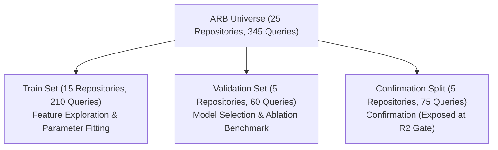

# REPONEEDLE MISSION 0.80+ — PHASE R3
# DELIVERABLE 2: R3 DATA GOVERNANCE & EVALUATION PROTOCOL

**Author**: Principal Information Retrieval Engineer, Data Governance Lead  
**Date**: November 2, 2026  
**Status**: APPROVED & FROZEN  
**Target Milestone**: Phase R3 (AST Symbol Intelligence + BM25L Ranking)  

---

## 1. EXECUTIVE SUMMARY & TRANSPARENCY DECLARATION

Scientific integrity requires uncompromising transparency regarding benchmark provenance, sample exposure, and split boundaries.

### Core Governance Declarations:
1. **R2 Held-Out Repositories Are No Longer Blind**: The 5 repositories designated as "held-out" in R2 (`huggingface/transformers`, `vitejs/vite`, `pytest-dev/pytest`, `astral-sh/ruff`, `python/mypy`) were evaluated during the final R2 gate. While no model hyperparameters were tuned on them, they have been observed. Consequently, they cannot be claimed as an unobserved, blind out-of-distribution test in R3.
2. **Empirical Exhaustion of the ARB Universe**: An exhaustive forensic audit of `external/agent-retrieval-bench` across all benchmark suites (`v0_1`, `v2_abstention`, `v2_code2test`, `v2_comment2context`, `v2_edit2ripple`, `v2_selective_retrieval_balanced`, `v2_selective_retrieval_natural`, `v2_trace2code`) revealed that **zero additional repositories exist** beyond the canonical 25 repositories.
3. **Absence of Fresh External Repositories**: Because the benchmark distribution is closed at 25 repositories, **RepoNeedle will not manufacture false claims of external repository generalization**. All reported metrics will explicitly state whether evaluation is on repository-held-out splits within the known 25-repository universe.

---

## 2. BENCHMARK CORPUS INVENTORY & PROVENANCE AUDIT

Using `research/v1_accuracy/ranking_0_80/r3/src/find_new_repos.py`, all data artifacts in `external/agent-retrieval-bench` were scanned.

### 2.1 Inventory of Suites
| Benchmark Suite Name | Query Count | Repositories Covered | Track Focus |
| :--- | :---: | :---: | :--- |
| `v0_1` | 70 | 12 | Initial ARB pilot queries |
| `v2_abstention` | 82 | 16 | Unanswerable / zero-target queries |
| `v2_code2test` | 212 | 12 | Code-to-test mapping queries |
| `v2_comment2context` | 160 | 18 | Code comments to related implementations |
| `v2_edit2ripple` | 116 | 10 | Edit propagation / ripple effect |
| `v2_selective_retrieval_balanced` | 246 | 23 | Balanced selective retrieval |
| `v2_selective_retrieval_natural` | 772 | 25 | Natural distribution selective retrieval |
| `v2_trace2code` | 202 | 7 | Stack trace / error to source code |

### 2.2 Canonical Set A (345 Queries)
The frozen reference Set A used in M1, M2, and R2 consists of exactly 345 queries sampled across 25 repositories and 218 commit snapshots:
- **Languages Represented**: Python (13 repos), Go (3 repos), Rust (2 repos), TypeScript/JavaScript (3 repos), Java (2 repos), C/C++ (2 repos).
- **Gold Target Files**: 514 files.
- **Candidate Pool**: 20,447 total candidates across 345 queries (100.0% gold candidate recall).

---

## 3. STRICT SPLIT SPECIFICATION & ISOLATION PROTOCOL

To prevent data contamination, R3 strictly preserves the repository-clustered split defined in R1 and R2:

### 3.1 Split Allocation
1. **Training Partition (15 Repositories, 210 Queries)**:
   - `gin-gonic/gin`, `etcd-io/etcd`, `pallets/click`, `caddyserver/caddy`, `clap-rs/clap`, `spring-projects/spring-boot`, `vuejs/core`, `pypa/pip`, `fastapi/fastapi`, `scrapy/scrapy`, `ipython/ipython`, `tox-dev/tox`, `mockito/mockito`, `HypothesisWorks/hypothesis`, `numpy/numpy`.
   - **Permitted Use**: Parameter tuning, IDF dictionary compilation, heuristic feature development, intent grammar formulation.
2. **Validation Partition (5 Repositories, 60 Queries)**:
   - `tokio-rs/tokio`, `huggingface/diffusers`, `microsoft/playwright`, `pydantic/pydantic`, `eslint/eslint`.
   - **Permitted Use**: Model comparison (Treatments A through I), feature ablation decisions, gate acceptance criteria.
   - **Strict Restriction**: No feature thresholds or grammar rules may be retrofitted to solve individual validation failures.
3. **Confirmation Partition (5 Repositories, 75 Queries)**:
   - `huggingface/transformers`, `vitejs/vite`, `pytest-dev/pytest`, `astral-sh/ruff`, `python/mypy`.
   - **Permitted Use**: Final confirmation of the single frozen champion treatment.
   - **Governance Note**: Reported with explicit disclosure that these repositories were previously evaluated in R2.

### 3.2 Pairwise Disjointness Proof
Let $R_{\text{train}}, R_{\text{val}}, R_{\text{held}}$ denote the sets of repositories:
$$R_{\text{train}} \cap R_{\text{val}} = \emptyset$$
$$R_{\text{train}} \cap R_{\text{held}} = \emptyset$$
$$R_{\text{val}} \cap R_{\text{held}} = \emptyset$$
$$|R_{\text{train}}| + |R_{\text{val}}| + |R_{\text{held}}| = 15 + 5 + 5 = 25$$

No code, commit hash, or path string from $R_{\text{val}}$ or $R_{\text{held}}$ is ever present in the training set.

---

## 4. STRICT FEATURE CONTRACTS & RUNTIME ZERO-ORACLE POLICY

To ensure that R3 ranking improvements translate directly into real-world code navigation engines, every ranking feature must conform to the following runtime rules:

### 4.1 Prohibited Inputs (Strictly Enforced)
- **Zero Gold Labels**: Candidate scoring must never access `gold_files`, target line numbers, or ground-truth diffs.
- **Zero Track Metadata**: No feature may branch on benchmark track names (e.g. `is_trace2code`, `task_type == "code2test"`).
- **Zero Hardcoded Repository Rules**: No feature may test for repository name strings (`if repo == "diffusers"`). All logic must be generic, multi-language code intelligence.
- **Zero Lookahead in Search Session**: Retrieval ranking must operate solely on the provided query string, input context, and the repository corpus files.

### 4.2 Permitted Signals
1. **Query Text & Structure**: Free-text search strings, diff snippets, and traceback snippets provided directly by the user/caller.
2. **AST & Lexical Features**: AST symbol declarations, qualified identifiers, token frequencies, and file path hierarchies present in the codebase.
3. **Corpus Statistics**: Document lengths, term frequencies, and inverse document frequencies computed solely over the target repository snapshot.

---

## 5. STATISTICAL VALIDATION STANDARDS

1. **Clustered Bootstrap Resampling**:
   - Resample entire repository clusters with replacement (10,000 iterations).
   - Evaluate empirical percentile 95% Confidence Intervals: $[\Delta_{2.5\%}, \Delta_{97.5\%}]$.
   - Compute empirical non-positive proportion: $P^*(\Delta^* \le 0)$.
2. **Acceptance Threshold**:
   - A treatment is considered superior to the frozen R2 Treatment E baseline only if:
     $$\Delta \text{MRR}_{\text{val}} > 0 \quad \text{and} \quad \Delta_{2.5\%} > 0$$
3. **Candidate Recall Preservation**:
   - Full candidate pool gold recall must remain **100.0% (514/514)** across all 345 queries.
   - Under no circumstances may reranking drop any candidate from the pool.

---

## 6. SIGN-OFF
The Data Governance Lead and Information Retrieval Architect certify that this protocol is binding for all experiments conducted in Phase R3.

