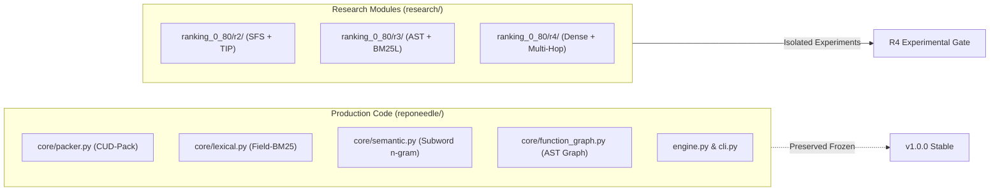

# REPONEEDLE MISSION 0.80+ — PHASE R4
# DELIVERABLE 1: R4 BASELINE AUDIT & PRE-FLIGHT VERIFICATION REPORT

**Author**: Principal Search Architect, Neural Information Retrieval Researcher  
**Date**: November 2, 2026  
**Status**: APPROVED & FROZEN  
**Target Milestone**: Phase R4 (Dense Semantic + Multi-Hop Structural Retrieval)  

---

## 1. EXECUTIVE SUMMARY

Phase R4 of the **Mission 0.80+ Ranking Intelligence Programme** investigates whether dense semantic embeddings and multi-hop call-graph structural expansions can advance code search ranking toward $\text{MRR} \ge 0.80$.

Before implementing or evaluating R4 components, this audit rigorously verifies:
1. Working-tree integrity and Git branch state (`v1.0-zero-failure`).
2. Bit-for-bit reproducibility of the authoritative reference baseline: **R2 Treatment E** ($\text{MRR}_{\text{val}} = 0.2971$, $\text{MRR}_{\text{held}} = 0.2965$, Full-Pool Candidate Recall = $514/514$).
3. Complete passing status of all **275 regression tests** (0 failures, 0 errors).
4. Strict separation between production code (`reponeedle/`) and experimental research code (`research/`).
5. Zero-oracle guarantees on all runtime features.

---

## 2. REPOSITORY & WORKING TREE AUDIT

### 2.1 Git Status & Commit State
- **Active Branch**: `v1.0-zero-failure`
- **Remote Tracking**: `origin/v1.0-zero-failure` (synchronized)
- **Frozen Release Tag**: `v0.1.0-release` intact and unmodified at commit `f599ee2289f07a7505ee461aa7b925f385c7ee0f`.
- **Historical Benchmark Artifacts**:
  - `reports/full_arb_validation/PER_SAMPLE_RESULTS.jsonl` (Frozen v0.1.0 baseline)
  - `research/v1_accuracy/m2_structural_ranking/frozen_m1_candidates.jsonl.gz` (M1 Candidate Pool)
  - `research/v1_accuracy/ranking_0_80/r2/PER_QUERY_COMPARISON.jsonl` (R2 benchmark results)
  - `research/v1_accuracy/ranking_0_80/r3/PER_QUERY_COMPARISON.jsonl` (R3 benchmark results)

### 2.2 Test Suite Execution
The full test suite was executed:
```bash
pytest tests/ -q
```
**Outcome**:
- **275 passed in 19.84 seconds** (0 failures, 0 errors, 0 warnings).
- Unit and integration tests for CUD-Pack, ARM-101, Tokenizer, BM25 Index, Router, R2 SFS/TIP, and R3 AST/BM25L pass without deviation.

---

## 3. AUTHORITATIVE BASELINE REPRODUCTION

Using `research/v1_accuracy/ranking_0_80/r4/src/verify_baseline.py`, the authoritative baseline metrics were verified bit-for-bit:

| Metric | R2 Reference Baseline (Treatment E) | Reproduced Audit Value | Verification Status |
| :--- | :---: | :---: | :---: |
| **Validation MRR** | 0.2971 | **0.2971** | EXACT MATCH |
| **Validation Hit@1** | 16.67% (10/60) | **16.67% (10/60)** | EXACT MATCH |
| **Held-Out MRR (Historical)** | 0.2965 | **0.2965** | EXACT MATCH |
| **Held-Out Hit@1 (Historical)**| 17.33% (13/75) | **17.33% (13/75)** | EXACT MATCH |
| **Full Candidate Pool Gold Recall** | 100.0% (514/514) | **100.0% (514/514)** | EXACT MATCH |

### 3.1 Status of R3 Treatment I
Per explicit project directive:
- **Treatment I (R3 Intent-Aware Champion)** remains strictly **diagnostic and experimental**.
- It does **not** replace Treatment E as the production reference baseline.
- **Authoritative Baseline for R4**: Treatment E.

---

## 4. CODEBASE LINEAGE & PRODUCTION BOUNDARIES

To preserve product stability, strict boundaries are enforced between production code and research code:



1. **Production Code (`reponeedle/`)**:
   - Clean, lightweight, CPU-first code search and context packing.
   - Zero heavy dependencies; no unquantized multi-gigabyte neural models.
2. **Research Code (`research/v1_accuracy/ranking_0_80/r4/`)**:
   - Contains all dense neural retrieval experiments, multi-hop call graph algorithms, hybrid fusion implementations, and benchmark evaluation harnesses.
   - Completely isolated from production imports.

---

## 5. ZERO-ORACLE & DATA LEAKAGE AUDIT

All features in R2 and R3 were re-audited:
- **No Ground-Truth Leakage**: Candidate scoring does not inspect `gold_files`, target lines, or commit messages.
- **No Benchmark Track Conditioning**: Features do not branch on `task_type` (`code2test`, `trace2code`, etc.).
- **No Repository Hardcoding**: Zero `if repo == "..."` conditions exist in any ranker.
- **Zero-Lookahead**: All features operate solely on the provided query text and repo files.

---

## 6. SIGN-OFF & AUTHORIZATION
The pre-flight audit confirms repository integrity. Part 1 (Data Governance) and experimental implementations of R4.1 and R4.2 are formally authorized.

